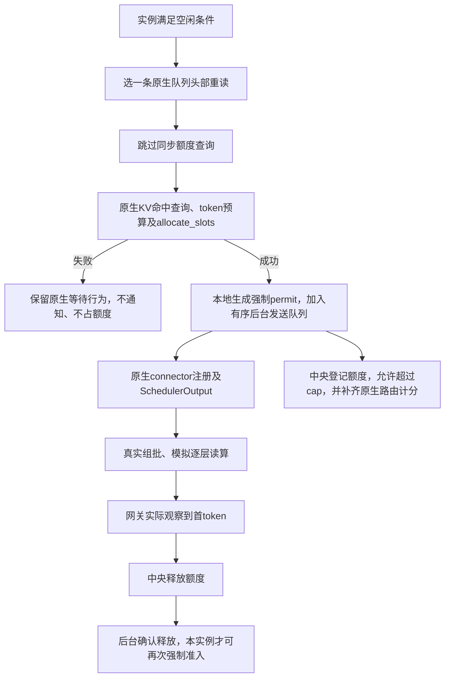

# TFS 空闲实例强制准入

该功能把重读配额改为可选软上限。默认关闭：`admission.idle_bypass=false`。

## 1. 触发条件

只用于 scheduler 侧 TFS、冻结分类、逐层读算、首 token 释放、零反馈延迟。

每次真实 `Scheduler.schedule()` 开始时，实例检查：

- 没有 running 请求。
- 没有尚未释放的本实例强制配额。
- waiting 与 skipped_waiting 中只有尚未获准、尚未计算的重读请求。
- 没有等待远端 KV、语法或流输入的阻塞状态。

满足时，实例选择原生队列头部的一条重读作为候选。候选数量可以大于一。存在轻读/零读请求时，仍按原流程执行；本版不会推测轻请求的分配是否会失败。这是一条保守触发规则，不保证消除所有计算空白。

## 2. 执行顺序

这是对真实 Scheduler 的有意语义修改。原生 block/slot 分配、序列与 token 上限、Dynamo picker、完整资源 booking、读算模型均保留。

## 3. 异步通知和因果顺序

`ReadGate.after_allocation()` 位于原生 `allocate_slots` 成功分支之后、connector 注册之前。此前失败不产生强制配额。通知不向中央询问是否允许，中央只校验身份与分配证明并登记。

`AdmissionOutbox` 独占反馈连接。强制准入通知及该请求的读取、逐层读取、读取完成事实按同一有序连接发送。调度/执行线程不等待这些通知的 RPC 回复。普通准入和非强制请求反馈仍同步等待，传输与消息格式未替换。

每个实例最多持有一条强制配额。后台仅在读取完成后查询该配额是否已由网关首 token 释放。该查询不阻塞 Scheduler；本地计算结束本身不提前释放额度。

通知可能晚于 HTTP 首 token 到达。中央暂存提前到达的网关完成事件，待有序读取事实到达后按原始 HTTP 时间入账，不修改实际 TTFT。强制 permit 的 `granted_s` 是本地实际决定时间，`registered_s` 是中央实际登记时间，日志 `t` 仍为中央接收时间。

需要同一单调时钟域：本机 Unix 连接天然同主机；TCP / Dynamo 通道须匹配共享 `clock_id`。无法证明时钟域时拒绝该通知，不猜测跨主机时间差。本轮 macOS 验证显式沿用 Unix 通道。

如果原生路由已关闭请求，强制通知不能复活路由计分。ScoreClient 仅在收到明确的 stale-activation 拒绝后，额外读取同一原生账本的 Closed 墓碑；确认后登记“已完成无需补齐”。其他拒绝、时钟或网络错误仍使实验失败，禁止静默忽略、重连或重放。

## 4. 中央账本

强制请求照常计入 held。超过 cap 不撤销已执行请求；普通 acquire 在 held≥cap 时继续拒绝。强制额度仍由首 token 释放，不新增带宽池，不跳过存储带宽竞争。

强制通知包含唯一 permit、worker、acquisition_key、加载尝试号和资源分配证明。重复通知按原身份去重，不能重复扣账。错误归属或同实例第二条未释放强制请求会被拒绝。

## 5. 使用

配置 `admission.idle_bypass=true`，或给 `scripts/run_tfs_stack.py` 增加 `--idle-bypass`。`--no-idle-bypass` 可显式关闭；其他必需的 scheduler/arrival/first_token 等配置仍须满足。

`worker*.read_admission.jsonl` 中的 `idle_bypass_committed` 记录分配边界、本地决定时间、证明和 `admission_waited=false`。中央 `admission_reserved.reason=idle_bypass`，另记 `over_cap`。`check_read_admission.py` 核对无同步 acquire、单实例上限、登记/释放、正常额度约束和最终无泄漏。

这条规则会增加重读并发，可能提高存储争用。减少空泡不等于必然提高 SLO，性能结果以实际开关对照为准。
