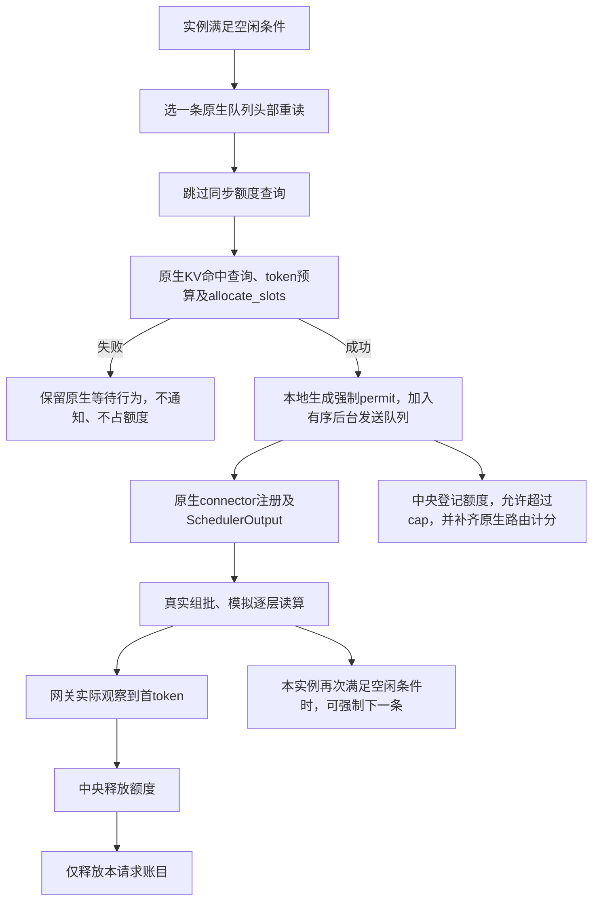

# TFS 空闲实例强制准入

该功能把重读配额改为可选软上限。默认关闭：`admission.idle_bypass=false`。

## 1. 触发条件

只用于 scheduler 侧 TFS、冻结分类、逐层读算、首 token 释放、零反馈延迟。

每次真实 `Scheduler.schedule()` 开始时，实例检查：

- 没有 running 请求。
- waiting 与 skipped_waiting 中只有尚未获准、尚未计算的重读请求。
- 没有等待远端 KV、语法或流输入的阻塞状态。

满足时，实例选择原生队列头部的一条重读作为候选。候选数量可以大于一。存在轻读/零读请求时，仍按原流程执行；本版不会推测轻请求的分配是否会失败。这是一条保守触发规则，不保证消除所有计算空白。

2026-10-29 修订：强制条件只检查实例执行状态，不等待上一笔强制额度登记或释放。
同一实例可以有多笔未释放账目；每轮 Scheduler 仍最多强制一条请求。

## 2. 执行顺序

这是对真实 Scheduler 的有意语义修改。原生 block/slot 分配、序列与 token 上限、Dynamo picker、完整资源 booking、读算模型均保留。

## 3. 异步通知和因果顺序

`ReadGate.after_allocation()` 位于原生 `allocate_slots` 成功分支之后、connector 注册之前。此前失败不产生强制配额。通知不向中央询问是否允许，中央只校验身份与分配证明并登记。

`AdmissionOutbox` 独占控制连接。强制准入通知与普通额度变更按同一有序队列发送。
调度/执行线程不等待强制通知的 RPC 回复；普通额度申请仍同步等待。
四种执行反馈已移除，读取观测仅保存在本地，传输与消息格式不变。

本实例的上一笔强制通知尚未确认或额度尚未释放，都不阻止下一次本地空闲判断。
每条请求有独立 permit。后台校验每笔登记回复，不发送 `force_status` 查询。
本地读算结束不提前释放中央额度；中央仍按每条请求的 HTTP 首 token 释放。

通知可能晚于 HTTP 首 token 到达。中央立即保存 HTTP 事实，强制通知到达后补登记并释放，
不修改实际 TTFT。强制 permit 的 `granted_s` 是本地实际决定时间，`registered_s` 是中央实际登记时间，日志 `t` 仍为中央接收时间。

需要同一单调时钟域：本机 Unix 连接天然同主机；TCP / Dynamo 通道须匹配共享 `clock_id`。无法证明时钟域时拒绝该通知，不猜测跨主机时间差。本轮 macOS 验证显式沿用 Unix 通道。

如果原生路由已关闭请求，强制通知不能复活路由计分。ScoreClient 仅在收到明确的 stale-activation 拒绝后，额外读取同一原生账本的 Closed 墓碑；确认后登记“已完成无需补齐”。其他拒绝、时钟或网络错误仍使实验失败，禁止静默忽略、重连或重放。

## 4. 中央账本

强制请求照常计入 held。超过 cap 不撤销已执行请求；普通 acquire 在 held≥cap 时继续拒绝。强制额度仍由首 token 释放，不新增带宽池，不跳过存储带宽竞争。

强制通知包含唯一 permit、worker、acquisition_key、加载尝试号和资源分配证明。
同实例不同请求的未释放额度全部计入 held，逐笔释放。重复通知按原身份去重；
同一请求换 permit 重复占账、错误归属或无效分配证明仍被拒绝。

## 5. 使用

配置 `admission.idle_bypass=true`，或给 `scripts/run_tfs_stack.py` 增加 `--idle-bypass`。`--no-idle-bypass` 可显式关闭；其他必需的 scheduler/arrival/first_token 等配置仍须满足。

`worker*.read_admission.jsonl` 中的 `idle_bypass_committed` 记录分配边界、本地决定时间、证明和 `admission_waited=false`。中央 `admission_reserved.reason=idle_bypass`，另记 `over_cap`。`check_read_admission.py` 核对强制请求无同步 acquire、每实例每轮最多强制一条、全部 permit 的 held 变化、逐笔登记/释放、正常额度约束和最终无泄漏；另报同实例未释放强制额度峰值，不把峰值大于 1 判为错误。

这条规则会增加重读并发，可能提高存储争用。减少空泡不等于必然提高 SLO，性能结果以实际开关对照为准。

## 2026-10-29：移除加载反馈后的通知顺序

四种执行反馈不再经过中央 RPC。首 token 和结束事实立即保存在中央，不等加载完成。
若较早作出的强制决定随后才到，中央补登记该额度，再用已保存的 HTTP 事实立即释放。
原首 token 时间保持不变。普通请求不能在首 token 后重新申请；强制通知换一个新
permit 也不能给同一请求重复占账。原身份重复通知仍返回原结果。

移除执行反馈时曾保留登记后查询 `force_status`。同日后续修订已删除该查询及
“上一笔未释放禁止再次强制”的本地、中央限制。加载观测仅写本地文件，结束后
用于审计，不能参与在线准入。此次修订不改变普通申请的同步等待方式。
