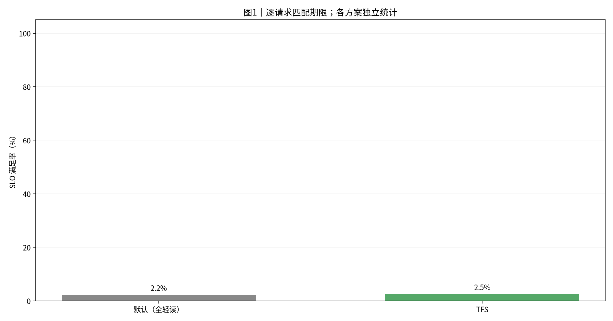
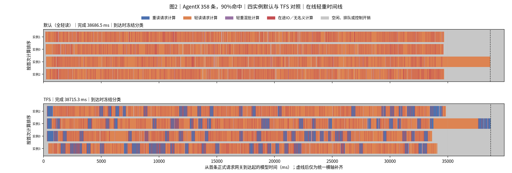
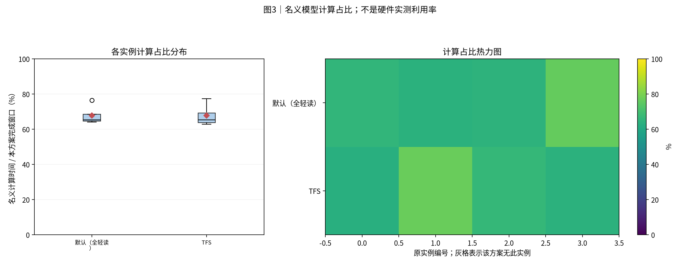
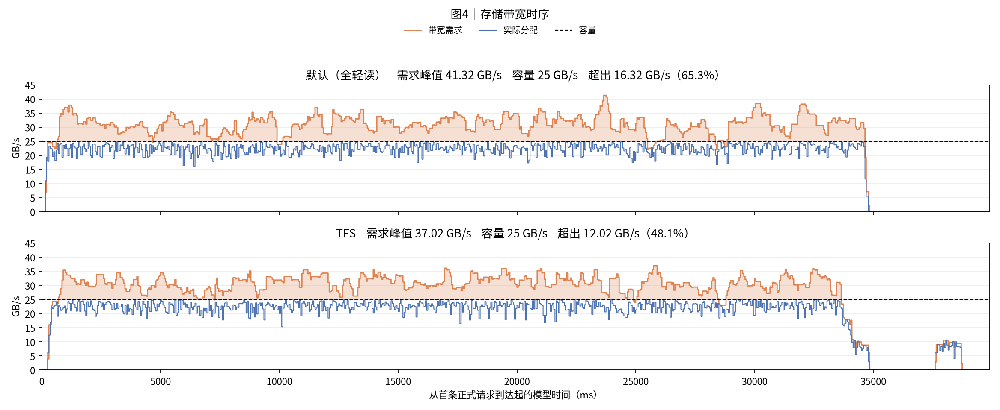
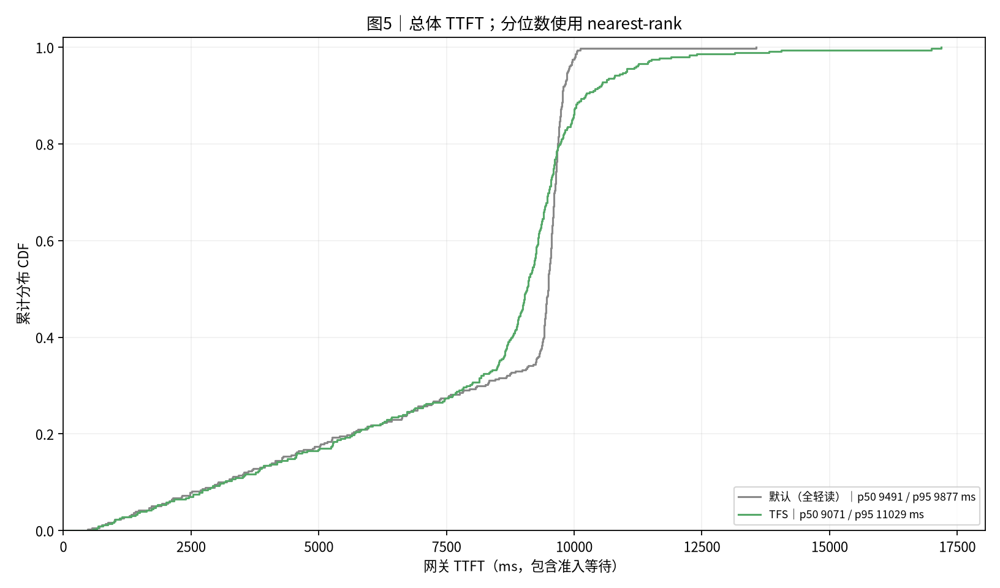
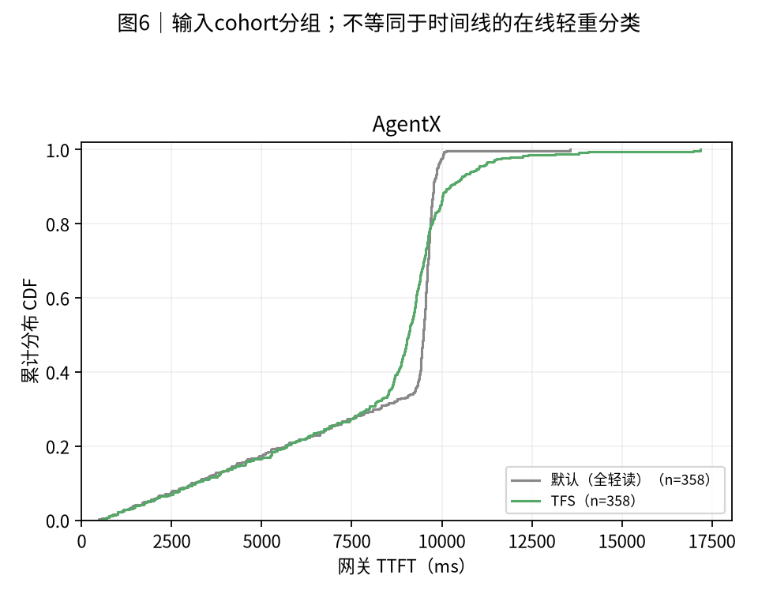
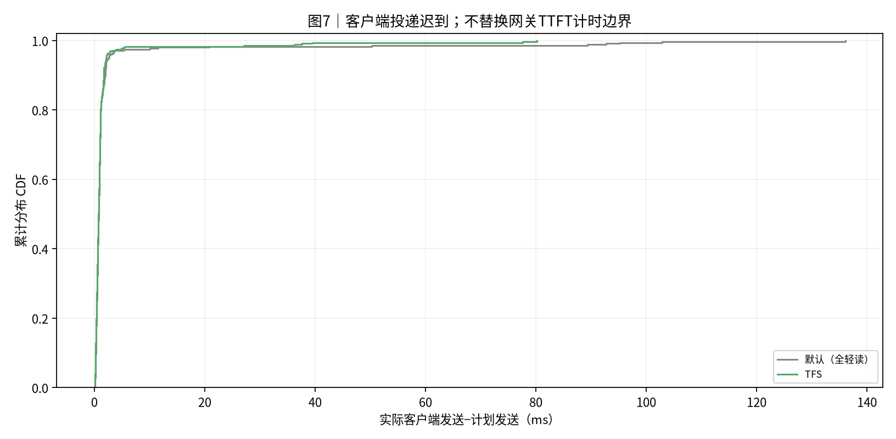

# 实验结果：AgentX 358 条，90%命中｜四实例默认与 TFS 对照

|项目|约定|
|---|---:|
|执行边界|本次新增两轮CPU进程栈仿真；97%版本仅引用历史数据；未执行真机实验。|
|方案顺序|默认（全轻读） → TFS|
|输入种子 / 重复|每个case独立展示一个冻结运行；种子与重复见附表，未提供时不推断|
|汇总 / 轨迹|不跨case合并样本、不生成置信区间；轨迹保留全部正式请求|
|SLO / TTFT|逐请求匹配deadline；TTFT=first_token−gateway arrival，包含准入等待|
|分组|分类表和CDF使用输入cohort；时间线使用在线轻重判定|
|单位|时间秒/毫秒；容量字节；带宽GB/s=10^9 B/s|
|整理日期|2026-11-24|
|负载|连续窗口360条，删除窗口第8、71条（输入超过96000），保留358条及原12秒到达时刻；并非早期316/360条版本。|
|命中口径|原H按同比例缩小，128-token块按余数分配；加权命中率89.9993%。总长度、逐token内容、请求顺序与到达时间均不变，减少的H转为U。不是每条请求独立设为同一命中率。|
|资源|4实例，16层，max_num_seqs=1；6盘共用25 GB/s；FCFS，α=0.1；关闭强制准入。|
|重复|本命中率版本默认和TFS各新增一轮；97%版本引用既有一轮。|
|时间口径|第0章保留客户端发送至首token；标准主表及CDF使用central画像到首token，二者不混用。|
|SLO|冻结profile.deadline_s，核对为arrival_s + 4 × reference_service_s；不是此次改成4倍全miss prefill。|
|输入SHA256|da9fdbf567297e2df72f6f663dec4b29f5de2d44a55e7551eab20650ef3a60ed|
|来源|/home/zed/.local/share/state-aware-network/audits/server-dynamo-1.2/agentx358_hit90_01xirk6j|

## 0. 总判决

相对默认，TFS 完成时间变化+0.0%，平均TTFT变化+0.2%，P95变化-1.3%。每组只有一轮。以下为客户端口径；后续固定工具主表和CDF为central画像到首token口径。

|策略|完成时间 s|平均 TTFT s|P95 s|重读请求|
|---|---:|---:|---:|---:|
|light|38.728|13.207|23.949|0|
|tfs|38.746|13.237|23.647|104|


## 1. 汇总表与 SLO 柱状图

|方案|请求数|完成ms|平均TTFT ms|p95 ms|SLO%|网关等待ms|
|---|---:|---:|---:|---:|---:|---:|
|默认（全轻读）|358|38686.5|8002.8|9876.9|2.2|142.8|
|TFS|358|38715.3|8030.8|11029.0|2.5|129.5|

分类结果使用输入cohort：

|方案|分组|请求数|平均TTFT ms|SLO%|
|---|---:|---:|---:|---:|
|默认（全轻读）|AgentX|358|8002.8|2.2|
|TFS|AgentX|358|8030.8|2.5|



**读法**：柱高与上表同口径。每条请求使用自身期限判断是否达标。

## 2. 各方案 full-sort-ms 执行时间线




**读法**：蓝重读、橙轻读、紫轻重混批。红色为未被名义计算覆盖的在途IO，灰色含空闲、排队和控制。动态与冻结分类分别标注；直接放行分类仅作参考。虚线右侧仅为统一横轴补齐。

## 3. 模型计算占比分布与热力图




**读法**：箱线和热力图来自同一组逐实例数据。分母是各方案从首次正式到达到末条首token的窗口。该值不是硬件实测利用率。

## 4. 存储带宽时序




**读法**：各方案共用从零起的线性纵轴。橙线为需求，蓝线为实际分配，黑虚线为容量。橙色阴影的高度表示需求超出容量的 GB/s。峰值取图中时间桶的平均需求最大值。

|方案|平均GB/s|需求超订%|实际饱和%|
|---|---:|---:|---:|
|默认（全轻读）|20.0|85.7|47.8|
|TFS|19.9|83.8|48.0|

## 5. TTFT 累积分布 CDF




**读法**：经验CDF按rank/n绘制，终点为1。期限不同时，SLO必须逐请求匹配，不能由两条CDF交点推算。




**读法**：此处分组来自cohort，可能是历史A/B或业务分类，不用该标签推断在线轻重。

## 6. 机制解释与前序对照

两组实际模型读取量相同，TFS通过在线75分位分类和配额改变调度。默认强制全部轻读，仍执行全部KV读取。蓝色少或没有，表示没有重读标记，不表示没有读KV。

|策略|首层累计等待 s|后15层累计等待 s|额度满跳过请求|
|---|---:|---:|---:|
|light|9.985|20.496|0|
|tfs|10.214|20.205|20|

首层等待为提交至读取完成；后续层等待为上一层算完至本层KV完成的正差。跨worker累计，不能直接从makespan减去。图2红色是IO活动区间减名义计算的并集，与此依赖等待口径不同。

本轮TFS的额度主要为2（353次更新），104条重读获批，20条请求曾因额度满而被跳过。默认/TFS首层累计等待为9.985/10.214秒，后续层为20.496/20.205秒，两者总和仅减少0.063秒。降低同时执行的需求峰值没有转化为明显的累计等待或总体延迟收益。

## 7. 计算模型与结论限制

每策略只有一轮；时间线的计算是模型名义时间，不是NPU kernel实测。不能用这些图证明真机AIV/HBM竞争。客户端与central起点不同，尤其本轮存在进入画像前的延迟，不能混报。原始AgentX token内容在仿真输入中用占位token构造并隔离前缀；保留请求长度与命中量，不能据此验证真实语义或实际缓存持久化。

## 8. 附表




**读法**：此图描述客户端实际发送相对计划的迟到，不是单次准入RPC耗时。

|方案|实例数|模型计算占比%|运行标识|
|---|---:|---:|---:|
|默认（全轻读）|4|67.8|{"repeat": 1, "ordering": "FCFS", "alpha": 0.1}|
|TFS|4|67.7|{"repeat": 1, "ordering": "FCFS", "alpha": 0.1}|

|方案|序列上限|token预算|存储容量GB/s|准入位置 / 规则|计算模型|
|---|---:|---:|---:|---:|---:|
|默认（全轻读）|1|50000|25.0|scheduler / arrival|未提供|
|TFS|1|50000|25.0|scheduler / arrival|未提供|

输入共 13,094,080 token，命中 11,784,576 token，读取 772.314 GB。以25 GB/s满带宽传输至少需要 30.893 秒；12秒内发送的平均新增读取需求为 64.359 GB/s。这是持续读取压力较高的工况，不是低平均负载下的短暂突发。

默认/TFS 的额度更新分布分别为 {2: 353, 6: 1, 5: 1, 3: 3} / {2: 353, 6: 1, 5: 1, 3: 3}；TFS获批 104 次。

|命中率|策略|完成 s|平均TTFT s|P95 s|读取 GB|
|---|---|---:|---:|---:|---:|
|97.0063%|light|39.905|13.887|25.180|832.444|
|97.0063%|tfs|37.288|14.043|27.938|832.444|
|89.9993%|light|38.728|13.207|23.949|772.314|
|89.9993%|tfs|38.746|13.237|23.647|772.314|

降低命中率同时降低远端读量、增加实际计算量，不是只调带宽。原未命中392000 token，新未命中1309504 token，约3.34倍。两版本各一轮，不把波动视为确定的因果效果。

|85%版本|完成 s|平均TTFT s|P95 s|
|---|---:|---:|---:|
|light|44.619|16.311|29.859|
|tfs|44.343|16.469|30.074|


## 9. 验证、数据与复现

已校验请求计数、逐请求SLO、nearest-rank分位数、CDF概率质量、实例时间账本及可用带宽积分。图片人工检查状态见校验文件。

- [校验记录](report_data/validation.json)
- [方案汇总](report_data/run_summary.csv)
- [请求明细](report_data/requests.csv)
- [标准重绘数据](report_data/dataset.json)
- [复现入口](reproduce/generate_report.py)

在报告目录执行：

```bash
python reproduce/generate_report.py --dataset report_data/dataset.json --output ../reproduced-report
```

## 10. 简要解读

90%处于85%与97%之间：85%时后续层几乎完全掩盖，97%时读取压力很高，90%仍有约20秒后续层累计等待。但本轮TFS减少后续层等待的收益几乎被首层等待增加抵消。完成时间和平均TTFT基本持平；P95下降约1.3%，单次实验不足以确认稳定收益。
