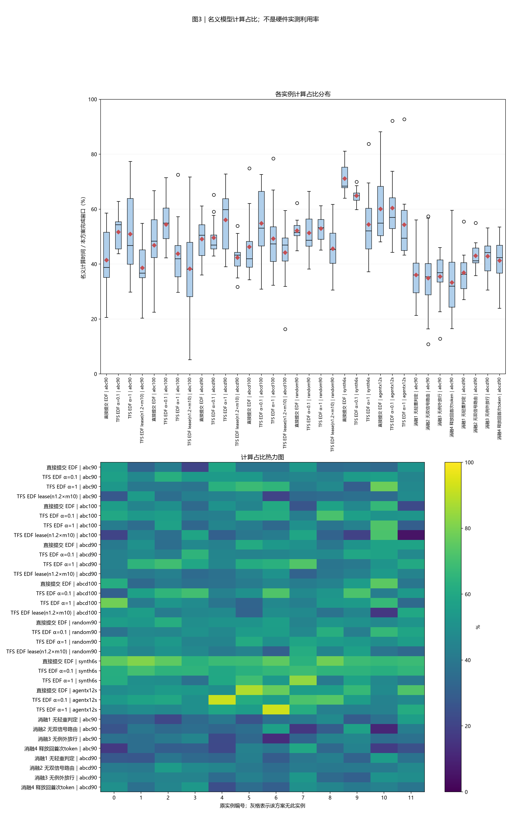
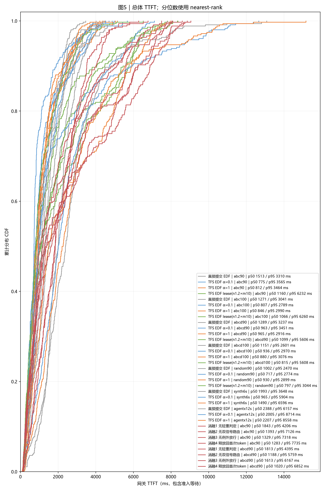
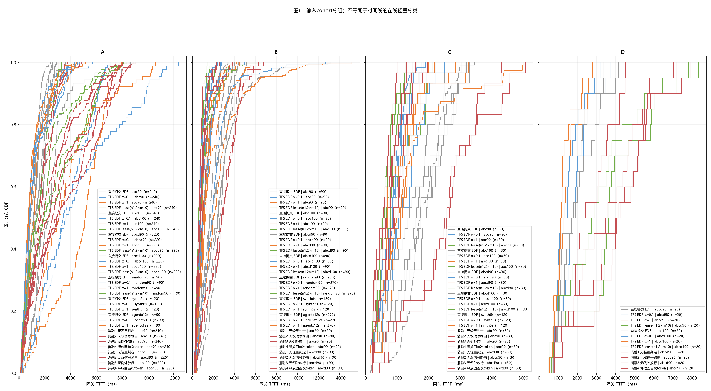
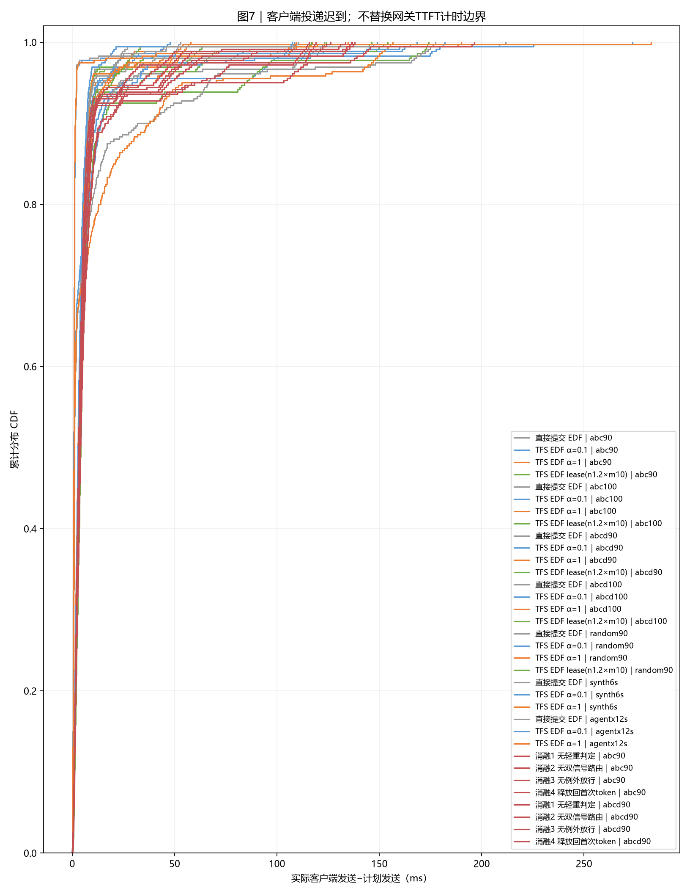

# 实验结果：tfs-lease 全负载四臂对照与四技术消融（总报告）

|项目|约定|
|---|---:|
|执行边界|从冻结日志离线整理；本次没有重跑实验|
|方案顺序|直接提交 EDF｜abc90 → TFS EDF α=0.1｜abc90 → TFS EDF α=1｜abc90 → TFS EDF lease(n1.2×m10)｜abc90 → 直接提交 EDF｜abc100 → TFS EDF α=0.1｜abc100 → TFS EDF α=1｜abc100 → TFS EDF lease(n1.2×m10)｜abc100 → 直接提交 EDF｜abcd90 → TFS EDF α=0.1｜abcd90 → TFS EDF α=1｜abcd90 → TFS EDF lease(n1.2×m10)｜abcd90 → 直接提交 EDF｜abcd100 → TFS EDF α=0.1｜abcd100 → TFS EDF α=1｜abcd100 → TFS EDF lease(n1.2×m10)｜abcd100 → 直接提交 EDF｜random90 → TFS EDF α=0.1｜random90 → TFS EDF α=1｜random90 → TFS EDF lease(n1.2×m10)｜random90 → 直接提交 EDF｜synth6s → TFS EDF α=0.1｜synth6s → TFS EDF α=1｜synth6s → 直接提交 EDF｜agentx12s → TFS EDF α=0.1｜agentx12s → TFS EDF α=1｜agentx12s → 消融1 无轻重判定｜abc90 → 消融2 无双信号路由｜abc90 → 消融3 无例外放行｜abc90 → 消融4 释放回首次token｜abc90 → 消融1 无轻重判定｜abcd90 → 消融2 无双信号路由｜abcd90 → 消融3 无例外放行｜abcd90 → 消融4 释放回首次token｜abcd90|
|输入种子 / 重复|每个case独立展示一个冻结运行；种子与重复见附表，未提供时不推断|
|汇总 / 轨迹|不跨case合并样本、不生成置信区间；轨迹保留全部正式请求|
|SLO / TTFT|逐请求匹配deadline；TTFT=first_token−gateway arrival，包含准入等待|
|分组|分类表和CDF使用输入cohort；时间线使用在线轻重判定|
|单位|时间秒/毫秒；容量字节；带宽GB/s=10^9 B/s|

## 0. 总判决

## 0 结论

本报告汇总 **全部 7 个负载的同轮多臂对照与租约四技术消融**（Mooncake×5、人工ABC×1、AgentX×1）。每个 case 一行指标见第 1 章汇总表；结论要点：
- lease 臂在 abcd 两负载 SLO 全场最优（34.4%/36.7%，领先最佳三臂约 +10pp）；
- abc 两负载 SLO 与 α=0.1 打平、mean 付出 +70%~98%；
- random 上 α=0.1 全面最优；synthetic 六秒上 α=0.1 SLO 最优（39.7%）；
- AgentX（180GB/s 长上下文）三臂中 α=0.1 SLO 最优（34.2%），lease 未参与（合同三臂）；
- 消融：轻重判定与双信号路由是 SLO 的主要来源；例外放行主要影响 mean；事件记账的收益以虚占窗口收缩体现。
- 单轮运行，噪声 ±15%~30%。

## 1. 汇总表与 SLO 柱状图

|方案|请求数|完成ms|平均TTFT ms|p95 ms|SLO%|网关等待ms|
|---|---:|---:|---:|---:|---:|---:|
|直接提交 EDF｜abc90|360|7882.4|1657.2|3309.6|12.2|0.7|
|TFS EDF α=0.1｜abc90|360|7260.8|1121.8|3565.1|31.7|0.8|
|TFS EDF α=1｜abc90|360|7200.1|1174.0|3463.7|26.1|0.7|
|TFS EDF lease(n1.2×m10)｜abc90|360|10175.0|1996.5|6231.7|31.1|1.1|
|直接提交 EDF｜abc100|360|7197.0|1376.3|3040.7|17.5|0.7|
|TFS EDF α=0.1｜abc100|360|6707.8|1075.8|2788.7|31.9|0.8|
|TFS EDF α=1｜abc100|360|8222.1|1119.2|2989.9|25.8|0.9|
|TFS EDF lease(n1.2×m10)｜abc100|360|10056.7|2128.7|6260.1|30.8|1.3|
|直接提交 EDF｜abcd90|360|7103.7|1442.9|3237.2|16.7|0.6|
|TFS EDF α=0.1｜abcd90|360|7352.7|1295.7|3450.5|21.9|1.0|
|TFS EDF α=1｜abcd90|360|6607.3|1203.9|2916.4|24.4|0.7|
|TFS EDF lease(n1.2×m10)｜abcd90|360|9680.5|1761.2|5606.1|34.4|1.5|
|直接提交 EDF｜abcd100|360|7623.4|1231.0|2600.6|18.9|0.6|
|TFS EDF α=0.1｜abcd100|360|6861.4|1150.1|2970.2|26.9|0.9|
|TFS EDF α=1｜abcd100|360|7501.9|1099.9|3076.3|25.3|0.7|
|TFS EDF lease(n1.2×m10)｜abcd100|360|9137.1|1520.2|5607.9|36.7|1.1|
|直接提交 EDF｜random90|360|6965.0|1200.2|2469.7|22.8|0.8|
|TFS EDF α=0.1｜random90|360|7454.9|930.3|2774.0|30.6|0.6|
|TFS EDF α=1｜random90|360|7038.5|1138.5|2899.2|21.7|0.9|
|TFS EDF lease(n1.2×m10)｜random90|360|8626.8|1146.7|3043.5|26.4|1.0|
|直接提交 EDF｜synth6s|360|8163.5|2027.5|3648.2|7.2|1.3|
|TFS EDF α=0.1｜synth6s|360|8976.9|1743.9|5904.2|39.7|1.2|
|TFS EDF α=1｜synth6s|360|10700.5|2513.2|6596.2|26.4|2.0|
|直接提交 EDF｜agentx12s|360|22820.2|2684.3|6156.6|21.9|0.4|
|TFS EDF α=0.1｜agentx12s|360|22670.1|2699.2|8714.0|34.2|0.4|
|TFS EDF α=1｜agentx12s|360|25182.7|2828.2|8558.1|25.8|0.4|
|消融1 无轻重判定｜abc90|360|9058.1|2011.3|4205.8|11.1|0.7|
|消融2 无双信号路由｜abc90|360|11162.4|2584.0|7125.9|25.3|1.4|
|消融3 无例外放行｜abc90|360|11147.3|2401.5|7318.0|28.9|1.2|
|消融4 释放回首次token｜abc90|360|11563.0|2618.2|7734.5|30.8|1.1|
|消融1 无轻重判定｜abcd90|360|9163.1|2030.0|4395.1|10.6|1.4|
|消融2 无双信号路由｜abcd90|360|9400.0|2005.3|5758.8|27.2|1.3|
|消融3 无例外放行｜abcd90|360|9724.5|2254.1|6166.5|28.1|2.0|
|消融4 释放回首次token｜abcd90|360|10137.9|1895.0|6852.0|33.6|1.3|

分类结果使用输入cohort：

|方案|分组|请求数|平均TTFT ms|SLO%|
|---|---:|---:|---:|---:|
|直接提交 EDF｜abc90|A|240|1399.0|7.5|
|直接提交 EDF｜abc90|B|90|2313.4|23.3|
|直接提交 EDF｜abc90|C|30|1754.9|16.7|
|TFS EDF α=0.1｜abc90|A|240|1220.8|16.7|
|TFS EDF α=0.1｜abc90|B|90|960.8|67.8|
|TFS EDF α=0.1｜abc90|C|30|813.1|43.3|
|TFS EDF α=1｜abc90|A|240|1172.2|12.9|
|TFS EDF α=1｜abc90|B|90|1242.3|55.6|
|TFS EDF α=1｜abc90|C|30|983.0|43.3|
|TFS EDF lease(n1.2×m10)｜abc90|A|240|2593.9|12.1|
|TFS EDF lease(n1.2×m10)｜abc90|B|90|847.5|72.2|
|TFS EDF lease(n1.2×m10)｜abc90|C|30|664.4|60.0|
|直接提交 EDF｜abc100|A|240|1137.9|12.1|
|直接提交 EDF｜abc100|B|90|1933.1|32.2|
|直接提交 EDF｜abc100|C|30|1612.7|16.7|
|TFS EDF α=0.1｜abc100|A|240|1157.0|17.1|
|TFS EDF α=0.1｜abc100|B|90|930.0|70.0|
|TFS EDF α=0.1｜abc100|C|30|863.3|36.7|
|TFS EDF α=1｜abc100|A|240|1043.8|12.5|
|TFS EDF α=1｜abc100|B|90|1391.3|50.0|
|TFS EDF α=1｜abc100|C|30|906.3|60.0|
|TFS EDF lease(n1.2×m10)｜abc100|A|240|2674.4|16.7|
|TFS EDF lease(n1.2×m10)｜abc100|B|90|1079.8|63.3|
|TFS EDF lease(n1.2×m10)｜abc100|C|30|910.0|46.7|
|直接提交 EDF｜abcd90|A|220|1154.9|10.9|
|直接提交 EDF｜abcd90|B|90|1903.9|23.3|
|直接提交 EDF｜abcd90|C|30|1834.8|13.3|
|直接提交 EDF｜abcd90|D|20|1948.2|55.0|
|TFS EDF α=0.1｜abcd90|A|220|1307.8|11.4|
|TFS EDF α=0.1｜abcd90|B|90|1205.8|37.8|
|TFS EDF α=0.1｜abcd90|C|30|1126.1|30.0|
|TFS EDF α=0.1｜abcd90|D|20|1822.1|55.0|
|TFS EDF α=1｜abcd90|A|220|1209.9|12.3|
|TFS EDF α=1｜abcd90|B|90|1164.4|46.7|
|TFS EDF α=1｜abcd90|C|30|1124.0|13.3|
|TFS EDF α=1｜abcd90|D|20|1435.7|75.0|
|TFS EDF lease(n1.2×m10)｜abcd90|A|220|2180.2|11.8|
|TFS EDF lease(n1.2×m10)｜abcd90|B|90|661.8|78.9|
|TFS EDF lease(n1.2×m10)｜abcd90|C|30|608.5|76.7|
|TFS EDF lease(n1.2×m10)｜abcd90|D|20|3829.5|20.0|
|直接提交 EDF｜abcd100|A|220|974.3|11.4|
|直接提交 EDF｜abcd100|B|90|1673.3|25.6|
|直接提交 EDF｜abcd100|C|30|1381.7|30.0|
|直接提交 EDF｜abcd100|D|20|1837.9|55.0|
|TFS EDF α=0.1｜abcd100|A|220|1109.9|17.7|
|TFS EDF α=0.1｜abcd100|B|90|1195.6|40.0|
|TFS EDF α=0.1｜abcd100|C|30|1092.5|26.7|
|TFS EDF α=0.1｜abcd100|D|20|1473.8|70.0|
|TFS EDF α=1｜abcd100|A|220|1004.2|12.7|
|TFS EDF α=1｜abcd100|B|90|1291.1|40.0|
|TFS EDF α=1｜abcd100|C|30|1102.4|33.3|
|TFS EDF α=1｜abcd100|D|20|1288.9|85.0|
|TFS EDF lease(n1.2×m10)｜abcd100|A|220|1852.5|14.1|
|TFS EDF lease(n1.2×m10)｜abcd100|B|90|665.8|83.3|
|TFS EDF lease(n1.2×m10)｜abcd100|C|30|610.6|66.7|
|TFS EDF lease(n1.2×m10)｜abcd100|D|20|3074.2|30.0|
|直接提交 EDF｜random90|A|90|1300.7|24.4|
|直接提交 EDF｜random90|B|270|1166.7|22.2|
|TFS EDF α=0.1｜random90|A|90|1056.7|33.3|
|TFS EDF α=0.1｜random90|B|270|888.2|29.6|
|TFS EDF α=1｜random90|A|90|1261.5|22.2|
|TFS EDF α=1｜random90|B|270|1097.5|21.5|
|TFS EDF lease(n1.2×m10)｜random90|A|90|1449.4|24.4|
|TFS EDF lease(n1.2×m10)｜random90|B|270|1045.8|27.0|
|直接提交 EDF｜synth6s|A|120|1708.8|5.8|
|直接提交 EDF｜synth6s|B|120|2560.6|12.5|
|直接提交 EDF｜synth6s|C|120|1813.1|3.3|
|TFS EDF α=0.1｜synth6s|A|120|3605.4|1.7|
|TFS EDF α=0.1｜synth6s|B|120|821.9|94.2|
|TFS EDF α=0.1｜synth6s|C|120|804.3|23.3|
|TFS EDF α=1｜synth6s|A|120|4617.2|2.5|
|TFS EDF α=1｜synth6s|B|120|1607.1|59.2|
|TFS EDF α=1｜synth6s|C|120|1315.4|17.5|
|直接提交 EDF｜agentx12s|A|90|2390.4|11.1|
|直接提交 EDF｜agentx12s|B|270|2782.3|25.6|
|TFS EDF α=0.1｜agentx12s|A|90|4522.0|11.1|
|TFS EDF α=0.1｜agentx12s|B|270|2091.6|41.9|
|TFS EDF α=1｜agentx12s|A|90|3581.9|13.3|
|TFS EDF α=1｜agentx12s|B|270|2577.0|30.0|
|消融1 无轻重判定｜abc90|A|240|1665.6|5.8|
|消融1 无轻重判定｜abc90|B|90|2804.4|23.3|
|消融1 无轻重判定｜abc90|C|30|2397.2|16.7|
|消融2 无双信号路由｜abc90|A|240|3329.0|10.4|
|消融2 无双信号路由｜abc90|B|90|1160.2|60.0|
|消融2 无双信号路由｜abc90|C|30|895.3|40.0|
|消融3 无例外放行｜abc90|A|240|3162.6|10.8|
|消融3 无例外放行｜abc90|B|90|884.2|72.2|
|消融3 无例外放行｜abc90|C|30|864.8|43.3|
|消融4 释放回首次token｜abc90|A|240|3503.8|12.9|
|消融4 释放回首次token｜abc90|B|90|904.0|71.1|
|消融4 释放回首次token｜abc90|C|30|675.4|53.3|
|消融1 无轻重判定｜abcd90|A|220|1620.7|6.4|
|消融1 无轻重判定｜abcd90|B|90|2700.6|18.9|
|消融1 无轻重判定｜abcd90|C|30|2595.1|6.7|
|消融1 无轻重判定｜abcd90|D|20|2666.5|25.0|
|消融2 无双信号路由｜abcd90|A|220|2491.1|11.4|
|消融2 无双信号路由｜abcd90|B|90|864.5|63.3|
|消融2 无双信号路由｜abcd90|C|30|767.8|40.0|
|消融2 无双信号路由｜abcd90|D|20|3652.6|20.0|
|消融3 无例外放行｜abcd90|A|220|2906.3|10.5|
|消融3 无例外放行｜abcd90|B|90|793.5|63.3|
|消融3 无例外放行｜abcd90|C|30|657.2|60.0|
|消融3 无例外放行｜abcd90|D|20|4047.2|15.0|
|消融4 释放回首次token｜abcd90|A|220|2418.8|10.0|
|消融4 释放回首次token｜abcd90|B|90|646.4|80.0|
|消融4 释放回首次token｜abcd90|C|30|536.3|76.7|
|消融4 释放回首次token｜abcd90|D|20|3791.3|20.0|


**读法**：柱高与上表同口径。每条请求使用自身期限判断是否达标。

## 2. 各方案 full-sort-ms 执行时间线


**读法**：蓝重读、橙轻读、紫轻重混批。红色为未被名义计算覆盖的在途IO，灰色含空闲、排队和控制。动态与冻结分类分别标注；直接放行分类仅作参考。虚线右侧仅为统一横轴补齐。

## 3. 模型计算占比分布与热力图




**读法**：箱线和热力图来自同一组逐实例数据。分母是各方案从首次正式到达到末条首token的窗口。该值不是硬件实测利用率。

## 4. 存储带宽时序


**读法**：橙线为需求，蓝线为实际分配，虚线为本次容量。按时间重叠积分，不对不等长事件直接取平均。零值在CSV保留0。

|方案|平均GB/s|需求超订%|实际饱和%|
|---|---:|---:|---:|
|直接提交 EDF｜abc90|68.5|69.7|76.1|
|TFS EDF α=0.1｜abc90|74.3|55.2|82.6|
|TFS EDF α=1｜abc90|74.9|60.1|83.3|
|TFS EDF lease(n1.2×m10)｜abc90|53.0|22.6|58.9|
|直接提交 EDF｜abc100|75.0|63.8|75.0|
|TFS EDF α=0.1｜abc100|80.4|51.7|80.4|
|TFS EDF α=1｜abc100|65.6|45.5|65.6|
|TFS EDF lease(n1.2×m10)｜abc100|53.7|15.5|53.7|
|直接提交 EDF｜abcd90|76.0|71.0|84.4|
|TFS EDF α=0.1｜abcd90|73.4|50.0|81.5|
|TFS EDF α=1｜abcd90|81.7|65.0|90.7|
|TFS EDF lease(n1.2×m10)｜abcd90|55.7|8.1|61.9|
|直接提交 EDF｜abcd100|70.8|55.2|70.8|
|TFS EDF α=0.1｜abcd100|78.6|38.6|78.6|
|TFS EDF α=1｜abcd100|71.9|45.4|71.9|
|TFS EDF lease(n1.2×m10)｜abcd100|59.1|4.2|59.1|
|直接提交 EDF｜random90|77.4|58.3|86.0|
|TFS EDF α=0.1｜random90|72.3|37.6|80.4|
|TFS EDF α=1｜random90|76.6|40.6|85.1|
|TFS EDF lease(n1.2×m10)｜random90|62.5|15.2|69.5|
|直接提交 EDF｜synth6s|64.8|51.7|72.0|
|TFS EDF α=0.1｜synth6s|58.9|3.7|65.4|
|TFS EDF α=1｜synth6s|49.4|0.9|54.9|
|直接提交 EDF｜agentx12s|108.7|44.6|60.4|
|TFS EDF α=0.1｜agentx12s|109.4|33.4|60.8|
|TFS EDF α=1｜agentx12s|98.5|33.1|54.7|
|消融1 无轻重判定｜abc90|59.6|60.1|66.2|
|消融2 无双信号路由｜abc90|48.3|20.6|53.7|
|消融3 无例外放行｜abc90|48.4|17.9|53.8|
|消融4 释放回首次token｜abc90|46.7|18.4|51.8|
|消融1 无轻重判定｜abcd90|58.9|50.7|65.4|
|消融2 无双信号路由｜abcd90|57.4|6.5|63.8|
|消融3 无例外放行｜abcd90|55.5|7.2|61.7|
|消融4 释放回首次token｜abcd90|53.2|6.7|59.1|

## 5. TTFT 累积分布 CDF




**读法**：经验CDF按rank/n绘制，终点为1。期限不同时，SLO必须逐请求匹配，不能由两条CDF交点推算。




**读法**：此处分组来自cohort，可能是历史A/B或业务分类，不用该标签推断在线轻重。

## 6. 机制解释与前序对照

## 6 机制与前序对照

- 三臂基线与 lease 臂定义见各负载分报告；本报告按负载并排展示。
- 消融四配置：无轻重判定/无双信号路由/无例外放行/释放回首次token。
- 合同型负载（AgentX/人工ABC）按冻结 run_contract 仅三臂。

## 7. 计算模型与结论限制

## 7 限制

- 跨负载绝对值不可直接互比（带宽/窗口/负载形态不同）；对比只在同负载内。
- 单轮，无统计显著性；仿真边界同分报告。

## 8. 附表




**读法**：此图描述客户端实际发送相对计划的迟到，不是单次准入RPC耗时。

|方案|实例数|模型计算占比%|运行标识|
|---|---:|---:|---:|
|直接提交 EDF｜abc90|12|41.4|{"benchmark": "mooncake_abc_360_4s_12_90GBps", "arm": "direct"}|
|TFS EDF α=0.1｜abc90|12|51.6|{"benchmark": "mooncake_abc_360_4s_12_90GBps", "arm": "tfs-a01"}|
|TFS EDF α=1｜abc90|12|50.9|{"benchmark": "mooncake_abc_360_4s_12_90GBps", "arm": "tfs-a1"}|
|TFS EDF lease(n1.2×m10)｜abc90|12|38.6|{"benchmark": "mooncake_abc_360_4s_12_90GBps", "arm": "tfs-lease"}|
|直接提交 EDF｜abc100|12|46.8|{"benchmark": "mooncake_abc_360_4s_12_100GBps", "arm": "direct"}|
|TFS EDF α=0.1｜abc100|12|54.4|{"benchmark": "mooncake_abc_360_4s_12_100GBps", "arm": "tfs-a01"}|
|TFS EDF α=1｜abc100|12|43.8|{"benchmark": "mooncake_abc_360_4s_12_100GBps", "arm": "tfs-a1"}|
|TFS EDF lease(n1.2×m10)｜abc100|12|38.3|{"benchmark": "mooncake_abc_360_4s_12_100GBps", "arm": "tfs-lease"}|
|直接提交 EDF｜abcd90|12|49.1|{"benchmark": "mooncake_abcd_360_4s_12_90GBps", "arm": "direct"}|
|TFS EDF α=0.1｜abcd90|12|49.5|{"benchmark": "mooncake_abcd_360_4s_12_90GBps", "arm": "tfs-a01"}|
|TFS EDF α=1｜abcd90|12|56.0|{"benchmark": "mooncake_abcd_360_4s_12_90GBps", "arm": "tfs-a1"}|
|TFS EDF lease(n1.2×m10)｜abcd90|12|42.3|{"benchmark": "mooncake_abcd_360_4s_12_90GBps", "arm": "tfs-lease"}|
|直接提交 EDF｜abcd100|12|46.2|{"benchmark": "mooncake_abcd_360_4s_12_100GBps", "arm": "direct"}|
|TFS EDF α=0.1｜abcd100|12|54.8|{"benchmark": "mooncake_abcd_360_4s_12_100GBps", "arm": "tfs-a01"}|
|TFS EDF α=1｜abcd100|12|49.2|{"benchmark": "mooncake_abcd_360_4s_12_100GBps", "arm": "tfs-a1"}|
|TFS EDF lease(n1.2×m10)｜abcd100|12|44.1|{"benchmark": "mooncake_abcd_360_4s_12_100GBps", "arm": "tfs-lease"}|
|直接提交 EDF｜random90|12|52.1|{"benchmark": "mooncake_random_360_4s_12_90GBps", "arm": "direct"}|
|TFS EDF α=0.1｜random90|12|51.3|{"benchmark": "mooncake_random_360_4s_12_90GBps", "arm": "tfs-a01"}|
|TFS EDF α=1｜random90|12|52.9|{"benchmark": "mooncake_random_360_4s_12_90GBps", "arm": "tfs-a1"}|
|TFS EDF lease(n1.2×m10)｜random90|12|45.6|{"benchmark": "mooncake_random_360_4s_12_90GBps", "arm": "tfs-lease"}|
|直接提交 EDF｜synth6s|12|71.1|{"benchmark": "synthetic_abc_360_6s_12_90GBps", "arm": "direct"}|
|TFS EDF α=0.1｜synth6s|12|64.8|{"benchmark": "synthetic_abc_360_6s_12_90GBps", "arm": "tfs-a01"}|
|TFS EDF α=1｜synth6s|12|54.4|{"benchmark": "synthetic_abc_360_6s_12_90GBps", "arm": "tfs-a1"}|
|直接提交 EDF｜agentx12s|12|60.0|{"benchmark": "agentx_random_360_12s_12_180GBps", "arm": "direct"}|
|TFS EDF α=0.1｜agentx12s|12|60.3|{"benchmark": "agentx_random_360_12s_12_180GBps", "arm": "tfs-a01"}|
|TFS EDF α=1｜agentx12s|12|54.3|{"benchmark": "agentx_random_360_12s_12_180GBps", "arm": "tfs-a1"}|
|消融1 无轻重判定｜abc90|12|36.0|{"benchmark": "mooncake_abc_360_4s_12_90GBps", "ablation": "no-classify"}|
|消融2 无双信号路由｜abc90|12|34.9|{"benchmark": "mooncake_abc_360_4s_12_90GBps", "ablation": "no-dual-route"}|
|消融3 无例外放行｜abc90|12|35.4|{"benchmark": "mooncake_abc_360_4s_12_90GBps", "ablation": "no-exception"}|
|消融4 释放回首次token｜abc90|12|33.2|{"benchmark": "mooncake_abc_360_4s_12_90GBps", "ablation": "no-events"}|
|消融1 无轻重判定｜abcd90|12|36.8|{"benchmark": "mooncake_abcd_360_4s_12_90GBps", "ablation": "no-classify"}|
|消融2 无双信号路由｜abcd90|12|43.0|{"benchmark": "mooncake_abcd_360_4s_12_90GBps", "ablation": "no-dual-route"}|
|消融3 无例外放行｜abcd90|12|42.8|{"benchmark": "mooncake_abcd_360_4s_12_90GBps", "ablation": "no-exception"}|
|消融4 释放回首次token｜abcd90|12|41.3|{"benchmark": "mooncake_abcd_360_4s_12_90GBps", "ablation": "no-events"}|

|方案|序列上限|token预算|存储容量GB/s|准入位置 / 规则|计算模型|
|---|---:|---:|---:|---:|---:|
|直接提交 EDF｜abc90|4|8192|90.0|gateway / dynamic|glm5_actual_batch_work_v2|
|TFS EDF α=0.1｜abc90|4|8192|90.0|scheduler / arrival|glm5_actual_batch_work_v2|
|TFS EDF α=1｜abc90|4|8192|90.0|scheduler / arrival|glm5_actual_batch_work_v2|
|TFS EDF lease(n1.2×m10)｜abc90|4|8192|90.0|scheduler / bandwidth_line|glm5_actual_batch_work_v2|
|直接提交 EDF｜abc100|4|8192|100.0|gateway / dynamic|glm5_actual_batch_work_v2|
|TFS EDF α=0.1｜abc100|4|8192|100.0|scheduler / arrival|glm5_actual_batch_work_v2|
|TFS EDF α=1｜abc100|4|8192|100.0|scheduler / arrival|glm5_actual_batch_work_v2|
|TFS EDF lease(n1.2×m10)｜abc100|4|8192|100.0|scheduler / bandwidth_line|glm5_actual_batch_work_v2|
|直接提交 EDF｜abcd90|4|8192|90.0|gateway / dynamic|glm5_actual_batch_work_v2|
|TFS EDF α=0.1｜abcd90|4|8192|90.0|scheduler / arrival|glm5_actual_batch_work_v2|
|TFS EDF α=1｜abcd90|4|8192|90.0|scheduler / arrival|glm5_actual_batch_work_v2|
|TFS EDF lease(n1.2×m10)｜abcd90|4|8192|90.0|scheduler / bandwidth_line|glm5_actual_batch_work_v2|
|直接提交 EDF｜abcd100|4|8192|100.0|gateway / dynamic|glm5_actual_batch_work_v2|
|TFS EDF α=0.1｜abcd100|4|8192|100.0|scheduler / arrival|glm5_actual_batch_work_v2|
|TFS EDF α=1｜abcd100|4|8192|100.0|scheduler / arrival|glm5_actual_batch_work_v2|
|TFS EDF lease(n1.2×m10)｜abcd100|4|8192|100.0|scheduler / bandwidth_line|glm5_actual_batch_work_v2|
|直接提交 EDF｜random90|4|8192|90.0|gateway / dynamic|glm5_actual_batch_work_v2|
|TFS EDF α=0.1｜random90|4|8192|90.0|scheduler / arrival|glm5_actual_batch_work_v2|
|TFS EDF α=1｜random90|4|8192|90.0|scheduler / arrival|glm5_actual_batch_work_v2|
|TFS EDF lease(n1.2×m10)｜random90|4|8192|90.0|scheduler / bandwidth_line|glm5_actual_batch_work_v2|
|直接提交 EDF｜synth6s|4|8192|90.0|gateway / dynamic|glm5_direct_sum_v1|
|TFS EDF α=0.1｜synth6s|4|8192|90.0|scheduler / arrival|glm5_direct_sum_v1|
|TFS EDF α=1｜synth6s|4|8192|90.0|scheduler / arrival|glm5_direct_sum_v1|
|直接提交 EDF｜agentx12s|4|8192|180.0|gateway / dynamic|glm5_direct_sum_v1|
|TFS EDF α=0.1｜agentx12s|4|8192|180.0|scheduler / arrival|glm5_direct_sum_v1|
|TFS EDF α=1｜agentx12s|4|8192|180.0|scheduler / arrival|glm5_direct_sum_v1|
|消融1 无轻重判定｜abc90|4|8192|90.0|scheduler / bandwidth_line|glm5_actual_batch_work_v2|
|消融2 无双信号路由｜abc90|4|8192|90.0|scheduler / bandwidth_line|glm5_actual_batch_work_v2|
|消融3 无例外放行｜abc90|4|8192|90.0|scheduler / bandwidth_line|glm5_actual_batch_work_v2|
|消融4 释放回首次token｜abc90|4|8192|90.0|scheduler / bandwidth_line|glm5_actual_batch_work_v2|
|消融1 无轻重判定｜abcd90|4|8192|90.0|scheduler / bandwidth_line|glm5_actual_batch_work_v2|
|消融2 无双信号路由｜abcd90|4|8192|90.0|scheduler / bandwidth_line|glm5_actual_batch_work_v2|
|消融3 无例外放行｜abcd90|4|8192|90.0|scheduler / bandwidth_line|glm5_actual_batch_work_v2|
|消融4 释放回首次token｜abcd90|4|8192|90.0|scheduler / bandwidth_line|glm5_actual_batch_work_v2|

## 8 附表口径

- 各 case 独立冻结运行；SLO 逐请求匹配各自 4×T0。

## 9. 验证、数据与复现

已校验请求计数、逐请求SLO、nearest-rank分位数、CDF概率质量、实例时间账本及可用带宽积分。图片人工检查状态见校验文件。

- [校验记录](report_data/validation.json)
- [方案汇总](report_data/run_summary.csv)
- [请求明细](report_data/requests.csv)
- [标准重绘数据](report_data/dataset.json.gz)
- [复现入口](reproduce/generate_report.py)

在报告目录执行：

```bash
python reproduce/generate_report.py --dataset report_data/dataset.json --output ../reproduced-report
```

## 10. 简要解读

## 10 解读

- 租约调度的适用面：混合"重读+重计算"负载换 SLO；其余场景沿用 α=0.1。判定线 1.2× 是跨负载折中。
