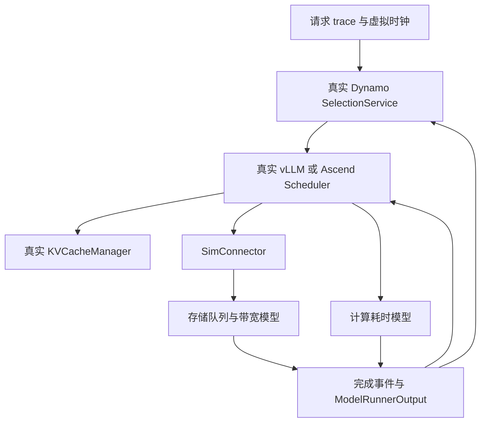
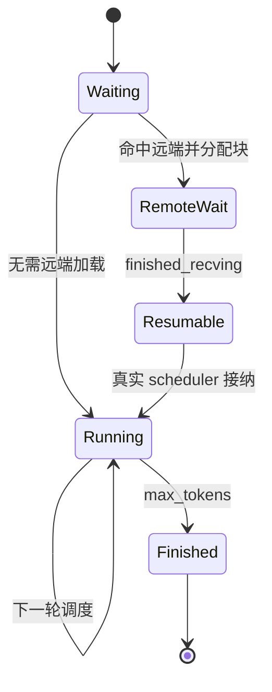

# 在 CPU 上运行真实 Dynamo / vLLM / vLLM-Ascend 调度代码：可行性与实施设计

## 2026-11-04：可选 Dynamo 分级命中画像

`admission.profile_source=dynamo_tier` 在原生分级查询之后、scorer 之前生成一个共享存储画像。
所有实例对等并共用存储；每请求只分类、登记一次，所有候选读取同一重读标记。
不再生成候选画像，不再使用预分类或 prepare/commit 协议。下发直接复用已有元数据。
共享存储原始命中来自 tier_overlap_blocks.disk，取共享副本的最大前缀一次，不相加。
固定上游合并 Disk/External；本模式不扩展 GPU/HostPinned 差异或异构实例支持。
既有 α、原生 picker/完整 booking、额度点、KV 分配和首 token 释放规则保持不变。
实际命中与画像偏差只记录，实际 KV 操作使用 Connector 查询结果；暂不自动重分类。
Python 画像/分类和中央账本仍复用原服务，由 Dynamo 在查询后调用一次。
默认 trace 模式不变，模型和存储仍为 CPU 仿真。测试 STORAGE 事件不是生产存储适配。
说明见 [Dynamo内部共享存储画像](../docs/Dynamo分级命中画像接入-20261104.md)。

## 2026-10-30：与研究版运行代码同步

当前实现已同步研究版的直接组合计时、四种加载反馈移除、强制准入释放等待移除，以及Dynamo Runtime最终答复/后台EOF收尾。
进程栈只允许first_token释放。执行器的加载事实只写本地日志；在线账本不消费这些事实，排空后才合并报告副本。
`admission.runtime.final.json`保留原始在线账本，`admission.final.json`标明离线观测来源，`admission_rpc.check.json`核对后台流排空。
GLM默认仍为实际工作量v2；`glm5_direct_sum_v1`是显式选项，不自动改写已有benchmark的计算模型。
现有可运行Mooncake入口保留K1、block16、EDF、到达窗口、带宽和预热规则。当前运行不再发送旧的同步batch/合帧反馈。
旧报告、config.historical.json和来源实验合同仍描述当时行为，不能当作当前运行验收。AgentX已于2026-11-02完成专用入口接入；六秒synthetic也已接入专用运行合同，见2026-11-02追加说明。
核心代码同步校验：`python dynamo_vllm_cpu_sim/scripts/check_runtime_sync.py`；可加`--source`指定另一份仓库根目录核对双方文件。


版本核对及工程验证日期：2026-09-24。配套代码见同目录；文中明确区分已交付实现、后续设计和实机校准任务。

## 1. 判断：可行，但“真实代码”必须定义到具体边界

2026-10-27新增可选weighted routing overlay：原生Rust默认scorer只对等待heavy请求扣除
`(1-waiting_factor)`倍prefill/decode成本。原scheduler booking、完整资源投影、容量准入、picker及guard仍由Dynamo持有。
Gateway预登记heavy UUID；原生booking绑定worker/AttemptId；额度获准经独立本机控制RPC撤销折扣，回滚恢复折扣，
无实际外部命中转完整计算分数。原生request-index删除时清理评分记录。该模式有意修改Dynamo评分行为，
仅对frontend加载指纹固定的独立native构建；worker和原磁盘源码保持原环境。默认关闭、启用缺省0.1，范围0～1，启动生效。
本机持久TCP评分控制不是远程部署接口；不明RPC结果停止本轮，不伪造资源释放。详细边界见折扣计分说明。

这个方向适合研究路由、批处理、KV 缓存和存储状态联合调度。最有价值的保真对象是**做决策的程序、它读到的状态，以及外部事件回来时发生的状态转换**。保留这些代码，确实比另写一套“近似 vLLM”的调度器更容易把实验策略迁回生产。

但不能得出“使用真实源码，性能预测就自动真实”的结论。NPU kernel、图捕获、设备 stream、HCCL、内存带宽和存储 I/O 都影响事件顺序。如果 mock 全部立即成功，调度器虽然是真的，它看到的世界却是假的。正确做法是在真实程序的执行边界上放入**有资源竞争、有延迟、有完成语义的执行模型**。

需要分别考察三个维度：

| 维度 | 要保留什么 | 本次交付 |
|---|---|---|
| 决策保真 | 路由选择、队列、预算、KV 分配、请求状态机 | 真实 Dynamo selection core、真实 vLLM Scheduler/KV 管理；指定 Ascend scheduler 文件 |
| 因果保真 | KV 就绪才恢复、分配成功才执行、完成才释放、并发共享资源 | 已实现只读存储/同步 scheduler 的事件闭环；其他功能见边界 |
| 性能保真 | 每类算子/批次/通信/存储的时间模型 | 仅提供示例系数和动态存储模型，需实际 NPU/存储数据校准 |

**推荐路线：先采用“真实调度核心 + 仿真执行器”的实验台，再逐步接完整服务与 EngineCore。** 如果要求“所有 vLLM-Ascend Python 路径都原样执行，只把底层 NPU 函数改成 no-op”，工程会变成半个 Ascend 运行时仿真器，投入大且更容易隐藏错误。

本工程可以直接安装并跑通，但并未声称把整个 Dynamo/vLLM/Ascend 服务栈移植到了 CPU。特别是“按文件加载 Ascend BalanceScheduler”与“完整 Ascend 插件在 CPU 注册并运行”是两个不同完成度。

### 直接搭建入口

在 Linux x86_64 上安装 uv 后，解压配套代码包并执行：

```bash
unzip dynamo_vllm_cpu_sim.zip
cd dynamo_vllm_cpu_sim
bash scripts/bootstrap.sh
```

脚本自动下载固定 SHA 的源码、创建 Python 3.12 环境、安装 CPU 依赖并运行默认案例。后续用 `.venv/bin/python -m sim.run` 运行实验；详细开关见包内 README.md。无源码、无虚拟环境的新目录启动也已验证。需要网络获取首次依赖，不需要模型权重或 NPU。

## 2. 版本固定与兼容性

| 组件 | 固定版本 | 源码提交 |
|---|---|---|
| vLLM | v0.20.2 | `bc150f50299199599673614f80d12a196f377655` |
| vLLM-Ascend | v0.20.2rc1 | `367b8e62da799870a7476ce34f5f7658589a8aad` |
| Dynamo | v1.5.0，本方案选定 | `b83b1d9304ebfc624709ac46db32b1b6f1ff1615` |
| 仿真 Python | 3.12 | 本次验证 3.12.14 |
| 仿真 PyTorch | 2.11.0+cpu | 不安装 torch_npu/CANN |

用户未指定 Dynamo 版本，这里选 v1.5.0，是因为它提供独立 SelectionService 以及正式的自定义 worker selection 接口。**Dynamo 1.5.0 官方发行组合采用 vLLM 0.28.0，不能宣称它的整套 vLLM adapter 对用户指定的 0.20.2 已获兼容验证。** 本工程绕开引擎适配组合，使用真实 Rust 路由核心与真实 vLLM 0.20.2 scheduler 的显式桥接。这是我们定义并测试的集成边界。

安装 `ai-dynamo-runtime==1.5.0` 使用官方编译 wheel；下载对应 Dynamo 源码便于审阅和后续修改。仅编辑下载的 Rust 文件不会改变已安装 wheel，必须重编译。vLLM 则为 editable 源码安装，修改 Python 调度器后即可生效。

`VLLM_TARGET_DEVICE=empty` 用来安装不编译设备扩展的 vLLM Python 源码。本工程同时明确设置 `CpuPlatform`，避免不受控设备自动发现；这不等于使用 vLLM CPU backend 做数值推理。示例 OPT config 只提供配置元数据，不下载权重、不执行模型、不初始化 tokenizer。

安装 lock 有意裁剪生产依赖，因此它不是“vLLM/NPU 全功能环境”。新启用任何可选路径，都应先审查该路径新增的导入、native op、依赖和状态协议。

## 3. 两类运行形态

### 3.1 本次交付：离散事件实验台



多个逻辑 worker 各自有真实 scheduler 和 KV block pool，共享一个存储系统和虚拟时间。Dynamo 的 selection/reservation 状态是真实 Rust 对象。仿真没有 HTTP/IPC 转发成本；需要研究它们时，应建立独立延迟模型或第二类运行形态。

### 3.2 后续：完整服务闭环（2026-10-21 追记：壁钟模式已实现）

让真实 Dynamo frontend、发现机制和 worker 接口运行；每个 worker 是真实 vLLM EngineCore + SimExecutor，底层存储/计算仍由模型完成。它适合验证 API、取消、跨进程协议、服务发现、PD 交接等完整行为。

**2026-10-21**：壁钟缩放模式（file 发现/tcp 请求面/ZMQ 事件面，免 etcd/NATS）已在 macOS 本机实现并验收——frontend + N×`dynamo.vllm` worker（各含 EngineCore 子进程）+ storage-sim 服务全部为真实进程，SimExecutor 经 `Executor` 限定名注入（vLLM/Dynamo 源码零修改）。实现细节、实测修正与验收数值见 [多进程真实Dynamo-vLLM仿真栈设计-20261020.md](../docs/多进程真实Dynamo-vLLM仿真栈设计-20261020.md) §13 追记与包内 README 的进程栈小节；高速离散事件推进（跨进程虚拟时间协调）仍为后续。

可以先用壁钟缩放模式验证服务协议；若要高速离散事件推进，必须让跨进程 participants 在各自事件边界上暂停/恢复，统一协调虚拟时间。只给 Python 打补丁替换 `time.time()` 无法控制 Rust/Tokio 定时器、IPC、native 线程或真实进程超时。

Dynamo 自带 Mocker 是可参考的校准/对照工具，但其中对 vLLM 风格调度的模拟不能替代用户要求的特定版本 Python Scheduler。二者适合对照，不应混称为同一保真等级。

## 4. 保留、替换和暂不执行的代码

| 组件/路径 | 本工程处理 | 原因 |
|---|---|---|
| Dynamo SelectionService、选择和负载预留 | 原生 wheel 中的真实 Rust 代码 | 路由决策不能在 Python 重写 |
| Dynamo 服务发现 | 显式 upsert_worker | 固定拓扑实验无需部署控制面 |
| Dynamo KV 索引事件 | 当前关闭 | 未桥接真实事件时不能伪称 cache-aware |
| vLLM Request/SamplingParams | 真实对象 | 保留长度、优先级和停止状态协议 |
| vLLM Scheduler/queue/KVCacheManager/block pool/hash | 原样执行 | 保留调度和逻辑块分配行为 |
| Ascend BalanceScheduler | 按真实文件加载 | 避开与本实验无关的 CANN 全量导入 |
| KVConnector scheduler 接口 | 自定义真实接口实现 | 让外部 KV 影响真实状态机 |
| NPU forward/sample/通信 | 生成定时完成的 ModelRunnerOutput | 需要时间与生命周期，不需要数值结果 |
| HBM/Host/存储内容 | block ID、引用、位置和字节数 | 逻辑容量约束由真实 allocator 执行，无需分配 TB 张量 |
| EngineCore/ModelRunner/worker | 当前不实例化完整栈 | 第一阶段直接驱动调度核心 |
| CANN/torch_npu/NIXL/RDMA | 当前无需安装 | 对应动作由执行边界模拟，未实现的入口显式报错 |

关键边界是 SchedulerOutput → 执行 → ModelRunnerOutput；不要 mock `schedule()` 返回一个自编的批次，不要自行重写 KV allocator，也不要绕过真正的 `update_from_output()`。

## 5. 已核对的源码接口

以下路径相对于脚本下载的三个仓库，锁定的 commit 见上表。

| 目的 | 实际入口 |
|---|---|
| vLLM 调度 | `vllm/v1/core/sched/scheduler.py`：`Scheduler.add_request/schedule/update_from_output` |
| 自定义 scheduler 注入 | `vllm/config/scheduler.py` 的 `scheduler_cls`；`vllm/v1/engine/core.py` 调用 `get_scheduler_cls()` |
| KV 分配/缓存 | `vllm/v1/core/kv_cache_manager.py`、`block_pool.py`、`kv_cache_utils.py` |
| 执行结果 | `vllm/v1/outputs.py`：`ModelRunnerOutput`、`KVConnectorOutput` |
| 外部 KV 协议 | `vllm/distributed/kv_transfer/kv_connector/v1/base.py`：`KVConnectorBase_V1` |
| 完整 EngineCore 的替换点 | `vllm/v1/executor/abstract.py`：`Executor` |
| Ascend balance | `vllm_ascend/patch/platform/patch_balance_schedule.py` |
| Ascend 实际存储边界 | `vllm_ascend/distributed/kv_transfer/kv_pool/ascend_store/backend/backend.py` |
| Dynamo Python 接口声明 | `lib/bindings/python/src/dynamo/_core.pyi`：`SelectionService` |
| Dynamo 自定义策略 | `lib/kv-router/src/scheduling/selector/policy.rs` |
| 策略注册/选择 | `lib/kv-router/src/services/selection/policy_registry.rs`、`catalog.rs` |
| 策略编译示例 | `examples/router/custom-policy-example/README.md` |

代码中的版本与关键文件哈希检查是为了尽早发现 API 漂移。正式实验另外保存自定义 patch、配置、trace 哈希、依赖 lock 和 seed；只记录版本号不足以复现策略改动。

## 6. 真实 vLLM 调度闭环的实现细节

每个 worker 创建真实 VllmConfig、KVCacheConfig、StructuredOutputManager 和 Scheduler。示例采用单个逻辑 FullAttention KV group、固定 block 数、chunked prefill、同步 scheduler、无 speculative decoding。

处理顺序为：

1. 创建真实 Request，用上游 SHA256 block hasher 计算连续前缀哈希。
2. Dynamo 选择 worker 并 reserve；随后对真实 scheduler 调用 `add_request()`。
3. `schedule()` 决定本轮请求、token budget、chunk 和块分配。
4. 读取真实 SchedulerOutput，为本轮建立计算事件；SimConnector 提交本轮实际触发的读请求。
5. 在虚拟完成时间构造 ModelRunnerOutput；如果有存储接收完成，同时附带 `KVConnectorOutput(finished_recving=...)`。
6. 调用真实 `update_from_output()`；取真实 EngineCoreOutput 中的新 token 与完成状态。
7. 首 token 通知 Dynamo `prefill_complete()`；完成后 `free_reservation()`；检查块可回收和无未完成请求。

有几个容易写错的点：

- 此版本 `schedule()` 自己推进 `num_computed_tokens`。仿真器如果再加一次，就会提前完成 prefill。
- chunked prefill 没到采样点时，不能每一轮都伪造一个输出 token。只有本轮已覆盖 request 需要的 token 时才产生一个样本。
- 本轮计算 token 数为零，也可能必须处理 connector completion。不能用 `if not scheduled_tokens: return` 丢掉状态更新。
- 结束时的“free blocks”包含可回收的缓存块，不意味着所有 prefix hash 都被删除。128 块配置下，上游保留一个 null sentinel，报告 127 块可回收是预期。
- 示例固定产生 token ID 100，ignore_eos、按 max_tokens 停止。它适合短输出调度实验，不代表模型生成内容；长输出或多轮语义缓存实验应回放真实输出 token。
- 本版启动包没有调用长输出的增量 `SelectionService.add_output_block()`，因此建议 output_tokens < block_size。研究长 decode 前要按 block 边界接反馈，并验证原生 decode load 记账语义。

真实 allocator 和 preemption 代码没有被替换，但默认案例未制造 HBM 紧张抢占。不能据此声称取消、抢占期间远端传输清理、重算和失效传播已经全面验证。后续应使用专门的容量受限/多次抢占负载验收。

## 7. 远端 KV 的正确异步语义

`SimConnector.get_num_new_matched_tokens(request, num_computed_tokens)` 从**本地已经匹配的连续前缀之后**继续找远端前缀。它返回新增 external token 数以及是否异步加载。不能把“存在的 KV”当作“已在设备可用的 KV”。

分配成功后 `update_state_after_alloc()` 才提交实际读；存储模型处理排队、启动延迟和传输。在所有必需 block 收完之前，真实 request 处于 WAITING_FOR_REMOTE_KVS。接收完成通过真实 `update_from_output()` 回传，下一次 schedule 才允许恢复。



完整命中时仍需考虑最后一个 token 的 logits 计算；示例限制远端命中到 `(prompt_len - 1)` 以内的完整块，不会把全部 prompt 都跳过而凭空生成首 token。

后续支持取消/失败时，完成事件必须携带 request generation 或 transfer ID：请求取消后晚到的 completion 不得恢复旧请求，重试不得重复释放同一批 block。写回场景还必须保留引用直至真实保存完成，不能在 submit save 时就发布“存储已存在”。

本工程只读池在 t=0 初始化，同一前缀对全部请求可见。它表达预置缓存快照，不表达“将未来请求产生的 KV 提前放入存储”。若 trace 的远端字段来自运行中的动态缓存，需要改成按时间提交写入/移除事件。

## 8. Ascend 适配：能保留的与需要解耦的部分

Ascend 插件并非一个只在末端调用 `torch.npu` 的薄壳。平台注册、patch 导入、设备特性、runner、通信与 KV 传输之间存在依赖。全局把 `torch_npu` 替成 MagicMock 很容易让本应失败的分支悄悄通过。

这里采用**范围明确的源码复用**：直接加载 rc1 的 `patch_balance_schedule.py`，使用其中的真实 BalanceScheduler，而不触发整个 `vllm_ascend.patch.platform` 包的初始化。该文件也包含对 EngineCoreProc 的补丁，本实验并不实例化完整 EngineCoreProc。

提供三个模式：

| 模式 | 调度实现 | 修改情况 |
|---|---|---|
| upstream | vLLM 0.20.2 Scheduler | 无修改 |
| ascend_default | rc1 BalanceScheduler，`enable_balance_scheduling=False` | 无修改；其 schedule 委托父类 |
| ascend_balance | rc1 BalanceScheduler，开关 True | 使用显式生成的副本补丁；单 rank |

在 balance=True + 本工程异步 KVConnector 的路径上，原始 rc1 的异步等待分支没有更新 `request.num_computed_tokens`，复现为重复加载/无法前进。对应上游 vLLM 路径会记录这一进度。因此提供以下局部差异：

```diff
 request.status = RequestStatus.WAITING_FOR_REMOTE_KVS
+request.num_computed_tokens = num_computed_tokens
 continue
```

补丁脚本核对原始文件哈希并要求唯一匹配；输出 `patched/ascend_balance_schedule.py` 和 diff，不改 upstream 文件。**这是针对 CPU 实验复现问题的修正，不是宣称已经验证 rc1 在所有 NPU 配置下有同一问题，也不是生产补丁批准。**

本地单 rank 测试只向 balance queue 填入本 worker 的 running 数；要研究多 DP rank，必须执行真实的跨 rank 状态更新/均衡逻辑，通信耗时再由模型替换。Ascend 的其他 scheduler 变体、重计算相关平台开关、动态 batch/profiling chunk 路径均应逐个建立兼容测试，不能从此处的成功推断全量可用。

## 9. 虚拟时间与异步一致性

仿真只维护一个全局时间。每次推进至下一个请求到达、计算完成、存储启动或存储完成事件；所有资源在这一时间段内按当前速率一起推进。遇到新 I/O 或旧 I/O 完成后重新计算带宽分配。

本实现先处理推进到当前时刻所产生的存储/计算完成，再接纳当前时刻的新请求；同一时刻的请求按 arrival_s、ID 排序。这是明确定义的 tie 顺序，实验报告应保留。

Dynamo native accounting 是异步的，await 外层函数不总等于所有负载快照已经更新。桥接层在 route/prefill/free 后检查真实 `loads()`，等其 active_requests 和 potential_prefill_tokens 收敛，再允许下一次决策。这个宿主 CPU 等待不计入虚拟推理延迟；超时作为仿真错误报出。

这种 fence 仅覆盖当前使用的原生记账路径，未控制所有 Rust 时钟。以后启用路由队列 timeout、缓存 TTL、KV events、指数衰减、异步 snapshot 等功能时，要额外设计虚拟时钟或明确的采样/交付事件。

Dynamo 默认 picker 对完全相同代价的候选仍可能有随机平局选择，即使 temperature=0 也不能承诺逐 worker 完全相同。当前 replay 的汇总值相同，但 worker 标签可能交换。需要严格复现时，应在真实 Rust WorkerPicker 中按 `(cost, stable_worker_id, dp_rank)` 明确比较，并用相同 picker 跑所有策略；也可以保留随机性，报告多次运行分布。

## 10. 存储模型：必须模拟共享瓶颈

默认模型有 2 个逻辑 disk，每 disk 256 个逻辑 path，disk 总预算 40 GB/s，单 path 上限 1 GB/s，全系统共享链路 10 GB/s，单次读启动延迟 100 μs。它们都是可改参数，不对应已校准设备规格。这里 GB 是十进制 bytes，Gb/s 必须先除以 8。

block 用稳定 rendezvous hash 映射到唯一 disk，对该盘全部 path 可见；path 不是放置属性而是访问通道——IO 请求发出时才按确定性最少占用规则指派 path（平局取最小下标，2026-10-10 起两策略共用，废除旧"块哈希到 (盘, path)"定位）。速率规则由 `storage.bandwidth_policy` 选择（设计文档 docs/存储带宽分配策略设计-maxmin-20261009.md）：

`active_split`（默认，每 path FIFO，同盘并发读超过 paths_per_disk 才排队）：对所有已启动的队头读，先按 disk 的活跃路径数分带宽并施加单路径上限，再用全局链路上限等比例缩放：

\[
r_p^{(0)}=\min(B_{path}, B_{disk(p)}/N_{active,disk(p)})
\]
\[
r_p=r_p^{(0)}\min(1,B_{shared}/\sum_q r_q^{(0)})
\]

`max_min_fair`（无排队）：每个 IO 请求独占一条 path、数量不限（paths_per_disk 仅为名义值），携带需求 \(d_i\)（= 一层传输数据量 ÷ 一层计算时间；聚合模型下即 kv_bytes_per_token / prefill_token_s，trace 行 demand_Bps 可覆盖）。每盘做带需求上限的水土填充：\(\sum_i d_i \le B_{disk}\) 时 \(a_i = d_i + (B_{disk}-\sum d)/N\)；否则迭代"均分→超额者截到需求→多余再均分"到不动点（标准 max-min fair）。随后同样施加全局链路等比例缩放；链路主导时盘内需求保证会被压缩破坏（设计文档 §3.5）。

这是本实验明确选定的两条分配策略，不宣称是实际存储控制器的固件调度；max_min_fair 仍不含读写隔离、分类组份额（策略文档 09-17 的 B0/B1）、cache tiers、介质服务时间分布，都可按目标系统扩展。

不能对每个读在提交时写一个固定 `size / peak_BW` 的完成时间然后不再更新。示例单元测试刻意在传输中途加入另一个读：原请求完成时间必须后移，另一个结束后剩余读再加速。这正是存储状态影响调度策略的基础。

当前读取不会去重多个 worker 的同一 block，也没有设备侧压缩、RDMA pipeline、Host staging 或写回。是否允许合并相同读，是需要显式控制的实验选项。不要将 disk、host-to-device、NIC、PCIe/HCCS 都无条件视为独立峰值链路；共享路径要在同一资源图计账。

## 11. KV 字节数与显存容量要从真实模型配置推导

对常规 dense attention，一个 token 全模型的未分片 KV 大小近似为：

\[
S_{token}=2\times L\times H_{KV}\times D_{head}\times s_{element}
\]

然后按实际 TP/PP 分片、KV head 复制、缓存 dtype/量化尺度、padding、block layout 和额外元数据修正。不能对所有模型机械地除以 TP：例如 KV head 数不足时的复制行为会改变每 rank 负担。MLA、滑窗、混合 attention、Mamba 等结构需要独立 cache spec 和分组建模。

本启动包 `kv_bytes_per_token=131072` 只是存储字节模型参数；OPT config 和单层 FullAttentionSpec 只用于构造合法调度元数据，**它们不构成这个字节参数的实机校准依据**。逻辑 block 数控制真实 allocator 的容量；字节数控制 I/O 成本。正式实验必须把二者从同一模型/设备 profile 生成，避免容量和带宽模型彼此矛盾。

## 12. 逐层 I/O 与计算重叠：后续必须单独实现

当前 request 等到所需远端 KV 全部到达才恢复调度。它可以研究外部 KV admission、存储拥塞、路由和计算之间的因果关系，但不能预测 layerwise prefetch 与 attention 的重叠收益。

逐层模型应保留真实 worker/connector 调用顺序，在 `start_load_kv`、`wait_for_layer_load(layer)`、forward layer、`save_kv_layer` 等边界生成事件。对一个融合 batch，层 l 的开始时间至少满足：

\[
t_{start,l}=\max(t_{finish,l-1},\max_{r\in batch}t_{KV-ready,r,l})
\]

如果实现允许按微批/组分别推进，要以实际调度粒度替换这里的 batch，不能假定每个 request 都有独立 NPU 流程。预取窗口还受 Host/HBM staging 容量、DMA 队列和层依赖约束；提前加载越多可能占用越多带宽和块，损害其他请求。

该扩展完成前，不应把当前 `stall_s=0` 叫作“完美 I/O 覆盖”：worker 可能在等待某请求时执行其他请求，但这并未证明同一次 forward 内 I/O 被计算遮蔽。逐层模型应记录 ready、start、finish、wait 的独立事件，并与真实 trace 对齐。

## 13. 计算和通信时间模型

示例每轮耗时为：

\[
T_{step}=\alpha+\beta N_{prefill}+\gamma N_{decode}
\]

参数在 config 中，适合验证流程及人为构造瓶颈。它不能可靠外推吞吐，更不应用来报告某 NPU 的绝对性能。正式模型至少输入：模型/量化、设备型号、TP/PP、prefill/decode 数量、chunk 长度、上下文长度分布、批大小、图模式、MoE 活跃专家和通信拓扑。

建议采样实机的真实 SchedulerOutput 与相应 NPU event 时间，而不是只测 HTTP E2E。以 table lookup / 分段回归 / 可解释拟合建立时延面；测不到的区域标记外推范围。单独建模调度 CPU 开销、launch/同步、TP/PP 通信和存储，不要把同一段耗时重复加入两次。

使用未参与拟合的负载做验证，比较每步时间、TTFT 分布、吞吐、队列与抢占次数；更重要的是检查不同策略的排序是否稳定。真实业务的输出长度可用 trace 作为仿真停止条件，但策略若在生产不知道它，不能把准确长度当作无误差预测输入。示例向 Dynamo 提供 expected_output_tokens 是一个已知长度的控制实验假设。

## 14. “考虑存储状态”应暴露哪些信息

仅传一个 cache_hit_rate 或当前带宽是不够的。一个请求可能命中远端，但需要跨拥塞路径读很多字节；另一个请求命中少，却可在空闲 NPU 上很快重算。建议定义显式、带版本的 StorageSnapshot：

| 信息 | 内容与用途 |
|---|---|
| epoch / measured_at / delivered_at / expires_at | 模拟测量、传播延迟、过期，防止读取未来状态 |
| tier / disk / path / link 标识 | 将请求 block 映射到真实共享瓶颈 |
| queue depth / queued bytes / active transfers | 预测等待与服务时间，区分排队和传输 |
| capacity / reserved bandwidth | 避免多个选择者同时把全部带宽当空闲 |
| block metadata / contiguous prefix | 请求在设备、Host、共享存储各自能连续复用多少 |
| device staging / free blocks | 预测预取是否挤占正在运行请求 |
| estimate uncertainty / freshness | 过期或不可靠时降级到原策略 |

实现上，仿真存储拥有“真实状态”，策略只能读“已交付的观测快照”。通过 `snapshot_delay_s`、更新周期和噪声模拟生产观测；请求尚未到达时的未来输出、未来写回不能进入策略输入。snapshot 的过期时间也要使用虚拟时钟。

当前代码的 `Storage.snapshot()` 提供简化观测原型，默认路由还没有消费它。priority 示例只使用静态长度/预置前缀估计，不能把它叫成已实现的动态存储感知调度器。

## 15. 在真实 Dynamo 中修改路由策略

Dynamo 的真实扩展点包括 `WorkerFilter`、`WorkerScorer`、`WorkerPicker`。Filter 处理硬约束，Scorer 返回有限的 lower-is-better cost，Picker 从候选中选择；原来的 eligibility、reservation、accounting 生命周期仍由 Dynamo 持有。

一种候选目标函数是：

\[
C(w,r)=\widehat{TTFT}(w,r)+\lambda\widehat{Externality}(w,r)
       +\mu\,\max(0,\widehat{TTFT}(w,r)-SLO_r)
\]

其中 externality 是此次加载给同路径其他请求造成的增量等待，不应仅用“本请求读完要多久”。TTFT 要联合考虑本地计算排队、已有 KV、读取/重算选择、批处理和首 token 计算。系数由实验设计给定，不能仅凭示例数值宣布最优。

落地步骤：

1. 从固定提交的 `examples/router/custom-policy-example` 建自己的 Rust policy crate，声明需要的 CACHE / LOAD 等输入组。
2. 将存储观测通过显式扩展的 context 或按 request key 查询的已缓存 snapshot 注入。评分过程中不做每候选一次同步 RPC，以免改变控制面的时间开销。
3. 实现 StorageAwareScorer；需要严格可复现时实现确定性的 WorkerPicker。注意候选行顺序未定义，不能用行号当稳定 worker ID。
4. 在 catalog 中注册 provider/factory；YAML 定义实例和 worker type；构建启用 `custom-policy` 的 Python 扩展。
5. 仍用本工程 select_and_reserve / prefill_complete / free_reservation 桥接，不在 Python 外面重新挑选 worker。
6. 加入决策收据：候选输入、snapshot epoch、cost 分量、winner、fallback 原因。用构造的小例子验证是否真的加载了新策略。

**接口限制必须正视：** v1.5.0 的 WorkerSelectionContext 有 request_blocks、block_size、session context、expected_output_tokens 等公开 getter，但它没有向自定义 crate 直接公开任意 request ID / block→disk 映射 / 每盘队列。内部有 request_id 字段不代表插件可以访问它。WorkerInputs::CACHE 中的 tier overlap 也不等于存储 ASU/path 状态。因此完整实现需要扩展上下文或建立明确的共享状态桥，不能假造 `candidate.storage_queue` 一类不存在的 API。

编译入口在 `upstream/dynamo/lib/bindings/python`，官方示例使用 `maturin develop --uv --features custom-policy` 并将 `dynamo-worker-selection-policy-catalog` 依赖别名指向自己的 catalog。Rust 工具链和系统构建依赖按固定仓库说明准备。**本启动包未编译新的 Rust 存储策略；默认使用发行 wheel。** 修改 `upstream/dynamo` 后，先重建替换扩展，再运行基准，不能只改文件就认为策略生效。

编译后先用 policy 的专门用例确认选择改变，再做本工程集成验收。实验记录 wheel/build hash；doctor 只检查发行版本与关键源码，不能单靠版本号辨别两个不同自定义 build。

## 16. 在真实 vLLM/Ascend 中修改本地策略

有三个粒度，建议依次做：

1. **队列优先级。** 使用真实 `policy='priority'` 和 Request.priority 验证策略入口。当前脚本默认按未复用 prompt 长度赋静态 priority；这是调通修改链路的例子。
2. **动态 admission / prefetch 预算。** 根据已交付存储快照选择哪些 waiting 请求可以启动远端读取、限制在途字节/路径并发，并保留真实 allocate_slots 和异步状态机。
3. **token budget / batch composition。** 在真实 schedule 路径上联合选择当前 batch 的请求、prefill chunk 和 decode 预算；需同时考虑 NPU 利用率、KV 就绪和公平性。

使用 scheduler_cls 继承目标真实 scheduler，或对固定版本 schedule 做小范围 patch；迁回生产时复用同一策略类/patch。不要让仿真器在 schedule 外面预先组成假 batch，然后只把结果塞给真实 scheduler。

如果动态修改 heap 中已有请求的 priority，必须遵循原队列实现的重新入队/重建规则；直接改字段不等于 heap 排序会刷新。Ascend 自定义 queue/balance 路径可能有不同逻辑，要逐一验证。

公平性必须与性能一起设计：aging、最长等待保护、每租户份额、prefill/decode 饥饿约束和 admission 上限。否则只选短请求/空闲路径，均值可能好看而尾延迟和 SLO 更差。

建议做四组消融：原路由+原本地策略、存储路由+原本地策略、原路由+存储本地策略、两者一起。计算/存储模型、trace、初始缓存、观测延迟和随机性必须固定；否则无法判断收益来自策略还是环境变化。

## 17. 接入真实 KV 事件后才比较缓存感知路由

当前明确关闭 `DYN_ROUTER_USE_KV_EVENTS`、`DYN_ROUTER_ASSUME_KV_REUSE`，把 overlap credit 设为 0。这样 Dynamo 使用真实的负载选择与预留，但不因缺少缓存事件而假装知道各 worker 的缓存。

完整桥接方案：

1. 在真实 vLLM Cache/BlockPool 路径启用 KVEventsConfig，将 BlockStored/BlockRemoved/清空等事件从真实状态变化处取出。
2. 配置 vLLM 的发布端和 Dynamo worker catalog 的 `kv_events_endpoint`、`kv_events_replay_endpoint`，由真实接收与索引代码处理。
3. 明确模型 namespace、block size、hash 算法/序列化、parent hash、DP rank、cache tier 等契约。必要时使用官方 adapter 的转换逻辑并移植到指定旧版本，不能仅比较 hash 数值“看起来一样”。
4. 定义虚拟完成事件与 KV index ingestion watermark。只有已交付且已入索引的缓存事件才能用于下一次决策；不能在发出 ZMQ publish 的瞬间假定所有 native consumer 已应用。
5. 处理丢失、重放、worker 重启、缓存删除和跨 tier 迁移；加入重复事件和乱序事件验收。

普通 device KV 事件不自动意味着共享磁盘里也有同一份 KV。存储写回确认后才能发布相应存储 tier 可用性；真实 HBM 淘汰只应移除对应 tier 的副本。路由到过某 worker 不代表它永远保留全部 prompt。

这条桥接完成后，才能得到可信的“默认 Dynamo cache-aware vs storage-aware Dynamo”对照。当前启动包提供的是前一阶段的 cache-blind baseline，不能用它冒充默认缓存感知方案。

## 18. 更完整的 EngineCore、PD 和多卡设计

### 18.1 SimExecutor 接入 EngineCore

vLLM 0.20.2 的 Executor 可以通过 ParallelConfig 的 `distributed_executor_backend` 指定类或限定名，但完整替换不止覆盖 execute_model。至少需要处理 `_init_executor`、`get_kv_cache_specs`、`determine_available_memory`、`initialize_from_config`、`collective_rpc`、`execute_model`、`sample_tokens`、shutdown，以及配置启用的其他方法。

EngineCore 在此版本会使用 `execute_model(..., non_block=True)`，并可能在返回 None 的路径再调用 sample_tokens。因此 SimExecutor 必须返回匹配实际协议的 Future/ModelRunnerOutput，并在虚拟执行完成时兑现 Future；不能永远同步返回一个字典。

初始 cache spec 和可用内存要来自仿真模型 profile，使真实 EngineCore 的 block 数推导仍然有效。将 warmup/profile 变成显式配置读取，设备 tensor 分配变成逻辑句柄；别用一片任意 CPU tensor 假装整台 NPU 的 HBM。

后续可把本工程 Engine 中的计算、采样、存储完成逻辑搬到 SimExecutor，而保留同一个 Storage/EventCoordinator。迁移验收要比较相同 trace 的 schedule 决策序列和请求状态，而不只是 HTTP 返回 200。

### 18.2 PD 分离

PD 至少有 prefill worker 池、decode worker 池、跨池 KV 传输、decode admission 和交接生命周期。Dynamo 自定义策略会区分 WorkerType::Prefill / Decode；当前单个 SelectionService 聚合式池不等于完整 PD 调度。

在全链路 TTFT 中，输入到达、prefill 排队/远端加载/计算、P→D 传输、decode admission 和首 token 路径应按实际实现的首 token 产生/返回位置计时。不要简单把“P 首次计算完成”一概当用户可见首 token。

NIXL/Ascend connector 等真实协议对象可以保留，把注册 buffer、传输和完成轮询换成模拟后端；必须保留传输句柄、完成确认与引用生命周期。共享 disk I/O 和 P→D 网络若争同一链路，要联合计账。

### 18.3 TP / PP / DP

router worker 不一定等于一张卡。TP group 的一个 request 横跨多个 rank，层完成通常受最慢 rank/collective 限制；PP 则有 stage 与流水线依赖。不要把 TP rank 当作独立路由副本。

CPU/Gloo 可帮助运行控制协议，但测得的 Gloo 时间不是 HCCL 时间。真实性来自保留操作与同步关系、用实机参数代替对应完成时间；不能按 CPU 通信耗时报告 NPU 性能。

## 19. Trace、指标和可复现性

输入需要有稳定 request ID、明确的到达时间单位、prompt token 序列/可构造的稳定 block 链、输出长度或真实输出、初始 cache 快照。只有 prompt length 而没有共享前缀结构，无法研究 KV cache locality。只有匿名 block ID 时，应保持连续前缀和 parent 关系，不能随机生成全部 token 破坏共享。

真实流量的时间戳可能为秒、毫秒、微秒或相对 tick，必须由数据集说明或产生端验证。开环到达流和按完成后再发请求的闭环负载也要区分：后者会随策略改变系统输入速率。

建议输出：

| 指标 | 定义/注意事项 |
|---|---|
| TTFT | 用户到达→首 token；当前不含 HTTP/tokenization，因为没有运行它们 |
| E2E / TPOT / token gap | 长输出研究中补齐，不用平均 decode step 代替所有请求的 token gap |
| throughput / goodput | 请求或 token 吞吐；goodput 只统计满足定义的 SLO 者 |
| SLO attainment | 含失败/取消/超时的明确分母；不能只从成功者中筛选 |
| p50/p95/p99 | 足够样本后才解释分位数；12 请求只能冒烟 |
| compute / stall / idle | 每 worker 在观测窗内互斥分区；不要把等待远端但忙于别的 batch 重复计 stall |
| cache/bytes/queues | 按 tier 区分本地命中、远端读、真正跳过计算的 tokens |
| normalized TTFT | 与相同模型/初始缓存的独占基线比较；不要称它为数学最优 |

每次实验保存配置、trace hash、版本与源码/patch hash、随机 seed、初始 cache hash、策略 snapshot epoch 和关键决策日志。默认输出有版本、实际 scheduler 文件 hash、配置、请求时间和事件；尚未自动包含完整 provenance 清单，正式大规模实验应扩充。config 可选 `storage_interval_log=true` 时，events.jsonl 追加 `storage_interval` 事件（每个推进区间的链路需求/实际速率与队列深度；数据源 `Storage.link_flux()`），供带宽时序图与 ∫actual=bytes_read 守恒断言消费，默认关闭、不影响调度行为。

本工程 wall-clock 运行时间主要是 Python 导入、native accounting 和仿真开销；报告的 makespan_s 是虚拟服务时间。两者应分别记录，不能混作 NPU 推理时延。

## 20. 本次已完成的验收

工程执行了以下路径，并保存原始 report.json / events.jsonl：

- 原始 vLLM Scheduler。
- 原始 Ascend BalanceScheduler 的默认委托路径。
- 显式局部补丁后启用 Ascend balance 的路径。
- vLLM 原生 priority 策略。
- 慢共享存储链路对照与重复运行。
- 新建 Python 虚拟环境后运行 bootstrap 安装、doctor、完整请求与集成断言。
- 3 个存储资源竞争测试：传输中加入竞争者、同路径 FIFO、启动延迟和共享链路上限。

集成验收检查：12 请求全部结束、每请求输出数正确、读取请求经历远端等待与接收、首 token 不早于必需 KV 接收、无残留请求、KV 块可回收、Dynamo active_requests/prefill/decode 预留归零。具体数值和解释见 VALIDATION.md。

这些测试证明当前边界可运行，并证明存储延迟会反馈到真实调度。它们不证明高并发生产稳定性、任意模型兼容性、任何 NPU 的性能误差范围或新调度策略的统计优势。

## 21. 推荐实施顺序与工作量

以下是熟悉这些代码的工程人员在模型/设备范围有限、已有测试资源下的粗略估计，不是固定排期：

| 阶段 | 交付与验收 | 估计 |
|---|---|---|
| P0，已提供 | 单模型真实路由/调度核心 + 异步存储 + 仿真计算 + 可启动代码 | 本包可用 |
| P1 | 真 KV 事件桥、存储 snapshot、一个真实 Rust scorer、scheduler admission；小负载状态逐步对齐 | 1–2 人周 |
| P2 | 完整目标模型 KV spec、逐层 I/O、实际 NPU/存储 profile、拟合及留出验证 | 2–4 人周，依赖测量资源 |
| P3，按需 | 完整 EngineCore/服务栈、PD、多 rank、取消/错误/重试、观测时延 | 2–4 人周以上 |

首先把问题缩到一个模型、一个并行拓扑、一个存储布局和一组真实 trace。若研究重点仅为请求路由与 admission，P1 加可靠 profile 往往已经有价值；若结论涉及逐层预取、NPU 利用率或 PD 网络，必须走到相应阶段。

停止条件应是：模型的策略排序在实机留出负载上足够稳定，而不是“所有 mock 接口都能返回”。最优先投入的通常是 KV 完成语义、共享资源竞争、真实状态回传和性能标定，这四点决定本方案是否比独立模拟器更可信。

## 22. 一手参考与复核入口

所有上游源码由固定 SHA 下载；文档链接帮助理解，具体行为以固定源码为准。

- [Dynamo 1.5.0 发行说明](https://docs.dynamo.nvidia.com/dynamo/reference/releases/v1-5-0)：自定义 worker selection、发行引擎版本。
- [Dynamo SelectionService Python 类型声明](https://github.com/ai-dynamo/dynamo/blob/b83b1d9304ebfc624709ac46db32b1b6f1ff1615/lib/bindings/python/src/dynamo/_core.pyi)。
- [Dynamo WorkerScorer/Filter/Picker 接口](https://github.com/ai-dynamo/dynamo/blob/b83b1d9304ebfc624709ac46db32b1b6f1ff1615/lib/kv-router/src/scheduling/selector/policy.rs)。
- [Dynamo 自定义策略构建示例](https://github.com/ai-dynamo/dynamo/blob/b83b1d9304ebfc624709ac46db32b1b6f1ff1615/examples/router/custom-policy-example/README.md)。
- [Dynamo Mocker 源码说明](https://github.com/ai-dynamo/dynamo/blob/b83b1d9304ebfc624709ac46db32b1b6f1ff1615/lib/mocker/README.md)。
- [vLLM 0.20.2 Scheduler 源码](https://github.com/vllm-project/vllm/blob/bc150f50299199599673614f80d12a196f377655/vllm/v1/core/sched/scheduler.py)。
- [vLLM 0.20.2 Scheduler API](https://docs.vllm.ai/en/v0.20.2/api/vllm/v1/core/sched/scheduler/)。
- [vLLM KVConnectorBase_V1](https://github.com/vllm-project/vllm/blob/bc150f50299199599673614f80d12a196f377655/vllm/distributed/kv_transfer/kv_connector/v1/base.py)。
- [vLLM Executor](https://github.com/vllm-project/vllm/blob/bc150f50299199599673614f80d12a196f377655/vllm/v1/executor/abstract.py)。
- [Ascend 0.20.2rc1 BalanceScheduler](https://github.com/vllm-project/vllm-ascend/blob/367b8e62da799870a7476ce34f5f7658589a8aad/vllm_ascend/patch/platform/patch_balance_schedule.py)。
- [Ascend 存储后端接口](https://github.com/vllm-project/vllm-ascend/blob/367b8e62da799870a7476ce34f5f7658589a8aad/vllm_ascend/distributed/kv_transfer/kv_pool/ascend_store/backend/backend.py)。


## 2026-10-19：请求级 TFS 准入适配

新增独立 `sim/admission.py`、`request_profile.py` 和 `control_events.py`，
中央准入位于 Dynamo 路由之前。允许向已有请求的实例提交；真实 vLLM Scheduler
仍自主组批。没有修改上游 SelectionService/Scheduler、计算公式或存储公式。

控制器只接收已到达画像和可见反馈。固定参考带宽、固定 token 画像预算；
P75 仅统计已到达历史，采用下标分位。全零读取不设配额；P75=0 且有正值时取最小正值。
所有批准请求建立租约，门槛变化时重分类仍开放的租约。首 token 与加载完成两种释放口径独立。
反馈延迟只作用于观测；物理 KV 完成照常通知真实调度器。

事件记录实际 `SchedulerOutput` 计算 batch、请求到达与提交、读取提交与完成、首 token 与结束。
报告 schema v2 保留旧指标，并分别统计中央等待、实例侧 TTFT、画像期限和按类分位数。
控制反馈排空不延长业务 makespan 或设备积分；重复加载和抢占显式标为超出主实验假设。

这只是固定供给参数下的请求级适配，不是 sa 逐层模型的严格复现，也不是生产端动态存储感知。
当前策略不会读取未来到达、私有引擎队列或存储剩余量真值。旧配置缺失 admission 时仍为 immediate。
入口、实验矩阵与复现命令见包内 README；技术规格见 docs/TFS接入dv技术方案-20261019.md。


## 2026-10-19：SA E26f 对齐执行模型

新增独立 `sim.sa_aligned`，保留原 `sim.run` 整段异步加载路径。真实 Dynamo SelectionService、真实 upstream vLLM Scheduler/KVCacheManager 不变；`Engine` 仅增加可选 connector 名称。SA 模式同步层加载 Connector 返回精确外部命中并让 Scheduler 正常组批，不发送未完成的异步 finished_recving。仿真执行器对真实 SchedulerOutput 运行八层画像、逐层屏障和一层预取；没有数值 ModelRunner。

`sim.sa_model.LayerStorage` 以 batch/layer 为流，在 120GB/s 聚合池中使用 SA max_min 规则（欠载 bonus、过载 waterfill），下一层 q=min(200GB/s,V/c_batch)，前层计算结束未完成则升速。该入口不做盘/路径/块放置，不与默认 `Storage.max_min_fair` 混用。`layer_compute` 使用 SA 的 batch eta/attention 公式，不再使用旧线性系数。独立单请求与串行 SA 引擎对拍验证模型。

逻辑 block=1 允许 h/u 原样输入，不使用旧 AB 的虚拟 token；关闭本地前缀复用、输出1token，无 decode。KV manager 容量按同一 8GB 逻辑内存预算扣除 base 和最大 workspace 后配置，各策略/容量上限共用，并记录实际峰值。资源限额与输入对齐不代表设备已校准。唯一有意替换的系统行为为 Dynamo 路由/每 Worker 队列/vLLM 自主组批及分块；相应准入租约仍按请求计数，不以存储真值或空闲 Worker 约束偷偷恢复 SA 的中央派发。

详见 `docs/SA-E26f对齐实验设计-20261019.md`、独立原始结果与逐格验收；旧实验结论保留，不覆盖。


## 2026-10-22：可选 GLM5 prefill 计时

执行计时增加 `compute.mode=glm5_d950pr`，DES 与进程栈共用，不改变真实 Scheduler。
按本轮已计算上下文 h、新 token u、真实 batch 形状估算 78 层时间。默认关闭来源模型的
额外稀疏存储拉取，外部 KV 读取仍由 Storage/StorageService 计时。仅支持输出 1 token，
不实现完整 PD，不把 prefill(u=1) 当作 decode。旧 linear 模式保留。TFS 单请求参考画像
使用同一模型；进程栈的中央 TFS 准入仍未接入。源码固定、参考 DP/EP、padding、误差
及独立公式验收见 `prefill_time接入与公式对拍-20261022.md` 和包内 README 新增章节。


## 2026-10-22：多进程 TFS 已接入

独立准入服务位于真实 Dynamo frontend 前，复用既有 TFS；EngineCore 的 Connector/
Executor 经 Unix socket 回传实际 KV 提交、接收与 no-load 事件，代理根据真实首 token
和正常流结束回写状态。两种释放口径可选；引擎组批与 Dynamo 选实例不变。所有策略
使用同一代理、同一公开画像。没有访问未来 trace 或存储内部真值。

当前为 prefill-only completion 服务，输出=1；关联依赖固定版本已有 header，未改
上游源码。排队取消与已放行请求排空分开；不确定错误关闭新准入。独立进程、反馈
延迟和 wall-clock 噪声不等同于 DES 虚拟时间。StorageService 改用单调时钟并加入
守恒/带宽下界检查。设计见 `多进程TFS接入设计-20261022.md`，包内 README 含入口，
实际结果见仓库根 `多进程TFS接入验证-20261022.md`。这更新了前节接入 prefill_time
当时尚未覆盖多进程 TFS 的状态，历史报告不重写。

## 2026-10-23：多进程逐盘带宽约束

`configs/tfs_stack_prefill.json` 与 `validate_tfs_stack.py` 默认采用三盘各 40 GB/s、
盘内 `max_min_fair`。`shared_link_Bps=null` 表示没有额外全局限速；数值配置仍保留
原链路缩放。总计 120 GB/s 仅是三盘同时饱和时的容量和，热点盘不能借用其他盘容量。

复用 `Storage.disk_of` 已有的 HRW：以真实 vLLM 块哈希和盘 ID 的 SHA256 最大值
确定唯一盘，保持既有 DV 二进制键编码。SA 使用 HRW 的字符串编码；本次不迁移 SA
的类标识、512-token 块或逐层模型。该三盘配置使用 16-token 块、完整前缀读取，所有 worker
通过同一 storage-sim 服务共享内容放置。块存在只表示可命中，完成前不能恢复计算。

GLM5 请求需求 `V/T` 按实际块数分摊，盘内按块分配。每个事件点重算速率；请求全部
块完成后才进入对应 worker 的完成集合。实际完成经 Executor 领取和 TFS 事实反馈返回。
单调时钟推进不变。逐盘累计字节/峰值及可选 read_history 支持独立哈希和时间下界验收。
read_history 会随请求数增长，短实验默认开启，长实验可设 `record_reads=false`。

TFS 的 `reference_bandwidth_Bps=120e9` 是画像标量，与物理分速率隔离。本次没有让
TFS 读取盘状态，也不把 `V/120e9` 当作真实读取时间。物理独占下界为
`read_latency + max_d(bytes_d/40e9)`；并发竞争可进一步延长读取时间。
不含真实磁盘服务、KV 写回、逐层预取、盘故障或动态迁移。验证记录见包内 VALIDATION。

## 2026-10-23：Mooncake first_seen 输入合同

`--admission` 默认改用 `mooncake_first_seen` 配置和六条源行样本。完整原始文件
按 timestamp/source_line 预扫，D1/D2/D3/D7 与 SA 工具一致，生成固定 hit/u 后才切片。
不将策略完成时间或运行期缓存写入时刻用于命中判定，不增加 frozen/全部命中模式。

Mooncake 无原始 token，导出使用合成可往返文本，保留源 hash、长度、h/u、到达分组。
新配置使用 1-token 仿真缓存块，精确保留非 16 对齐的尾块命中及 u=1；逻辑槽数扩大，
关闭本地 prefix caching。此选择改变 HRW 放置与逐块分配粒度，不与旧三盘数值混用。

gateway 转发前绑定 UUID/源行/prompt/h 到 storage-sim。Connector 按绑定读取固定
命中前缀；服务验证块序列与范围，不能因预置池中有未来共享块而超出 h。命中绑定
只传固定输入，不返回存储负载。仍由真实 Scheduler 分槽后提交读，三盘各 40 GB/s
独立分配，全部块完成后回写 KV，再恢复执行。TFS 的参考 120 GB/s 仍只用于画像。

验收逐请求核对提交字节=h×KV字节/token、首次计算 h、chunk 连续性、Σu=u_tokens，
并保留原公式、逐盘守恒、下界和反馈因果检查。短 socket 目录规避 AF_UNIX 路径限制。
完整设计见 `docs/Mooncake首现命中多进程接入设计-20261023.md`；结果见 VALIDATION。

## 2026-10-23：默认存储改为统一带宽池

当前 `mooncake_first_seen.json` 使用一个逻辑资源、容量 120e9 B/s、无额外共享链路、
max_min_fair 分配。这是现有单逻辑盘能力的参数化使用，没有修改 Storage 内核。
所有 KV 块进入同一分配器，取消独立盘瓶颈，分配仍以块为主体。HRW 仅有盘0可选。
启动延迟、first_seen、1-token 仿真块、TFS 标量参考与 KV 完成语义均不变。

导出器默认配置改为当前 first_seen 配置。原三盘 first_seen 配置另存
`mooncake_first_seen_three_disk.json`，旧 16-token tfs_stack_prefill 也保留。
统一池读取下界为 `read_latency + bytes/120e9`；仅给三盘加总链路上限不等价。
历史实验归档仍按各自实际配置解读，不更新历史结果。


## 2026-10-23 本机360请求突发实验适配边界

实验产物目录 `results/mc_360_2s_8w_20261023/` 的 `run_comparison.py` 复用现有
起停和逐例验收。完整conversation首现预扫后选择前360条，压缩计划到达，实际HTTP
登记跨度单独记录。用户明确接受大致接近两秒，未要求严格两秒墙钟上限。

该实验通过结果目录适配器在子进程内替换部分输入/传输处理：HTTP池512连接、600秒
超时；网关预先验证固定文本的tokenizer往返与冻结画像字段，回放时复用，期限按
实际到达平移；绑定元数据经实际token/h一致性校验后发送源引用，存储端展开同一
固定输入并调用原绑定实现；AF_UNIX listen队列1024。两种策略使用完全相同适配。
控制器仅消费已到达画像，阈值不读未来请求；KV字节、池带宽、引擎组批与结果反馈
不改。前端/worker仍按既有路径运行。这不是新增生产接口，默认入口不启用这些适配。

运行源码文件未改，并不表示此次执行没有运行时适配。原 `implementation.json` 的
源码指纹必须与provenance中的网关/存储适配器SHA、接续器SHA一起阅读。前四次传输
或到达预试保留并排除；正式首臂在全部执行验收通过后因严格时间断言停止，按用户
澄清接受该完整数据并继续配对，其异常保留。所有墙钟延迟含本机CPU和JSON元数据
协议成本，不能视为GPU硬件性能或纯解析计算时间。详细边界、固定输入、预试记录
见仓库docs/Mooncake360条两秒到达对照设计-20261023.md及结果目录。

## 2026-10-24：存储服务带权合并表示与数值边界

`sim.stack.storage_service.Service` 的max-min服务默认使用 `GroupedStorage`。
DES入口仍使用 `Storage`；active_split仍使用逐块FIFO。上游Dynamo/vLLM源码、
输入、计算计时、TFS、反馈协议、全局锁与壁钟映射不改。
storage配置 `max_min_read_representation` 可选 `grouped`（默认）/`per_block`。

同一提交、同一盘上的块初始大小、就绪时刻和逐块需求相同，后续受相同带宽规则
作用，因而每块剩余量一致。只合并此集合，不跨请求、提交或盘合并。
一个对象保存逐块剩余字节、逐块需求d_i及块数n_i。带宽权重是块数，不能改成
各请求均分，也不能直接把整请求需求送入原来的逐块waterfill。

盘容量C、N=Σn_i。若Σ(n_i*d_i)≤C，每块速率为
`d_i + (C-Σ(n_i*d_i))/N`；否则每块速率为 `min(d_i, λ)`，
其中λ满足 `Σ[n_i*min(d_i,λ)]=C`。这是原waterfill两分支的带权表示。
盘总速率为逐块速率乘块数之和；共享链路仍按此总量等比例压缩。
下一完成时刻仍为逐块剩余量/逐块速率；完成时按n_i递减pending块数。
只有请求所有盘上的逻辑块完成，才返回一次读取完成反馈。

单盘直接统计块数；三盘仍逐块HRW哈希并按实际落盘统计。命中与hex解析保持逐块
校验。路径序号仍按逻辑块递增。`pending`、snapshot的queued_reads/active_paths
及逐路径速率映射保留逻辑块含义；`queues`内的对象数现为物理分组数。
显式调用rates/snapshot时才展开逐路径映射，内部事件推进按分组计算。
逐路径映射的遍历顺序与原逐块插入顺序可以不同，路径编号及数值含义保持。

数值求和次序改变，不能声明浮点逐位一致。测试使用冻结的真实逐块源码，按明确
时间、字节与速率预算检查动态事件、逐盘字节、逻辑路径和完成顺序。
旧模型在40.0001009152s、剩余0.0002922856B时可能把下一事件舍入为当前时刻。
合并模型遇到此零进展边界时，用 `math.nextafter(now,+inf)` 前进一个可表示刻度，
并在advance中完整计入剩余字节，不扩大完成阈值或丢弃剩余量。
此处理在已复现场景增加7.1054e-15s；逐块回退仍保留旧边界，不代表全时域精度已验证。
测试对两模型接近的事件预测取较晚者，最多在声明的时间预算内对齐；这不是服务
运行时的事件合批。完整验证及误差上限见VALIDATION，失败/中断预试也保留。

实现加速会改变壁钟服务中提交的实际间隔，从而恢复模型中的带宽竞争；不要求
壁钟结果与优化前相同。没有引入攒批、虚拟时钟协调或统一时间缩放，也没有以
并发必须达到8作为验收标准。仍需后续缩放稳定性验证及完整栈复测。

## 2026-10-24：进程栈时间缩放与量纲

`sim.stack.clock.TimeScale` 统一解释顶层wall_time_scale=K，默认1，有限且K≥1。
这是壁钟时间膨胀，不是分布式离散事件协调。DES入口不消费该参数。
模型配置仍使用原SI单位，所有容量/带宽、KV字节、模型计算系数和画像均不缩放。
`run_tfs_stack.py` 向所有子进程传同一配置，并向回放器传K；验收核对各层参数。

| 项目 | 实现 |
|---|---|
| 存储事件推进 | now_model=(monotonic-t0_wall)/K；原资源模型和带权合并均不改 |
| mock计算等待 | sleep_wall=K*T_model；估时公式、实际SchedulerOutput和输出token不变 |
| 计划到达 | 真实回放起点后K*arrival_s发起请求；原trace不改写 |
| gateway及TFS | now_model=(monotonic-origin_wall)/K；画像/期限/老化参数仍为模型单位 |
| EngineCore事实反馈 | 原始occurred_mono为真实时钟；gateway减原点后除K，且只换算一次 |
| 反馈延迟 | 在模型occurred_s上加配置delay；真实等待自然为K*delay |
| 协议及原生控制代码 | 继续按真实CPU/OS执行，未乘K、未替换其调度或消息顺序 |

gateway按模型唤醒时刻换算实际等待。心跳、最小轮询和HTTP断连轮询属于实现开销，
保留实际时间间隔。请求HTTP容错超时乘K，避免慢速执行被120秒操作超时截断；
启动就绪、停栈及socket元数据请求仍采用原运维超时。

HTTP报告ttft_s/e2e_s与model_elapsed_s为模型秒，同时保留*_wall_s及wall_clock_s。
步骤timing.duration_s仍为模型公式结果；sleep_elapsed_s保留真实秒，新增
sleep_requested_wall_s、sleep_elapsed_model_s和wall_time_scale。
Storage的read_history和gateway控制事件为各自本地起点下的模型秒；两者不能直接
混用绝对时间。原始occurred_mono、t_wall、服务t0_monotonic_s仍采用真实时钟。
诊断脚本把模型完成时刻映回真实时刻时采用t0_wall+K*completed_model，而非直接相加。

`validate_time_scaling.py` 在固定输入和资源下扫描K，同时观测归一化延迟、真实组批、
读取并发和SLO。最高两个K的跨轮中位数比较只是局部筛查，不构成全负载收敛证明。
增大K会相对减小真实控制面的开销，这只能揭示模拟器敏感性，不能替代生产控制面
定标。本轮完整栈为round-robin，未证明基于壁钟预测的全部路由策略缩放后等价。


## 2026-10-24：正式回放前的实例就绪屏障

`run_tfs_stack.py`原先以模型名称出现且各worker日志包含Registered作为就绪条件。
原360条输入复测中，该条件在前端仅发现部分实例时就放行突发请求，导致配置8实例
但实际只有6实例执行。另一预试中8份generate注册文件均已存在，前端却持续仅报告7实例。
不能把进程启动、模型卡写入或任意Registered日志等同于前端路由池就绪。

入口先启动全部引擎，等待每个引擎日志明确注册generate端点，再启动前端读取完整
注册快照。入口读取原生前端`/v1/models/sim-opt/ready`；只有dynamo命名空间就绪且
aggregated实例数等于预期，才开始回放。registration.json、readiness.latest.json及
readiness.json保存注册和前端事实。该屏障处于测量窗口之前；真实/模型计时、输入、
准入、存储分配及原生调度代码不变。串行启动worker的预试也出现增量发现缺失，不能
声称串行启动已解决问题。macOS原生文件发现的深层根因尚未完成定位；未改上游源码。


## 2026-10-24：真实进程栈逐层前缀加载与计算屏障

### 边界与调用顺序

新增模式为 `bulk/layer_serial/layer_pipeline`。配置缺省保留 bulk；准入 shell 入口
显式选择新增 layerwise 配置。只改变 mock 执行和其 KV 就绪边界，不修改固定上游源码。
原生 Dynamo 路由、EngineCore、Scheduler、KV 分配器和 update_from_output 继续运行。

1. 连接器查询实际远端命中，并返回 `(external_tokens, False)`。False 表示同步连接器执行，
   不是“KV 已物理读完”。因此真实调度器可以把该请求放入本步 batch。
2. 原生分配成功后，连接器向存储登记远端前缀。登记校验 first_seen 合同、块存在及盘放置；
   登记本身不提交全部层。每请求加载元数据进入 SchedulerOutput.kv_connector_metadata。
3. SimExecutor 接收真实 SchedulerOutput。请求集合和 num_scheduled_tokens 固定到本步结束。
   LayerRunner 开启一次加载尝试，并先提交第 0 层读取。
4. 第 l 层计算必须等本批每个远端成员的第 l 层 KV 就绪，且第 l−1 层计算结束。
   零读成员不提交读取，但同样参加 batch 屏障。pipeline 在第 l 层开始时提交 l+1；
   serial 在第 l 层结束后提交 l+1。至多预取下一层，不预先提交其余全部层。
5. 最后一层计算完成后生成原生 ModelRunnerOutput，再经原 update_from_output 更新状态。
   不借用 bulk 的 finished_recving 将整段 KV 等待重新塞回调度器。

### 字节、带宽和计算

GLM5 固定 78 层。109824B/token 拆为每层 1408B/token，所有层读取总量与原整段相等。
同一远端块在各层保持相同 HRW 盘位置。LayerStorageState 只在注册时统计盘上块数；
GroupedStorage.submit_counted 在每次真实层提交时创建带相同逻辑块数权重的读组。
所有 worker 共用原存储分配器；按盘独立竞争，可选总链路上限仍有效。

逐块需求保持原单请求参考 V/T 除以实际远端块数。这是平均层参考需求，不另行按 dense/MoE
耗时重算需求。请求释放与存储读完成是不同事件，TFS 不读取存储内部预测或未来 batch。
只有真实提交的层计入 submitted_read_bytes，不在登记时把完整前缀预记为实际读取。
一次加载尝试由 parent 反馈登记预期层数/字节，每层子反馈累计实际字节，末层就绪才完成 parent。
parent 登记可以早于第 0 层实际提交；逐层实际提交时刻以存储层日志为准。

计算耗时使用原 estimate_step 的本轮实际 h/u。第 0..2 层使用 dense_layer_us，
第 3..77 层使用 moe_layer_us；engine_overhead_s 仅加到第 0 层。补偿求和核对总量。
第 l 层预取 RPC 处于本层真实计算区间内，等待剩余 K*C_l，不在 RPC 之后再次等待完整 C_l。
若 RPC/调度成本超过 K*C_l，实际计算区间会被拉长，仍须保留实际记录。

启动延迟默认 once，仅第 0 层收取原 read_latency_s，避免改变总启动成本；per_layer
支持每层收取。两者代表不同模型假设。不能把一次启动成本等价于实测层读取协议成本。

层读取使用 complete_exactly 标志，只有 per-block remaining=0 才完成；bulk 保留原
1e-5B/块阈值。拆为 78 层后，旧阈值在原场景累计少记 2.410202B，触发原先 <1B 的
守恒断言。修复不放宽断言或补写统计量。若 remaining/rate 加到 now 后被舍入为 now，
nextafter 前进一个可表示刻度，再按实际剩余量传输。受影响的是最后的浮点尾量，
带宽分配不变。65537 块×78 层的数值回归将累计误差从 −0.108152B 降为 0，
总完成时间差约 2.22e-12s。完整运行结果另见 VALIDATION。

### 跨 step 驻留与反馈

远端前缀在首次执行的 78 层内加载一次。后续 chunk 只对本步实际新 token 计算；
不能根据不断增长的 h 重新读取本地新生成 KV。LayerRunner 保留请求驻留标志，
收到原生 finished_req_ids 后清理自身映射。存储端保留紧凑历史用于审计，成功运行结束无 pending。
重复外部登记/抢占恢复当前明确报错；取消中的读回收不在本次覆盖范围。

默认 first_token 释放不变；load_done 释放在最后一层读取就绪时发生，可以早于最后层计算结束。
延迟反馈仍按原 K 和模型延迟处理。未新增“本步每个成员单独计算”或绕过真实组批的路径。

### 验证与限制

check_layerwise 独立重算原 GLM 公式、层时序、读取下界、HRW、逐盘/总字节、固定 batch 及预取位置。
hit_check 另核对每请求 h/u 连续和首次前缀总读量。解析小用例同时检查读慢/算慢、串行/重叠、
K=1/10、混合屏障、一次驻留和一次 parent 尝试。真实链路矩阵包含 chunk、零读、两种准入、
三盘和两种启动成本。每次运行保存配置、源码指纹、实际事件与校验结果，不改写历史实验。

原生 KV 分配仍用合成的单层逻辑 FullAttentionSpec；本次的 78 层是执行/IO 的模型层，
并非真实 78 层 GPU 张量。ModelRunner、CUDA、写回、容量淘汰、取消/抢占压力仍未实现。
层级事件增加真实 CPU/IPC/轮询开销；K 只能用于敏感性检查，尚无全负载收敛证明。
功能验收不代表新 TFS 性能结论。时间字段遵守前节量纲；execution_elapsed_wall_s 包含层等待，
timing.duration_s 仅为计算模型总量。具体实测范围与数值以 VALIDATION 为准。

逐层模式将远端就绪屏障移入执行器，会改变相对 bulk 异步预加载的 batch 形成时机。
真实调度规则不变不等于两种模式的 batch 序列相同；padding 和总计算模型时间可随组批改变。
请求画像/SLO/配额仍用原参考服务时间，没有利用逐层 overlap 的实际完成时间重标定。
这些参数保留用于隔离本次修改范围，不能将跨模式 TTFT 差直接归因于 overlap，
也不能把功能矩阵解释为逐层 TFS 策略已经完成性能校准。


## 2026-10-24：SA 八层模型接入真实进程栈

新增可选SA模型，保留原GLM和linear路径。`sa_e26f`复用原SA系数：L=8，
κ=4096B/token/layer，η=min(1,max(1/16,Σu/512))；
c=t_launch+aΣu/η+bΣ[u*h+u(u+1)/2]。每步实际SchedulerOutput决定h/u，
一次step执行8次c，前缀在后续chunk中驻留，不按最长长度padding。
`sa_reference_v1`使用同源单请求T0及4倍期限；中央准入使用原SAAdmission，
包括P75=0不限制的边界。其余画像/计算模式不自动切换到SA。

存储模式`sa_max_min`由`SAStackStorage`适配旧`sim.sa_model.LayerStorage`。
实际vLLM batch/layer为带宽分配单位，容量120e9B/s，q_max=200e9B/s。
首层q=q_max；本层计算同时预取下一层，q=min(q_max,V_batch_layer/c)，
若预取跨过本层计划结束时刻仍未完成，提升到q_max。IPC延迟导致RPC抵达时已经
到期，则立即提升。每层计算必须同时等前一层计算完成和本层读取完成。
同批远端成员共用聚合流完成屏障，零读成员不新增读取；只读取实际外部前缀。

旧GroupedStorage在此配置仅提供block存在性/首现命中合同和单池元数据校验，
不参与带宽分配。其盘向量长度1只是通用审计接口。不能把SA聚合池描述为三盘HRW
或按请求/块共享。SA模式要求prefix cache关、零读取启动延迟、8层字节系数一致；
不支持bulk/layer_serial/decode。层事件另存聚合流、成员、速率区间和完成记录。

运行仍为原生Dynamo路由、AsyncLLM、EngineCore、Scheduler及KV分配，
SimExecutor兑现模型等待；未接真实GPU ModelRunner、KV张量或物理盘。
真实壁钟/IPC/操作系统调度开销不属于SA公式。K统一缩放未消除这些开销。
报告按公式时长表示纯计算，额外执行内时间单列控制开销；存储未就绪的重叠区间
才列IO等待。其余空白可能包含中央/引擎排队，不能视为系统没有请求。

新增准备器与对照脚本详见README。输入不强制控制计算负载，80%表示计划窗口
全前缀需求/(120GB/s×窗口)，不表示排空阶段或实际存储速率。单轮K10对照只说明
该输入/进程配置的观测结果，不能验证跨种子稳健性或硬件定标。

SA全记录预试发现客户端JSON-lines接收反复复制完整缓冲的平方复杂度。客户端
现仅搜索新增分片并一次合并，保留行尾多响应缓冲。服务端分配/时间规则不变；
该修复用于正式两组。大stats导出与之后审计均在计时窗口外，原慢导出预试保留。

SA waterfill在Σq≤B时按q分配后均分剩余容量，实际速率可高于申请率。
q仅在争抢分配中限制低申请流，不是独占时的硬上限。报告须明确此继承规则，
不能套用grouped逐块分配的解释。

## 2026-10-25：单进程 SA ABC 可选轮询路由

`sim.sa_aligned` 顶层 `router_mode` 支持 `kv`（缺省）和 `round-robin`。
`kv` 沿用 Dynamo 原生 select_and_reserve。轮询使用 Python 循环实例编号，
随后调用原生 create_reservation，显式给出 worker_id、完整 prompt 长度的
有效 prefill hint 和 track_prefill_tokens=true；首token和完成仍由原生
prefill_complete/free_reservation结算。轮询选择不依据负载或KV内容。

这是策略适配，不是Rust HTTP frontend的直接复用；完整frontend/EngineCore
仍只存在于进程栈。DES创建N个原生vLLM Scheduler与KV管理器，同一虚拟时刻
先收齐到达再准入和组批，Python/native调用的壁钟时间不进入模型时钟。
默认负载选择、SAAdmission、八层读算公式与存储分配不变。报告显式记录
router_mode和router_selection，不能用“真实Dynamo路由”笼统遮盖该边界。

`run_sa_abc_des.py` 保留冻结多进程输入的h/u、计划到达、T0、deadline和数值
资源，仍使用旧DES合成token IDs。原生前端池顺序、网络实际到达、EngineCore
调用路径与时间处理没有被复刻。轮询统一后可以判断某现象是否也会在单进程
出现，不能把两条路径的全部指标差异解释为进程通信成本。

## 2026-10-25 四种子存储输入归一化

`run_sa_pressure.py`将冻结E26f样本整体缩放到有限窗口W=Σ读取字节/(B×rho)，
保持h/u和原来的同刻簇/相对间隔，按B与原qmax重算T0和4T0期限。默认12个DES
实例、轮询、B=60GB/s、rho=.8、qmax=200GB/s、max_num_seqs=4。单进程真实
Scheduler/KV管理器及原生Dynamo记账边界不变，不修改核心读算或准入算法。

每份读取205581189120B，窗口4.28294144s；C_A输入等价计算75.89%，C_B118.05%。
有限窗口归一化不是重新生成平稳泊松过程，不能据此认定长期平均也是80%。
check_sa_results的参考验证改为读取当前B/qmax；保留120GB/s既有输入的验收。

P75阈值来自历史已到达画像。417在本轮3154.7ms才把阈值从B切为A，典型配额44
降到2，当时有27个重请求持有准入，不能追溯撤回。此为原有策略行为，不是新规则。
带宽间歇应在到达阶段核对，排空阶段单列。已到达未读取的总字节含未来层，不能
等同于存储服务中的积压；同时核对存储空闲区间与A的实际加载完成事件。

## 2026-10-25 原生进程栈的Dynamo负载选择

SA进程栈入口`run_sa_abc_stack.py`默认`--router-mode kv`；可显式选择round-robin。
通用`run_tfs_stack.py`读取配置router_mode，CLI可覆盖；旧配置缺省仍为round-robin，
避免改变既有GLM/Mooncake的历史复跑语义。sa_abc_stack.json显式选择kv。

kv模式运行原始dynamo.frontend的KV路由器和原始vLLM worker/EngineCore。前端参数
显式关闭KV事件和假定缓存复用，overlap_score_credit=0、temperature=0，并启用
prefill token跟踪。它按Dynamo原生负载评分选择目标，非新写的最短队列算法，亦非
专门的least-loaded模式。TFS仍先做准入，随后前端路由，实例内原生Scheduler组批。
同分选择仍有原生随机性，PYTHONHASHSEED不固定该选择。

生命周期由原生RequestGuard管理：含token输出标记prefill完成，流正常结束释放
booking；本实现不手工覆盖原生路由账本，不向选择器提供仿真真实剩余计算量。
这与DES主动调用SelectionService维护账本的接入边界不同。prefill负载按完整prompt
记账，不按SA层计算进度逐层扣减。真实HTTP/分词/控制耗时仍存在，没有被消除。

启动仍先等待全部worker注册，再起前端，并确认模型ready中完整实例数。kv额外
设置最小初始worker数。结果记录实际argv/路由配置，1秒采样原生负载gauges，保存
最终快照。check_stack_routing从原生每候选评分及Best日志检查选择最小值，要求
观察到不等负载和非零记账，结束时prefill tokens和decode blocks全部归零。只检查
native router账本，不将它等同于存储A配额。首token释放的TFS规则未改。

上述诊断不改变评分或强制实例编号。日志和采样有实际执行成本；时间倍率沿用原
实验，单轮结果不是时间收敛或统计等价证明。新增检查不跳过原读取字节、计算公式、
层屏障、命中合同和请求回收验收。取消、抢占、长decode与GPU模型仍不在本次范围。
> 2026-10-26补充：新增独立`sim.layer_aligned` DES入口。该入口以真实vLLM Scheduler/KV分配和Dynamo选择为控制面，复用原生栈的GLM逐层计算和GroupedStorage逐请求逐层读取模型，支持下一层预取。控制代码不推进虚拟时钟。原有`sim.run`整段读取及SA八层入口保持原行为。此入口用于机制对照，不能直接把单多进程时间差全部归为通信成本；路由和组批仍可不同。

## 2026-10-26：调度前重读准入 V1（显式启用）

`admission.placement=scheduler` 将申请位置移到真实 vLLM waiting 路径的
外部KV命中查询之前。先按已有hint申请，再由原查询确定实际命中，不缓存查询结果或改变协议。
网关转发时不占额度。到达时冻结重读标记，在线阈值只更新并发上限。
重读申请一条额度；hint预计无读取或标记轻读时不申请。本轮第一次 full 后跳过
后续未获额度的重读，继续轻读；缺省壁钟 2 ms 后允许下一轮重试，不做防饥饿。

当前 Rust HTTP 不透传任意 extra_args，测试适配通过 nvext.annotations 携带 hint，
在 Python worker 恢复到 SamplingParams.extra_args.storage_hint。原生路由未替换。
单事件循环账本提供幂等 acquire/rollback。查询暂不可用、实际外部命中为零、预算/空间
检查退出和KV分配失败，只退还本次刚申请且未提交读取的额度；
已提交读取的旧额度不会因后续分配失败被释放。沿用 HTTP 实际首 token 释放，
不新增 FPM 释放通道。通信结果不确定时失败关闭，不按额度不足或已完成处理。

运行期 AST 补丁校验固定 Scheduler.schedule 的源码哈希和唯一锚点。
**上游磁盘源码未改，但新模式有意改变调度语义，不属于纯观测。**
旧配置默认 gateway/dynamic，行为不变。仅当前只读前缀、文本 prefill-only 实验，
不支持重复加载、抢占压力或跨机恢复。完整说明见
`docs/重读信息下发与调度前准入V1-20261026.md`（相对仓库根）。
验收包含真实两 worker 的 bulk/layer_pipeline 链路及独立账本审计；不宣称收益。

## 2026-10-27：准入网络通信

多进程准入的默认传输改为 TCP 长连接上的 JSON-lines RPC。
新配置 admission.rpc_transport=tcp；unix 仅作显式对照。账本语义与额度钩子不变。
run_tfs_stack 自动分配空闲回环端口，服务就绪后记录 admission.rpc.json，
worker 根据 SIM_STACK_ADMISSION_ENDPOINT 连接。远程服务可绑定指定 IP/端口。
网络异常不重放不确定申请，不回退 Unix。超时缺省为壁钟 5 秒。

同一 Linux 时钟域沿用原事件时间。不同或未知时钟域使用服务端接收时间，
并明确标记 receiver_observation；不能把两台机器的 monotonic 值直接相减。
事件 ID 加入连接 UUID，避免跨机 PID 冲突。消息分帧、大小和响应错误均有检查。

本机验收仍为 TCP 回环，不代表物理跨机网络，也不代表整套仿真跨机部署完成。
存储模拟器仍使用原 IPC。RPC 时延记录真实壁钟；模型时延仍按既有 K 换算。
功能与开销记录见 VALIDATION 2026-10-27 条目。

## 2026-10-27 后续：准入复用 Dynamo Runtime

当前 admission.rpc_transport 缺省改为 dynamo，使用固定版本 Runtime 的 TCP 请求面和
MessagePack。tcp/unix 保留为显式 JSON-lines 对照。独立准入服务注册账本端点；
EngineCore 固定目标实例直接调用，不经推理路由器或外部 worker 进程转发。
账本与原 HTTP 登记、分类、转发、首 token 释放共用 AdmissionState 和服务事件循环。
扣账期间无 await；只支持单账本实例，无副本一致性或重启恢复。

每个 EngineCore 在初始化后创建常驻通信线程、事件循环和 Runtime 客户端，
完成发现与 ping。同步 schedule 等待该线程返回；等待期间本轮后续轻请求也会等待。
这不是异步跳过式准入。Runtime 自身的 Rust 后台线程和网络连接仍由真实库管理。
EngineCore 的系统健康端口关闭，以免与继承的外部 worker 监听端口冲突。

runner 每次生成唯一 dyn:// 端点。就绪记录与响应携带实例 ID、账本启动标识、
服务器进程 ID、传输和编码；独立审计核对。客户端使用 direct 固定实例，并在每次
调用前检查发现集合；结果不确定、发现或身份变化时关闭，不重连、不回放、不改投。
同一客户端串行处理申请与反馈。既有申请键和事件 ID 幂等语义继续保留。

申请 RTT 由 ReadGate.allow 计量，包含线程交接、Python/Rust 边界、Runtime 分帧和
编解码、TCP 与账本处理、完整响应流收尾。初始化发现与 ping 不在该指标内。
仍记录真实壁钟，不除以 K。完整栈仍是同机；接口与传输真实不等于物理跨机延迟已测。
外部 KV 查询前的额度钩子、分类、回滚、额度上限、重试和存储模型均不变。
代码入口 sim/stack/dynamo_admission_rpc.py；完整部署约定见 V1 文档第 12 节。

## 2026-10-27：原公式预算 priority

本节保留历史实验说明。2026-10-28 起当前实现统一为下文的 EDF；复核本节实验须使用冻结运行包。

新增可选 `request_ordering=budget_priority`，要求 `policy=priority`。
网关只使用已到达请求的冻结画像，携带 deadline、T0、模型时钟起点和 K。
同机多进程共用 monotonic 时间域；没有验证跨机器时钟同步或动态剩余服务时间估计。
通过原有 annotations → SamplingParams.extra_args 路径传递元数据，
EngineCore 在 add_request 和每轮 schedule 按 `deadline - now - T0` 原式计算。
每轮所有候选共用一次采样。负预算保留，模型微秒量化为有符号整数。

运行期适配刷新 running、waiting、skipped_waiting 的 Request.priority，并重建固定
版本原生 PriorityRequestQueue 的堆。排队和可能的 priority 抢占行为由原生 Scheduler 执行。
TFS 申请、共享存储模型及 Dynamo 原生 worker picker 保留。
本次正式试验使用既有 waiting_factor=0.1 的 Dynamo 计分版本。
这是新调度策略接入，不是 vLLM 已有的 deadline/T0 自动观测能力。
默认路径不启用该适配。单次结果及独立审计见 VALIDATION 和 results/budget_priority_20261027。


2026-10-27补充：可选等待heavy评分扩展为 block1/16。等待账本仍保存 token，
在原生 scorer 内除以 block_size，将折扣转换为 block 单位，并保留小数。
原生 decode block 边界规则、完整资源 booking 和 vLLM KV 分配不变。
block1公式不变。此扩展不提供计算或真实存储硬件画像，不改变真实/仿真执行边界。


## 2026-10-28：可选空闲实例强制准入

新增admission.idle_bypass，默认false。只有本实例无running、无未释放强制请求，且原生等待队列只含未获准/未计算/非阻塞重读时，允许一条请求跳过同步permit查询。原生KV/slot分配成功后生成本地强制permit，有序后台通知中央并上报读取事实；中央计入held，可超过cap，普通acquire仍受包含超额在内的held约束。首token原口径释放，每实例强制配额上限1。

这有意改变真实Scheduler的准入语义；计算/存储模型、原生资源分配、picker和完整booking不变。HTTP完成与后台通知跨连接乱序时保留实际发生时间并延后账本应用。只允许Unix或可验证共享单调时钟、逐层KV、零反馈延迟。非强制路径保持同步，传输异常禁止自动重放。存在轻请求或阻塞状态时本版不触发，不能宣称完全工作守恒。完整说明见docs/TFS空闲实例强制准入-20261028.md；运行数据只以VALIDATION实际记录为准。


## 2026-10-28：存储仿真服务的 GC 测量窗口

原生进程栈的 `run_tfs_stack.run_one()` 缺省设置 `storage.gc_policy=defer_during_run`。调用者可以显式设为 `automatic` 保留旧自动 GC，或通过 CLI `--storage-gc-policy automatic` 对照。独立启动存储服务时，未配置该字段仍使用 `automatic`；`defer_during_run` 也必须经 `gc_control begin/end` 才生效。

在原生路由和全部实例就绪后，编排端调用存储服务 `gc_begin()`。存储读取必须排空。服务先执行一次全代 GC，再暂停自动循环 GC。引用计数释放继续工作。结束全部请求并释放引擎配额后，编排端调用 `gc_end()`；服务确认存储读取排空，恢复原自动 GC 状态并执行全代回收。这些回收均在客户端性能计时之外。多阶段预热驱动应在预热及引擎/路由排空后调用 `gc_end(collect=False)`、`gc_begin()`，在正式回放前重新建立测量边界。

`StorageGcWindow` 每 0.25 秒采样存储进程 RSS。缺省上限 `storage.gc_max_rss_bytes=4294967296`（4 GiB）、`gc_max_window_s=600`（壁钟秒，可配置）。Linux 使用当前 RSS，macOS 使用保守的进程峰值 RSS。超过任一上限或监控读取失败，立即恢复原 GC 状态，记录 guard failure；后续数据 RPC 报错，验收必须失败，不将保护后的轨迹作为有效结果。异常清理恢复原状态，但有未完成读取时不主动执行全代回收。进程被强制终止时随进程结束，不承诺执行清理回调。

此改动控制仿真程序的宿主开销，不改变 KV 字节、带宽分配、计算公式、原生调度或路由。它会影响实际壁钟和后续组批，因此新旧结果必须标明 GC 策略。它不解决所有通信开销，也不保证 TFS 性能改善。

## 2026-10-28：EDF 与分模型估时接口

`policy=priority` 统一按固定绝对期限 `deadline_s` 排序，配置名为 `request_ordering=edf`。
整数键为 `round(deadline_s*1e9)`，限定有符号 64 位范围；同键沿用原生比较规则。
排序不扣 now 或 T0。到达画像冻结期限，超期不丢弃、不自行延长；原生 Scheduler
仍决定排队、组批及可能的 priority 抢占。FCFS 对照保留。
旧 `budget_priority` 配置名称带警告迁移为 EDF；旧模块/审计入口只转发新实现，
不能据此重新解释历史剩余预算日志。annotations、extra_args 与事件使用 `edf_priority`。

`sim/compute_time.py:get_compute_time_model` 返回 `ComputeTimeModel`，
其 `estimate_step(shapes,decode_tokens)` 使用实际 `(h,u)`。ABC 使用 SA 逐层公式，
Mooncake 使用 GLM padding、dense/MoE 与原参考 DP/EP；线性计时独立保留。
三个实现位于 `sim/timing_models/compute_models.py`。外部函数入口和 timing 明细兼容。
这只封装计算接口，不改变数学、硬件布局、KV 字节或依赖版本。

`sim/reference_time.py` 为各模型分别实现参考时间。期限仍为
`arrival_s+slo_multiplier*T0`，倍率可配置、缺省4。该倍率不是 EDF 常数。
bulk 的 T0 为读后算；layer_serial 为逐层串行；layer_pipeline 使用
`x1+sum(max(x_l,c_(l-1)))+c_L`。首个 chunk 后前缀驻留，后续 chunk 只算。
各层时长复用执行器的拆分，零读没有读取启动成本；SA 使用 min(B_ref,q_max)。
参考带宽是配置值，不读取当前存储竞争真值，也不保证实际 batch/排队时间。

画像版本升级为 `*_reference_v2`，v1 名称带警告迁移。Mooncake pipeline 的旧画像
按读算相加，新画像按重叠合成，T0/期限/SLO 因此变化。应以同版本 FCFS/EDF 做对照，
不能把历史和新结果的全部差异归因于排序。详细设计见
`docs/EDF统一排序与分模型估时接口-20261028.md`，实际测试范围见 VALIDATION。


## 2026-10-28 后续：prefill_time 实际组批工作量

正式GLM估时使用`glm5_actual_batch_work_v2`，实现收入
`sim/timing_models/prefill_time_batch.py`。线性算子聚合sum(u)，indexer与KV复用保留
逐请求边界；MoE、dispatch、combine统一统计DP*sum(u)*top_k，权重读取与FLOPs分开。
参考TP/DP/EP固定配置，默认1/8/8，不再用实际batch大小改变布局。

GLM画像升级glm5_reference_v3。singleton T0与执行批次使用同一公式和布局，
不同chunk的前缀仍只加载一次；逐层执行保留3个Dense和75个MoE时间。
旧冻结来源与原始SHA不变，历史无版本事件由独立审计器按旧算法解释。
本项修正批次估时，不修改Scheduler组批规则、路由或存储资源。SA/ABC与线性模型不变。
新旧请求压力/期限/SLO可能变化，历史比较必须标明模型版本。
详细方案见`docs/prefill_time实际组批公式接入-20261028.md`，验收按VALIDATION实际记录。
仍未GLM5实机定标，未模拟真实专家倾斜、kernel内部补齐和计算通信重叠。
## 2026-10-29：前置分诊与层级遥测模式

可选`admission.placement=gateway, classification=arrival`先在中央TFS队列分诊，
获准后才交给原生Dynamo选实例。中央只使用已到达画像和反馈；没有新增实例队列真值或实时存储传感器。
配额仍从准入持有到首token，实例内排队可能继续占额。

可选`experiment.batch_feedback`在同一原生batch/层合帧，仍同步确认。
`experiment.coalesced_feedback`则本地有界保存各层原始事实，在下一同步控制或生命周期事件前确认。
每事件ID、顺序、字节和原始发生时间保留；中央可见性变晚。
当前P75计数控制不使用中间层事实；未来依赖实时逐层反馈的算法不能直接沿用此模式。
缓冲、256KiB帧或RPC限制失败必须判运行失败，不丢弃、不截断、不重连。
原生路由/完整booking、token预算与slot、逐层读算屏障、物理容量和计算公式不变。
当前最多4请求×78层形状已进入实验；其他形状和原生Dynamo RPC新模式不能据此宣称通过。

活动许可按请求索引；JSONL流式解析仅复用不可变整数，保留独立可变数组。
日志64KiB缓冲不改变内存控制事件。正常关闭flush；强杀失败日志可能缺尾。
说明见`../docs/TFS前置分诊与反馈开销对照-20261029.md`，实测结果见VALIDATION。


## 2026-10-30：独立实验分支交付入口

本分支提供仓库内benchmark与scripts/run_benchmark.py，冻结同一代码/输入/native构建后串行回放。
新入口固定90 GB/s、K=1、12逻辑实例、EDF、72预热后360正式，保持完整booking/picker和逐层屏障。
网关预分词、无payload重复bind、Unix backlog及GC/预热隔离适配位于scripts/benchmark_support/，
属于显式实验运行时，不新增真实存储传感器或张量执行。profile/T0在当前配置下重算。
存储对拍测试使用tests/fixtures实际冻结源码与原SHA，不依赖作者历史results。
具体路径从仓库根docs/实验分支使用说明.md进入。新鲜依赖安装与Linux/WSL全流程尚未在本轮验证。

## 2026-11-02：AgentX360统一入口

AgentX360已接入run_benchmark.py，读取agentx360_v1合同。导出的原始配置保持不变；
冻结运行配置显式增加compute.context_length_limit=300481。默认仍限131072；
所有公式系数保持原值，超出原范围的事件标明formula_context_extrapolation。
禁止把本次解析外推写成实机长上下文定标。
冒烟2实例6请求覆盖最长300480；正式三组各12实例、72预热、360请求、12秒、180GB/s。
验收包含有效配置逐项比较、客户端与账本ID集合、最长请求执行、独立公式、层屏障、
预热排空/历史重置、离线观测、RPC流排空、路由与许可归零及进程退出。
GroupedStorage诊断累计字节使用Kahan补偿求和；不改变读取状态、速率与完成时间。
命令和输入SHA见benchmark/agentx_random_360_12s_12_180GBps/README.md，
验证摘要见dynamo_vllm_cpu_sim/AGENTX_VALIDATION.json。历史章节按日期解释。

## 2026-11-02：人工ABC六秒统一入口

synthetic_abc_360_6s_12_90GBps读取synthetic_abc360_v1专用合同，已纳入--case all。
12实例、6秒、90GB/s、direct_sum、四类执行反馈关闭；每方案72预热及360正式。
不修改原始输入、三方案历史配置、约5.03ms的首请求间隔或固定A/B/C形状。
最长30979 token不需长上下文外推；不注入AgentX的长度或启动预算。
验收逐项比较有效配置，并核对到达原点/顺序、独立公式、层屏障、EDF、P75配额3、
RPC流排空、记账归零及所属进程退出。实际命令见该benchmark README，
摘要见dynamo_vllm_cpu_sim/SYNTHETIC_ABC_VALIDATION.json。历史报告不随本次改写。

## 2026-11-02：多盘矩阵的原生队列观测与短运行验收

fine_trace在首次schedule时记录native_queue_policy及waiting队列类型，用于区分真实FCFS和priority队列。
该观测不改变排序、KV分配或执行策略。运行期指标仍按原1秒频率采样。
短冒烟可能完全落在两次采样之间；check_stack_routing在此情形下允许用原生selector日志中
明确的正raw_prefill_blocks交叉证明已保留负载。原生候选比较、最小分选择及最终零账本仍必须通过。
同时缺少正采样与正原生日志时继续失败，不把非零加权分数当作资源预留证据。
336项完整回归及6组分盘冒烟通过；保留一次因指标采样遗漏导致的旧验收失败记录。
共享运行文件与交付分支同步；五方案入口、分盘参数、矩阵驱动和报告适配器为交付专用资源。

显式独立多盘五方案入口、全局TFS与逐盘存储的边界，以及队列/配置验收规则见[矩阵合同](../docs/独立多盘五方案矩阵-20261102.md)。原benchmark输入和共享池配置不变；不按分盘后的执行时间放宽期限。


## 2026-11-03：GroupedStorage 带宽分配缓存

`sim/grouped_storage.py` 缓存当前活跃读集合的盘内原始分配及共享链路缩放后分配。
新读取加入、读取组完成、启动等待结束时刷新；普通查询和未跨事件的时间推进复用结果。
实例配置在运行期固定。公开 rates()/snapshot() 返回独立结果，调用方不能修改内部缓存。
本步使用全局活跃集合失效，不包含按盘增量更新、完成事件堆或独立后台推进。
现有块数权重、盘放置、启动容差、完成阈值、字节累加顺序及查询驱动墙钟方式保持原规则。
固定读取提交记录可用于精确对拍；多进程墙钟结果须单独测量，不能用离线加速比替代。


## 可选 C++ 独立盘后端（2026-11-03）

`--storage-backend cpp` 把存储进度与逐盘带宽缓存交给 C++；默认仍为 Python。仅支持 Linux 独立盘 grouped max-min、逐层 poll/locked。原准入、路由、组批、0.5 ms 轮询及服务锁保持不变。配置、构建与验收边界见[使用说明](../docs/CPP独立盘存储后端-20261103.md)。
