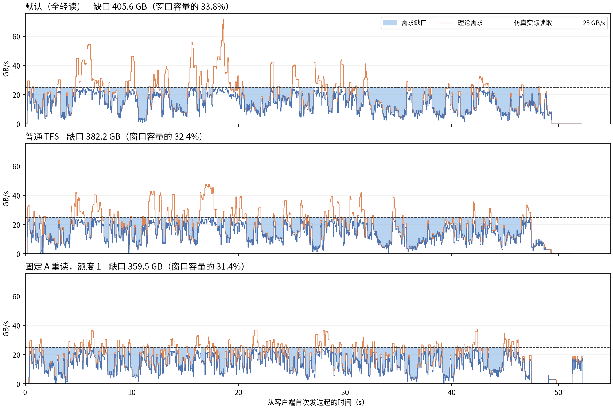
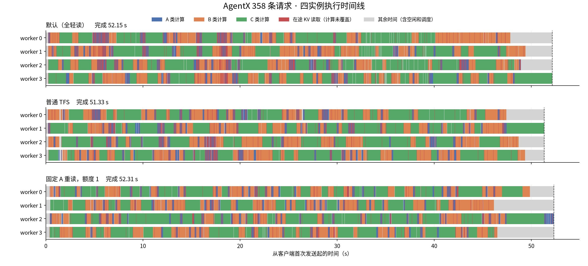

# AgentX 358 条请求的四实例带宽实验

每种策略在同一份 trace 上各运行一次。保持每条请求的类别、prompt 长度、到达时刻和一个输出 token。原计划在 12 秒内发完。四个实例使用 FCFS，每实例同时执行一条请求。六块盘共享 25 GB/s。

## 请求如何调整

每类在指定范围内均匀取目标值，再以固定种子分配给请求。保持 H + M 不变，按 128 token 一个块选取目标附近的 H。单请求理论需求等于 H × 65,536 字节除以该请求的模型计算时间。

| 类别 | 条数 | 单条最低 GB/s | 类内平均 GB/s | 单条最高 GB/s |
|---|---:|---:|---:|---:|
| A | 120 | 15.04 | 17.48 | 19.79 |
| B | 150 | 3.02 | 5.50 | 7.98 |
| C | 88 | 0.00 | 1.50 | 2.96 |

按 token 加权的命中率为 81.53%。三组实际读取均为 699.61 GB。

## 客户端表现

| 策略 | 单请求平均完成耗时 s | 平均完成时刻 s | 整批完成 s | 平均 TTFT s | P95 TTFT s | A 平均 TTFT s | B 平均 TTFT s | C 平均 TTFT s |
|---|---:|---:|---:|---:|---:|---:|---:|---:|
| 默认（全轻读） | 19.317 | 23.864 | 52.151 | 19.315 | 37.121 | 16.808 | 20.546 | 20.634 |
| 普通 TFS | 19.410 | 23.961 | 51.328 | 19.408 | 36.916 | 17.324 | 20.455 | 20.465 |
| 固定 A 重读，额度 1 | 20.076 | 24.624 | 52.311 | 20.074 | 36.849 | 21.350 | 19.324 | 19.612 |

单请求完成耗时从该请求实际发送计到响应结束，对 358 条请求等权取平均。以整批首次发送为零点，358 个响应结束时刻的均值为平均完成时刻，最大值为整批完成时间。TTFT 从每条请求实际发送计到收到首 token。P95 取从小到大排序后第 341 条。三组均成功 358/358。

## 实际分类和带宽

| 策略 | 重读 A/B/C | 同时持有许可的峰值 | 需求峰值 GB/s | 积分区间 s | 超载面积 GB | 缺口面积 GB | 缺口占窗口容量 |
|---|---:|---:|---:|---:|---:|---:|---:|
| 默认（全轻读） | 0/0/0 | 0 | 71.69 | 0.25–48.25 | 125.00 | 405.62 | 33.80% |
| 普通 TFS | 86/1/0 | 2 | 47.76 | 0.25–47.40 | 100.20 | 382.22 | 32.43% |
| 固定 A 重读，额度 1 | 120/0/0 | 1 | 37.11 | 0.40–46.25 | 45.92 | 359.54 | 31.37% |

每 50 ms 一个桶。每组各自在理论需求首次超过 25 GB/s 的桶起点与最后一次超过 25 GB/s 的桶终点之间积分。蓝色阴影为理论需求低于 25 GB/s 的缺口，占比分母为 25 GB/s × 该组窗口时长。实际读取来自六盘仿真的字节记录。

普通 TFS 使用动态 P75 分类和额度。固定方案按输入标签识别 A，全局同时最多发出一个重读许可，收到首 token 后释放。运行检查、逐层检查和准入检查均通过。单轮比较无法估计运行间波动。

## 各 worker 的完成时刻

以整批首次发送为 0 秒。按逐层执行日志确定每条请求的 worker，取该 worker 最后一条客户端响应的结束时刻。四个 worker 等权取均值。

| 策略 | worker 0 秒 | worker 1 秒 | worker 2 秒 | worker 3 秒 | 四实例均值 秒 |
|---|---:|---:|---:|---:|---:|
| 默认（全轻读） | 47.843 | 49.400 | 48.927 | 52.151 | 49.580 |
| 普通 TFS | 47.422 | 51.328 | 48.692 | 49.350 | 49.198 |
| 固定 A 重读，额度 1 | 49.844 | 46.139 | 52.311 | 46.509 | 48.701 |

## 四个实例的执行时间线

三组均按输入 A/B/C 类别着色。红色是存在在途 KV 读取且该实例没有名义计算的时间。灰色含空闲和调度间隙。竖虚线标记客户端整批完成。
