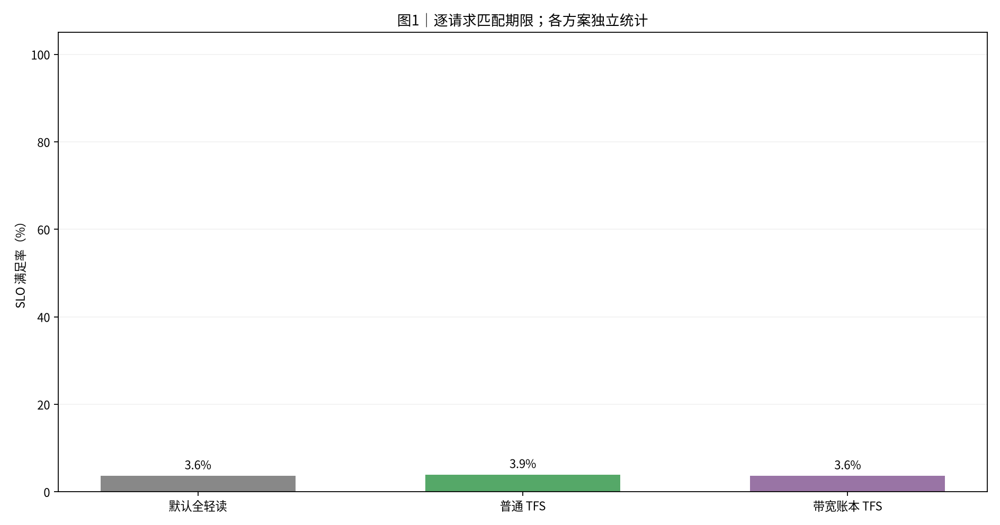
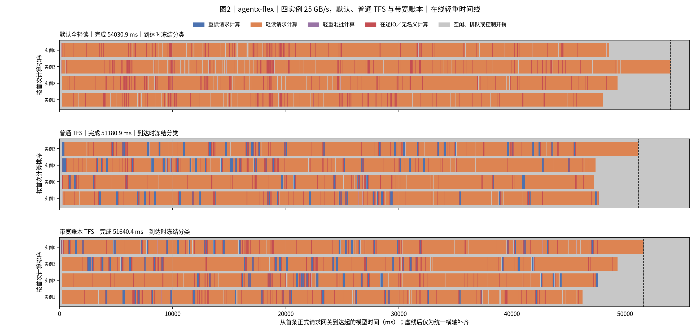
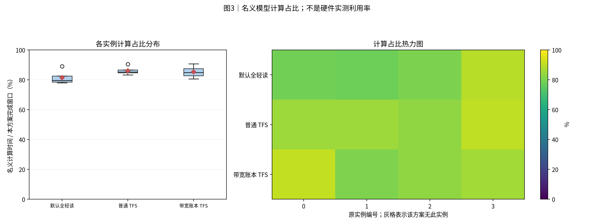
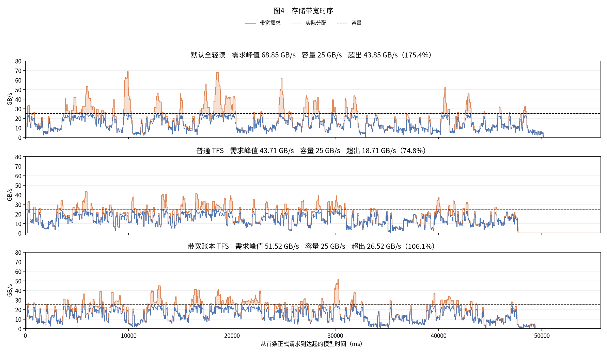
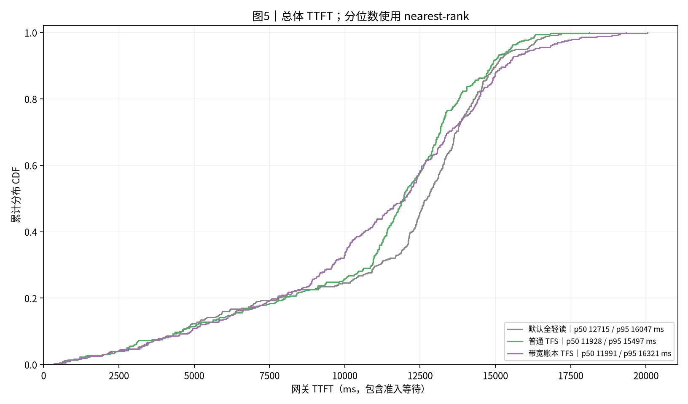
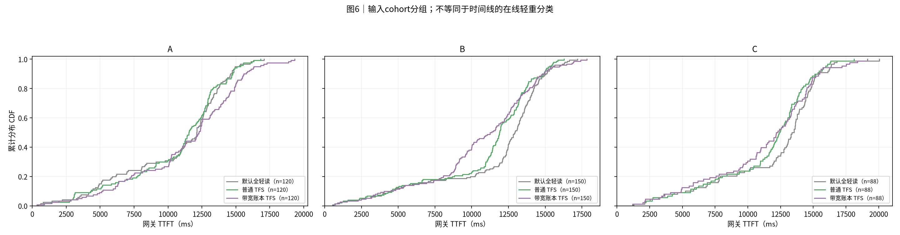
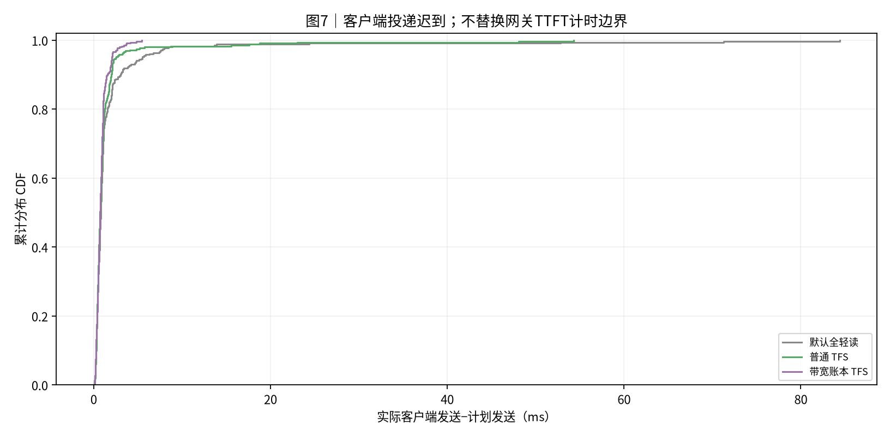

# 实验结果：agentx-flex｜四实例 25 GB/s，默认、普通 TFS 与带宽账本

|项目|约定|
|---|---:|
|执行边界|本轮各方案新运行一次 CPU 进程栈仿真；本报告离线读取冻结日志。|
|方案顺序|默认全轻读 → 普通 TFS → 带宽账本 TFS|
|输入种子 / 重复|每个case独立展示一个冻结运行；种子与重复见附表，未提供时不推断|
|汇总 / 轨迹|不跨case合并样本、不生成置信区间；轨迹保留全部正式请求|
|SLO / TTFT|逐请求匹配deadline；TTFT=first_token−gateway arrival，包含准入等待|
|分组|分类表和CDF使用输入cohort；时间线使用在线轻重判定|
|单位|时间秒/毫秒；容量字节；带宽GB/s=10^9 B/s|
|实验日期|2026-11-25、2026-11-26|
|固定负载|agentx_flex_358_12s_4_25GBps|
|请求数 / 到达窗口|358 / 12 s|
|输入 SHA256|9f77ba7980ed962f6706e87e183278ea6240efce19aa896cdad45b8edeb6e13b|
|读量|699.610 GB|
|资源|四实例、每实例 BS=1、MiniMax 16 层、6 盘共享 25 GB/s，FCFS，α=0.1，关闭强制准入|
|带宽|50ms 积分分桶；实际分配由逐层提交事件在共享六盘模型离线重放；理论需求按执行请求求和|
|客户端与网关|第 0 节使用客户端 TTFT 和完成时间；标准 CDF/主表采用 central 画像到首 token；SLO 使用冻结 deadline。|
|SLO 定义|逐请求 deadline=到达时刻+4×原画像 reference_service_s；保留每条期限和按原公式得到的名义计算。|

## 0. 总判决

- 相比默认全轻读，新 TFS 的整批完成时间变化 -4.4%，平均 TTFT 变化 -3.0%，四实例平均完成时刻变化 -2.6%。
- 相比普通 TFS，新 TFS 的整批完成时间变化 +0.9%，平均 TTFT 变化 +1.1%，四实例平均完成时刻变化 +0.7%。

|指标|默认全轻读|普通 TFS|带宽账本 TFS|
|---|---:|---:|---:|
|客户端整批完成（s）|54.061|51.212|51.670|
|四 worker 完成时刻均值（s）|50.023|48.411|48.731|
|客户端平均 TTFT（s）|19.688|18.887|19.099|
|客户端 P95 TTFT（s）|37.717|36.396|36.067|
|SLO 满足率（%）|3.631|3.911|3.631|
|首层累计 KV 等待（s）|6.586|6.202|6.337|
|后 15 层累计 KV 等待（s）|8.735|5.392|6.418|
|累计 KV 等待合计（s）|15.321|11.594|12.755|

上表的完成时间和 TTFT 为客户端口径；后续标准主表与 CDF 为 central 画像口径。

## 1. 汇总表与 SLO 柱状图

|方案|请求数|完成ms|平均TTFT ms|p95 ms|SLO%|网关等待ms|四个 worker 完成时刻均值（s）|
|---|---:|---:|---:|---:|---:|---:|---:|
|默认全轻读|358|54030.9|11378.2|16046.7|3.6|119.2|50.023|
|普通 TFS|358|51180.9|10978.5|15496.7|3.9|151.8|48.411|
|带宽账本 TFS|358|51640.4|11019.3|16321.2|3.6|115.7|48.731|

以首条正式请求实际发送为 0 秒，按执行 worker 分组取最后一个客户端响应结束时刻。四个 worker 等权取均值。任一 worker 缺少完整记录或未执行请求时，均值标为缺少数据。

|方案|worker 0（s）|worker 1（s）|worker 2（s）|worker 3（s）|四个 worker 完成时刻均值（s）|
|---|---:|---:|---:|---:|---:|
|默认全轻读|48.587|48.063|49.380|54.061|50.023|
|普通 TFS|47.304|47.702|47.428|51.212|48.411|
|带宽账本 TFS|51.670|46.273|47.606|49.376|48.731|

分类结果使用输入cohort：

|方案|分组|请求数|平均TTFT ms|SLO%|
|---|---:|---:|---:|---:|
|默认全轻读|A|120|10578.0|0.8|
|默认全轻读|B|150|11651.2|3.3|
|默认全轻读|C|88|12003.8|8.0|
|普通 TFS|A|120|10637.7|0.8|
|普通 TFS|B|150|10986.0|3.3|
|普通 TFS|C|88|11430.4|9.1|
|带宽账本 TFS|A|120|11344.5|0.8|
|带宽账本 TFS|B|150|10605.9|3.3|
|带宽账本 TFS|C|88|11280.7|8.0|



**读法**：柱高与上表同口径。每条请求使用自身期限判断是否达标。

## 2. 各方案 full-sort-ms 执行时间线




**读法**：蓝重读、橙轻读、紫轻重混批。红色为未被名义计算覆盖的在途IO，灰色含空闲、排队和控制。动态与冻结分类分别标注；直接放行分类仅作参考。虚线右侧仅为统一横轴补齐。

## 3. 模型计算占比分布与热力图




**读法**：箱线和热力图来自同一组逐实例数据。分母是各方案从首次正式到达到末条首token的窗口。该值不是硬件实测利用率。

## 4. 存储带宽时序




**读法**：各方案共用从零起的线性纵轴。橙线为需求，蓝线为实际分配，黑虚线为容量。橙色阴影的高度表示需求超出容量的 GB/s。峰值取图中时间桶的平均需求最大值。

|方案|平均GB/s|需求超订%|实际饱和%|
|---|---:|---:|---:|
|默认全轻读|12.9|26.6|10.5|
|普通 TFS|13.7|22.2|5.2|
|带宽账本 TFS|13.5|27.0|9.7|

## 5. TTFT 累积分布 CDF




**读法**：经验CDF按rank/n绘制，终点为1。期限不同时，SLO必须逐请求匹配，不能由两条CDF交点推算。




**读法**：此处分组来自cohort，可能是历史A/B或业务分类，不用该标签推断在线轻重。

## 6. 机制解释与前序对照

默认强制全轻读，实际 KV 读取保持一致。普通 TFS 冻结进入时的 P75 轻重标记，以重读条数计许可。新方案增加均摊门槛 6.25 GB/s，以原模型需求判重，再将画像带宽四舍五入到整数 B/s，用于 RPC、账本与本地选择。被拒后用剩余带宽和均摊门槛选轻读。

|策略|A 判重/总数|B 判重/总数|C 判重/总数|许可获批|拒绝次数|曾被拒绝或跳过的请求数|
|---|---:|---:|---:|---:|---:|---:|
|默认全轻读|0/120|0/150|0/88|0|0|0|
|普通 TFS|85/120|1/150|0/88|86|79|56|
|带宽账本 TFS|86/120|1/150|0/88|87|82|48|

新 TFS 的累计 KV 等待为 12.755 s，普通 TFS 为 11.594 s，默认策略为 15.321 s。首层等待取提交至存储完成；逐层等待取上一层计算完成至下一层读取完成的正差。跨 worker 求和，不能直接从整批完成时间扣除。时间线红色为在途读取减名义计算的区间，口径与依赖等待不同。

新方案账本峰值为 24.428 GB/s；自身需求大于 25 GB/s 且单独获批 0 次；最后账本归零。本次拒绝后选择轻读：符合上限 73 次，选择最小需求兜底 7 次。沿用上次拒绝上限：符合上限 0 次，兜底 0 次。以上为选队事件计数，同一请求可能多次被选。

普通 TFS 的额度更新次数按额度分布为 `{"1":347,"3":11}`。普通 TFS 的申请 RPC 平均/P95 为 2.367/3.934 ms，新方案为 2.456/4.423 ms。拒绝次数包含重复申请。

## 7. 计算模型与结论限制

本次每种策略仅执行一次。独立路由和 CPU 调度时序有波动。模型计算占比和模拟分配带宽不等于真机 NPU 与 OD 测量；无法据此确认 AIV/HBM 竞争。轻读没有全局预算预留，过载仍可能出现。

普通 TFS有一轮未计入报告。跨宿主休眠，客户端回放失败。客户端成功 0/358 条。该轮日志保留在本机 `agentx-flex-tfs-failed-suspend`，报告使用最终版本的完整验收轮。

## 8. 附表




**读法**：此图描述客户端实际发送相对计划的迟到，不是单次准入RPC耗时。

|方案|实例数|模型计算占比%|运行标识|
|---|---:|---:|---:|
|默认全轻读|4|81.5|{"repeat": 1, "ordering": "FCFS", "alpha": 0.1, "frontend_start": "2026-11-25T18:03:59.668497+08:00", "frontend_stop": "2026-11-25T18:05:30.905592+08:00"}|
|普通 TFS|4|86.0|{"repeat": 1, "ordering": "FCFS", "alpha": 0.1, "frontend_start": "2026-11-26T08:43:08.996817+08:00", "frontend_stop": "2026-11-26T08:44:37.922960+08:00"}|
|带宽账本 TFS|4|85.2|{"repeat": 1, "ordering": "FCFS", "alpha": 0.1, "frontend_start": "2026-11-26T08:55:01.080946+08:00", "frontend_stop": "2026-11-26T08:56:30.428901+08:00"}|

|方案|序列上限|token预算|存储容量GB/s|准入位置 / 规则|计算模型|
|---|---:|---:|---:|---:|---:|
|默认全轻读|1|50000|25.0|scheduler / arrival|未提供|
|普通 TFS|1|50000|25.0|scheduler / arrival|未提供|
|带宽账本 TFS|1|50000|25.0|scheduler / arrival|未提供|

逐请求 H/U、实际归属、理论需求和 KV 等待详见[请求明细](report_data/request_wait_details.csv)。客户端主指标及逐次读取重放最大误差详见[客户端对照](report_data/client_comparison.csv)。

[排除的尝试及原始日志指纹](report_data/excluded_attempts.csv)。

## 9. 验证、数据与复现

已校验请求计数、逐请求SLO、nearest-rank分位数、CDF概率质量、实例时间账本及可用带宽积分。图片人工检查状态见校验文件。

- [校验记录](report_data/source_validation.json)
- [方案汇总](report_data/run_summary.csv)
- [请求明细](report_data/requests.csv)
- [标准重绘数据](report_data/dataset.json.gz)
- [复现入口](reproduce/generate_report.py)

从仓库根目录执行（自动解压冻结数据）：

```bash
python scripts/manage_reports.py redraw "agentx_flex_358_12s_4_25GBps/20261126-090103_默认_TFS_带宽账本" --output <新的输出目录>
```

## 10. 简要解读

对比普通 TFS，带宽账本的 50ms 理论需求峰值从 43.71 变为 51.52 GB/s。客户端平均 TTFT 变化 +1.1%，P95 变化 -0.9%，SLO 满足率变化 -0.3 个百分点。这些指标从不同角度描述一次回放，结合时间线看排队长尾。

带宽账本标重 86/120 条 A。其余 A 按轻读放行，仍会与重读共享链路。图 4 的峰值同账本峰值采用不同口径。
