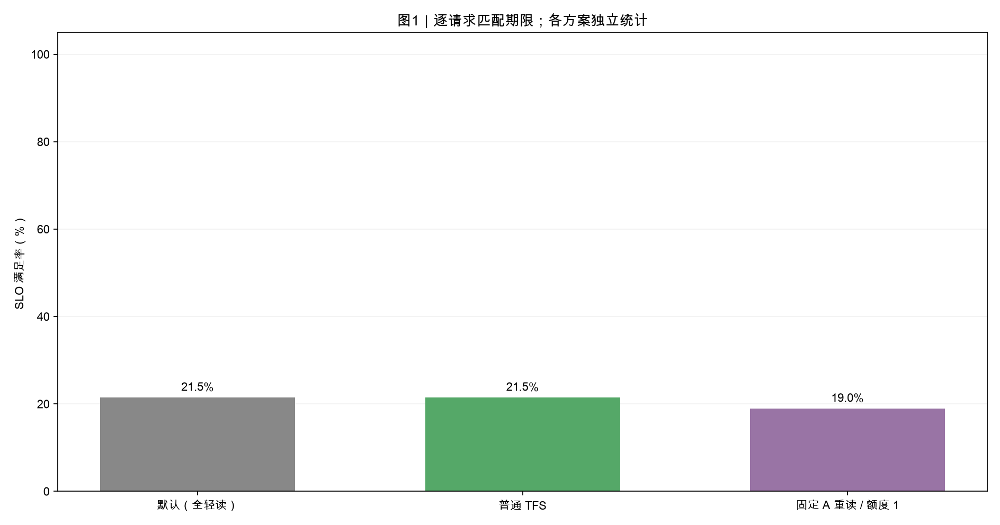
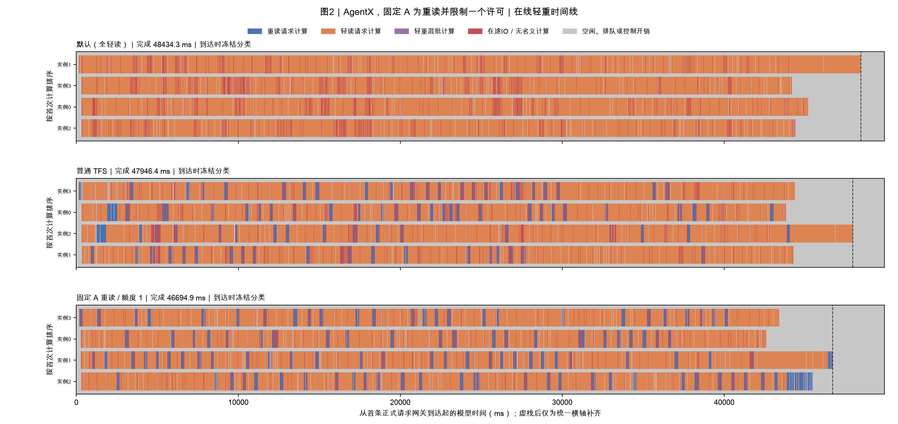
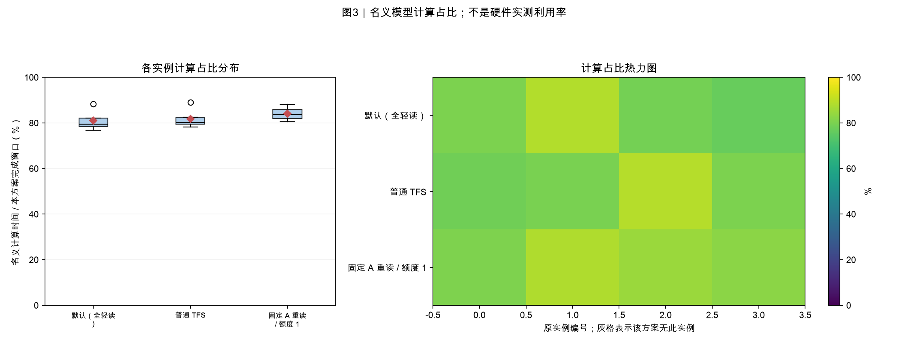
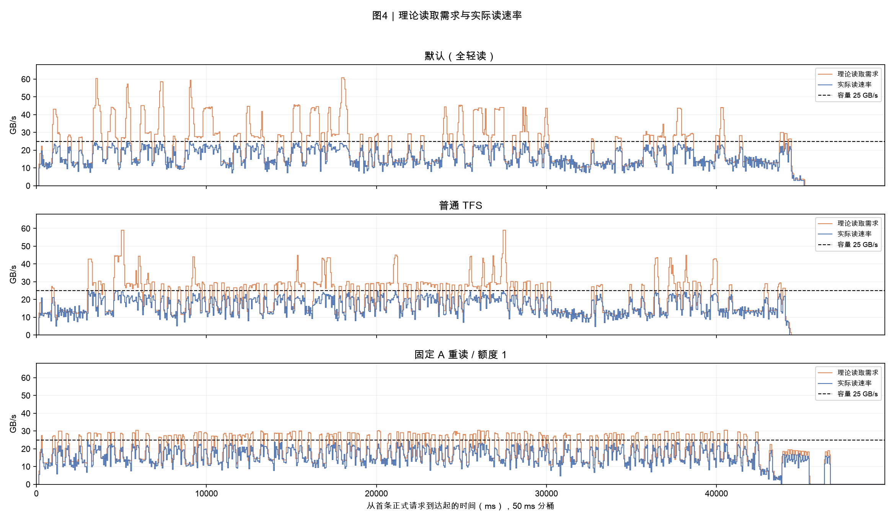
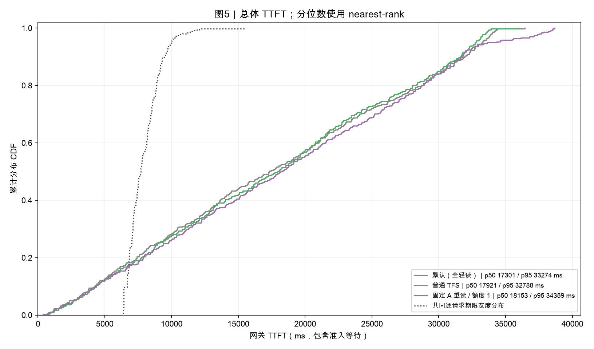
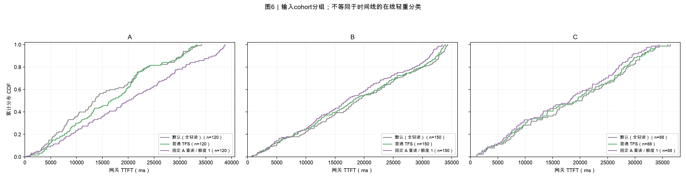
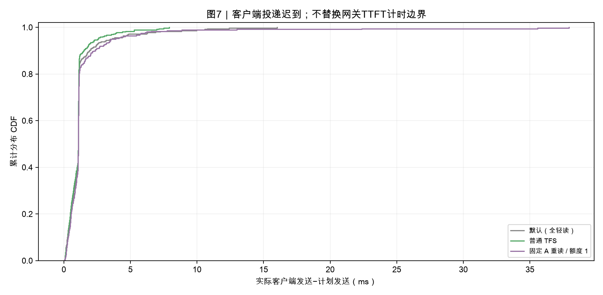

# 实验结果：AgentX，固定 A 为重读并限制一个许可

|项目|约定|
|---|---:|
|执行边界|2026-11-25 在 Mac CPU 进程栈新增固定 A 组一次，默认和普通 TFS 引用同一份输入的上一轮运行。|
|方案顺序|默认（全轻读） → 普通 TFS → 固定 A 重读 / 额度 1|
|输入种子 / 重复|每个case独立展示一个冻结运行；种子与重复见附表，未提供时不推断|
|汇总 / 轨迹|不跨case合并样本、不生成置信区间；轨迹保留全部正式请求|
|SLO / TTFT|逐请求匹配deadline；TTFT=first_token−gateway arrival，包含准入等待|
|分组|分类表和CDF使用输入cohort；时间线使用在线轻重判定|
|单位|时间秒/毫秒；容量字节；带宽GB/s=10^9 B/s|
|输入|358 条，计划到达窗口 12 秒，加权命中率 84.58467%。冻结输入 SHA-256 为 ace4a4a3d4923770f295a13ccb42058bfa17ffdb7f0a93f1d00051a6813b74d9。|
|进程栈|Dynamo 1.2.0、vLLM 0.20.2，4 个执行实例，每步最多 1 条请求。|
|模型与存储|MiniMax 16 层读算流水线，每块 128 token，六盘总容量 25 GB/s，时间倍率 1。|
|准入策略|默认组将全部请求标记为轻读。普通 TFS 使用 P75 冻结分类。实验组按 A/B/C 标签冻结分类，重读额度为 1。两种 TFS 都使用 α=0.1 和首 token 释放，关闭超额放行。|
|本轮 TTFT 与 SLO|首 token 延迟从客户端实际发送开始计时。每条期限是完整 prompt 零命中时名义计算时间的 4 倍。|
|带宽|50 ms 分桶。橙线为活跃请求的理论读取需求，蓝线为六盘实际读速率。|

## 0. 总判决

固定 A 重读、额度为 1 的方案中，120 条 A 都通过重读许可。任何时刻最多有一条 A 执行。原始事件中，两条以上 A 的执行重叠时间为 **0**。

| 方案 | 整批完成（秒） | 平均 TTFT（秒） | P95 TTFT（秒） | SLO 满足率 |
| --- | ---: | ---: | ---: | ---: |
| 默认（全轻读） | 48.434 | 17.646 | 33.274 | 21.51% |
| 普通 TFS | 47.946 | 17.673 | 32.788 | 21.51% |
| 固定 A 重读 / 额度 1 | 46.695 | 18.287 | 34.359 | 18.99% |

### 分档输入

三组使用同一份冻结输入。单条 A 的理论读取需求为 18.04–19.44 GB/s。一条 A 加三条 B/C 的理论需求最高仍可达 30.54 GB/s。

| 输入类 | 请求数 | 命中率 | 平均命中 token | 平均未命中 token | 总读取量 GB | 单条理论需求范围 GB/s |
| --- | ---: | ---: | ---: | ---: | ---: | ---: |
| A | 120 | 96.21% | 34742 | 1367 | 273.23 | 18.04–19.44 |
| B | 150 | 81.13% | 29652 | 6899 | 291.50 | 2.69–3.70 |
| C | 88 | 75.00% | 27939 | 9314 | 161.13 | 0.00–3.40 |

## 1. 汇总表与 SLO 柱状图

|方案|请求数|完成ms|平均TTFT ms|p95 ms|SLO%|网关等待ms|
|---|---:|---:|---:|---:|---:|---:|
|默认（全轻读）|358|48434.3|17646.4|33273.8|21.5|118.7|
|普通 TFS|358|47946.4|17673.0|32788.2|21.5|120.5|
|固定 A 重读 / 额度 1|358|46694.9|18287.2|34359.5|19.0|126.7|

分类结果使用输入cohort：

|方案|分组|请求数|平均TTFT ms|SLO%|
|---|---:|---:|---:|---:|
|默认（全轻读）|A|120|15256.6|25.0|
|默认（全轻读）|B|150|18971.8|19.3|
|默认（全轻读）|C|88|18645.9|20.5|
|普通 TFS|A|120|16513.2|21.7|
|普通 TFS|B|150|18386.1|20.0|
|普通 TFS|C|88|18039.1|23.9|
|固定 A 重读 / 额度 1|A|120|20099.1|14.2|
|固定 A 重读 / 额度 1|B|150|17493.6|20.0|
|固定 A 重读 / 额度 1|C|88|17169.2|23.9|



**读法**：柱高与上表同口径。每条请求使用自身期限判断是否达标。

## 2. 各方案 full-sort-ms 执行时间线




**读法**：蓝重读、橙轻读、紫轻重混批。红色为未被名义计算覆盖的在途IO，灰色含空闲、排队和控制。动态与冻结分类分别标注；直接放行分类仅作参考。虚线右侧仅为统一横轴补齐。

## 3. 模型计算占比分布与热力图




**读法**：箱线和热力图来自同一组逐实例数据。分母是各方案从首次正式到达到末条首token的窗口。该值不是硬件实测利用率。

## 4. 存储带宽时序




**读法**：橙线为理论读取需求。每条活跃请求的贡献是远端 KV 字节除以名义计算时间。蓝线为实际读速率，虚线为存储容量。峰谷面积在首末达到容量的桶之间计算。实际饱和指读速率达到容量的 90%。

|方案|理论峰值 GB/s|理论超载秒数|超载量 GB|缺口量 GB|净超载量 GB|实际均速 GB/s|实际饱和%|
|---|---:|---:|---:|---:|---:|---:|---:|
|默认（全轻读）|60.8|19.4|184.8|265.3|-80.5|15.0|51.9|
|普通 TFS|59.0|20.9|127.4|238.1|-110.6|15.1|52.6|
|固定 A 重读 / 额度 1|30.5|18.5|63.2|234.5|-171.3|15.5|53.7|

## 5. TTFT 累积分布 CDF




**读法**：经验CDF按rank/n绘制，终点为1。期限不同时，SLO必须逐请求匹配，不能由两条CDF交点推算。




**读法**：此处分组来自cohort，可能是历史A/B或业务分类，不用该标签推断在线轻重。

## 6. 机制解释与前序对照

### 准入和理论超载

普通 TFS 根据到达时的 P75 门槛确定轻重。固定 A 方案按输入类别设置轻重，额度从首条请求开始固定为 1。许可仍在首 token 时释放。其余运行参数沿用普通 TFS。下表的重叠时长按原始活跃区间积分。第 4 节的超载时长按 50 ms 分桶。

| 方案 | 至少两条 A 同时执行（秒） | 一条 A 加 B/C 过载（秒） | 理论需求峰值 GB/s | 实际平均读速率 GB/s |
| --- | ---: | ---: | ---: | ---: |
| 默认（全轻读） | 6.891 | 13.681 | 60.81 | 14.99 |
| 普通 TFS | 3.319 | 19.176 | 59.03 | 15.14 |
| 固定 A 重读 / 额度 1 | 0.000 | 21.493 | 30.47 | 15.54 |

| 方案 | A 被标重读 | B/C 被标重读 | 发放许可 | 同时持有许可峰值 | 至少一次未获许可 |
| --- | ---: | ---: | ---: | ---: | ---: |
| 默认（全轻读） | 0 | 0 | 0 | 0 | 0 |
| 普通 TFS | 86 | 2 | 88 | 1 | 64 |
| 固定 A 重读 / 额度 1 | 120 | 0 | 120 | 1 | 102 |

### 按输入类看延迟

| 输入类 | 默认平均 TTFT（秒） | 普通 TFS 平均（秒） | 固定 A 平均（秒） | 固定 A 减普通 TFS（秒） |
| --- | ---: | ---: | ---: | ---: |
| A | 15.257 | 16.513 | 20.099 | +3.586 |
| B | 18.972 | 18.386 | 17.494 | -0.893 |
| C | 18.646 | 18.039 | 17.169 | -0.870 |

## 7. 计算模型与结论限制

三种策略各有一次运行。差值描述本次对照观测。计算占比来自模型的名义工时。网关等待取准入记录中画像到达至提交的时间，首 token 延迟采用客户端时钟。

## 8. 附表




**读法**：此图描述客户端实际发送相对计划的迟到，不是单次准入RPC耗时。

|方案|实例数|模型计算占比%|运行标识|
|---|---:|---:|---:|
|默认（全轻读）|4|81.0|{"全局命中率": 84.58467, "重复": 1, "验收": "通过"}|
|普通 TFS|4|81.8|{"全局命中率": 84.58467, "重复": 1, "验收": "通过"}|
|固定 A 重读 / 额度 1|4|84.0|{"全局命中率": 84.58467, "重复": 1, "验收": "通过"}|

|方案|序列上限|token预算|存储容量GB/s|准入位置 / 规则|计算模型|
|---|---:|---:|---:|---:|---:|
|默认（全轻读）|1|50000|25.0|scheduler / arrival|未提供|
|普通 TFS|1|50000|25.0|scheduler / arrival|未提供|
|固定 A 重读 / 额度 1|1|50000|25.0|scheduler / arrival|未提供|

[分档输入](report_data/cohort_inputs.csv) · [各类结果](report_data/cohort_comparison.csv) · [准入分类](report_data/permit_classification.csv) · [A 执行重叠](report_data/active_a_overlap.csv) · [A 前缀扩展](report_data/a_prefix_extensions.csv)

## 9. 验证、数据与复现

已校验请求计数、逐请求SLO、nearest-rank分位数、CDF概率质量、实例时间账本及可用带宽积分。图片人工检查状态见校验文件。

- [校验记录](report_data/validation.json)
- [方案汇总](report_data/run_summary.csv)
- [请求明细](report_data/requests.csv)
- [标准重绘数据](report_data/dataset.json.gz)
- [复现入口](reproduce/generate_report.py)

在报告目录执行：

```bash
gzip -dk report_data/dataset.json.gz
python reproduce/generate_report.py --dataset report_data/dataset.json --output ../reproduced-report
```

## 10. 简要解读

固定 A 配额可以消除多条 A 叠加。单条 A 与 B/C 同时执行仍可能使理论读取需求超过 25 GB/s。

## 各 worker 收尾时刻

时间从本轮客户端首次发送计到该 worker 最后一个响应结束，单位为秒。

|策略|worker 0|worker 1|worker 2|worker 3|四实例均值|
|---|---:|---:|---:|---:|---:|
|默认（全轻读）|45.199|48.437|44.411|44.192|45.560|
|普通 TFS|43.818|44.296|47.948|44.371|45.108|
|固定 A 重读，额度 1|42.616|46.696|45.465|43.404|44.545|
