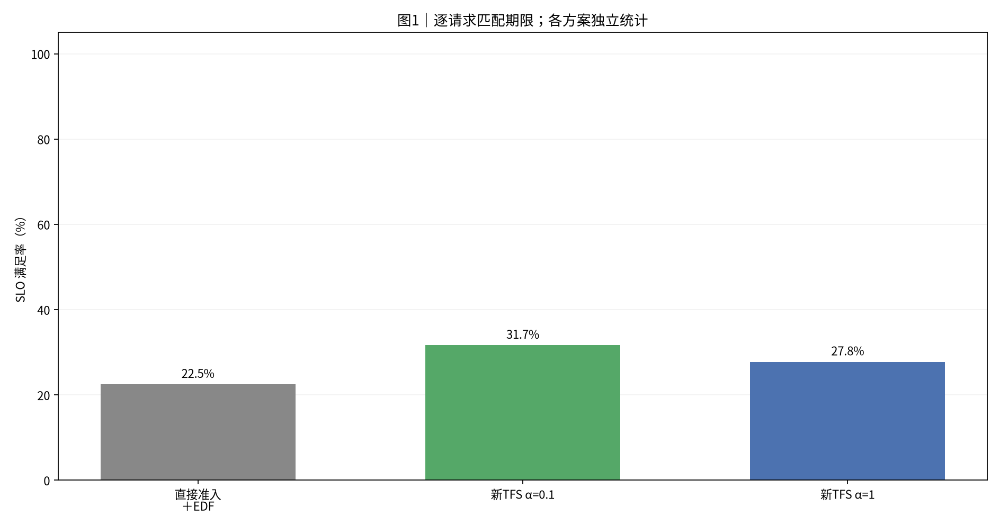
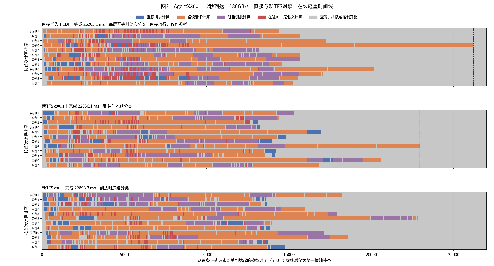
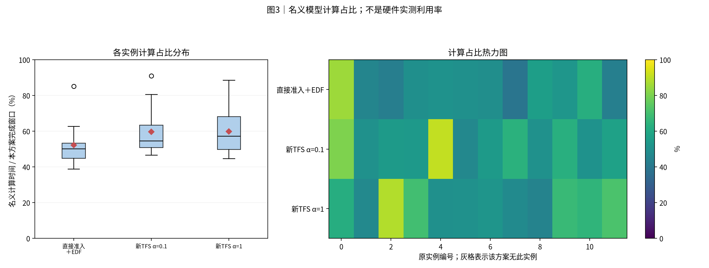
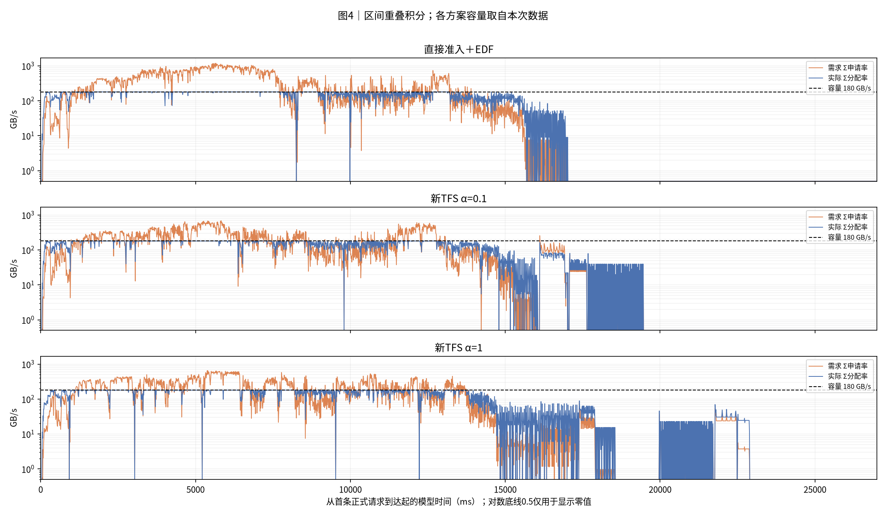
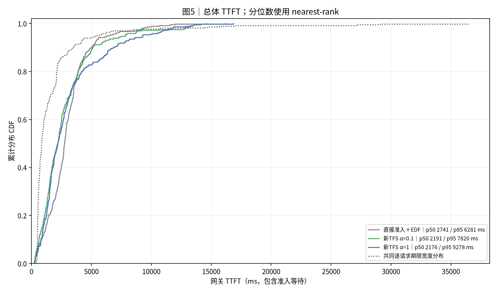
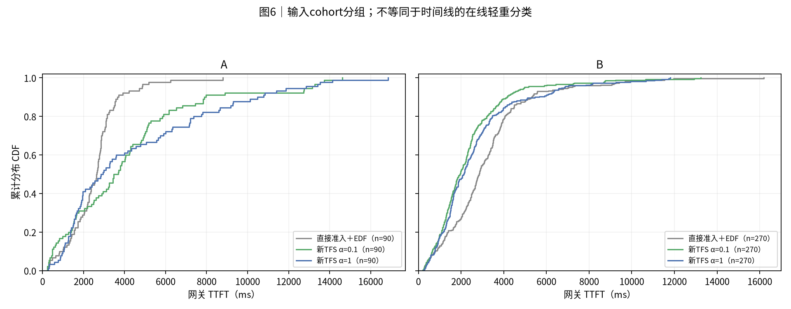
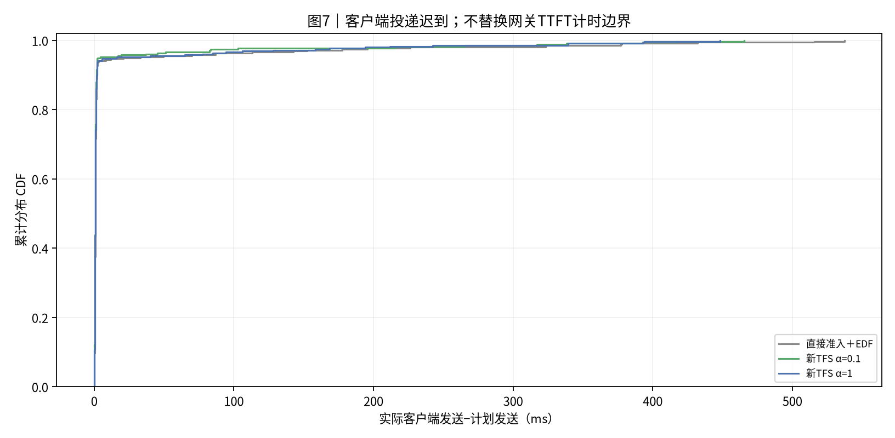

# agentx_random_360_12s_12_180GBps｜直接提交 EDF；TFS EDF α=0.1；TFS EDF α=1

|归档信息|内容|
|---|---|
|报告创建时间|2026-10-30T16:27:07+08:00，Asia/Shanghai|
|实际实验日期|2026-10-30；源记录未提供的精确时刻不推断|
|Benchmark|[agentx_random_360_12s_12_180GBps](../../../benchmark/agentx_random_360_12s_12_180GBps/README.md)|
|本次操作|只归档既有结果；未运行仿真、未改变性能数值；原图字节保持一致|
|归档清单|[manifest.json](manifest.json)、[归档校验](archive_validation.json)|
|原报告标题|实验结果：AgentX360｜12秒到达｜180GB/s｜直接与新TFS对照|

**研究版运行报告**：该 benchmark 当前在交付运行器中仍为 export_only。本文结果来自已完成的研究版实验，不代表交付运行器已实现这套运行合同。


|项目|约定|
|---|---:|
|执行边界|从冻结日志离线整理；本次没有重跑实验|
|方案顺序|直接准入＋EDF → 新TFS α=0.1 → 新TFS α=1|
|输入种子 / 重复|每个case独立展示一个冻结运行；种子与重复见附表，未提供时不推断|
|汇总 / 轨迹|不跨case合并样本、不生成置信区间；轨迹保留全部正式请求|
|SLO / TTFT|逐请求匹配deadline；TTFT=first_token−gateway arrival，包含准入等待|
|分组|分类表和CDF使用输入cohort；时间线使用在线轻重判定|
|单位|时间秒/毫秒；容量字节；带宽GB/s=10^9 B/s|
|实验与整理日期|2026-10-30|
|执行边界补充|本次新执行三轮；固定报告工具仅整理冻结日志，其simulations_run=0不代表没有运行实验|
|负载|AgentX抽中40组的全局第2608—2967条，360条；保持相对间隔缩放至12秒到达|
|命中口径|沿用完整主链组历史理想命中，有效命中97.1307%；block16保留至少一个新块；假设窗口前缓存已在远端，非实测命中|
|资源|12逻辑实例；180GB/s单共享池；K1；block16/30159块；batch≤4/8192新token；78层流水|
|计算|glm5_direct_sum_v1，launch_saving_fraction=1；TP1/DP8/EP8参考画像；关闭本地prefix caching；输出1 token|
|方案|直接准入EDF；新TFS α0.1；新TFS α1；全部EDF；关闭强制准入与四类执行反馈|
|重复与预热|每方案一次有效运行；72预热排空、重置分类历史与正式GC窗口，再执行360正式|
|SLO与TTFT|网关到达→首token，包含准入与排队；逐请求期限=arrival+4×glm5_reference_v3服务时间；客户端另表|
|长上下文|39条超过原131072入口，最长300480；冻结副本guard及max_model_len为300481；原公式系数不变，属于外推|
|版本与RPC|沿用240条实验冻结DV b6aca299ec9888d25435c94013f05d73fd8fa825及同一native扩展；Dynamo runtime原生RPC、最终答复及后台EOF；Kahan仅诊断计数|
|审计目录|/home/zed/.local/share/state-aware-network/audits/agentx360-180gb-12s-20261030-r1|

## 0. 总判决

本次新执行固定360条的三方案对照。12秒指计划到达跨度，不是完成时限；每方案一次有效运行。

|方案|完成ms|平均TTFT ms|p95 ms|SLO%|计算占比%|
|---|---:|---:|---:|---:|---:|
|直接准入＋EDF|26205.1|2978.6|6281.3|22.5|52.2|
|新TFS α=0.1|22936.1|2773.3|7819.9|31.7|59.7|
|新TFS α=1|22893.3|3085.8|9278.1|27.8|59.8|


新TFS α=0.1相对直接准入：完成时间变化-12.47%，平均TTFT变化-6.89%，SLO变化+9.17个百分点。

新TFS α=1相对直接准入：完成时间变化-12.64%，平均TTFT变化+3.60%，SLO变化+5.28个百分点。

本轮完成最快为新TFS α=1，平均TTFT最低为新TFS α=0.1，SLO最高为新TFS α=0.1。需结合p95及分组CDF判断代价，不能由一次运行推断稳定收益。

另有1次失败尝试，未纳入性能；详见第6节。

## 1. 汇总表与 SLO 柱状图

|方案|请求数|完成ms|平均TTFT ms|p95 ms|SLO%|网关等待ms|
|---|---:|---:|---:|---:|---:|---:|
|直接准入＋EDF|360|26205.1|2978.6|6281.3|22.5|0.7|
|新TFS α=0.1|360|22936.1|2773.3|7819.9|31.7|0.5|
|新TFS α=1|360|22893.3|3085.8|9278.1|27.8|0.7|

分类结果使用输入cohort：

|方案|分组|请求数|平均TTFT ms|SLO%|
|---|---:|---:|---:|---:|
|直接准入＋EDF|A|90|2539.5|12.2|
|直接准入＋EDF|B|270|3124.9|25.9|
|新TFS α=0.1|A|90|4128.3|17.8|
|新TFS α=0.1|B|270|2321.6|36.3|
|新TFS α=1|A|90|4441.7|14.4|
|新TFS α=1|B|270|2633.8|32.2|



**读法**：柱高与上表同口径。每条请求使用自身期限判断是否达标。

## 2. 各方案 full-sort-ms 执行时间线




**读法**：蓝重读、橙轻读、紫轻重混批。红色为未被名义计算覆盖的在途IO，灰色含空闲、排队和控制。动态与冻结分类分别标注；直接放行分类仅作参考。虚线右侧仅为统一横轴补齐。

## 3. 模型计算占比分布与热力图




**读法**：箱线和热力图来自同一组逐实例数据。分母是各方案从首次正式到达到末条首token的窗口。该值不是硬件实测利用率。

## 4. 存储带宽时序




**读法**：橙线为需求，蓝线为实际分配，虚线为本次容量。按时间重叠积分，不对不等长事件直接取平均。零值在CSV保留0。

|方案|平均GB/s|需求超订%|实际饱和%|
|---|---:|---:|---:|
|直接准入＋EDF|94.7|34.7|52.6|
|新TFS α=0.1|108.2|33.3|60.1|
|新TFS α=1|108.4|35.0|60.2|

## 5. TTFT 累积分布 CDF




**读法**：经验CDF按rank/n绘制，终点为1。期限不同时，SLO必须逐请求匹配，不能由两条CDF交点推算。




**读法**：此处分组来自cohort，可能是历史A/B或业务分类，不用该标签推断在线轻重。

## 6. 机制解释与前序对照

三方案共用输入、模型、存储、EDF、逐层流水、预热与同一原生扩展。直接准入不执行重读许可门控；新TFS在Scheduler分配slot前申请配额，到达时冻结重读标记，首token释放。α只改变等待重请求的路由分数，α1仍有配额与RPC，不等于直接准入。

|方案|step数|平均batch|batch直方图|准入拒绝次数|最终配额|最低可用GiB|子进程RSS峰值GiB|
|---|---:|---:|---:|---:|---:|---:|---:|
|直接准入＋EDF|169|2.31|{1: 76, 2: 20, 4: 55, 3: 18}|0|不执行|1.17|21.59|
|新TFS α=0.1|192|2.03|{1: 94, 2: 39, 4: 41, 3: 18}|242|5|1.14|21.89|
|新TFS α=1|186|2.10|{1: 86, 2: 33, 4: 38, 3: 29}|501|5|0.90|21.79|


|方案|正式重读请求|峰值占额度|峰值在途IO重请求|配额范围|最终配额|获准RPC均值ms|全部查询均值ms|获准/拒绝调用数|
|---|---:|---:|---:|---:|---:|---:|---:|---:|
|新TFS α=0.1|100|7|7|[4, 20]|5|4.090|2.676|101/242|
|新TFS α=1|99|7|6|[4, 20]|5|4.970|2.793|99/501|


上表RPC从调度侧发起同步acquire到最终答复返回，含线程桥接、Dynamo runtime往返、服务端判断及获准后的路由计分激活；排除预热、被拒后的重试间隔及后台EOF等待。获准后原生slot分配失败会回滚并重试，调用数可能大于重读请求数。额度占用并发与实际未完成层读取请求并发分列，均为全12实例合计。

配额随历史P75变化；最终值不是全过程固定上限。输入分组A90/B270为整段外读压力P75展示，不等于到达冻结标记。中央在线关闭四类执行反馈，报告执行字段由worker日志离线补全，不是中央在线真值。

|方案|客户端平均TTFT ms|客户端同宽SLO%|平均到达迟到ms|最大迟到ms|网关到达跨度s|
|---|---:|---:|---:|---:|---:|
|直接准入＋EDF|3006.9|22.5|12.66|537.3|11.999|
|新TFS α=0.1|2786.3|31.4|9.56|465.6|12.001|
|新TFS α=1|3107.0|27.5|10.54|448.1|12.000|


客户端与网关计时边界分开。图中的红色是在途IO并集减去名义计算，不等于纯读取依赖阻塞；灰色含空闲、排队及控制，不能单凭颜色认定为RPC开销。

失败尝试保留：a1首次在准入服务RPC就绪阶段超过原40秒等待，未提交预热或正式请求；driver确认无存活子进程，未触发内存保护。日志：/home/zed/.local/share/state-aware-network/audits/agentx360-180gb-12s-20261030-r1/12-a1.console.log。按原参数重试，不调整超时或策略，不纳入有效性能，也不作为成功重复。底层延迟原因未由日志确定，不归因为ZMQ冲突。

## 7. 计算模型与结论限制

本机CPU实际运行HTTP、Dynamo路由/RPC、vLLM调度和KV块分配；GLM5/D950PR计算与180GB/s存储是模拟。参考工作量为164.180523实例秒、2480.769528GB外读；12秒计算输入压力114.01%，存储输入压力114.85%，不是实测利用率。

39条超长请求使用原公式外推，最长300480。三方案仅将共用冻结副本长度检查与max_model_len调整为300481，原算子系数不变；继承统一Kahan诊断计数补丁，读取状态与速率不改。

沿用完整历史理想命中，假设窗口前前缀已在远端。关闭本地prefix cache；每请求跨78层读取一次有效前缀。合成token仅保留长度与命中，不复现真实Agent工具依赖。

与此前240条/8秒同为平均30请求每秒，但新增120条改变了工作量、分组、阈值、组批及SLO，不能当作只改到达窗口的对照。每方案一次、固定运行顺序，无置信区间。RSS合计可能重复计算共享页，WSL内存与swap为全局观测。

两实例六请求冒烟覆盖最长上下文；三轮正式运行各72预热加360正式。原生运行验收、逐请求读算量、EDF、路由/配额账本排空、层屏障、独立公式与进程退出通过。固定报告工具进一步校验CDF、带宽积分和时间账本；图表人工检查状态见validation.json。

## 8. 附表




**读法**：此图描述客户端实际发送相对计划的迟到，不是单次准入RPC耗时。

|方案|实例数|模型计算占比%|运行标识|
|---|---:|---:|---:|
|直接准入＋EDF|12|52.2|{"input": "AgentX全局2608—2967条", "planned_window_s": 12, "seed": 416, "repeat": 0, "source_commit": "b6aca299ec9888d25435c94013f05d73fd8fa825"}|
|新TFS α=0.1|12|59.7|{"input": "AgentX全局2608—2967条", "planned_window_s": 12, "seed": 416, "repeat": 0, "source_commit": "b6aca299ec9888d25435c94013f05d73fd8fa825"}|
|新TFS α=1|12|59.8|{"input": "AgentX全局2608—2967条", "planned_window_s": 12, "seed": 416, "repeat": 0, "source_commit": "b6aca299ec9888d25435c94013f05d73fd8fa825"}|

|方案|序列上限|token预算|存储容量GB/s|准入位置 / 规则|计算模型|
|---|---:|---:|---:|---:|---:|
|直接准入＋EDF|4|8192|180.0|gateway / dynamic|glm5_direct_sum_v1|
|新TFS α=0.1|4|8192|180.0|scheduler / arrival|glm5_direct_sum_v1|
|新TFS α=1|4|8192|180.0|scheduler / arrival|glm5_direct_sum_v1|

|方案|客户端平均TTFT ms|客户端同宽SLO%|平均到达迟到ms|最大迟到ms|网关到达跨度s|
|---|---:|---:|---:|---:|---:|
|直接准入＋EDF|3006.9|22.5|12.66|537.3|11.999|
|新TFS α=0.1|2786.3|31.4|9.56|465.6|12.001|
|新TFS α=1|3107.0|27.5|10.54|448.1|12.000|


|方案|step数|平均batch|batch直方图|准入拒绝次数|最终配额|最低可用GiB|子进程RSS峰值GiB|
|---|---:|---:|---:|---:|---:|---:|---:|
|直接准入＋EDF|169|2.31|{1: 76, 2: 20, 4: 55, 3: 18}|0|不执行|1.17|21.59|
|新TFS α=0.1|192|2.03|{1: 94, 2: 39, 4: 41, 3: 18}|242|5|1.14|21.89|
|新TFS α=1|186|2.10|{1: 86, 2: 33, 4: 38, 3: 29}|501|5|0.90|21.79|


|方案|正式重读请求|峰值占额度|峰值在途IO重请求|配额范围|最终配额|获准RPC均值ms|全部查询均值ms|获准/拒绝调用数|
|---|---:|---:|---:|---:|---:|---:|---:|---:|
|新TFS α=0.1|100|7|7|[4, 20]|5|4.090|2.676|101/242|
|新TFS α=1|99|7|6|[4, 20]|5|4.970|2.793|99/501|


## 9. 验证、数据与复现

已校验请求计数、逐请求SLO、nearest-rank分位数、CDF概率质量、实例时间账本及可用带宽积分。图片人工检查状态见校验文件。

- [校验记录](report_data/source_validation.json)
- [方案汇总](report_data/run_summary.csv)
- [请求明细](report_data/requests.csv)
- [标准重绘数据](report_data/dataset.json.gz)
- [复现入口](../../tools/generate_report.py)

在报告目录执行：

```bash
python reproduce/generate_report.py --dataset report_data/dataset.json --output ../reproduced-report
```

## 10. 简要解读

本轮新TFS α=1完成最快，新TFS α=0.1的SLO最高。先核对总体与分组TTFT，再结合时间线、带宽和配额/RPC表判断收益与代价。数据说明本轮表现，不证明单次RPC或α是全部差异的原因。

## 归档与复现补充

本轮选取的原始数据表及配图保留来源指纹。较大的派生数据用 gzip 无损压缩，原始运行日志不随本归档发布。[复现说明](reproduce/README.md)区分数据重绘和完整仿真重跑；源验证记录与归档验证不是同一次验收。
