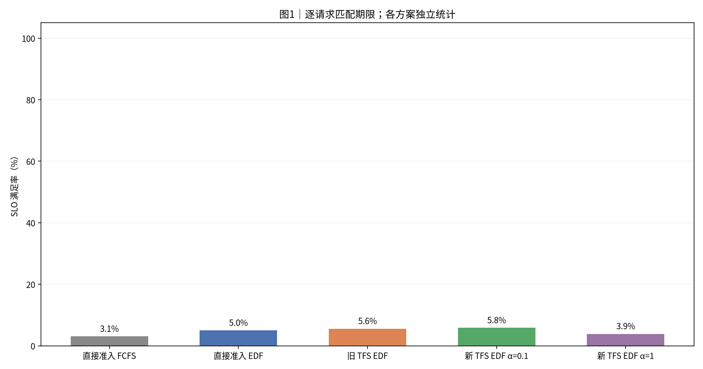
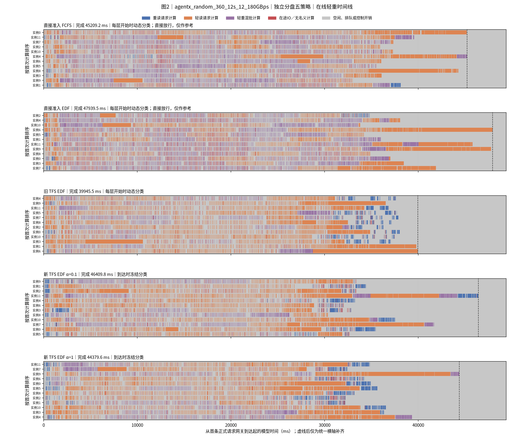
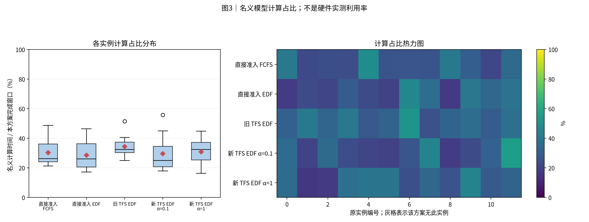
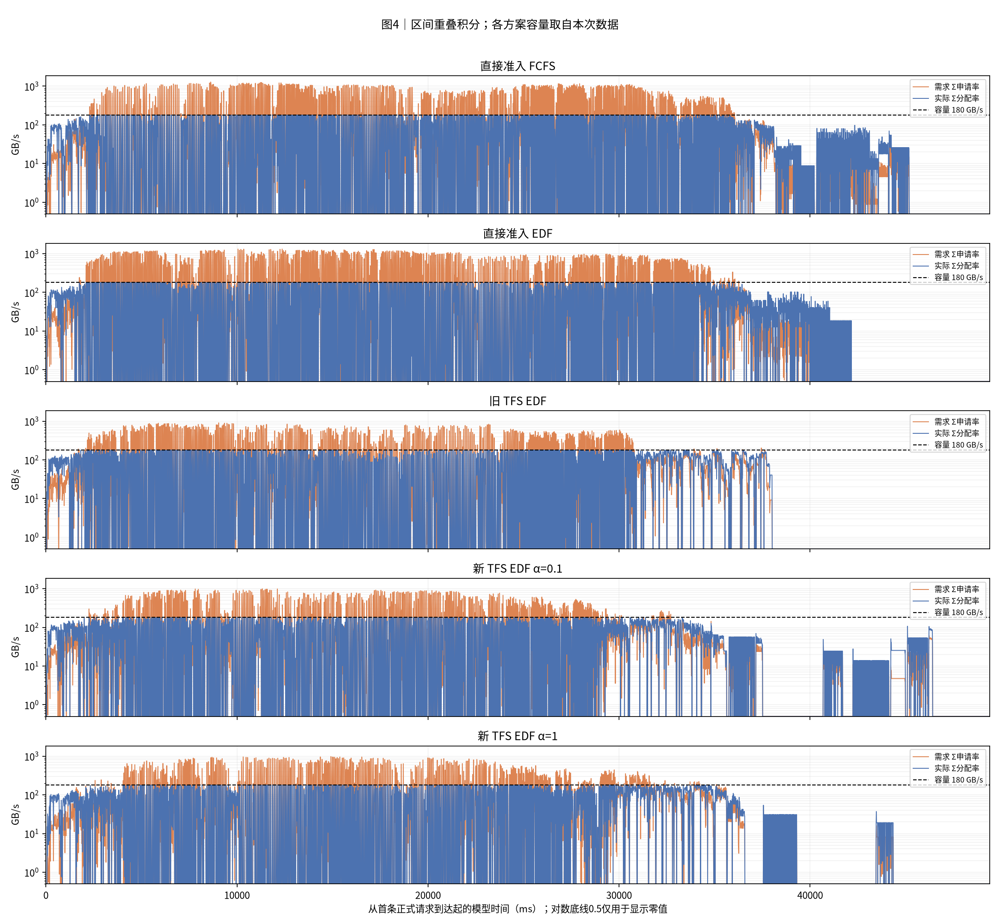
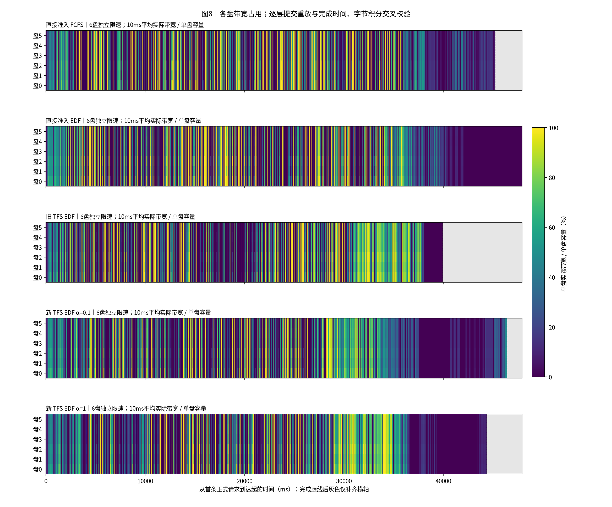
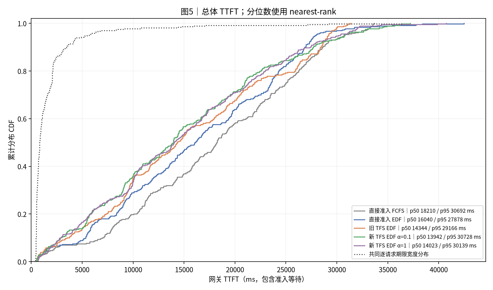
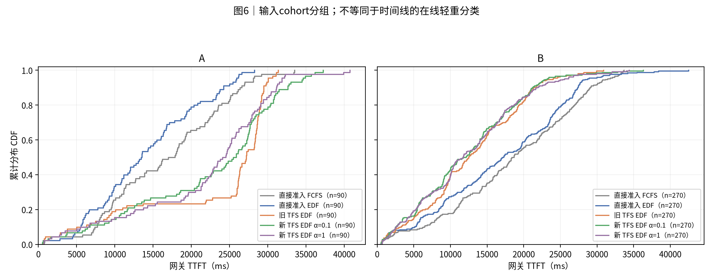
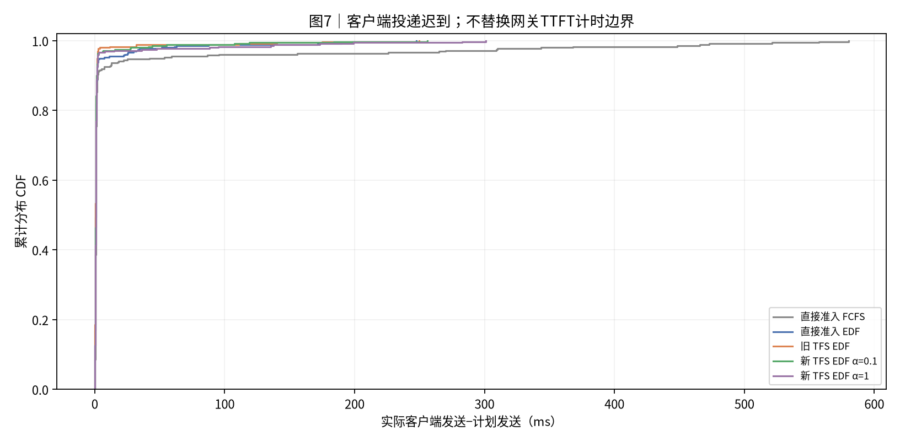

# 实验结果：agentx_random_360_12s_12_180GBps｜独立分盘五策略

报告创建时间：2026-11-02T21:48:28+08:00，Asia/Shanghai。实际运行起止时间见[全部尝试](report_data/execution_attempts.json)。

本任务新跑五种策略各一次，共1800正式请求和360预热请求。本次归档及离线制图没有再运行性能实验。原始大日志留在本机。公开标准dataset省去冗余的逐事件盘速率数组，保留总速率事件和逐盘10ms积分表；重算校验与原汇总一致，图像字节不变，详见[精简校验](report_data/dataset_compaction.json)。其余较大派生表使用无损gzip压缩。

[Benchmark合同](../../../benchmark/agentx_random_360_12s_12_180GBps/README.md) · [本次分盘合同](../../../docs/独立多盘五方案矩阵-20261102.md) · [归档清单](manifest.json) · [归档校验](archive_validation.json)

本组最高SLO满足率为5.83%，对应仍有339条请求未达标。相对改善不等于已达到较高的绝对达标率。SLO按每条请求的`deadline=arrival+4×T0`判断；T0使用冻结模型及总参考带宽估计，不按分盘后的实际执行时间放宽。

|项目|约定|
|---|---:|
|执行边界|本任务新跑：每方案12实例、72预热排空后360正式；下述制图阶段仅离线处理，不重跑实验。|
|方案顺序|直接准入 FCFS → 直接准入 EDF → 旧 TFS EDF → 新 TFS EDF α=0.1 → 新 TFS EDF α=1|
|输入种子 / 重复|每个case独立展示一个冻结运行；种子与重复见附表，未提供时不推断|
|汇总 / 轨迹|不跨case合并样本、不生成置信区间；轨迹保留全部正式请求|
|SLO / TTFT|逐请求匹配deadline；TTFT=first_token−gateway arrival，包含准入等待|
|分组|分类表和CDF使用输入cohort；时间线使用在线轻重判定|
|单位|时间秒/毫秒；容量字节；带宽GB/s=10^9 B/s|
|实验日期|2026-11-02|
|负载|agentx_random_360_12s_12_180GBps|
|固定输入SHA256|eeafecc40e2eb2e5185875e872716056531daecb13bcb768fa9555efacf2e707|
|独立磁盘|6盘 × 30 GB/s；shared_link_Bps=null|
|放置与分配|真实KV块内容HRW哈希；盘内grouped max-min；盘间不借带宽|
|准入范围|TFS仍为总参考带宽的全局配额，没有按盘压力准入或路由|
|排序|仅直接准入FCFS使用FCFS；其余四方案实例内EDF；旧TFS保留网关准入规则|
|计算模型|glm5_direct_sum_v1|
|窗口|12秒计划到达；保留原时间原点|
|实例与预算|12逻辑实例；seq=4；新token预算=8192；K=1|
|种子与重复|输入固定；运行顺序seed20261102；每方案1次有效运行；无置信区间|
|带宽重建|记录逐层提交时刻，在冻结存储模型离线重放；核对每次完成及每盘字节积分；逐盘图按10ms积分分桶|
|反馈与释放|四类执行反馈关闭；首token释放TFS；原始在线快照与离线执行观测分开|
|宿主与边界|WSL/Linux CPU壁钟仿真；名义计算占比不是GPU/NPU实测利用率|

## 0. 总判决

本次固定单次记录中，**新 TFS EDF α=0.1**的SLO满足率最高，为**5.83%**；**旧 TFS EDF**完成最快，为**39945.5 ms**。最高SLO与最短完成时间可能属于不同策略，应按实际目标判断。

## 1. 汇总表与 SLO 柱状图

|方案|请求数|完成ms|平均TTFT ms|p95 ms|SLO%|网关等待ms|
|---|---:|---:|---:|---:|---:|---:|
|直接准入 FCFS|360|45209.2|17908.3|30691.5|3.1|0.7|
|直接准入 EDF|360|47939.5|16134.5|27877.6|5.0|0.5|
|旧 TFS EDF|360|39945.5|15302.1|29165.5|5.6|5066.9|
|新 TFS EDF α=0.1|360|46409.8|14655.7|30727.9|5.8|0.4|
|新 TFS EDF α=1|360|44379.6|14715.3|30139.0|3.9|0.5|

分类结果使用输入cohort：

|方案|分组|请求数|平均TTFT ms|SLO%|
|---|---:|---:|---:|---:|
|直接准入 FCFS|A|90|16613.7|0.0|
|直接准入 FCFS|B|270|18339.9|4.1|
|直接准入 EDF|A|90|14071.2|1.1|
|直接准入 EDF|B|270|16822.3|6.3|
|旧 TFS EDF|A|90|22831.6|1.1|
|旧 TFS EDF|B|270|12792.3|7.0|
|新 TFS EDF α=0.1|A|90|22171.7|1.1|
|新 TFS EDF α=0.1|B|270|12150.4|7.4|
|新 TFS EDF α=1|A|90|21768.4|0.0|
|新 TFS EDF α=1|B|270|12364.2|5.2|



**读法**：柱高与上表同口径。每条请求使用自身期限判断是否达标。

## 2. 各方案 full-sort-ms 执行时间线




**读法**：蓝重读、橙轻读、紫轻重混批。红色为未被名义计算覆盖的在途IO，灰色含空闲、排队和控制。动态与冻结分类分别标注；直接放行分类仅作参考。虚线右侧仅为统一横轴补齐。

## 3. 模型计算占比分布与热力图




**读法**：箱线和热力图来自同一组逐实例数据。分母是各方案从首次正式到达到末条首token的窗口。该值不是硬件实测利用率。

## 4. 存储带宽时序




**读法**：橙线为需求，蓝线为实际分配，虚线为本次容量。按时间重叠积分，不对不等长事件直接取平均。零值在CSV保留0。

|方案|平均GB/s|需求超订%|实际饱和%|
|---|---:|---:|---:|
|直接准入 FCFS|54.9|21.3|29.2|
|直接准入 EDF|51.7|21.2|27.6|
|旧 TFS EDF|62.1|18.8|33.0|
|新 TFS EDF α=0.1|53.5|15.7|28.4|
|新 TFS EDF α=1|55.9|17.2|29.7|




**读法**：各行是一块独立限速盘，颜色为10ms桶内平均实际带宽占比；灰色只补齐完成后的横轴。不能用总带宽平均值代替单盘热点。

## 5. TTFT 累积分布 CDF




**读法**：经验CDF按rank/n绘制，终点为1。期限不同时，SLO必须逐请求匹配，不能由两条CDF交点推算。




**读法**：此处分组来自cohort，可能是历史A/B或业务分类，不用该标签推断在线轻重。

## 6. 机制解释与前序对照

本次30次正式运行均为新运行。本报告使用其中同一负载的五次有效运行；没有复用历史共享池结果。旧TFS也使用EDF，因此旧TFS与新TFS的排序差异不再混入FCFS/EDF。

相对本组直接准入EDF的变化如下。完成时间变化为负表示更快，SLO变化单位为百分点。

|方案|SLO变化pp|完成时间变化%|平均TTFT变化ms|
|---|---|---|---|
|直接准入 FCFS|-1.94|-5.70|+1773.8|
|直接准入 EDF|+0.00|+0.00|+0.0|
|旧 TFS EDF|+0.56|-16.68|-832.4|
|新 TFS EDF α=0.1|+0.83|-3.19|-1478.8|
|新 TFS EDF α=1|-1.11|-7.43|-1419.2|

机制边界：旧TFS在网关先占额度，再向实例下发，动态更新轻重判定；新TFS先下发，再在Scheduler执行KV分配前查询额度，到达时冻结轻重标记。α只折扣等待重读的路由负载，获准时补齐。两类TFS均在首token释放额度；α=1也不等于旧TFS，因为准入位置与分类时机仍不同。

独立磁盘按已有HRW内容哈希分配块，盘内独立限速。本次TFS仍按总参考带宽计算全局标量配额，并未读取某块盘的即时热点。因而总额有余量不能保证每块盘都有余量；是否形成热点应看图8与逐盘表。

正式请求的准入RPC与配额如下。RPC均值包含获准和拒绝的单次往返，只统计正式请求；没有Scheduler额度查询的策略写“不适用”，不是0 ms。最大持有量与最终cap是不同指标，cap可随P75变化。

|方案|正式获准数|获准事件峰值重读持有|最终cap|查询次数|拒绝次数|单次均值ms|单次p95ms|
|---|---|---|---|---|---|---|---|
|直接准入 FCFS|360|70|5|0|0|不适用|不适用|
|直接准入 EDF|360|69|5|0|0|不适用|不适用|
|旧 TFS EDF|360|10|5|0|0|不适用|不适用|
|新 TFS EDF α=0.1|101|7|5|1588|1487|1.410|2.740|
|新 TFS EDF α=1|100|8|5|937|837|1.690|3.796|

获准数的口径：网关模式为全部请求生成reservation；Scheduler模式只为重读生成permit，因此两者的获准数不能直接当作同口径重读请求数。表中峰值仅取获准事件的held_after，不包含单独阈值更新引起的持有量变化，也不代表实际在途IO并发。直接准入虽然记录持有量，但不受cap限制。最终cap不等于全程固定cap。

这些统计不能单独把TTFT差异归因于RPC。路由分布、重复拒绝、实例队列、组批和读算重叠都会改变完整时间线；本次没有用单一均值替代这些执行路径。

真实原生调度批次如下，均排除预热。一次schedule的token数是实际新增token预算使用量；分块请求可在多次schedule出现。

|方案|schedule数|平均batch|最大batch|平均token/步|最大token/步|
|---|---|---|---|---|---|
|直接准入 FCFS|138|2.86|4|4835.4|8192|
|直接准入 EDF|144|2.75|4|4633.9|8192|
|旧 TFS EDF|192|2.09|4|3475.4|8192|
|新 TFS EDF α=0.1|171|2.30|4|3902.2|8192|
|新 TFS EDF α=1|170|2.32|4|3925.2|8192|


## 7. 计算模型与结论限制

每方案仅一次有效运行。固定作业顺序seed20261102；该种子只打乱30种组合的运行顺序，不改变负载内部请求顺序。没有重复层级或置信区间，不能把单次排名写成稳定收益。

计算使用`glm5_direct_sum_v1`，固定TP/DP/EP参考布局；不是12卡实机测量。输入token命中率为97.1307%。AgentX命中来自原组完整历史的理想远端前缀，不代表冷启动或实测命中；39条超出131072上下文，公式显式外推至300480，未进行设备定标。

计算模型给出的名义时长不含全部Python、RPC、系统唤醒和进程排队开销。红色是在途IO减去名义计算后的时间并集，不等于纯存储依赖阻塞；灰色包含空闲、排队和控制。四类执行反馈关闭；报告读取本地事件离线补全事实，不能把这些离线观测写成调度器运行期可见的状态。

独立盘没有共享链路瓶颈，盘间不能借带宽。每次读取完成时间与逐盘字节积分均通过冻结模型重放交叉校验；这验证带宽重建，不等于再次测量性能。不同负载保留不同计算模型，不跨负载合并CDF或性能排名。

保留失败证据：r1最后一组短冒烟因1秒指标采样未捕获非零预留而失败。原生selector日志明确有正raw_prefill_blocks；验收器增加该交叉证据，仍检查原生最小分选择和最终零账本。运行策略与采样频率未改。修正后336项回归与6组冒烟通过，才开始r2正式矩阵。其他正式尝试见本报告来源记录。

## 8. 附表




**读法**：此图描述客户端实际发送相对计划的迟到，不是单次准入RPC耗时。

|方案|实例数|模型计算占比%|运行标识|
|---|---:|---:|---:|
|直接准入 FCFS|12|30.3|{"seed": 20261102, "repeat": 1, "started_at": "2026-11-02T20:44:16.433722+08:00", "finished_at": "2026-11-02T20:47:49.638877+08:00", "run_name": "direct-fcfs"}|
|直接准入 EDF|12|28.6|{"seed": 20261102, "repeat": 1, "started_at": "2026-11-02T21:09:53.835875+08:00", "finished_at": "2026-11-02T21:13:31.609073+08:00", "run_name": "direct"}|
|旧 TFS EDF|12|34.4|{"seed": 20261102, "repeat": 1, "started_at": "2026-11-02T21:22:45.443642+08:00", "finished_at": "2026-11-02T21:26:04.032280+08:00", "run_name": "old-tfs"}|
|新 TFS EDF α=0.1|12|29.5|{"seed": 20261102, "repeat": 1, "started_at": "2026-11-02T21:14:44.135641+08:00", "finished_at": "2026-11-02T21:18:10.505919+08:00", "run_name": "tfs-a01"}|
|新 TFS EDF α=1|12|30.9|{"seed": 20261102, "repeat": 1, "started_at": "2026-11-02T20:47:49.668944+08:00", "finished_at": "2026-11-02T20:51:21.807422+08:00", "run_name": "tfs-a1"}|

|方案|序列上限|token预算|存储容量GB/s|准入位置 / 规则|计算模型|
|---|---:|---:|---:|---:|---:|
|直接准入 FCFS|4|8192|180.0|gateway / dynamic|glm5_direct_sum_v1|
|直接准入 EDF|4|8192|180.0|gateway / dynamic|glm5_direct_sum_v1|
|旧 TFS EDF|4|8192|180.0|gateway / dynamic|glm5_direct_sum_v1|
|新 TFS EDF α=0.1|4|8192|180.0|scheduler / arrival|glm5_direct_sum_v1|
|新 TFS EDF α=1|4|8192|180.0|scheduler / arrival|glm5_direct_sum_v1|

输入与计划窗口的静态压力用于识别负载规模，不是执行期实测利用率：

- 输入/命中/新增token：23,255,872 / 22,588,592 / 667,280。
- 总KV读取：2480.770 GB。
- 计划到达窗口：12 s。
- 独立计算时间之和：164.181 实例秒；除以12实例×窗口为114.01%。
- 总读取量除以6×30 GB/s×窗口为114.85%。该比值不能反映盘内偏斜。

时间账本占比如下，分母为各自12实例×完成窗口。

|方案|名义计算%|红色在途IO%|灰色%|
|---|---|---|---|
|直接准入 FCFS|30.29|5.29|64.42|
|直接准入 EDF|28.57|6.65|64.79|
|旧 TFS EDF|34.44|3.91|61.65|
|新 TFS EDF α=0.1|29.50|3.44|67.06|
|新 TFS EDF α=1|30.87|3.70|65.43|

正式读取的逐盘字节分布如下。相同输入的字节分布应相同，平均GB/s随完成窗口变化；预热不计入此表。

|方案|磁盘|读取GB|窗口均值GB/s|读取占比%|
|---|---|---|---|---|
|直接准入 FCFS|0|444.736|9.837|17.93|
|直接准入 FCFS|1|413.190|9.139|16.66|
|直接准入 FCFS|2|427.029|9.446|17.21|
|直接准入 FCFS|3|398.260|8.809|16.05|
|直接准入 FCFS|4|400.745|8.864|16.15|
|直接准入 FCFS|5|396.809|8.777|16.00|
|直接准入 EDF|0|444.736|9.277|17.93|
|直接准入 EDF|1|413.190|8.619|16.66|
|直接准入 EDF|2|427.029|8.908|17.21|
|直接准入 EDF|3|398.260|8.308|16.05|
|直接准入 EDF|4|400.745|8.359|16.15|
|直接准入 EDF|5|396.809|8.277|16.00|
|旧 TFS EDF|0|444.736|11.134|17.93|
|旧 TFS EDF|1|413.190|10.344|16.66|
|旧 TFS EDF|2|427.029|10.690|17.21|
|旧 TFS EDF|3|398.260|9.970|16.05|
|旧 TFS EDF|4|400.745|10.032|16.15|
|旧 TFS EDF|5|396.809|9.934|16.00|
|新 TFS EDF α=0.1|0|444.736|9.583|17.93|
|新 TFS EDF α=0.1|1|413.190|8.903|16.66|
|新 TFS EDF α=0.1|2|427.029|9.201|17.21|
|新 TFS EDF α=0.1|3|398.260|8.581|16.05|
|新 TFS EDF α=0.1|4|400.745|8.635|16.15|
|新 TFS EDF α=0.1|5|396.809|8.550|16.00|
|新 TFS EDF α=1|0|444.736|10.021|17.93|
|新 TFS EDF α=1|1|413.190|9.310|16.66|
|新 TFS EDF α=1|2|427.029|9.622|17.21|
|新 TFS EDF α=1|3|398.260|8.974|16.05|
|新 TFS EDF α=1|4|400.745|9.030|16.15|
|新 TFS EDF α=1|5|396.809|8.941|16.00|

完整配置、逐请求、真实batch、准入和带宽重建核对表保存在report_data。标准dataset足以重绘8张图；原始层事件、原生二进制和上游依赖不随公开报告发布。

## 9. 验证、数据与复现

已校验请求计数、逐请求SLO、nearest-rank分位数、CDF概率质量、实例时间账本及可用带宽积分。图片人工检查状态见校验文件。

- [校验记录](report_data/source_validation.json)
- [方案汇总](report_data/run_summary.csv)
- [请求明细](report_data/requests.csv)
- [标准重绘数据](report_data/dataset.json.gz)
- [复现入口](reproduce/generate_report.py)

从仓库根目录执行（自动解压标准dataset到临时目录）：

```bash
python scripts/manage_reports.py redraw "agentx_random_360_12s_12_180GBps/20261102-214828_多盘_直接FCFS+EDF_旧TFS-EDF_新TFS-EDF-a0.1+a1" --output <新的输出目录>
```

## 10. 简要解读

先看图1比较SLO，再看图2中尾部与空泡；图4和图8分别给出总带宽及逐盘带宽。当前拓扑为6盘×30 GB/s，各盘独立限速。TFS使用全局配额，本次结果只能评价这一机制在独立盘上的表现，不能证明逐盘压力感知策略的收益。
