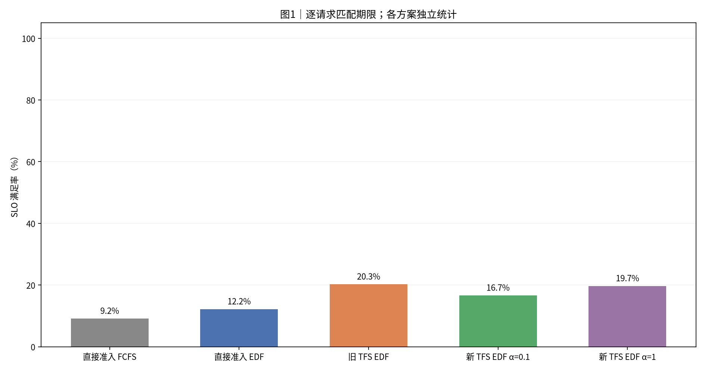
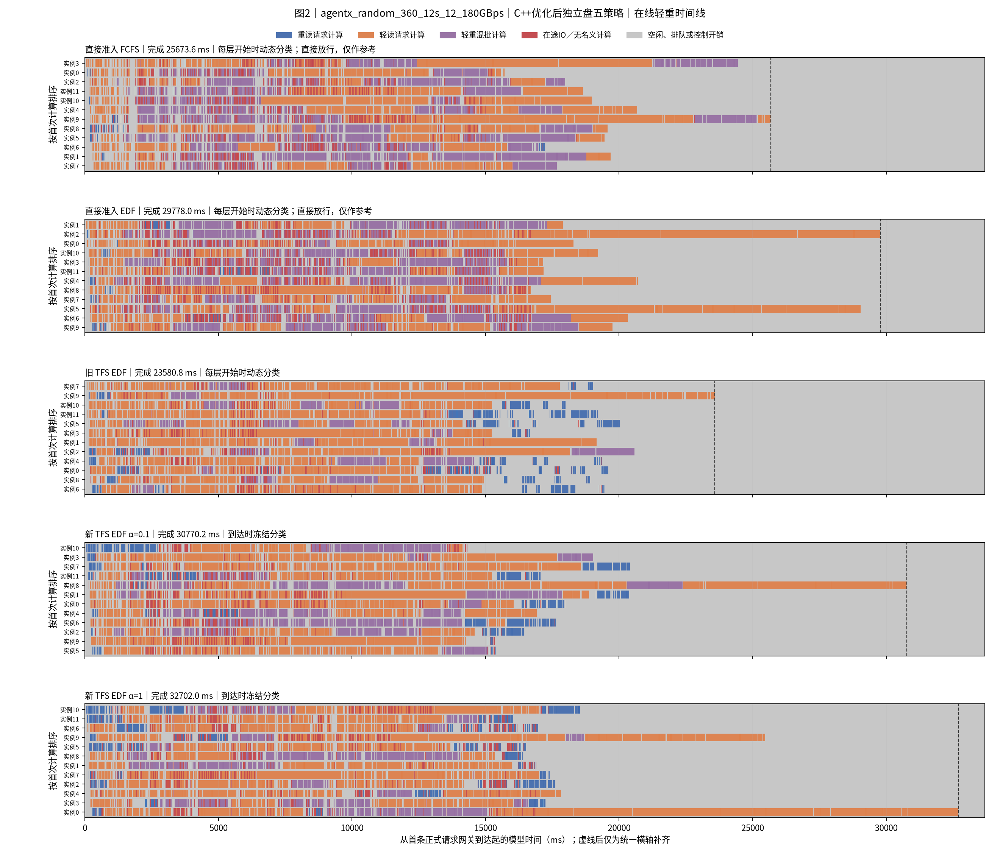
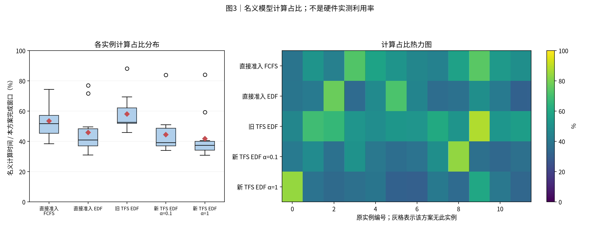
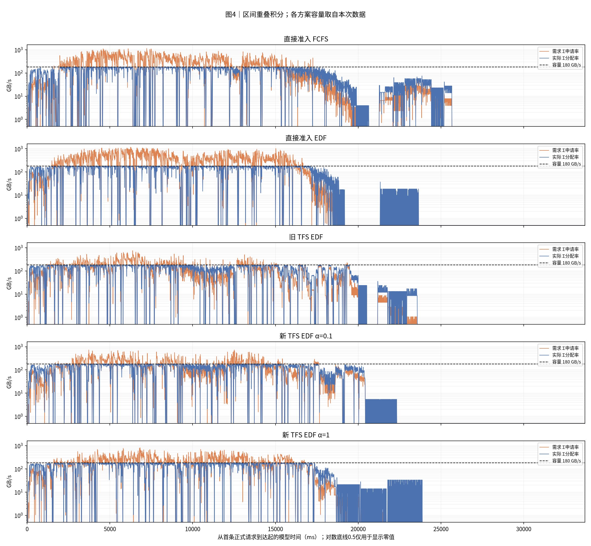
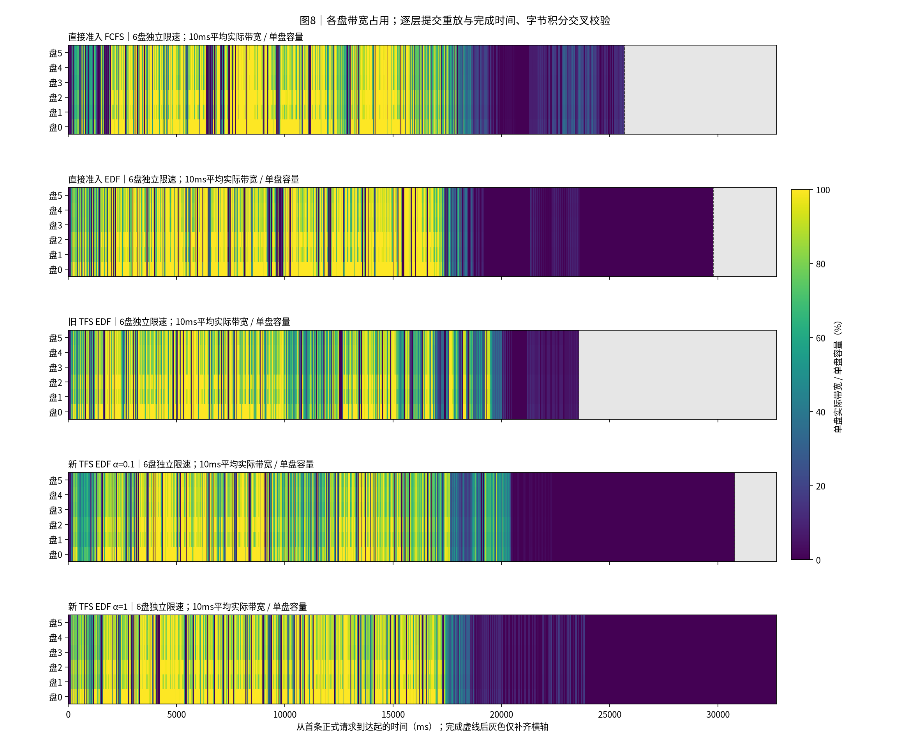
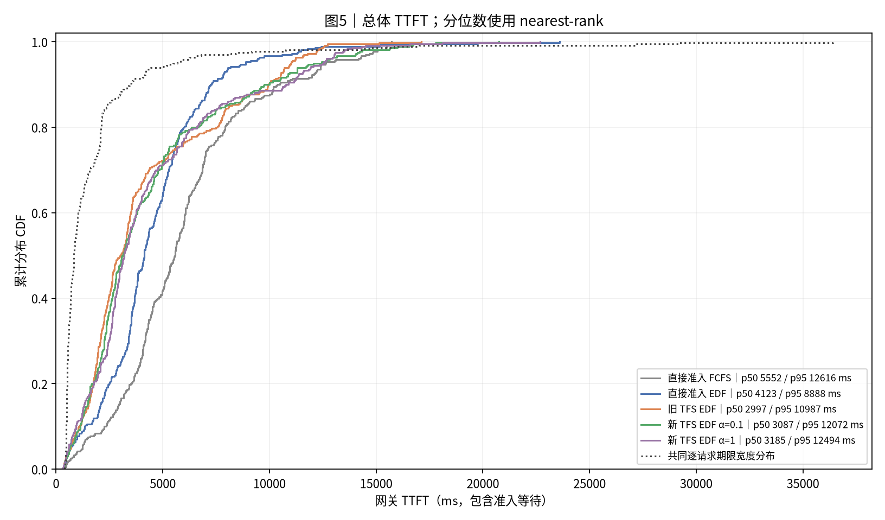
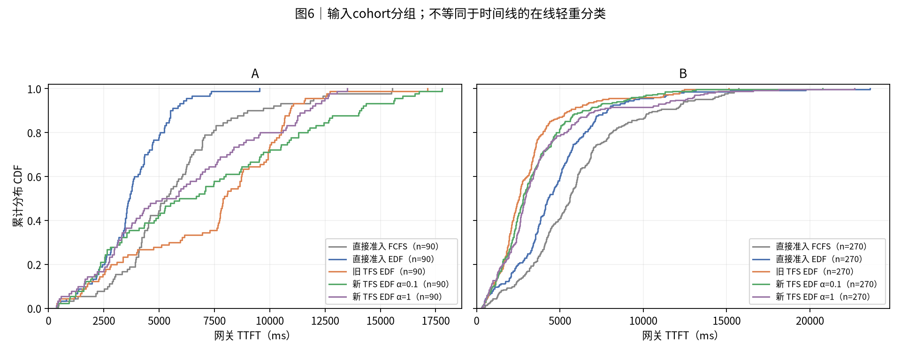
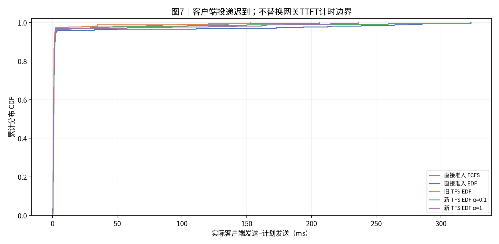

# 实验结果：agentx_random_360_12s_12_180GBps｜C++优化后独立盘五策略

归档创建时间：2026-11-03T19:44:02+08:00（Asia/Shanghai）。本报告对应本轮新执行的五次正式运行，共1800条正式请求、360条预热请求；制图与归档阶段不重跑性能实验。运行起止见[全部尝试](report_data/execution_attempts.json)。

 所有方案使用C++存储后端，固定源码为`8edf27a4148275a70bc67342caadc5cd8245e05f`，运行核心继承`5721537`。相同benchmark的历史报告另存，不覆盖旧结果。八张PNG保持源文件字节不变；大表gzip压缩，标准数据省去重复逐事件盘数组，保留总速率事件及逐盘10ms积分表；汇总与原CSV一致。大型原始事件留在本机。

 [Benchmark合同](../../../benchmark/agentx_random_360_12s_12_180GBps/README.md) · [独立盘矩阵](../../../docs/独立多盘五方案矩阵-20261102.md) · [C++说明](../../../docs/CPP独立盘存储后端-20261103.md) · [归档清单](manifest.json) · [归档校验](archive_validation.json) · [精简校验](report_data/dataset_compaction.json)

|项目|约定|
|---|---:|
|执行边界|本任务新跑：每方案12实例、72预热排空后360正式；下述制图阶段仅离线处理，不重跑实验。|
|方案顺序|直接准入 FCFS → 直接准入 EDF → 旧 TFS EDF → 新 TFS EDF α=0.1 → 新 TFS EDF α=1|
|输入种子 / 重复|每个case独立展示一个冻结运行；种子与重复见附表，未提供时不推断|
|汇总 / 轨迹|不跨case合并样本、不生成置信区间；轨迹保留全部正式请求|
|SLO / TTFT|逐请求匹配deadline；TTFT=first_token−gateway arrival，包含准入等待|
|分组|分类表和CDF使用输入cohort；时间线使用在线轻重判定|
|单位|时间秒/毫秒；容量字节；带宽GB/s=10^9 B/s|
|实验日期|2026-11-03|
|负载|agentx_random_360_12s_12_180GBps|
|固定输入SHA256|eeafecc40e2eb2e5185875e872716056531daecb13bcb768fa9555efacf2e707|
|存储后端|cpp|
|独立磁盘|6盘 × 30 GB/s；shared_link_Bps=null|
|放置与分配|真实KV块内容HRW哈希；盘内grouped max-min；盘间不借带宽|
|准入范围|TFS仍为总参考带宽的全局配额，没有按盘压力准入或路由|
|排序|仅直接准入FCFS使用FCFS；其余四方案实例内EDF；旧TFS保留网关准入规则|
|计算模型|glm5_direct_sum_v1|
|窗口|12秒计划到达；保留原时间原点|
|实例与预算|12逻辑实例；seq=4；新token预算=8192；K=1|
|种子与重复|输入固定；运行顺序seed20261102；每方案1次有效运行；无置信区间|
|带宽重建|记录逐层提交时刻，在冻结存储模型离线重放；核对每次完成及每盘字节积分；逐盘图按10ms积分分桶|
|反馈与释放|四类执行反馈关闭；首token释放TFS；原始在线快照与离线执行观测分开|
|宿主与边界|WSL/Linux CPU壁钟仿真；名义计算占比不是GPU/NPU实测利用率|
|代码版本|8edf27a4148275a70bc67342caadc5cd8245e05f（运行核心继承5721537）|
|运行后端|C++进度/完成/逐盘带宽缓存；Python保留元数据；poll/locked、0.5 ms轮询|
|单测与本轮验收|348项完整回归、6次冒烟、30次正式运行；逐次读取完成与逐盘字节积分另核对|

## 0. 总判决

本次单次轨迹中，**旧 TFS EDF**的SLO最高，为**20.28%**；**旧 TFS EDF**完成最快，为**23580.8ms**。相对直接EDF的变化见第6节。全部为C++优化后独立盘仿真；相对改善不代表已达到较高绝对达标率。

## 1. 汇总表与 SLO 柱状图

|方案|请求数|完成ms|平均TTFT ms|p95 ms|SLO%|网关等待ms|
|---|---:|---:|---:|---:|---:|---:|
|直接准入 FCFS|360|25673.6|5945.0|12616.5|9.2|0.5|
|直接准入 EDF|360|29778.0|4498.4|8887.7|12.2|0.5|
|旧 TFS EDF|360|23580.8|4175.9|10987.5|20.3|1513.0|
|新 TFS EDF α=0.1|360|30770.2|4361.8|12072.0|16.7|0.4|
|新 TFS EDF α=1|360|32702.0|4402.8|12493.6|19.7|0.4|

分类结果使用输入cohort：

|方案|分组|请求数|平均TTFT ms|SLO%|
|---|---:|---:|---:|---:|
|直接准入 FCFS|A|90|5736.3|2.2|
|直接准入 FCFS|B|270|6014.6|11.5|
|直接准入 EDF|A|90|3764.8|3.3|
|直接准入 EDF|B|270|4742.9|15.2|
|旧 TFS EDF|A|90|7318.5|6.7|
|旧 TFS EDF|B|270|3128.3|24.8|
|新 TFS EDF α=0.1|A|90|7022.7|3.3|
|新 TFS EDF α=0.1|B|270|3474.8|21.1|
|新 TFS EDF α=1|A|90|5971.4|5.6|
|新 TFS EDF α=1|B|270|3879.9|24.4|



**读法**：柱高与上表同口径。每条请求使用自身期限判断是否达标。

## 2. 各方案 full-sort-ms 执行时间线




**读法**：蓝重读、橙轻读、紫轻重混批。红色为未被名义计算覆盖的在途IO，灰色含空闲、排队和控制。动态与冻结分类分别标注；直接放行分类仅作参考。虚线右侧仅为统一横轴补齐。

## 3. 模型计算占比分布与热力图




**读法**：箱线和热力图来自同一组逐实例数据。分母是各方案从首次正式到达到末条首token的窗口。该值不是硬件实测利用率。

## 4. 存储带宽时序




**读法**：橙线为需求，蓝线为实际分配，虚线为本次容量。按时间重叠积分，不对不等长事件直接取平均。零值在CSV保留0。

|方案|平均GB/s|需求超订%|实际饱和%|
|---|---:|---:|---:|
|直接准入 FCFS|96.6|35.9|51.4|
|直接准入 EDF|83.3|36.5|44.4|
|旧 TFS EDF|105.2|22.9|56.0|
|新 TFS EDF α=0.1|80.6|20.4|42.9|
|新 TFS EDF α=1|75.9|24.9|40.4|




**读法**：各行是一块独立限速盘，颜色为10ms桶内平均实际带宽占比；灰色只补齐完成后的横轴。不能用总带宽平均值代替单盘热点。

## 5. TTFT 累积分布 CDF




**读法**：经验CDF按rank/n绘制，终点为1。期限不同时，SLO必须逐请求匹配，不能由两条CDF交点推算。




**读法**：此处分组来自cohort，可能是历史A/B或业务分类，不用该标签推断在线轻重。

## 6. 机制解释与前序对照

本次六负载、五策略共30次正式运行均重新执行。本报告包含其中同一负载的五次有效运行。全部使用C++优化后端。相对本组直接准入EDF的变化如下。完成时间变化为负表示更快，SLO变化单位为百分点。

|方案|SLO变化pp|完成时间变化%|平均TTFT变化ms|
|---|---|---|---|
|直接准入 FCFS|-3.06|-13.78|+1446.7|
|直接准入 EDF|+0.00|+0.00|+0.0|
|旧 TFS EDF|+8.06|-20.81|-322.5|
|新 TFS EDF α=0.1|+4.44|+3.33|-136.6|
|新 TFS EDF α=1|+7.50|+9.82|-95.6|

旧TFS在网关先占额度后下发，动态判定轻重；新TFS先下发，在Scheduler分配KV前申请许可，到达时冻结轻重标记。α折扣等待重读的路由负载，获准后补齐；资源预留仍完整。两类TFS都在首token释放额度。α=1与旧TFS仍有准入位置和分类时机差异。

逐盘HRW放置及盘内max-min保持原语义。C++执行进度、完成判断和逐盘带宽缓存，仍保留服务锁与0.5ms轮询。TFS读取总参考带宽并执行全局标量配额，本次未增加逐盘压力路由。

正式请求准入记录如下。网关模式为全部请求生成reservation，Scheduler模式只为重读生成permit，获准数不能直接当作同口径重读数。持有峰值取获准事件held_after，不等于实际在途IO并发，也不包含单独阈值更新事件。最终cap不代表全程固定cap。RPC统计包含获准与拒绝的单次往返，未使用Scheduler额度RPC的策略写“不适用”。

|方案|正式获准数|获准事件持有峰值|最终cap|RPC次数|拒绝次数|RPC均值ms|RPC p95ms|
|---|---|---|---|---|---|---|---|
|直接准入 FCFS|360|39|5|0|0|不适用|不适用|
|直接准入 EDF|360|31|5|0|0|不适用|不适用|
|旧 TFS EDF|360|7|5|0|0|不适用|不适用|
|新 TFS EDF α=0.1|101|7|5|709|608|1.731|4.968|
|新 TFS EDF α=1|99|7|5|1148|1049|1.791|4.038|

RPC均值不能单独解释端到端TTFT。路由、重复拒绝、实例队列、组批、读算重叠与宿主唤醒共同影响轨迹。实际原生schedule统计如下，已排除预热；分块请求可出现在多个schedule中。

|方案|schedule数|平均batch|最大batch|平均新增token/步|最大新增token/步|
|---|---|---|---|---|---|
|直接准入 FCFS|143|2.76|4|4666.3|8192|
|直接准入 EDF|154|2.53|4|4333.0|8192|
|旧 TFS EDF|202|1.93|4|3303.4|8192|
|新 TFS EDF α=0.1|181|2.17|4|3686.6|8192|
|新 TFS EDF α=1|188|2.08|4|3549.4|8192|

与2026-11-02的Python后端独立盘历史记录对照：

|方案|历史Python完成ms|本次C++完成ms|完成缩短%|历史SLO%|本次SLO%|
|---|---|---|---|---|---|
|直接准入 FCFS|45209.2|25673.6|+43.2|3.06|9.17|
|直接准入 EDF|47939.5|29778.0|+37.9|5.00|12.22|
|旧 TFS EDF|39945.5|23580.8|+41.0|5.56|20.28|
|新 TFS EDF α=0.1|46409.8|30770.2|+33.7|5.83|16.67|
|新 TFS EDF α=1|44379.6|32702.0|+26.3|3.89|19.72|

两轮保留相同固定输入、到达、拓扑、模型与策略合同，但在不同时间执行，原Python尚无本次缓存优化；本次同时使用C++和缓存。每组合各一次，历史对照只能描述观察变化，不能单独分解语言、缓存和宿主时序的贡献。当前五策略内部也只有单次轨迹。


## 7. 计算模型与结论限制

输入固定；30组合顺序seed=20261102，该种子不改变请求内部顺序。每组合一次有效运行，不给置信区间或稳定排名。计算模型为`glm5_direct_sum_v1`，12个逻辑实例不是12卡硬件实测。输入token命中率为97.1307%。AgentX使用原组历史计算的理想远端前缀，39条请求超出131072上下文，公式显式外推至300480，未做真实设备定标。

名义计算时长不含全部RPC、Python、唤醒和排队开销。红色为在途IO并集减去名义计算，不能当作纯读取阻塞；灰色含空闲、排队和控制。四类执行反馈关闭，离线观测不是调度器运行期状态。不同负载保留不同计算模型，不跨负载合并CDF或胜率。

所有正式运行前均通过本组冒烟。当前记录中失败尝试共0次，全部尝试保留在运行来源中；失败重试不计为重复样本。逐层完成时刻和逐盘字节积分通过Python参考模型重放核对，该核对验证语义及绘图，不是再次测量性能。


## 8. 附表




**读法**：此图描述客户端实际发送相对计划的迟到，不是单次准入RPC耗时。

|方案|实例数|模型计算占比%|运行标识|
|---|---:|---:|---:|
|直接准入 FCFS|12|53.4|{"seed": 20261102, "repeat": 1, "storage_backend": "cpp", "started_at": "2026-11-03T18:52:09.474419+08:00", "finished_at": "2026-11-03T18:55:13.742399+08:00", "run_name": "direct-fcfs"}|
|直接准入 EDF|12|45.9|{"seed": 20261102, "repeat": 1, "storage_backend": "cpp", "started_at": "2026-11-03T19:15:53.308441+08:00", "finished_at": "2026-11-03T19:18:59.686624+08:00", "run_name": "direct"}|
|旧 TFS EDF|12|58.1|{"seed": 20261102, "repeat": 1, "storage_backend": "cpp", "started_at": "2026-11-03T19:27:35.090057+08:00", "finished_at": "2026-11-03T19:30:35.955432+08:00", "run_name": "old-tfs"}|
|新 TFS EDF α=0.1|12|44.5|{"seed": 20261102, "repeat": 1, "storage_backend": "cpp", "started_at": "2026-11-03T19:20:08.021715+08:00", "finished_at": "2026-11-03T19:23:18.105228+08:00", "run_name": "tfs-a01"}|
|新 TFS EDF α=1|12|41.8|{"seed": 20261102, "repeat": 1, "storage_backend": "cpp", "started_at": "2026-11-03T18:55:13.761618+08:00", "finished_at": "2026-11-03T18:58:27.557999+08:00", "run_name": "tfs-a1"}|

|方案|序列上限|token预算|存储容量GB/s|准入位置 / 规则|计算模型|
|---|---:|---:|---:|---:|---:|
|直接准入 FCFS|4|8192|180.0|gateway / dynamic|glm5_direct_sum_v1|
|直接准入 EDF|4|8192|180.0|gateway / dynamic|glm5_direct_sum_v1|
|旧 TFS EDF|4|8192|180.0|gateway / dynamic|glm5_direct_sum_v1|
|新 TFS EDF α=0.1|4|8192|180.0|scheduler / arrival|glm5_direct_sum_v1|
|新 TFS EDF α=1|4|8192|180.0|scheduler / arrival|glm5_direct_sum_v1|

静态规模：输入/命中/新增token为23,255,872/22,588,592/667,280；正式读取2480.770GB；计划到达窗口12s。独立计算时长之和164.181实例秒，除以12×窗口为114.01%；读取量除以6×30GB/s×窗口为114.85%。这些比值是静态需求，不是执行利用率，也不反映盘内偏斜。

|方案|名义计算%|红色在途IO%|灰色%|
|---|---|---|---|
|直接准入 FCFS|53.40|6.99|39.61|
|直接准入 EDF|45.95|9.79|44.26|
|旧 TFS EDF|58.09|4.83|37.08|
|新 TFS EDF α=0.1|44.51|4.09|51.41|
|新 TFS EDF α=1|41.85|5.20|52.95|

正式请求逐盘读取量与完成窗口内均值如下，排除预热。相同输入下逐盘字节应相同，均值随完成时间变化。

|方案|盘|读取GB|窗口均值GB/s|读取占比%|
|---|---|---|---|---|
|直接准入 FCFS|0|444.736|17.323|17.93|
|直接准入 FCFS|1|413.190|16.094|16.66|
|直接准入 FCFS|2|427.029|16.633|17.21|
|直接准入 FCFS|3|398.260|15.512|16.05|
|直接准入 FCFS|4|400.745|15.609|16.15|
|直接准入 FCFS|5|396.809|15.456|16.00|
|直接准入 EDF|0|444.736|14.935|17.93|
|直接准入 EDF|1|413.190|13.876|16.66|
|直接准入 EDF|2|427.029|14.340|17.21|
|直接准入 EDF|3|398.260|13.374|16.05|
|直接准入 EDF|4|400.745|13.458|16.15|
|直接准入 EDF|5|396.809|13.326|16.00|
|旧 TFS EDF|0|444.736|18.860|17.93|
|旧 TFS EDF|1|413.190|17.522|16.66|
|旧 TFS EDF|2|427.029|18.109|17.21|
|旧 TFS EDF|3|398.260|16.889|16.05|
|旧 TFS EDF|4|400.745|16.995|16.15|
|旧 TFS EDF|5|396.809|16.828|16.00|
|新 TFS EDF α=0.1|0|444.736|14.453|17.93|
|新 TFS EDF α=0.1|1|413.190|13.428|16.66|
|新 TFS EDF α=0.1|2|427.029|13.878|17.21|
|新 TFS EDF α=0.1|3|398.260|12.943|16.05|
|新 TFS EDF α=0.1|4|400.745|13.024|16.15|
|新 TFS EDF α=0.1|5|396.809|12.896|16.00|
|新 TFS EDF α=1|0|444.736|13.600|17.93|
|新 TFS EDF α=1|1|413.190|12.635|16.66|
|新 TFS EDF α=1|2|427.029|13.058|17.21|
|新 TFS EDF α=1|3|398.260|12.178|16.05|
|新 TFS EDF α=1|4|400.745|12.254|16.15|
|新 TFS EDF α=1|5|396.809|12.134|16.00|

完整配置、逐请求、batch、准入和C++源码SHA存于标准数据及辅助表。逐盘图按10ms积分分桶。大规模原始层/RPC事件、上游依赖和原生二进制留在本机。

## 9. 验证、数据与复现

已校验请求计数、逐请求SLO、nearest-rank分位数、CDF概率质量、实例时间账本及可用带宽积分。图片人工检查状态见校验文件。

- [校验记录](report_data/source_validation.json)
- [方案汇总](report_data/run_summary.csv)
- [请求明细](report_data/requests.csv)
- [标准重绘数据](report_data/dataset.json.gz)
- [复现入口](reproduce/generate_report.py)

从仓库根目录执行（自动解压）：

```bash
python scripts/manage_reports.py redraw "agentx_random_360_12s_12_180GBps/20261103-194402_CPP多盘_直接FCFS+EDF_旧TFS-EDF_新TFS-EDF-a0.1+a1" --output <新的输出目录>
```

## 10. 简要解读

先看图1的逐请求SLO，再看图2的尾部与空泡。图4看总带宽，图8看6块独立盘的带宽。当前最快方案与最高SLO方案可能不同。第6节给出历史Python对照，但两期单次结果不足以证明稳定策略优势。
