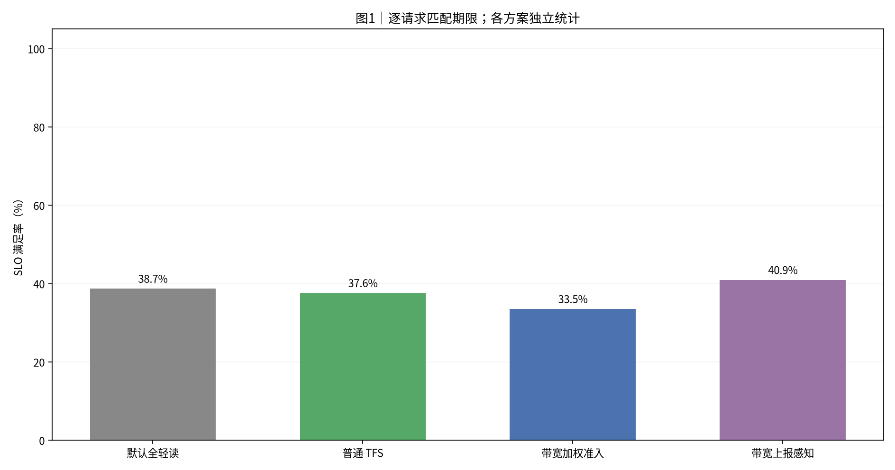
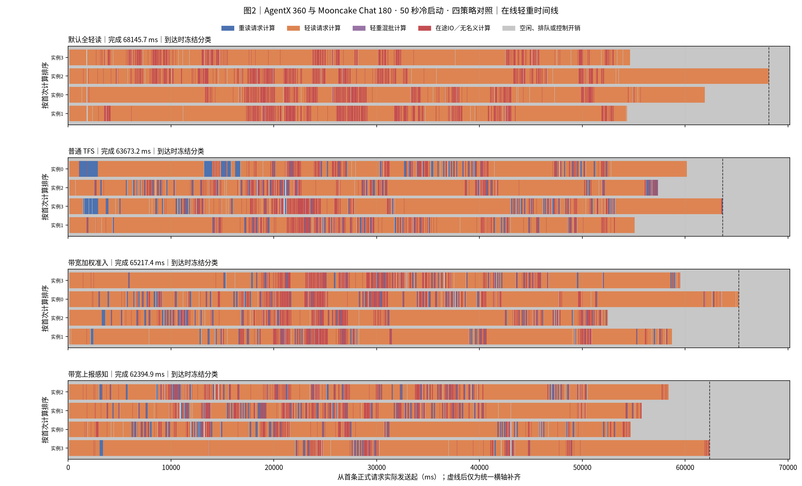
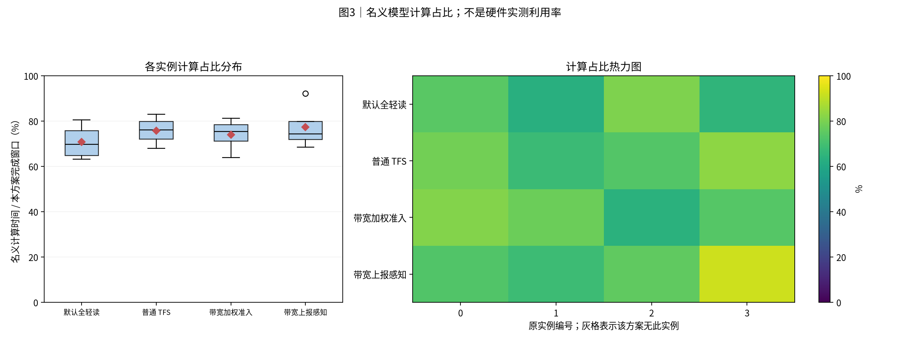
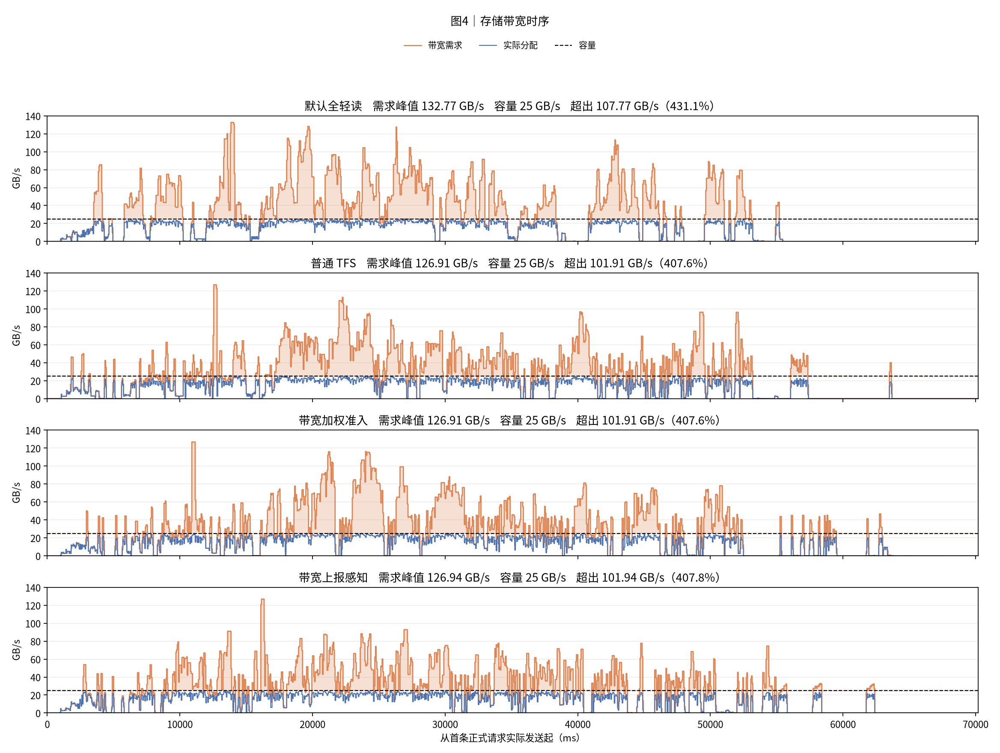
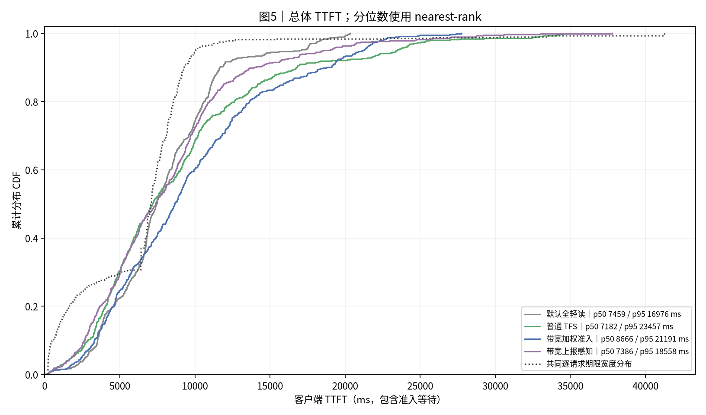
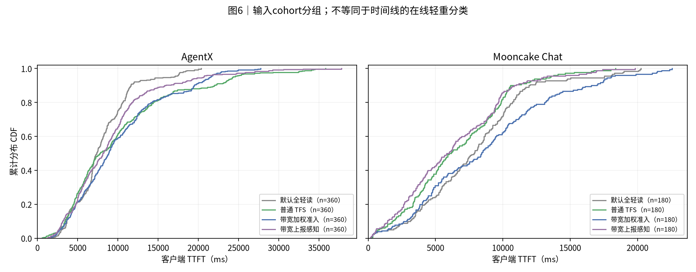
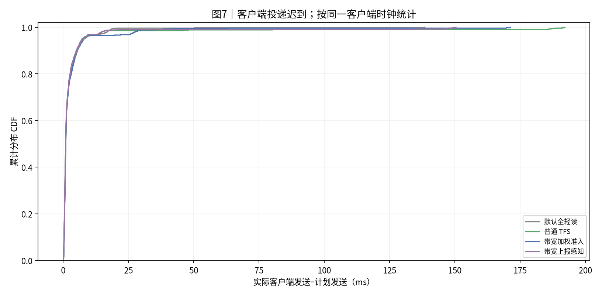

# 实验结果：AgentX 360 与 Mooncake Chat 180 · 50 秒冷启动 · 四策略对照

|项目|约定|
|---|---:|
|执行边界|四实例 WSL CPU 进程栈仿真。每个策略一轮，使用相同的 50 秒冻结 trace。|
|方案顺序|默认全轻读 → 普通 TFS → 带宽加权准入 → 带宽上报感知|
|输入种子 / 重复|每个case独立展示一个冻结运行；种子与重复见附表，未提供时不推断|
|汇总 / 轨迹|不跨case合并样本、不生成置信区间；轨迹保留全部正式请求|
|SLO / TTFT|逐请求匹配期限。TTFT 从客户端实际发送到首 token，包含路由、排队和准入。|
|分组|分类表和CDF使用输入cohort；时间线使用在线轻重判定|
|单位|时间秒/毫秒；容量字节；带宽GB/s=10^9 B/s|
|混合输入|AgentX 360 条与 Mooncake Chat 原始前 180 条，共 540 条。两路同在 0–50 秒发送。|
|冷启动|两路各自从空缓存开始。只复用更早到达请求出现过的完整前缀块。同刻到达批次先判定，再更新历史。|
|资源|4 实例，批大小 1，MiniMax 16 层，50,000 token 分块预算，六盘共享 25 GB/s。|
|SLO 期限|逐请求取全 miss prefill 计算耗时的 4 倍。使用截断后的完整输入，远端读取为 0，按 50,000 token 分块。|
|客户端时间|TTFT 从实际发送到首 token。标准主表完成时间取最后首 token，worker 分项取最后完整响应。|
|带宽口径|六盘逐层读提交重放，逐次完成时刻及总量校验，按 50 ms 分桶。报告使用共同线性轴展示 25 GB/s 容量线与实际速率。|
|冻结 trace SHA256|6676c26c71a9fc28438909f4ea56f0124e9a323d735b23a5b6cbea6a2164d669|

## 0. 总判决

四组均完成 540 条，均读取 **839.52 GB**。相对普通 TFS，带宽加权的后 15 层等待变化 **+0.713 实例·秒**，客户端 P95 变化 **-2.265 秒**。在带宽加权上叠加开工上报与选队后，后 15 层等待变化 **-4.495 实例·秒**，客户端 P95 变化 **-2.633 秒**。

|指标|默认全轻读|普通 TFS|带宽加权准入|带宽上报感知|
|---|---:|---:|---:|---:|
|实际发送窗口（秒）|50.007|50.008|50.007|50.008|
|最后一个首 token（秒）|68.146|63.673|65.217|62.395|
|最后一个完整响应（秒）|68.146|63.673|65.218|62.395|
|平均客户端 TTFT（秒）|7.931|8.904|9.598|8.144|
|P95 客户端 TTFT（秒）|16.976|23.457|21.191|18.558|
|首层累计 KV 等待（实例·秒）|8.550|7.855|7.907|7.311|
|后 15 层累计 KV 等待（实例·秒）|30.873|26.186|26.899|22.404|
|16 层累计 KV 等待（实例·秒）|39.422|34.041|34.806|29.715|
|全 miss SLO|209/540（38.7%）|203/540（37.6%）|181/540（33.5%）|221/540（40.9%）|


## 1. 汇总表与 SLO 柱状图

|方案|请求数|完成ms|平均TTFT ms|p95 ms|SLO%|四个 worker 完成时刻均值（s）|
|---|---:|---:|---:|---:|---:|---:|
|默认全轻读|540|68145.7|7931.2|16976.1|38.7|59.774|
|普通 TFS|540|63673.2|8904.4|23456.6|37.6|59.080|
|带宽加权准入|540|65217.4|9598.1|21191.3|33.5|58.987|
|带宽上报感知|540|62394.9|8143.9|18557.8|40.9|57.820|

以首条正式请求实际发送为 0 秒，按执行 worker 分组取最后一个客户端响应结束时刻。四个 worker 等权取均值。任一 worker 缺少完整记录或未执行请求时，均值标为缺少数据。

|方案|worker 0（s）|worker 1（s）|worker 2（s）|worker 3（s）|四个 worker 完成时刻均值（s）|
|---|---:|---:|---:|---:|---:|
|默认全轻读|61.934|54.359|68.146|54.658|59.774|
|普通 TFS|60.173|55.103|57.369|63.673|59.080|
|带宽加权准入|65.218|58.734|52.479|59.518|58.987|
|带宽上报感知|54.697|55.786|58.403|62.395|57.820|

分类结果使用输入cohort：

|方案|分组|请求数|平均TTFT ms|SLO%|
|---|---:|---:|---:|---:|
|默认全轻读|AgentX|360|7959.6|52.2|
|默认全轻读|Mooncake Chat|180|7874.4|11.7|
|普通 TFS|AgentX|360|10050.6|49.2|
|普通 TFS|Mooncake Chat|180|6612.0|14.4|
|带宽加权准入|AgentX|360|10037.8|41.7|
|带宽加权准入|Mooncake Chat|180|8718.8|17.2|
|带宽上报感知|AgentX|360|9051.0|50.6|
|带宽上报感知|Mooncake Chat|180|6329.7|21.7|



**读法**：柱高与上表同口径。每条请求使用自身期限判断是否达标。

## 2. 各方案 full-sort-ms 执行时间线




**读法**：蓝重读、橙轻读、紫轻重混批。红色为未被名义计算覆盖的在途IO，灰色含空闲、排队和控制。动态与冻结分类分别标注；直接放行分类仅作参考。虚线右侧仅为统一横轴补齐。

## 3. 模型计算占比分布与热力图




**读法**：箱线和热力图来自同一组逐实例数据。分母是各方案从首次正式到达到末条首token的窗口。该值不是硬件实测利用率。

## 4. 存储带宽时序




**读法**：各方案共用从零起的线性纵轴。橙线为需求，蓝线为实际分配，黑虚线为容量。橙色阴影的高度表示需求超出容量的 GB/s。峰值取图中时间桶的平均需求最大值。

|方案|平均GB/s|需求超订%|实际饱和%|
|---|---:|---:|---:|
|默认全轻读|12.3|50.0|17.1|
|普通 TFS|13.2|53.7|12.6|
|带宽加权准入|12.9|49.0|12.3|
|带宽上报感知|13.5|53.4|11.8|

## 5. TTFT 累积分布 CDF




**读法**：经验CDF按rank/n绘制，终点为1。期限不同时，SLO必须逐请求匹配，不能由两条CDF交点推算。




**读法**：此处分组来自cohort，可能是历史A/B或业务分类，不用该标签推断在线轻重。

## 6. 机制解释与前序对照

### 准入与选队

|策略|在线判重|获批|单条超预算且单独获批|开工登记|快照选队事件|需求峰值 GB/s|需求超出容量（秒）|
|---|---:|---:|---:|---:|---:|---:|---:|
|默认全轻读|0|0|—|—|—|132.77|34.05|
|普通 TFS|182|182|—|—|—|126.91|34.22|
|带宽加权准入|175|175|154|—|—|126.91|31.95|
|带宽上报感知|174|174|154|361|3177|126.94|33.29|

带宽加权用 6.25 GB/s 均分门槛和在线 P75 判重，按请求带宽需求记账。单个重读需求超过总预算时可单独获批。带宽上报在同一账本上异步登记需求至少 1 GB/s 的读盘开工，并按快照在实例内选队。选队计数包含维持队首顺序的事件。需求峰值按 50 ms 桶统计。带宽加权的 175 次重读获批中，154 次为单条超预算后独占许可，因此重读按需求共享许可的机会有限。

### 按输入来源拆解

|策略|来源|在线判重|后 15 层等待（实例·秒）|客户端 P95（秒）|全 miss SLO|
|---|---:|---:|---:|---:|---:|
|默认全轻读|AgentX|0|29.643|16.571|188/360|
|默认全轻读|Mooncake Chat|0|1.229|17.539|21/180|
|普通 TFS|AgentX|182|24.461|24.285|177/360|
|普通 TFS|Mooncake Chat|0|1.725|13.504|26/180|
|带宽加权准入|AgentX|175|25.858|21.492|150/360|
|带宽加权准入|Mooncake Chat|0|1.041|18.028|31/180|
|带宽上报感知|AgentX|174|21.467|20.613|182/360|
|带宽上报感知|Mooncake Chat|0|0.937|13.000|39/180|

### 按普通 TFS 的固定标签对比

|策略|按普通 TFS 冻结标签配对|条数|后 15 层等待（实例·秒）|
|---|---:|---:|---:|
|默认全轻读|普通 TFS 重读|182|18.010|
|默认全轻读|普通 TFS 轻读|358|12.862|
|普通 TFS|普通 TFS 重读|182|12.115|
|普通 TFS|普通 TFS 轻读|358|14.071|
|带宽加权准入|普通 TFS 重读|182|12.393|
|带宽加权准入|普通 TFS 轻读|358|14.506|
|带宽上报感知|普通 TFS 重读|182|11.810|
|带宽上报感知|普通 TFS 轻读|358|10.594|

固定标签用于同一批请求配对。执行时间线使用各轮实际在线标签。带宽上报相对带宽加权少等的 4.49 实例·秒中，有 3.91 实例·秒来自普通 TFS 的轻读组。这一分布与快照选队会约束轻读开工相符。

### 同批输入的 36 秒与 50 秒对照

|策略|36 秒后 15 层等待|50 秒后 15 层等待|36 秒客户端 P95|50 秒客户端 P95|
|---|---:|---:|---:|---:|
|默认全轻读|33.023|30.873|25.818|16.976|
|普通 TFS|27.451|26.186|29.544|23.457|

KV 等待单位为实例·秒，P95 单位为秒。两个回放窗口的平均到达读量分别为 23.32 和 16.79 GB/s。

## 7. 计算模型与结论限制

四组各一轮 WSL CPU 进程栈仿真。默认和普通 TFS 复用首轮日志，带宽两组为本轮新增。四组使用同一回放器、冻结 trace、存储容量和计算模型。全 miss SLO 只在报告层重算。准入时的画像和原期限保留在原始日志。不同策略会改变路由、实际开工次序和链路争用。单轮结果只描述这次回放。

## 8. 附表




**读法**：此图描述客户端实际发送相对计划的迟到，不是单次准入RPC耗时。

|方案|实例数|模型计算占比%|运行标识|
|---|---:|---:|---:|
|默认全轻读|4|70.8|{"repeat": 1, "native_sha256": "2887ddcf901e2f03652d438f5dce3a0c9d28170234d16c7a1baa106e6273fcab", "prefill_model_sha256": "48776fc742ba30edd6715219cff9fb9891104c55c5cc8e45df3a3f292857e1aa", "frontend_start": "2026-11-27T11:28:59.929594+08:00", "frontend_stop": "2026-11-27T11:30:47.381409+08:00", "origin": "50 秒已有运行"}|
|普通 TFS|4|75.8|{"repeat": 1, "native_sha256": "2887ddcf901e2f03652d438f5dce3a0c9d28170234d16c7a1baa106e6273fcab", "prefill_model_sha256": "48776fc742ba30edd6715219cff9fb9891104c55c5cc8e45df3a3f292857e1aa", "frontend_start": "2026-11-27T11:31:12.766207+08:00", "frontend_stop": "2026-11-27T11:32:56.113336+08:00", "origin": "50 秒已有运行"}|
|带宽加权准入|4|74.0|{"repeat": 1, "native_sha256": "2887ddcf901e2f03652d438f5dce3a0c9d28170234d16c7a1baa106e6273fcab", "prefill_model_sha256": "48776fc742ba30edd6715219cff9fb9891104c55c5cc8e45df3a3f292857e1aa", "frontend_start": "2026-11-27T11:41:12.595995+08:00", "frontend_stop": "2026-11-27T11:43:01.512507+08:00", "origin": "本轮新增运行"}|
|带宽上报感知|4|77.4|{"repeat": 1, "native_sha256": "2887ddcf901e2f03652d438f5dce3a0c9d28170234d16c7a1baa106e6273fcab", "prefill_model_sha256": "48776fc742ba30edd6715219cff9fb9891104c55c5cc8e45df3a3f292857e1aa", "frontend_start": "2026-11-27T11:43:24.843722+08:00", "frontend_stop": "2026-11-27T11:45:06.792258+08:00", "origin": "本轮新增运行"}|

|方案|序列上限|token预算|存储容量GB/s|准入位置 / 规则|计算模型|
|---|---:|---:|---:|---:|---:|
|默认全轻读|1|50000|25.0|scheduler / arrival|prefill_fit|
|普通 TFS|1|50000|25.0|scheduler / arrival|prefill_fit|
|带宽加权准入|1|50000|25.0|scheduler / arrival|prefill_fit|
|带宽上报感知|1|50000|25.0|scheduler / arrival|prefill_fit|

[客户端汇总](report_data/client_comparison.csv) · [按来源](report_data/by_source.csv) · [按普通 TFS 标签配对](report_data/matched_wait.csv) · [逐请求 KV 等待](report_data/request_wait_details.csv) · [准入和开工事件](report_data/admission_counts.csv) · [带宽校验](report_data/bandwidth_audit.csv)

## 9. 验证、数据与复现

已校验请求计数、逐请求SLO、nearest-rank分位数、CDF概率质量、实例时间账本及可用带宽积分。图片人工检查状态见校验文件。

- [校验记录](report_data/validation.json)
- [方案汇总](report_data/run_summary.csv)
- [请求明细](report_data/requests.csv)
- [标准重绘数据](report_data/dataset.json)
- [复现入口](reproduce/generate_report.py)
- [冻结 trace](frozen_input/trace.jsonl.gz) · [输入清单](frozen_input/manifest.json) · [逐请求输入](frozen_input/requests.csv)

在报告目录执行：

```bash
python reproduce/generate_report.py --dataset report_data/dataset.json --output ../reproduced-report
```

## 10. 简要解读

按全 miss SLO，本次最高为 **带宽上报感知**。后 15 层等待最少的是 **带宽上报感知**。首层累计等待按读盘提交至完成计时。后 15 层只累计上一层计算结束后还没读完的时间。两项都按实例求和。
