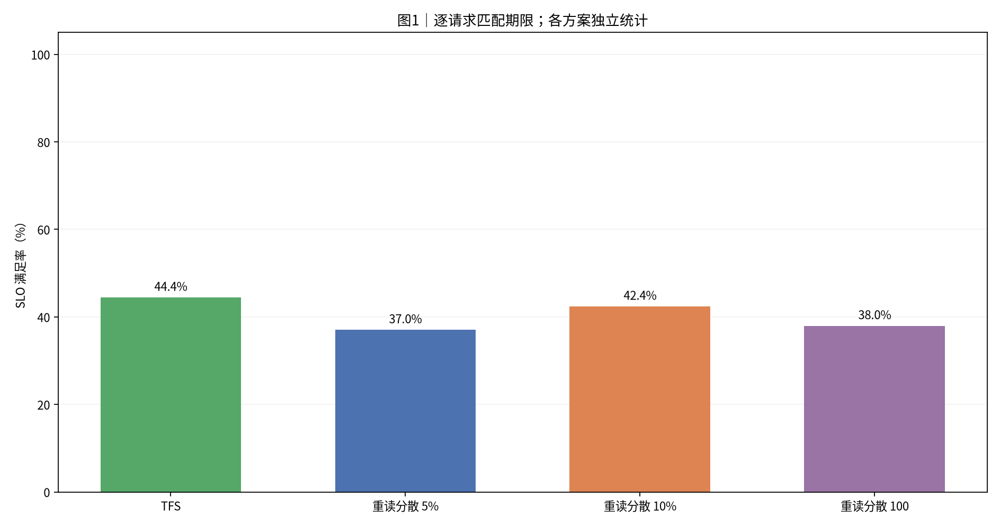
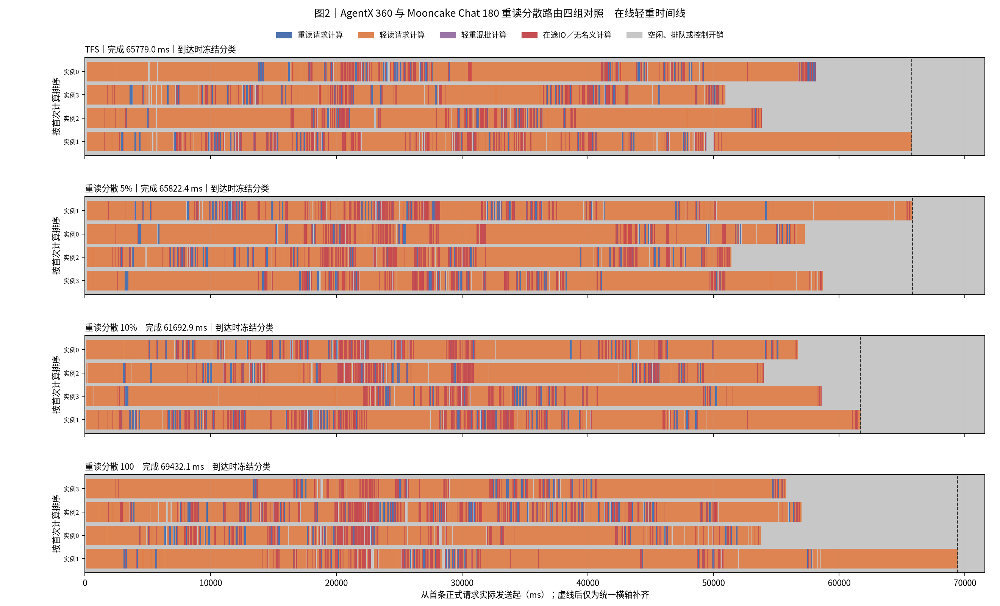
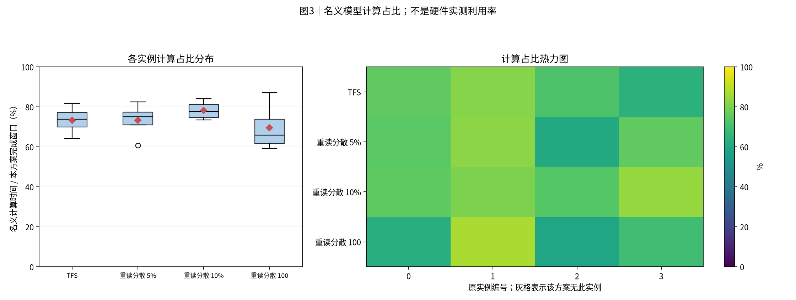
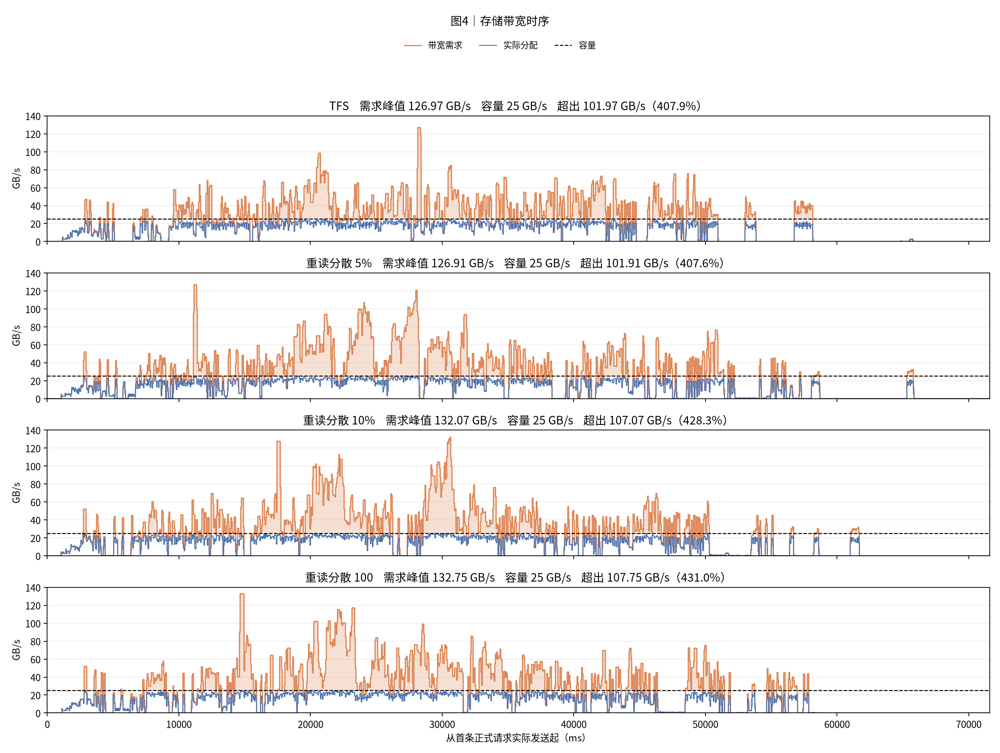
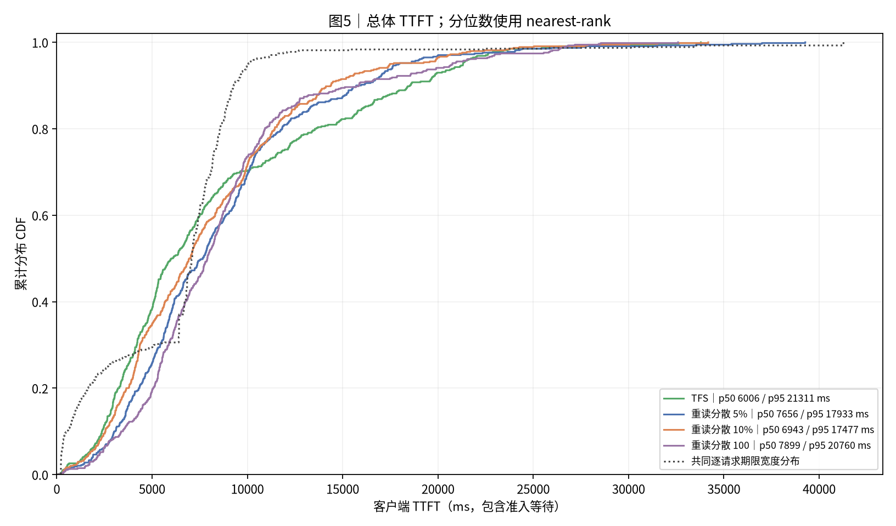
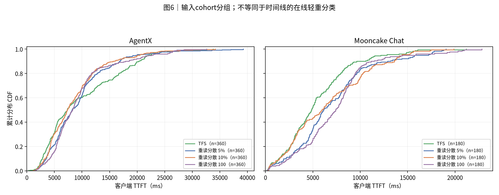
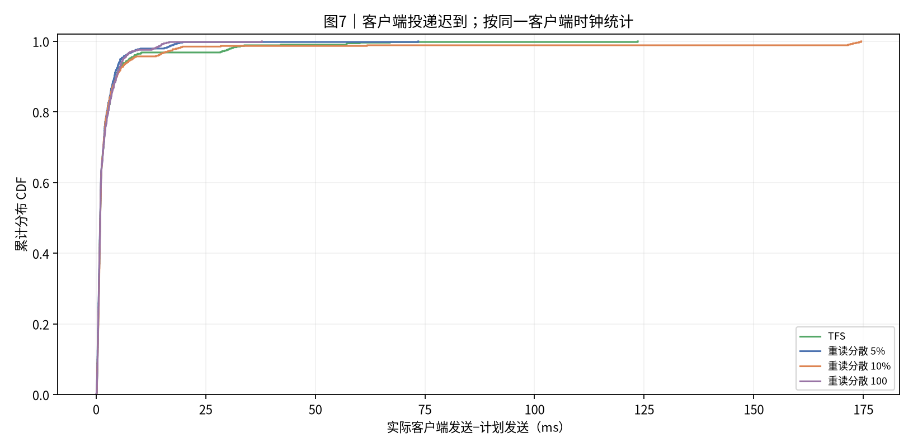

# 实验结果：AgentX 360 与 Mooncake Chat 180 重读分散路由四组对照

|项目|约定|
|---|---:|
|执行边界|同一 Dynamo 1.2 构建下四轮独立 WSL CPU 仿真，每档一轮。|
|方案顺序|TFS → 重读分散 5% → 重读分散 10% → 重读分散 100|
|输入种子 / 重复|每个case独立展示一个冻结运行；种子与重复见附表，未提供时不推断|
|汇总 / 轨迹|不跨case合并样本、不生成置信区间；轨迹保留全部正式请求|
|SLO / TTFT|逐请求匹配期限。TTFT 从客户端实际发送到首 token，包含路由、排队和准入。|
|分组|分类表和CDF使用输入cohort；时间线使用在线轻重判定|
|单位|时间秒/毫秒；容量字节；带宽GB/s=10^9 B/s|
|输入|AgentX 360 条与 Mooncake Chat 180 条，50 秒开环发送。|
|资源|4 worker，BS=1，FCFS，MiniMax 16 层，6 盘共享 25 GB/s。|
|公共策略|α=0.1、带宽加权准入、全量带宽上报和快照选队。|
|路由|5% 和 10% 约束相对最低原分差。100 取消分差上限。启用组均要求候选 KV 命中相同。|
|读量|四轮逐次对账，均为 839.515 GB。带宽图按 50 ms 分桶。|
|trace SHA256|6676c26c71a9fc28438909f4ea56f0124e9a323d735b23a5b6cbea6a2164d669|
|计时与 SLO|期限为逐请求全 miss prefill 耗时的 4 倍。按完整 prompt 估算，从空前缀开始，沿用 50,000 token 分块预算，远端 KV 读取为零。TTFT 从客户端实际发送到首 token。|

## 0. 总判决

四组各完成 540 条。**平均 TTFT 最低是 重读分散 10%，整批完成最快是 重读分散 10%。** 100 组相对基线的平均 TTFT 变化为 +392 ms，整批完成变化为 +3.653 秒。

|指标|TFS|重读分散 5%|重读分散 10%|重读分散 100|
|---|---:|---:|---:|---:|
|整批完成（最后完整响应，秒）|65.779|65.823|61.693|69.433|
|四实例平均完成（秒）|57.183|58.301|57.758|58.998|
|平均 TTFT（秒）|8.355|8.593|7.951|8.747|
|P95 TTFT（秒）|21.311|17.933|17.477|20.760|
|首层 KV 等待（实例·秒）|6.860|7.787|7.444|7.852|
|后 15 层 KV 等待（实例·秒）|19.622|25.059|23.209|25.683|


## 1. 汇总表与 SLO 柱状图

|方案|请求数|完成ms|平均TTFT ms|p95 ms|SLO%|四个 worker 完成时刻均值（s）|
|---|---:|---:|---:|---:|---:|---:|
|TFS|540|65779.0|8355.4|21310.5|44.4|57.183|
|重读分散 5%|540|65822.4|8593.1|17932.9|37.0|58.301|
|重读分散 10%|540|61692.9|7950.8|17477.4|42.4|57.758|
|重读分散 100|540|69432.1|8747.2|20760.3|38.0|58.998|

以首条正式请求实际发送为 0 秒，按执行 worker 分组取最后一个客户端响应结束时刻。四个 worker 等权取均值。任一 worker 缺少完整记录或未执行请求时，均值标为缺少数据。

|方案|worker 0（s）|worker 1（s）|worker 2（s）|worker 3（s）|四个 worker 完成时刻均值（s）|
|---|---:|---:|---:|---:|---:|
|TFS|58.157|65.779|53.837|50.957|57.183|
|重读分散 5%|57.280|65.823|51.419|58.681|58.301|
|重读分散 10%|56.705|61.693|54.018|58.617|57.758|
|重读分散 100|53.769|69.433|56.994|55.796|58.998|

分类结果使用输入cohort：

|方案|分组|请求数|平均TTFT ms|SLO%|
|---|---:|---:|---:|---:|
|TFS|AgentX|360|9811.6|55.0|
|TFS|Mooncake Chat|180|5442.9|23.3|
|重读分散 5%|AgentX|360|9382.8|47.2|
|重读分散 5%|Mooncake Chat|180|7013.5|16.7|
|重读分散 10%|AgentX|360|8642.0|53.6|
|重读分散 10%|Mooncake Chat|180|6568.4|20.0|
|重读分散 100|AgentX|360|9439.0|49.7|
|重读分散 100|Mooncake Chat|180|7363.6|14.4|



**读法**：柱高与上表同口径。每条请求使用自身期限判断是否达标。

## 2. 各方案 full-sort-ms 执行时间线




**读法**：蓝重读、橙轻读、紫轻重混批。红色为未被名义计算覆盖的在途IO，灰色含空闲、排队和控制。动态与冻结分类分别标注；直接放行分类仅作参考。虚线右侧仅为统一横轴补齐。

## 3. 模型计算占比分布与热力图




**读法**：箱线和热力图来自同一组逐实例数据。分母是各方案从首次正式到达到末条首token的窗口。该值不是硬件实测利用率。

## 4. 存储带宽时序




**读法**：各方案共用从零起的线性纵轴。橙线为需求，蓝线为实际分配，黑虚线为容量。橙色阴影的高度表示需求超出容量的 GB/s。峰值取图中时间桶的平均需求最大值。

|方案|平均GB/s|需求超订%|实际饱和%|
|---|---:|---:|---:|
|TFS|12.8|50.6|9.0|
|重读分散 5%|12.8|50.3|12.2|
|重读分散 10%|13.6|53.4|11.3|
|重读分散 100|12.1|48.0|12.5|

## 5. TTFT 累积分布 CDF




**读法**：经验CDF按rank/n绘制，终点为1。期限不同时，SLO必须逐请求匹配，不能由两条CDF交点推算。




**读法**：此处分组来自cohort，可能是历史A/B或业务分类，不用该标签推断在线轻重。

## 6. 机制解释与前序对照

### 路由改选与获批等待

|策略|在线重读|改选|平均等待队列极差|末 20 条获批分布|等待获批均值（秒）|等待获批 P95（秒）|改选后遇轻读剩余逾 100 ms|
|---|---:|---:|---:|---:|---:|---:|---:|
|TFS|175|0|11.29|11 / 1 / 2 / 6|8.938|19.021|0|
|重读分散 5%|174|22|4.93|11 / 3 / 3 / 3|5.723|14.258|2|
|重读分散 10%|174|34|5.02|4 / 5 / 7 / 4|5.813|16.059|1|
|重读分散 100|174|112|1.45|4 / 6 / 6 / 4|6.146|19.789|4|


队列极差为每次绑定后，四个 worker 等待重读的最大条数减最小条数。获批等待从 worker 收到 hint 计起，包含本地调度和许可等待。末 20 条分布按获批激活顺序统计。

### 按请求来源

|来源|指标|TFS|重读分散 5%|重读分散 10%|重读分散 100|
|---|---:|---:|---:|---:|---:|
|AgentX|平均 TTFT（秒）|9.812|9.383|8.642|9.439|
|AgentX|客户端发出至 worker 收到 hint（秒）|3.059|4.906|4.252|5.425|
|AgentX|worker 收到 hint 至客户端首 token（秒）|6.753|4.477|4.390|4.014|
|AgentX|后 15 层等待（实例·秒）|18.704|23.750|22.407|25.100|
|Mooncake Chat|平均 TTFT（秒）|5.443|7.014|6.568|7.364|
|Mooncake Chat|客户端发出至 worker 收到 hint（秒）|2.794|4.457|3.950|5.010|
|Mooncake Chat|worker 收到 hint 至客户端首 token（秒）|2.649|2.557|2.618|2.354|
|Mooncake Chat|后 15 层等待（实例·秒）|0.918|1.310|0.801|0.583|


前段包括入口处理、等待路由与转发。后段包括 worker 排队、准入与执行。两段用同一次运行中的时钟对齐。

### 固定请求集合的平均 TTFT（秒）

|固定请求集合|条数|TFS|重读分散 5%|重读分散 10%|重读分散 100|
|---|---:|---:|---:|---:|---:|
|基线重读|175|12.017|10.377|9.900|11.344|
|基线轻读|365|6.600|7.738|7.016|7.502|


## 7. 计算模型与结论限制

各档各一轮，分布式路由和进程执行顺序存在波动。四组按相同客户端边界统计。总览的整批完成取最后完整响应，时间线取最后首 token。逐请求 SLO 使用 4 倍全 miss prefill。

## 8. 附表




**读法**：此图描述客户端实际发送相对计划的迟到，不是单次准入RPC耗时。

|方案|实例数|模型计算占比%|运行标识|
|---|---:|---:|---:|
|TFS|4|73.4|{"repeat": 1, "native_sha256": "8dd768bee814139d5ed04e5735c58556064c089fd6c17c4a597bf4c3aa775726", "prefill_model_sha256": "48776fc742ba30edd6715219cff9fb9891104c55c5cc8e45df3a3f292857e1aa", "frontend_start": "2026-11-27T17:28:24.285954+08:00", "frontend_stop": "2026-11-27T17:30:16.257042+08:00", "heavy_spread": "off"}|
|重读分散 5%|4|73.3|{"repeat": 1, "native_sha256": "8dd768bee814139d5ed04e5735c58556064c089fd6c17c4a597bf4c3aa775726", "prefill_model_sha256": "48776fc742ba30edd6715219cff9fb9891104c55c5cc8e45df3a3f292857e1aa", "frontend_start": "2026-11-27T17:30:38.795029+08:00", "frontend_stop": "2026-11-27T17:32:31.137853+08:00", "heavy_spread": "5"}|
|重读分散 10%|4|78.2|{"repeat": 1, "native_sha256": "8dd768bee814139d5ed04e5735c58556064c089fd6c17c4a597bf4c3aa775726", "prefill_model_sha256": "48776fc742ba30edd6715219cff9fb9891104c55c5cc8e45df3a3f292857e1aa", "frontend_start": "2026-11-27T17:32:50.813368+08:00", "frontend_stop": "2026-11-27T17:34:34.771880+08:00", "heavy_spread": "10"}|
|重读分散 100|4|69.5|{"repeat": 1, "native_sha256": "8dd768bee814139d5ed04e5735c58556064c089fd6c17c4a597bf4c3aa775726", "prefill_model_sha256": "48776fc742ba30edd6715219cff9fb9891104c55c5cc8e45df3a3f292857e1aa", "frontend_start": "2026-11-27T17:34:57.667771+08:00", "frontend_stop": "2026-11-27T17:36:50.526565+08:00", "heavy_spread": "100"}|

|方案|序列上限|token预算|存储容量GB/s|准入位置 / 规则|计算模型|
|---|---:|---:|---:|---:|---:|
|TFS|1|50000|25.0|scheduler / arrival|prefill_fit|
|重读分散 5%|1|50000|25.0|scheduler / arrival|prefill_fit|
|重读分散 10%|1|50000|25.0|scheduler / arrival|prefill_fit|
|重读分散 100|1|50000|25.0|scheduler / arrival|prefill_fit|

[重读路由与准入](report_data/heavy_routing.csv) · [按来源对比](report_data/by_source.csv) · [逐请求 KV 等待](report_data/request_wait_details.csv) · [带宽重放校验](report_data/bandwidth_audit.csv)

## 9. 验证、数据与复现

已校验请求计数、逐请求SLO、nearest-rank分位数、CDF概率质量、实例时间账本及可用带宽积分。图片人工检查状态见校验文件。

- [校验记录](report_data/validation.json)
- [方案汇总](report_data/run_summary.csv)
- [请求明细](report_data/requests.csv)
- [标准重绘数据](report_data/dataset.json)
- [复现入口](reproduce/generate_report.py)

在报告目录执行：

```bash
python reproduce/generate_report.py --dataset report_data/dataset.json --output ../reproduced-report
```

## 10. 简要解读

100 组把等待重读的平均队列极差由 11.29 条变为 1.45 条。同组实际改选 112 条。结合 AgentX 和 Mooncake Chat 的 TTFT 变化判断分散后两类请求分别承担的排队代价。
