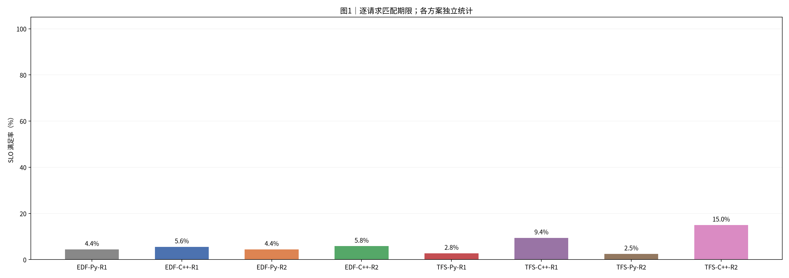
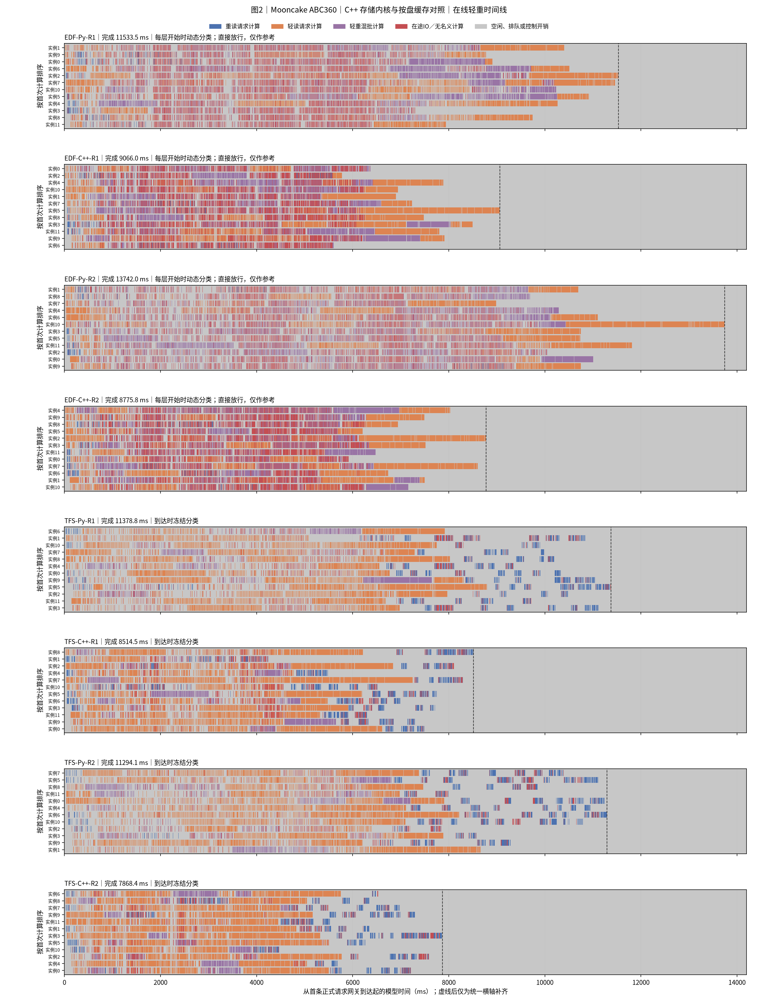
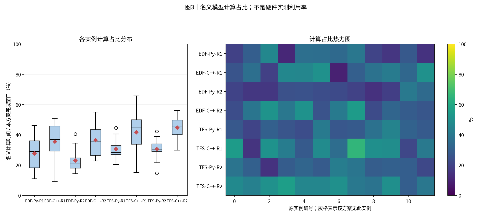
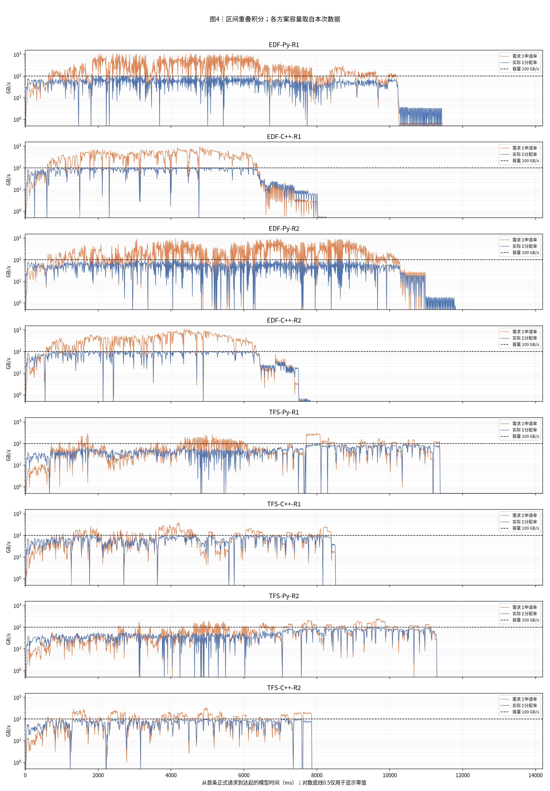
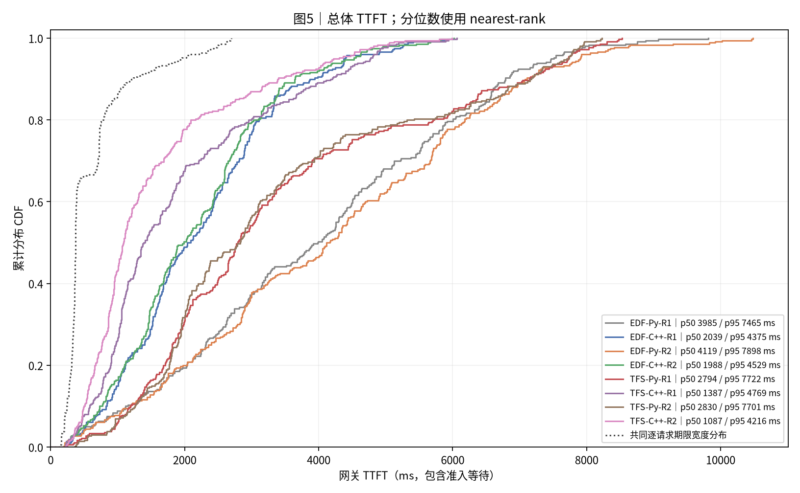
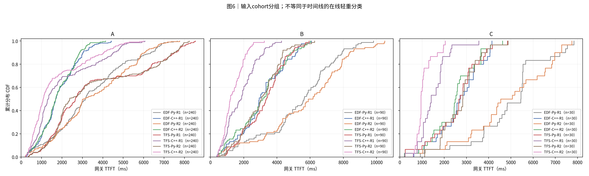
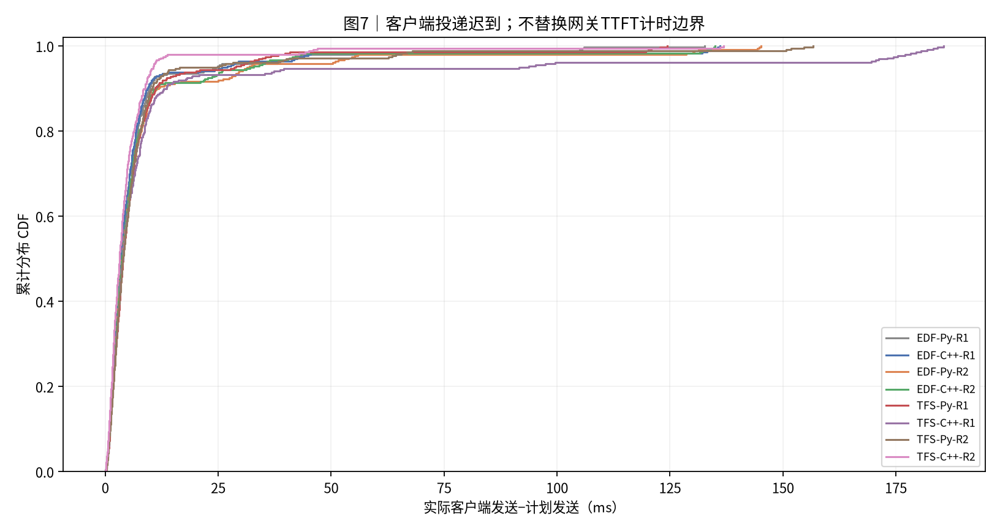

# 实验结果：Mooncake ABC360｜C++ 存储内核与按盘缓存对照

报告归档时间：2026-11-03T18:17:59+08:00（Asia/Shanghai）。原实验为两种策略 × 两种后端 × 两轮，共八次正式运行、2880条正式请求；另有两个 C++ 冒烟。

本次归档没有重跑性能实验。七张PNG保持源文件字节不变。较大派生表使用无损gzip压缩；标准数据移除重复的逐事件盘数组，保留总速率事件和逐盘10ms积分表，汇总已与原CSV核对。大型原始事件留在本机。

[Benchmark合同](../../../benchmark/mooncake_abc_360_4s_12_100GBps/README.md) · [C++后端说明](../../../docs/CPP独立盘存储后端-20261103.md) · [归档清单](manifest.json) · [归档校验](archive_validation.json) · [精简校验](report_data/dataset_compaction.json)

|项目|约定|
|---|---:|
|执行边界|本次新跑：每方案 12 个逻辑实例，72 条预热排空后运行 360 条正式请求；每种策略与后端各两轮。下述制图只处理日志。|
|方案顺序|EDF-Py-R1 → EDF-C++-R1 → EDF-Py-R2 → EDF-C++-R2 → TFS-Py-R1 → TFS-C++-R1 → TFS-Py-R2 → TFS-C++-R2|
|输入种子 / 重复|每个case独立展示一个冻结运行；种子与重复见附表，未提供时不推断|
|汇总 / 轨迹|不跨case合并样本、不生成置信区间；轨迹保留全部正式请求|
|SLO / TTFT|逐请求匹配deadline；TTFT=first_token−gateway arrival，包含准入等待|
|分组|分类表和CDF使用输入cohort；时间线使用在线轻重判定|
|单位|时间秒/毫秒；容量字节；带宽GB/s=10^9 B/s|
|实验日期|2026-11-03|
|输入|Mooncake ABC360；计划到达 4 秒|
|固定输入 SHA256|afb2b6c2f8015bcd224410b0e9e6d9d626115c2a85b8d89dd2bc7e43ee65c308|
|磁盘|4 × 25 GB/s，HRW 内容块放置，盘间不借带宽，shared_link_Bps=null|
|基线|Python 已缓存带宽分配结果；本次 C++ 内核进一步按盘失效缓存|
|控制变量|同一冻结运行包；每个策略内只改 storage.backend；poll/locked、0.5ms 轮询和首 token 释放保持不变|
|计算|实际工作量 v2；78 层；seq=4；新 token 预算 8192；K=1|
|策略|直接 EDF、新 TFS EDF α=0.1；不包含旧 TFS 或 FCFS|
|重复|每格两轮，第二轮倒换同策略后端顺序；没有置信区间|
|宿主|WSL/Linux CPU 壁钟仿真；计算占比不是 GPU 硬件利用率|
|源码范围|固定上一轮缓存版运行包，仅覆盖新内核及后端选择；研究分支完整回归另行通过|
|带宽验证|离线按逐层提交记录重放 Python 参考模型，逐次核对完成时间和每盘字节积分|
|图中简称|EDF=直接准入 EDF；TFS=新 TFS EDF α=0.1；Py=Python 缓存版；C++=原生按盘缓存版；R1/R2=独立重复|

## 0. 总判决

C++ 存储内核接入后，两种策略均有收益。direct：完成时间下降 29.4%，平均 TTFT 从 4073.5 ms 降至 2189.1 ms。 tfs-a01：完成时间下降 27.7%，平均 TTFT 从 3402.8 ms 降至 1713.4 ms。

| 策略 | 后端 | 两轮完成时间（秒） | 均值（秒） | 平均带宽 GB/s | 名义计算占比 | SLO 满足率 |
|---|---|---|---:|---:|---:|---:|
| direct | python | 11.533 / 13.742 | 12.638 | 43.02 | 25.36% | 4.44% |
| direct | cpp | 9.066 / 8.776 | 8.921 | 60.50 | 36.01% | 5.69% |
| tfs-a01 | python | 11.379 / 11.294 | 11.336 | 47.60 | 30.57% | 2.64% |
| tfs-a01 | cpp | 8.515 / 7.868 | 8.191 | 65.97 | 43.24% | 12.22% |

数值为每格两轮的算术平均；图表保留全部八轮，不拼接或选择最快一轮。每轮正式读取量均为 539.571462144 GB、25,740 次读取。

## 1. 汇总表与 SLO 柱状图

|方案|请求数|完成ms|平均TTFT ms|p95 ms|SLO%|网关等待ms|
|---|---:|---:|---:|---:|---:|---:|
|EDF-Py-R1|360|11533.5|3979.8|7464.7|4.4|0.8|
|EDF-C++-R1|360|9066.0|2226.4|4374.9|5.6|0.9|
|EDF-Py-R2|360|13742.0|4167.3|7898.0|4.4|0.9|
|EDF-C++-R2|360|8775.8|2151.9|4528.6|5.8|0.8|
|TFS-Py-R1|360|11378.8|3426.5|7721.5|2.8|1.0|
|TFS-C++-R1|360|8514.5|1894.3|4769.4|9.4|1.5|
|TFS-Py-R2|360|11294.1|3379.1|7700.7|2.5|0.9|
|TFS-C++-R2|360|7868.4|1532.4|4215.8|15.0|1.0|

分类结果使用输入cohort：

|方案|分组|请求数|平均TTFT ms|SLO%|
|---|---:|---:|---:|---:|
|EDF-Py-R1|A|240|3366.5|3.8|
|EDF-Py-R1|B|90|5298.2|7.8|
|EDF-Py-R1|C|30|4930.6|0.0|
|EDF-C++-R1|A|240|1841.4|2.9|
|EDF-C++-R1|B|90|3100.1|13.3|
|EDF-C++-R1|C|30|2685.5|3.3|
|EDF-Py-R2|A|240|3525.6|3.3|
|EDF-Py-R2|B|90|5659.8|7.8|
|EDF-Py-R2|C|30|4823.6|3.3|
|EDF-C++-R2|A|240|1779.5|2.9|
|EDF-C++-R2|B|90|3031.7|14.4|
|EDF-C++-R2|C|30|2491.1|3.3|
|TFS-Py-R1|A|240|3605.6|0.0|
|TFS-Py-R1|B|90|3228.0|8.9|
|TFS-Py-R1|C|30|2589.2|6.7|
|TFS-C++-R1|A|240|1965.5|3.3|
|TFS-C++-R1|B|90|1832.5|27.8|
|TFS-C++-R1|C|30|1510.6|3.3|
|TFS-Py-R2|A|240|3591.7|0.0|
|TFS-Py-R2|B|90|3025.6|10.0|
|TFS-Py-R2|C|30|2739.3|0.0|
|TFS-C++-R2|A|240|1657.3|3.8|
|TFS-C++-R2|B|90|1351.2|46.7|
|TFS-C++-R2|C|30|1076.9|10.0|



**读法**：柱高与上表同口径。每条请求使用自身期限判断是否达标。

## 2. 各方案 full-sort-ms 执行时间线




**读法**：蓝重读、橙轻读、紫轻重混批。红色为未被名义计算覆盖的在途IO，灰色含空闲、排队和控制。动态与冻结分类分别标注；直接放行分类仅作参考。虚线右侧仅为统一横轴补齐。

## 3. 模型计算占比分布与热力图




**读法**：箱线和热力图来自同一组逐实例数据。分母是各方案从首次正式到达到末条首token的窗口。该值不是硬件实测利用率。

## 4. 存储带宽时序




**读法**：橙线为需求，蓝线为实际分配，虚线为本次容量。按时间重叠积分，不对不等长事件直接取平均。零值在CSV保留0。

|方案|平均GB/s|需求超订%|实际饱和%|
|---|---:|---:|---:|
|EDF-Py-R1|46.8|41.0|42.8|
|EDF-C++-R1|59.5|53.9|54.5|
|EDF-Py-R2|39.3|34.2|35.9|
|EDF-C++-R2|61.5|56.0|56.3|
|TFS-Py-R1|47.4|27.0|43.4|
|TFS-C++-R1|63.4|35.1|58.0|
|TFS-Py-R2|47.8|27.5|43.7|
|TFS-C++-R2|68.6|41.4|62.8|

## 5. TTFT 累积分布 CDF




**读法**：经验CDF按rank/n绘制，终点为1。期限不同时，SLO必须逐请求匹配，不能由两条CDF交点推算。




**读法**：此处分组来自cohort，可能是历史A/B或业务分类，不用该标签推断在线轻重。

## 6. 机制解释与前序对照

此次优化把带宽分配、进度更新和完成检测放入 C++。每块盘单独缓存速率；事件只使相关盘失效。请求关联、HRW 放置、RPC、轮询与服务锁仍由原 Python 服务处理。

| 策略 | 后端 | 查询往返 ms | 服务端解析至获锁 ms | 锁内处理 ms | 全盘无在途读取 秒 |
|---|---|---:|---:|---:|---:|
| direct | python | 5.205 | 3.476 | 0.406 | 6.947 |
| direct | cpp | 1.126 | 0.815 | 0.084 | 3.232 |
| tfs-a01 | python | 2.322 | 1.454 | 0.195 | 5.545 |
| tfs-a01 | cpp | 0.918 | 0.627 | 0.078 | 2.422 |

“解析至获锁”含解析、锁等待与线程调度，不能把整段等同于锁等待。“全盘无在途读取”与计算可以重叠，不是额外可加到完成时间上的独立阶段。

最明显的收益是缩短读取之间的间隙：直接 EDF 至少一盘正在读取的累计时间为
5.691→5.689 秒，几乎不变；全盘无在途读取从 6.947→3.232 秒。
新 TFS 的活动读取累计时间为 5.791→5.770 秒，全盘无在途读取从 5.545→2.422 秒。
有读取时的总带宽仍约 93～95 GB/s，整体平均带宽的提升主要来自减少空档。
全盘无读取也可能是正常计算或排队，不能把全部这段时间都解释为存储服务浪费。
但本次只改存储实现，完成时间的缩短与这段时间的缩短基本一致。


## 7. 计算模型与结论限制

25,740 次固定轨迹通过 Python/C++ 接口对拍，完成时间最大差为 0，字节数与逐盘字节相同。该接口重放单次为 Python 4.546 秒、C++ 0.454 秒；这里只作为内核层证据，不将约 10 倍速度比套用到整条请求链。完整研究分支 319 项测试通过，两个 C++ 冒烟和八个正式运行均通过验收。

正式实验保持同一冻结运行包和输入。C++ 共享库在服务启动时编译，正式窗口不含编译或启动时间。冻结包沿用上一轮路由、准入、反馈和实际组批 v2，以隔离后端变化；不是重跑所有开发分支功能。

## 8. 附表




**读法**：此图描述客户端实际发送相对计划的迟到，不是单次准入RPC耗时。

|方案|实例数|模型计算占比%|运行标识|
|---|---:|---:|---:|
|EDF-Py-R1|12|27.6|{"repeat": 1, "backend": "python", "arm": "direct"}|
|EDF-C++-R1|12|35.6|{"repeat": 1, "backend": "cpp", "arm": "direct"}|
|EDF-Py-R2|12|23.1|{"repeat": 2, "backend": "python", "arm": "direct"}|
|EDF-C++-R2|12|36.5|{"repeat": 2, "backend": "cpp", "arm": "direct"}|
|TFS-Py-R1|12|30.6|{"repeat": 1, "backend": "python", "arm": "tfs-a01"}|
|TFS-C++-R1|12|41.7|{"repeat": 1, "backend": "cpp", "arm": "tfs-a01"}|
|TFS-Py-R2|12|30.6|{"repeat": 2, "backend": "python", "arm": "tfs-a01"}|
|TFS-C++-R2|12|44.7|{"repeat": 2, "backend": "cpp", "arm": "tfs-a01"}|

|方案|序列上限|token预算|存储容量GB/s|准入位置 / 规则|计算模型|
|---|---:|---:|---:|---:|---:|
|EDF-Py-R1|4|8192|100.0|gateway / dynamic|glm5_actual_batch_work_v2|
|EDF-C++-R1|4|8192|100.0|gateway / dynamic|glm5_actual_batch_work_v2|
|EDF-Py-R2|4|8192|100.0|gateway / dynamic|glm5_actual_batch_work_v2|
|EDF-C++-R2|4|8192|100.0|gateway / dynamic|glm5_actual_batch_work_v2|
|TFS-Py-R1|4|8192|100.0|scheduler / arrival|glm5_actual_batch_work_v2|
|TFS-C++-R1|4|8192|100.0|scheduler / arrival|glm5_actual_batch_work_v2|
|TFS-Py-R2|4|8192|100.0|scheduler / arrival|glm5_actual_batch_work_v2|
|TFS-C++-R2|4|8192|100.0|scheduler / arrival|glm5_actual_batch_work_v2|

本次结果支持：原 Python 存储模型的 CPU 工作拖慢了壁钟仿真，减少这部分工作能降低空泡。它不能证明真实 SSD 的带宽提升，也不能证明 TFS 策略本身发生改进。

仍存在 RPC、0.5 ms 轮询、服务锁、Python 元数据处理、宿主唤醒和调度开销。名义计算总量可能随实际组批改变。两轮样本不足以给出置信区间。此次在线对照同时启用 C++ 与按盘缓存，不能单独量化两项改动各自的收益。没有同时改通知、按盘拆进程或路由分数。默认保留 Python；C++ 目前仅支持独立分盘、grouped max-min、逐层 poll/locked。

## 9. 验证、数据与复现

已校验请求计数、逐请求SLO、nearest-rank分位数、CDF概率质量、实例时间账本及可用带宽积分。图片人工检查状态见校验文件。

- [校验记录](report_data/source_validation.json)
- [方案汇总](report_data/run_summary.csv)
- [请求明细](report_data/requests.csv.gz)
- [标准重绘数据](report_data/dataset.json.gz)
- [复现入口](reproduce/generate_report.py)

从仓库根目录执行（自动解压标准数据）：

```bash
python scripts/manage_reports.py redraw "mooncake_abc_360_4s_12_100GBps/20261103-181759_四盘_Python与CPP_直接EDF+新TFS-a0.1_各两轮" --output <新的输出目录>
```

## 10. 简要解读

运行顺序、冻结源码差分、逐轮配置、验收、单测日志与接口对拍已保存。标准 dataset 包含每轮精确计算与 I/O 区间、请求、带宽区间；辅助表提供 RPC 分解与逐盘 10 ms 带宽。reproduce 可离线重绘。完整原始日志保留在本机审计目录，不随报告 ZIP 上传。

本报告现归档到 `drt_develop/report`，并同步已验证的 C++ 与带宽缓存代码。新增交付验收不替换本报告的原始八轮性能数字。
