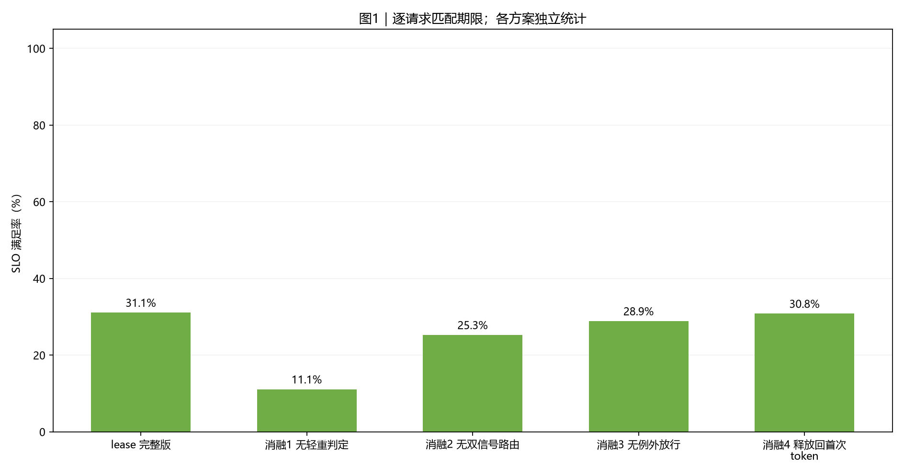
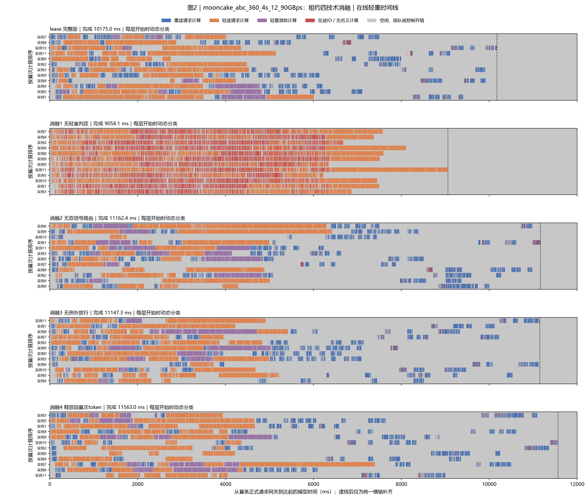
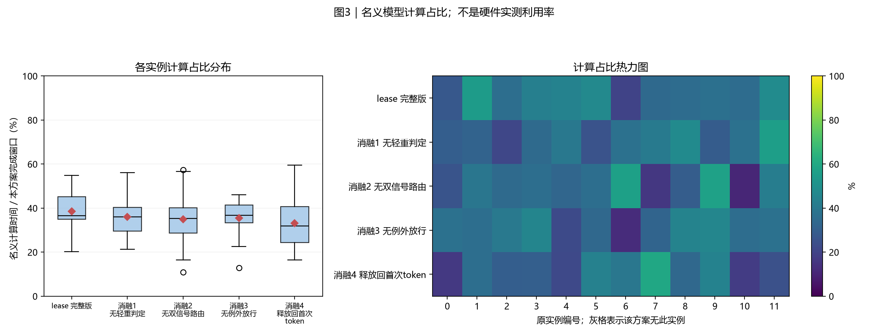
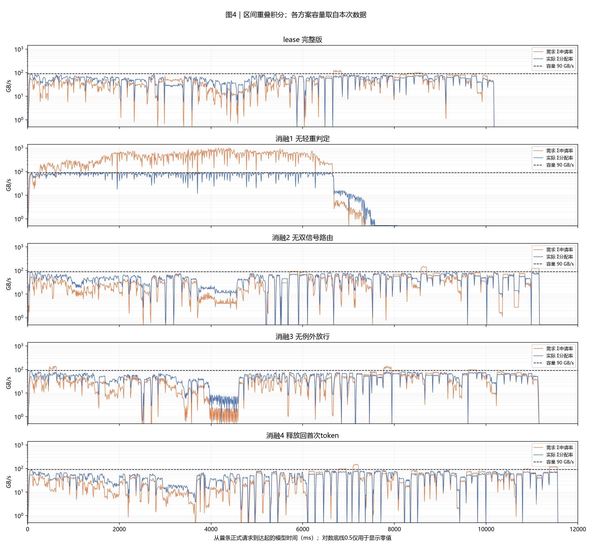
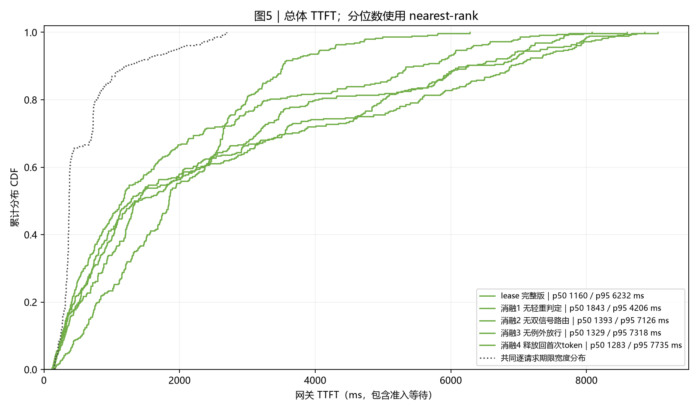
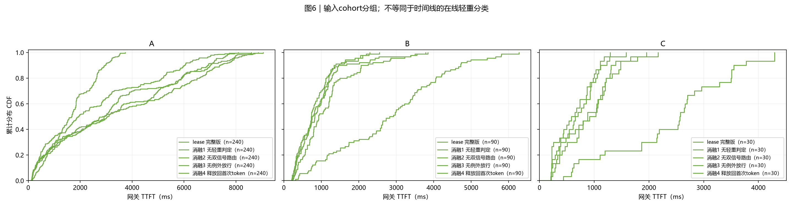
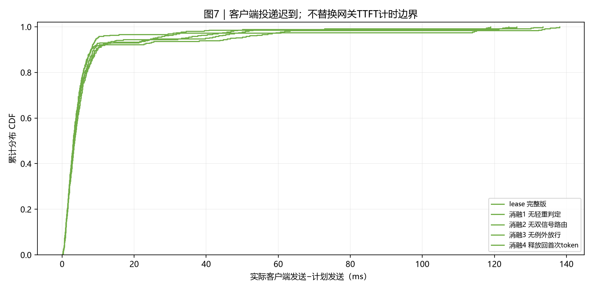

# 实验结果：mooncake_abc_360_4s_12_90GBps：租约四技术消融

|项目|约定|
|---|---:|
|执行边界|从冻结日志离线整理；本次没有重跑实验|
|方案顺序|lease 完整版 → 消融1 无轻重判定 → 消融2 无双信号路由 → 消融3 无例外放行 → 消融4 释放回首次token|
|输入种子 / 重复|每个case独立展示一个冻结运行；种子与重复见附表，未提供时不推断|
|汇总 / 轨迹|不跨case合并样本、不生成置信区间；轨迹保留全部正式请求|
|SLO / TTFT|逐请求匹配deadline；TTFT=first_token−gateway arrival，包含准入等待|
|分组|分类表和CDF使用输入cohort；时间线使用在线轻重判定|
|单位|时间秒/毫秒；容量字节；带宽GB/s=10^9 B/s|

## 0. 总判决

## 0 结论

**Mooncake abc 90GB/s（A240/B90/C30，4s 窗口）** 上的租约四技术消融（tfs-lease 单臂，每次移除一项，其余保持定标参数）。
- 完整版与三个消融配置同日运行；direct 与 α=0.1 作为外部参照。
- 消融结果见第 1 章汇总表；单轮运行，方向性结论以两项负载一致为准。

## 1. 汇总表与 SLO 柱状图

|方案|请求数|完成ms|平均TTFT ms|p95 ms|SLO%|网关等待ms|
|---|---:|---:|---:|---:|---:|---:|
|lease 完整版|360|10175.0|1996.5|6231.7|31.1|1.1|
|消融1 无轻重判定|360|9058.1|2011.3|4205.8|11.1|0.7|
|消融2 无双信号路由|360|11162.4|2584.0|7125.9|25.3|1.4|
|消融3 无例外放行|360|11147.3|2401.5|7318.0|28.9|1.2|
|消融4 释放回首次token|360|11563.0|2618.2|7734.5|30.8|1.1|

分类结果使用输入cohort：

|方案|分组|请求数|平均TTFT ms|SLO%|
|---|---:|---:|---:|---:|
|lease 完整版|A|240|2593.9|12.1|
|lease 完整版|B|90|847.5|72.2|
|lease 完整版|C|30|664.4|60.0|
|消融1 无轻重判定|A|240|1665.6|5.8|
|消融1 无轻重判定|B|90|2804.4|23.3|
|消融1 无轻重判定|C|30|2397.2|16.7|
|消融2 无双信号路由|A|240|3329.0|10.4|
|消融2 无双信号路由|B|90|1160.2|60.0|
|消融2 无双信号路由|C|30|895.3|40.0|
|消融3 无例外放行|A|240|3162.6|10.8|
|消融3 无例外放行|B|90|884.2|72.2|
|消融3 无例外放行|C|30|864.8|43.3|
|消融4 释放回首次token|A|240|3503.8|12.9|
|消融4 释放回首次token|B|90|904.0|71.1|
|消融4 释放回首次token|C|30|675.4|53.3|



**读法**：柱高与上表同口径。每条请求使用自身期限判断是否达标。

## 2. 各方案 full-sort-ms 执行时间线




**读法**：蓝重读、橙轻读、紫轻重混批。红色为未被名义计算覆盖的在途IO，灰色含空闲、排队和控制。动态与冻结分类分别标注；直接放行分类仅作参考。虚线右侧仅为统一横轴补齐。

## 3. 模型计算占比分布与热力图




**读法**：箱线和热力图来自同一组逐实例数据。分母是各方案从首次正式到达到末条首token的窗口。该值不是硬件实测利用率。

## 4. 存储带宽时序




**读法**：橙线为需求，蓝线为实际分配，虚线为本次容量。按时间重叠积分，不对不等长事件直接取平均。零值在CSV保留0。

|方案|平均GB/s|需求超订%|实际饱和%|
|---|---:|---:|---:|
|lease 完整版|53.0|22.6|58.9|
|消融1 无轻重判定|59.6|60.1|66.2|
|消融2 无双信号路由|48.3|20.6|53.7|
|消融3 无例外放行|48.4|17.9|53.8|
|消融4 释放回首次token|46.7|18.4|51.8|

## 5. TTFT 累积分布 CDF




**读法**：经验CDF按rank/n绘制，终点为1。期限不同时，SLO必须逐请求匹配，不能由两条CDF交点推算。




**读法**：此处分组来自cohort，可能是历史A/B或业务分类，不用该标签推断在线轻重。

## 6. 机制解释与前序对照

## 6 机制与前序对照

- 消融1 无轻重判定（heavy 线=∞，零门控零消息）：等同 direct 语义+lease 管道。
- 消融2 无双信号路由（f=1，等待全计分，无反压钳位）。
- 消融3 无例外放行（例外带=判定线，五步只剩正常路+护栏）。
- 消融4 释放回首次 token（读毕事件只记录不释放，账本持有至首 token）。

## 7. 计算模型与结论限制

## 7 限制

- 单轮消融，噪声 ±15%~30%；配置间小于该量级的差异不下结论。
- 消融为"整项移除"，不拆解项内子机制（如条件(a)/(b)分别的贡献）。

## 8. 附表




**读法**：此图描述客户端实际发送相对计划的迟到，不是单次准入RPC耗时。

|方案|实例数|模型计算占比%|运行标识|
|---|---:|---:|---:|
|lease 完整版|12|38.6|{"round": "lease-final-r3"}|
|消融1 无轻重判定|12|36.0|{"round": "abl2-no-classify-abc"}|
|消融2 无双信号路由|12|34.9|{"round": "abl2-no-route-abc"}|
|消融3 无例外放行|12|35.4|{"round": "abl2-no-exception-abc"}|
|消融4 释放回首次token|12|33.2|{"round": "abl4-no-events-abc"}|

|方案|序列上限|token预算|存储容量GB/s|准入位置 / 规则|计算模型|
|---|---:|---:|---:|---:|---:|
|lease 完整版|4|8192|90.0|scheduler / bandwidth_line|glm5_actual_batch_work_v2|
|消融1 无轻重判定|4|8192|90.0|scheduler / bandwidth_line|glm5_actual_batch_work_v2|
|消融2 无双信号路由|4|8192|90.0|scheduler / bandwidth_line|glm5_actual_batch_work_v2|
|消融3 无例外放行|4|8192|90.0|scheduler / bandwidth_line|glm5_actual_batch_work_v2|
|消融4 释放回首次token|4|8192|90.0|scheduler / bandwidth_line|glm5_actual_batch_work_v2|

## 8 附表口径

- 同主报告口径；消融臂 hint/账本口径不变。

## 9. 验证、数据与复现

已校验请求计数、逐请求SLO、nearest-rank分位数、CDF概率质量、实例时间账本及可用带宽积分。图片人工检查状态见校验文件。

- [校验记录](report_data/validation.json)
- [方案汇总](report_data/run_summary.csv)
- [请求明细](report_data/requests.csv)
- [标准重绘数据](report_data/dataset.json.gz)
- [复现入口](reproduce/generate_report.py)

在报告目录执行：

```bash
python reproduce/generate_report.py --dataset report_data/dataset.json --output ../reproduced-report
```

## 10. 简要解读

## 10 解读

- 见汇总表：各项技术对该负载 mean/SLO 的方向性贡献。
