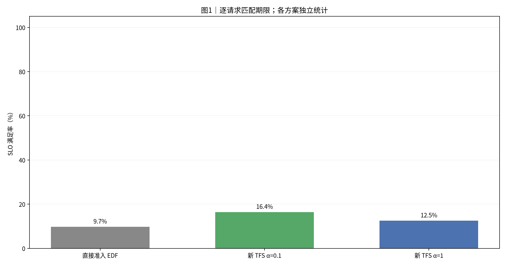
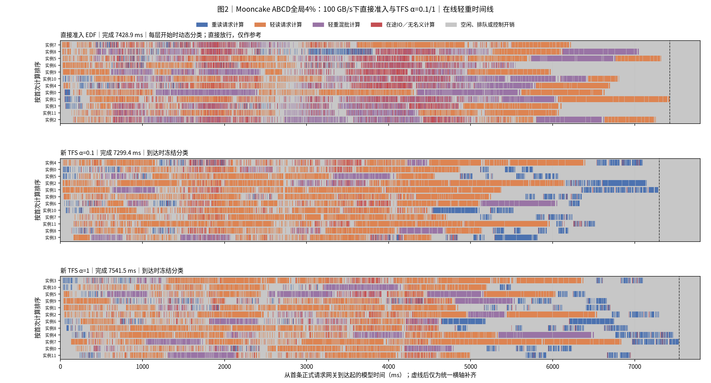
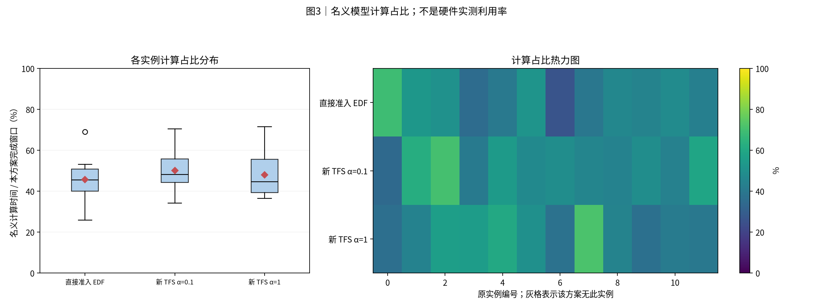
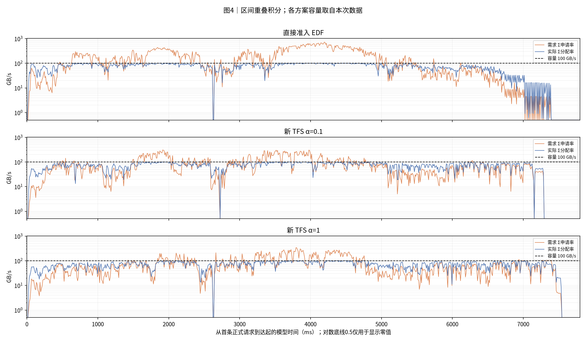
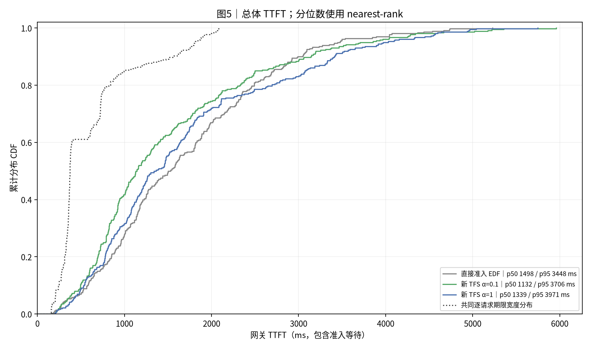
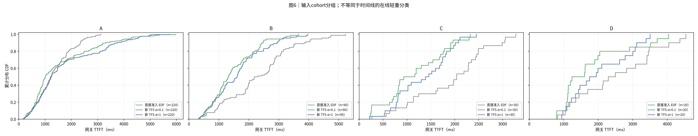
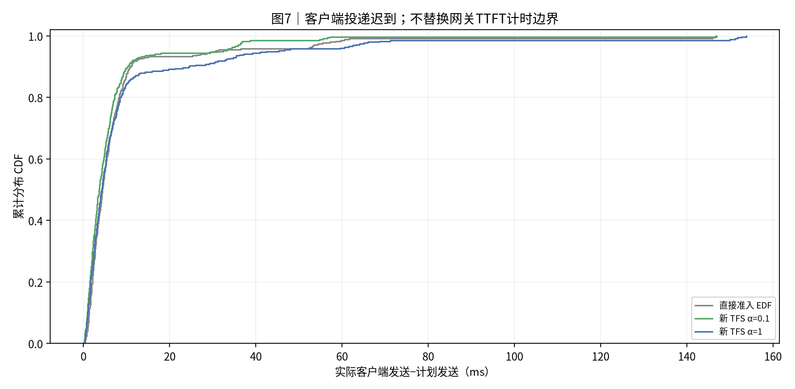

# mooncake_abcd_360_4s_12_100GBps｜直接提交 EDF；TFS EDF α=0.1；TFS EDF α=1

|归档信息|内容|
|---|---|
|报告创建时间|2026-10-30T16:27:07+08:00，Asia/Shanghai|
|实际实验日期|2026-10-30；源记录未提供的精确时刻不推断|
|Benchmark|[mooncake_abcd_360_4s_12_100GBps](../../../benchmark/mooncake_abcd_360_4s_12_100GBps/README.md)|
|本次操作|只归档既有结果；未运行仿真、未改变性能数值；原图字节保持一致|
|归档清单|[manifest.json](manifest.json)、[归档校验](archive_validation.json)|
|原报告标题|实验结果：Mooncake ABCD全局4%：100 GB/s下直接准入与TFS α=0.1/1|


|项目|约定|
|---|---:|
|执行边界|2026-10-30重新执行三组；真实Dynamo/vLLM控制面，模型执行与存储为CPU仿真；本报告离线读取已完成日志|
|方案顺序|直接准入 EDF → 新 TFS α=0.1 → 新 TFS α=1|
|输入种子 / 重复|每个case独立展示一个冻结运行；种子与重复见附表，未提供时不推断|
|汇总 / 轨迹|不跨case合并样本、不生成置信区间；轨迹保留全部正式请求|
|SLO / TTFT|逐请求匹配deadline；TTFT=first_token−gateway arrival，包含准入等待|
|分组|分类表和CDF使用输入cohort；时间线使用在线轻重判定|
|单位|时间秒/毫秒；容量字节；带宽GB/s=10^9 B/s|
|实验日 / 整理日|2026-10-30 / 2026-10-30|
|输入|conversation前360条；保留input与到达节奏，4秒计划窗口；人工重分配h/u，不用原output/hash_ids推导命中|
|人工类别|A220/B90/C30/D20；D为最长20条原A|
|token与读取量|input 5117755；新计算204699（3.999781%）；外部读取539571462144 B；每条输出1 token|
|共同资源|12逻辑实例；单共享池100 GB/s；block16；每步≤4请求/8192新token；K=1|
|预热与重复|每组72预热排空、清分类历史并重置GC；360正式请求；各方案本轮一次|
|策略|均EDF；直接准入完整路由计分；TFS调度前准入、到达冻结P75、首token释放；无强制/老化|
|计算与反馈|glm5_actual_batch_work_v2；TP1/DP8/EP8；78层；同步batch反馈；coalesced关闭|
|通信|沿用交付benchmark的Unix额度通信；Dynamo数据路由及原生预留保留|
|代码版本|独立交付3f515a2；与上一轮α0.5的sim/patched/native及输入一致，仅运行器arm选择不同|

## 0. 总判决

三组各360条正式请求全部完成并通过原生验收。**完成最快：新 TFS α=0.1（7299.4 ms）；平均TTFT最低：新 TFS α=0.1（1508.9 ms）；SLO最高：新 TFS α=0.1（16.39%）。**

相对本轮重新运行的直接准入，负百分比表示用时减少：

|方案|完成时间变化|平均TTFT变化|SLO变化|
|---|---:|---:|---:|
|新 TFS α=0.1|-1.74%|-10.45%|+6.67个百分点|
|新 TFS α=1|+1.52%|+0.27%|+2.78个百分点|

每方案本轮只有一次。上述排名和差值仅描述这些运行，不判断稳定最优。

## 1. 汇总表与 SLO 柱状图

|方案|请求数|完成ms|平均TTFT ms|p95 ms|SLO%|网关等待ms|
|---|---:|---:|---:|---:|---:|---:|
|直接准入 EDF|360|7428.9|1684.9|3448.1|9.7|1.4|
|新 TFS α=0.1|360|7299.4|1508.9|3705.6|16.4|1.4|
|新 TFS α=1|360|7541.5|1689.4|3970.6|12.5|1.8|

分类结果使用输入cohort：

|方案|分组|请求数|平均TTFT ms|SLO%|
|---|---:|---:|---:|---:|
|直接准入 EDF|A|220|1322.7|6.8|
|直接准入 EDF|B|90|2314.1|11.1|
|直接准入 EDF|C|30|1904.3|10.0|
|直接准入 EDF|D|20|2509.1|35.0|
|新 TFS α=0.1|A|220|1548.6|5.0|
|新 TFS α=0.1|B|90|1474.2|30.0|
|新 TFS α=0.1|C|30|1143.3|26.7|
|新 TFS α=0.1|D|20|1776.8|65.0|
|新 TFS α=1|A|220|1732.3|3.6|
|新 TFS α=1|B|90|1626.8|26.7|
|新 TFS α=1|C|30|1339.7|13.3|
|新 TFS α=1|D|20|2024.0|45.0|



**读法**：柱高与上表同口径。每条请求使用自身期限判断是否达标。

## 2. 各方案 full-sort-ms 执行时间线




**读法**：蓝重读、橙轻读、紫轻重混批。红色为未被名义计算覆盖的在途IO，灰色含空闲、排队和控制。动态与冻结分类分别标注；直接放行分类仅作参考。虚线右侧仅为统一横轴补齐。

## 3. 模型计算占比分布与热力图




**读法**：箱线和热力图来自同一组逐实例数据。分母是各方案从首次正式到达到末条首token的窗口。该值不是硬件实测利用率。

## 4. 存储带宽时序




**读法**：橙线为需求，蓝线为实际分配，虚线为本次容量。按时间重叠积分，不对不等长事件直接取平均。零值在CSV保留0。

|方案|平均GB/s|需求超订%|实际饱和%|
|---|---:|---:|---:|
|直接准入 EDF|72.6|47.4|72.6|
|新 TFS α=0.1|73.9|32.4|73.9|
|新 TFS α=1|71.5|28.9|71.5|

## 5. TTFT 累积分布 CDF




**读法**：经验CDF按rank/n绘制，终点为1。期限不同时，SLO必须逐请求匹配，不能由两条CDF交点推算。




**读法**：此处分组来自cohort，可能是历史A/B或业务分类，不用该标签推断在线轻重。

## 6. 机制解释与前序对照

### 6.1 组批与实例负载

|方案|批次数|平均batch|总模型计算/实例秒|实例计算量最小/最大秒|
|---|---:|---:|---:|---:|
|直接准入 EDF|132|2.727|40.728|1.922 / 5.135|
|新 TFS α=0.1|177|2.034|43.854|2.496 / 5.143|
|新 TFS α=1|171|2.111|43.373|2.745 / 5.398|

相同新计算token总数不等于相同模型计算时间。本轮使用实际组批v2，批次组成会影响解析计时。表中模型时间不包含主机控制开销，不能只凭batch大小解释全部完成时间。实例最重计算量、在途IO与队列/控制等待共同决定尾部。

### 6.2 人工类别与在线重读

|方案|人工类别|请求数|到达冻结重读数|
|---|---:|---:|---:|
|新 TFS α=1|A|220|91|
|新 TFS α=1|B|90|0|
|新 TFS α=1|C|30|0|
|新 TFS α=1|D|20|3|
|新 TFS α=0.1|A|220|92|
|新 TFS α=0.1|B|90|0|
|新 TFS α=0.1|C|30|0|
|新 TFS α=0.1|D|20|3|

A/B/C/D是构造标签；是否被TFS限制取决于到达时的P75。该表读取本轮实际冻结标记，不能用整批静态P75替代。直接准入图中的动态轻重分类仅作参考，不代表执行过TFS准入。

### 6.3 额度查询

|方案|申请次数|拒绝次数|均值ms|P95 ms|最大ms|累计实例ms|
|---|---:|---:|---:|---:|---:|---:|
|新 TFS α=1|2706|2612|0.780|3.839|35.423|2111.4|
|新 TFS α=0.1|2061|1966|0.671|3.276|11.505|1381.9|

累计申请时间是所有实例之和，不能直接加到完成时间。调用时长包含同步适配、传输、账本处理及获准后评分更新，不等同纯网络延迟。

## 7. 计算模型与结论限制

### 7.1 负载构造

|人工类别|条数|单请求新算token范围|新算token总量|总读取GB|
|---|---:|---:|---:|---:|
|A|220|1–16|1878|371.553|
|B|90|592–3192|134805|9.536|
|C|30|892–965|27256|0.000|
|D|20|2033–2046|40760|158.482|

A取最少1–16个新算token，C取最短30条且零读取，B承接剩余全局计算额度。ABCD保留B/C成员，把最长20条原A改为D，D新增计算额度从B转移；不重排原到达顺序。人工类别不等于在线P75重读判定。

### 7.2 模型与边界

两份负载均人工分配全局4%未命中：新算204699 token，总读取539.571462144 GB，保留原输入长度与4秒计划到达。平均输入读取需求134.893 GB/s，为100 GB/s池的134.9%；只按总读量计算的存储时间下界为5.3957秒，不是可实现完成时间预测。ABC与ABCD分配h/u不同，不能用共同总token数断言计算负载完全相等。

K=1；实际组批v2；3层Dense+75层MoE；TP1/DP8/EP8。名义模型时间、存储分配和KV传输均为仿真，HTTP/IPC、额度查询、反馈与轮询在CPU上实际执行。本轮沿用交付版同步batch反馈与Unix额度通信，没有切换为另一研究分支的直接求和模型、四反馈移除或Dynamo额度RPC版本。

三组EDF一致；TFS只改变等待重读评分α，仍按首token释放，未启用强制准入。请求期限均由100GB/s的新画像重算。本次未运行真实GPU/NPU，也未重复多轮或提供统计显著性。红色在途IO不等于纯依赖阻塞，灰色不是全都无请求。

## 8. 附表




**读法**：此图描述客户端实际发送相对计划的迟到，不是单次准入RPC耗时。

|方案|实例数|模型计算占比%|运行标识|
|---|---:|---:|---:|
|直接准入 EDF|12|45.7|{"repeat": 1, "matrix_seed": 20261030, "case": "global4_abcd", "arm": "direct", "phase": "fresh_20261030", "bandwidth_GBps": 100}|
|新 TFS α=0.1|12|50.1|{"repeat": 1, "matrix_seed": 20261030, "case": "global4_abcd", "arm": "tfs-a01", "phase": "fresh_20261030", "bandwidth_GBps": 100}|
|新 TFS α=1|12|47.9|{"repeat": 1, "matrix_seed": 20261030, "case": "global4_abcd", "arm": "tfs-a1", "phase": "fresh_20261030", "bandwidth_GBps": 100}|

|方案|序列上限|token预算|存储容量GB/s|准入位置 / 规则|计算模型|
|---|---:|---:|---:|---:|---:|
|直接准入 EDF|4|8192|100.0|gateway / dynamic|glm5_actual_batch_work_v2|
|新 TFS α=0.1|4|8192|100.0|scheduler / arrival|glm5_actual_batch_work_v2|
|新 TFS α=1|4|8192|100.0|scheduler / arrival|glm5_actual_batch_work_v2|

### 8.1 资源检查

|方案|WSL全局swap峰值GiB|宿主可用内存最小GiB|
|---|---:|---:|
|直接准入 EDF|0.000000|8.511|
|新 TFS α=0.1|0.000000|8.202|
|新 TFS α=1|0.000000|8.381|

所有正式驱动均未触发资源保护，所属进程检查无残留。swap为WSL全局值，不是单个进程的换出量。


## 9. 验证、数据与复现

已校验请求计数、逐请求SLO、nearest-rank分位数、CDF概率质量、实例时间账本及可用带宽积分。图片人工检查状态见校验文件。

- [校验记录](report_data/source_validation.json)
- [方案汇总](report_data/run_summary.csv)
- [请求明细](report_data/requests.csv)
- [标准重绘数据](report_data/dataset.json.gz)
- [复现入口](../../../scripts/report_tools/generate_report.py)

在报告目录执行：

```bash
python reproduce/generate_report.py --dataset report_data/dataset.json --output ../reproduced-report
```

## 10. 简要解读

先按目标选指标：总完成时间、平均TTFT、P95与逐请求SLO可能给出不同排名。结合完整时间线与带宽图，区分需求峰值降低、存储实际饱和时间、计算分配和尾部等待。已有数据只支持本轮观察，不能仅因橙线降低就认定吞吐提高。下一步若要确认α收益，应使用相同运行版本重复配对实验，并保留全部有效结果。

## 归档与复现补充

本轮选取的原始数据表及配图保留来源指纹。较大的派生数据用 gzip 无损压缩，原始运行日志不随本归档发布。[复现说明](reproduce/README.md)区分数据重绘和完整仿真重跑；源验证记录与归档验证不是同一次验收。
