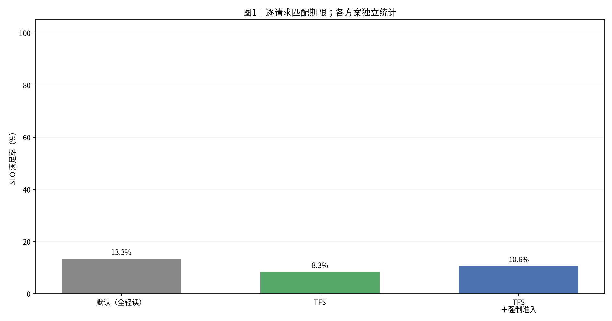
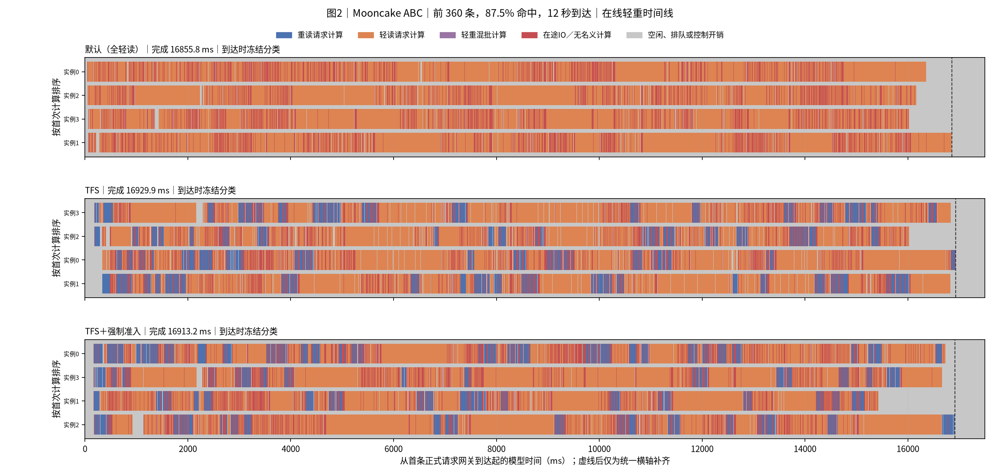
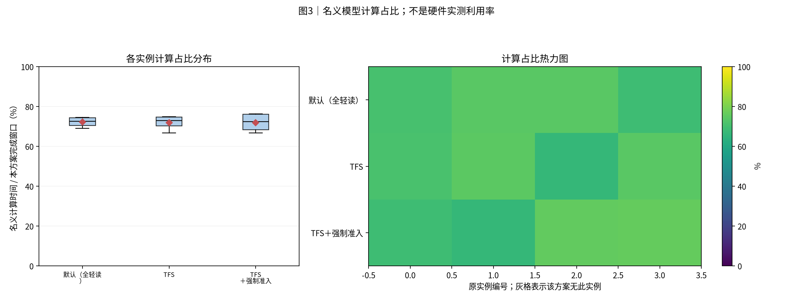
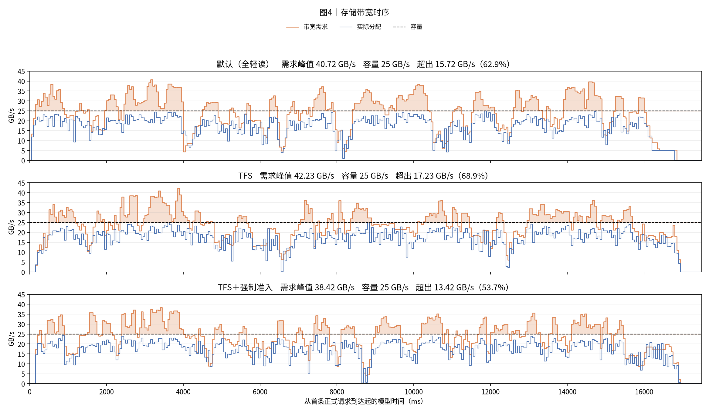
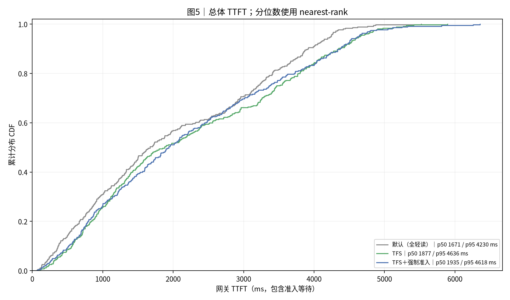
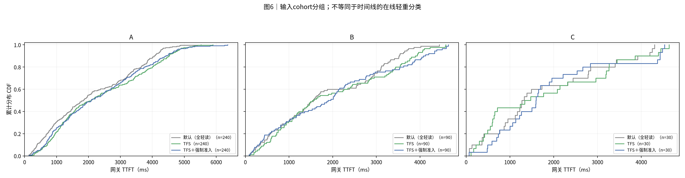
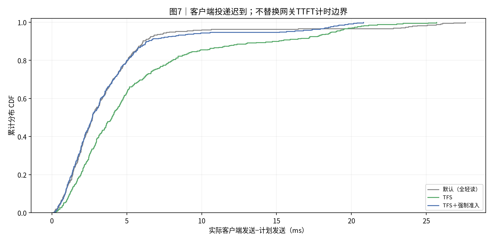

# 实验结果：Mooncake ABC｜前 360 条，87.5% 命中，12 秒到达

|项目|约定|
|---|---:|
|执行边界|四实例 CPU 进程栈仿真，原生 Dynamo 1.2 路由与 MiniMax 16 层计算模型。|
|方案顺序|默认（全轻读） → TFS → TFS＋强制准入|
|输入种子 / 重复|每个case独立展示一个冻结运行；种子与重复见附表，未提供时不推断|
|汇总 / 轨迹|不跨case合并样本、不生成置信区间；轨迹保留全部正式请求|
|SLO / TTFT|逐请求匹配deadline；TTFT=first_token−gateway arrival，包含准入等待|
|分组|分类表和CDF使用输入cohort；时间线使用在线轻重判定|
|单位|时间秒/毫秒；容量字节；带宽GB/s=10^9 B/s|
|取样|Mooncake conversation trace 开头 360 条，沿用原四实例 12 秒实验的到达时刻及输入长度。三条超长输入沿用先前的截断。输出 1 token。|
|模型|四实例 FCFS，每实例每步最多一条，计算预算 50,000 token。6 盘共用 25 GB/s，α=0.1。|
|请求形状|总输入 5,072,443 token，预置命中 4,438,400 token。按原 ABC 成员和 128-token 块，B/C 的前缀保持原样，A 按 prompt 长度分配剩余命中预算。|
|计时|下表使用客户端发送到首 token 的时间。后续图表采用网关登记到首 token 的时间。|
|输入 SHA256|8e2b54aef1a915a106687c1710ba4cef2be7b8dc07aa8111589b8b7308792796|

## 0. 总判决

TFS 相对默认策略，完成时间变化 +0.4%，客户端平均 TTFT 变化 +11.9%。 TFS＋强制准入 相对默认策略，完成时间变化 +0.3%，客户端平均 TTFT 变化 +10.5%。

三种策略各运行一轮，输入和到达时刻一致。

|策略|完成 s|客户端平均 TTFT s|客户端 P95 s|首层累计等待 s|后 15 层累计等待 s|强制放行次数|
|---|---|---|---|---|---|---|
|默认（全轻读）|16.886|2.007|4.233|3.851|9.028|0|
|TFS|16.953|2.246|4.640|3.660|7.469|0|
|TFS＋强制准入|16.937|2.217|4.624|3.716|8.637|11|

|类别|策略|请求数|平均 TTFT s|P95 s|
|---|---|---|---|---|
|A|默认（全轻读）|240|2.096|4.268|
|B|默认（全轻读）|90|1.844|3.705|
|C|默认（全轻读）|30|1.790|4.255|
|A|TFS|240|2.391|4.795|
|B|TFS|90|1.994|4.073|
|C|TFS|30|1.838|4.450|
|A|TFS＋强制准入|240|2.335|4.753|
|B|TFS＋强制准入|90|2.007|4.388|
|C|TFS＋强制准入|30|1.909|4.485|

三档命中率使用相同的到达时刻。KV 读取量分别为 282.562 GB、290.875 GB、299.188 GB。以下按客户端口径比较，每格取单轮结果。

|命中率|策略|完成 s|平均 TTFT s|P95 TTFT s|
|---|---|---|---|---|
|85%|默认（全轻读）|19.407|2.635|5.591|
|85%|TFS|18.892|2.809|5.704|
|85%|TFS＋强制准入|18.423|2.692|5.547|
|87.5%|默认（全轻读）|16.886|2.007|4.233|
|87.5%|TFS|16.953|2.246|4.640|
|87.5%|TFS＋强制准入|16.937|2.217|4.624|
|90%|默认（全轻读）|15.766|1.627|3.454|
|90%|TFS|16.876|1.915|5.605|
|90%|TFS＋强制准入|15.781|1.712|4.591|

## 1. 汇总表与 SLO 柱状图

|方案|请求数|完成ms|平均TTFT ms|p95 ms|SLO%|网关等待ms|
|---|---:|---:|---:|---:|---:|---:|
|默认（全轻读）|360|16855.8|2000.5|4229.7|13.3|56.4|
|TFS|360|16929.9|2238.0|4636.3|8.3|60.8|
|TFS＋强制准入|360|16913.2|2211.0|4617.5|10.6|60.7|

分类结果使用输入cohort：

|方案|分组|请求数|平均TTFT ms|SLO%|
|---|---:|---:|---:|---:|
|默认（全轻读）|A|240|2088.2|15.4|
|默认（全轻读）|B|90|1838.8|8.9|
|默认（全轻读）|C|30|1784.3|10.0|
|TFS|A|240|2382.9|9.6|
|TFS|B|90|1987.9|5.6|
|TFS|C|30|1828.5|6.7|
|TFS＋强制准入|A|240|2328.3|10.0|
|TFS＋强制准入|B|90|2000.5|14.4|
|TFS＋强制准入|C|30|1903.1|3.3|



**读法**：柱高与上表同口径。每条请求使用自身期限判断是否达标。

## 2. 各方案 full-sort-ms 执行时间线




**读法**：蓝重读、橙轻读、紫轻重混批。红色为未被名义计算覆盖的在途IO，灰色含空闲、排队和控制。动态与冻结分类分别标注；直接放行分类仅作参考。虚线右侧仅为统一横轴补齐。

## 3. 模型计算占比分布与热力图




**读法**：箱线和热力图来自同一组逐实例数据。分母是各方案从首次正式到达到末条首token的窗口。该值不是硬件实测利用率。

## 4. 存储带宽时序




**读法**：各方案共用从零起的线性纵轴。橙线为需求，蓝线为实际分配，黑虚线为容量。橙色阴影的高度表示需求超出容量的 GB/s。峰值取图中时间桶的平均需求最大值。

|方案|平均GB/s|需求超订%|实际饱和%|
|---|---:|---:|---:|
|默认（全轻读）|17.3|54.9|10.4|
|TFS|17.2|47.8|6.8|
|TFS＋强制准入|17.2|49.1|5.9|

## 5. TTFT 累积分布 CDF




**读法**：经验CDF按rank/n绘制，终点为1。期限不同时，SLO必须逐请求匹配，不能由两条CDF交点推算。




**读法**：此处分组来自cohort，可能是历史A/B或业务分类，不用该标签推断在线轻重。

## 6. 机制解释与前序对照

强制准入组发放 101 次重读许可，其中强制放行 11 次。首层累计等待从提交到完成；后 15 层统计上一层计算结束时仍需等待读取的时间。各实例可以同时等待。

默认策略累计模型计算 48.67 个实例秒，均分四实例的理想下限为 12.17 秒。默认组后 15 层累计暴露读取等待为 9.03 秒，按请求累计，可跨实例重叠。

|策略|重读标记|许可|拒绝次数|被跳过请求|强制放行|同时持有峰值|额度范围|
|---|---|---|---|---|---|---|---|
|默认（全轻读）|0|0|0|0|0|0|2–75|
|TFS|99|99|128|19|0|2|2–75|
|TFS＋强制准入|101|101|24|12|11|5|2–75|

默认策略的需求峰值为 40.72 GB/s，按 50 ms 分箱，超过链路容量的时长合计 9.25 秒。常规 TFS 在 19 条请求上观察到因额度跳过，首层累计等待从 3.851 秒变为 3.660 秒，后 15 层从 9.028 秒变为 7.469 秒。

## 7. 计算模型与结论限制

命中长度由实验预置。A 为最长的 240 条，B 为接下来的 90 条，C 为最短的 30 条。87.5% 按全体输入 token 加权。运行时重读分类见准入表。

## 8. 附表




**读法**：此图描述客户端实际发送相对计划的迟到，不是单次准入RPC耗时。

|方案|实例数|模型计算占比%|运行标识|
|---|---:|---:|---:|
|默认（全轻读）|4|72.2|{"repeat": 1, "ordering": "FCFS", "alpha": 0.1}|
|TFS|4|71.9|{"repeat": 1, "ordering": "FCFS", "alpha": 0.1}|
|TFS＋强制准入|4|71.9|{"repeat": 1, "ordering": "FCFS", "alpha": 0.1}|

|方案|序列上限|token预算|存储容量GB/s|准入位置 / 规则|计算模型|
|---|---:|---:|---:|---:|---:|
|默认（全轻读）|1|50000|25.0|scheduler / arrival|未提供|
|TFS|1|50000|25.0|scheduler / arrival|未提供|
|TFS＋强制准入|1|50000|25.0|scheduler / arrival|未提供|

每组读取 290.875 GB，330 条请求加载 KV，每条 16 层。读取量按 12 秒到达窗口均摊为 24.24 GB/s。带宽图给出随执行时间变化的需求和实际分配。

|策略|需求峰值 GB/s（50 ms 分箱）|需求超过 25 GB/s 的时长 s|
|---|---|---|
|默认（全轻读）|40.72|9.25|
|TFS|42.23|8.10|
|TFS＋强制准入|38.42|8.30|

## 9. 验证、数据与复现

已校验请求计数、逐请求SLO、nearest-rank分位数、CDF概率质量、实例时间账本及可用带宽积分。图片人工检查状态见校验文件。

- [校验记录](report_data/validation.json)
- [方案汇总](report_data/run_summary.csv)
- [请求明细](report_data/requests.csv)
- [标准重绘数据](report_data/dataset.json)
- [复现入口](reproduce/generate_report.py)

在报告目录执行：

```bash
python reproduce/generate_report.py --dataset report_data/dataset.json --output ../reproduced-report
```

## 10. 简要解读

图 2 对照四实例执行与排空，图 4 对照需求和带宽分配，图 6 对照 A/B/C 的首 token 延迟。
