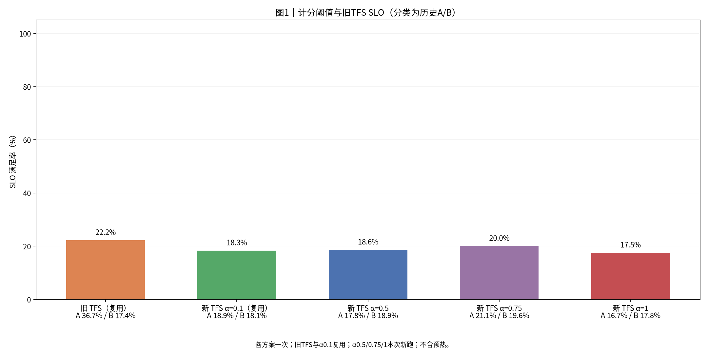
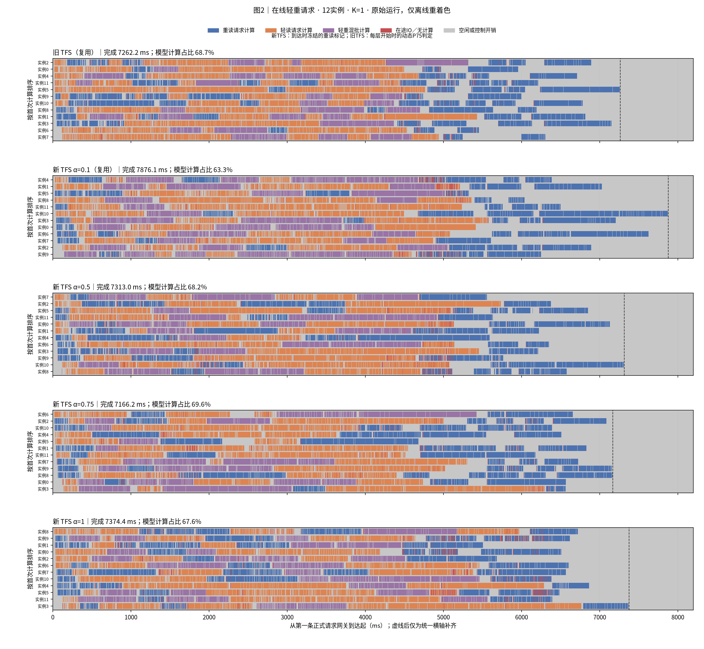
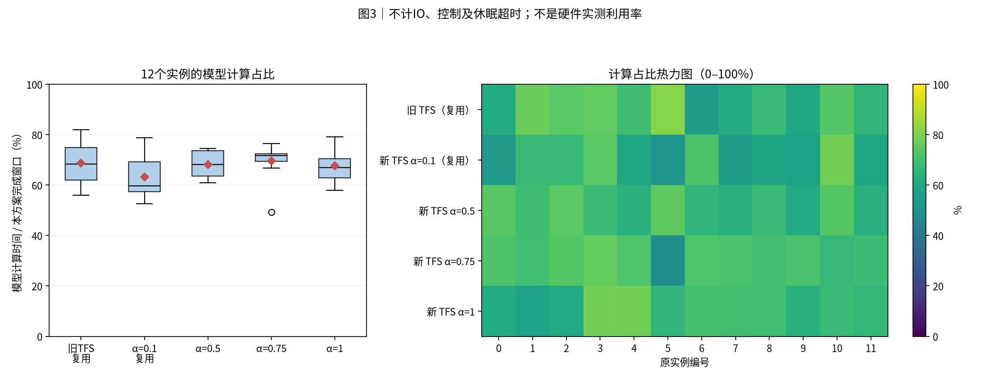
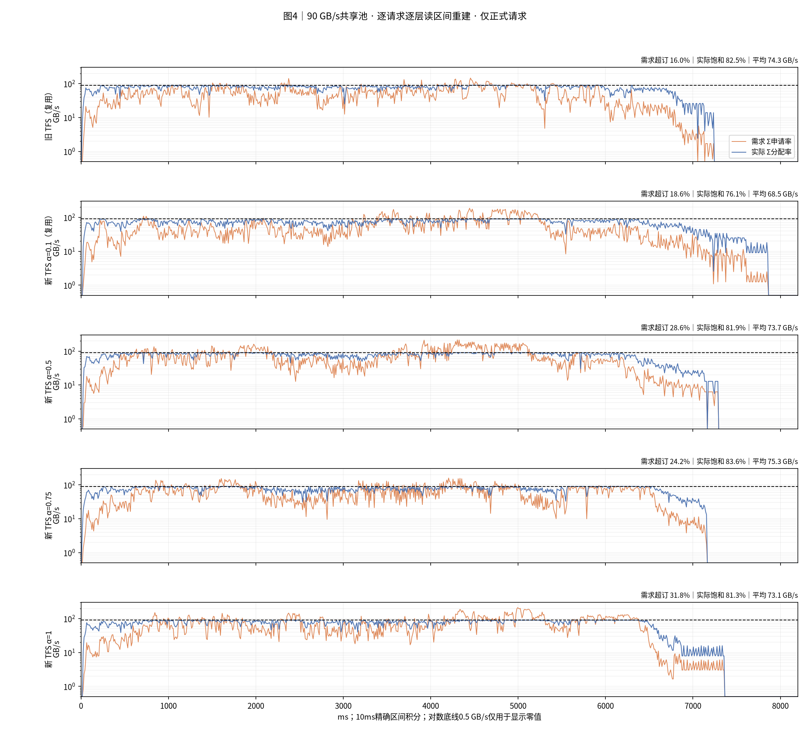
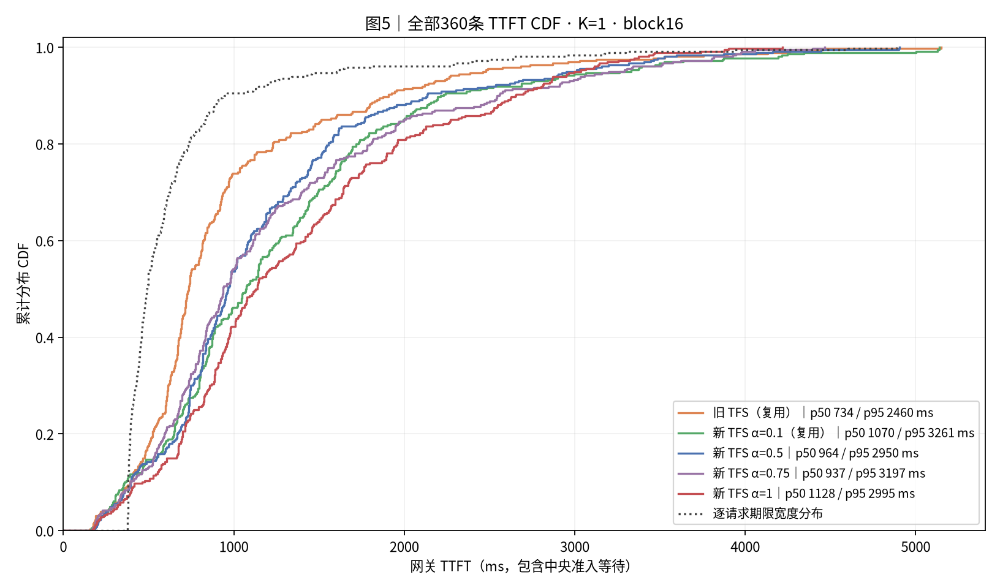
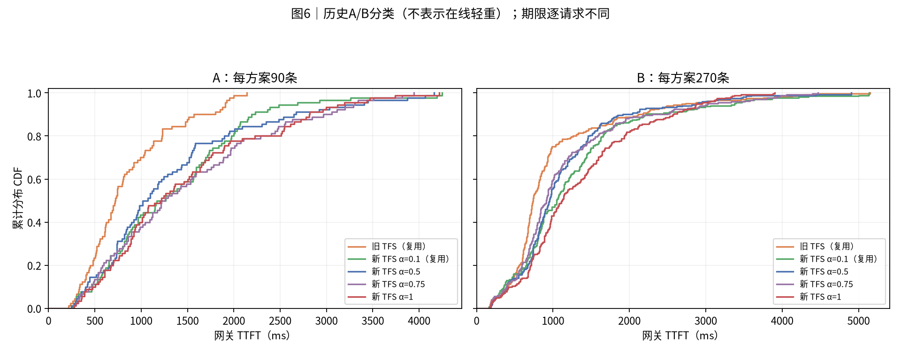
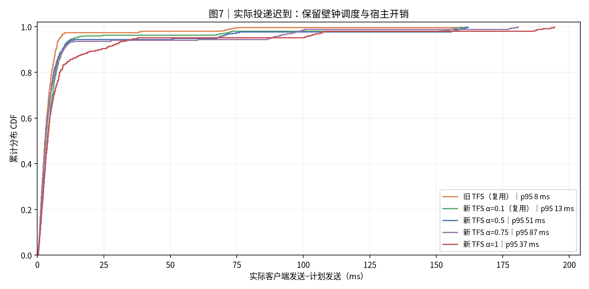

# mooncake_random_360_4s_12_90GBps｜旧TFS FCFS；TFS EDF α=0.1；TFS EDF α=0.5；TFS EDF α=0.75；TFS EDF α=1

|归档信息|内容|
|---|---|
|报告创建时间|2026-10-30T16:27:07+08:00，Asia/Shanghai|
|实际实验日期|2026-10-29；源记录未提供的精确时刻不推断|
|Benchmark|[mooncake_random_360_4s_12_90GBps](../../../benchmark/mooncake_random_360_4s_12_90GBps/README.md)|
|本次操作|只归档既有结果；未运行仿真、未改变性能数值；原图字节保持一致|
|归档清单|[manifest.json](manifest.json)、[归档校验](archive_validation.json)|
|原报告标题|实验结果：Mooncake360 90 GB/s计分阈值对照|

**历史版本报告**：本报告使用 glm5_direct_sum_v1、关闭执行反馈；当前同名 benchmark 配置使用 glm5_actual_batch_work_v2、同步 batch 反馈。输入和资源对应，不能把历史指标视为当前配置的新结果。

|项目|约定|
|---|---:|
|实验日 / 整理日|2026-10-29；新跑α0.5、0.75、1各一次；复用此前90GB/s的α0.1和旧TFS|
|输入|conversation前360条，保留顺序和同刻组；计划0–4秒到达；A90/B270为固定展示标签|
|命中|人为96%远端前缀命中，向下对齐完整16-token块；实际token命中率95.9446%|
|工作量|5117755输入token；4910208命中；207547新增token；539258683392B读取|
|资源|1个真实Dynamo前端、12个真实vLLM实例及EngineCore；设备计算与传输为仿真；K=1|
|组批|batch≤4；每步8192新增token；30159逻辑块；block16；本地前缀缓存关闭|
|计算|glm5_direct_sum_v1；launch_saving_fraction=1；78层；固定参考TP1/DP8/EP8|
|存储与额度|90 GB/s统一池；逐层读、预取下一层；P75人数额度；首token释放；强制准入关闭|
|受控变量|四组新TFS仅routing_accounting.waiting_factor不同；α1仍保留准入RPC、额度和记账|
|时间线分类|蓝色重读、橙色轻读、紫色轻重混批；新TFS用到达时冻结标记；旧TFS取每层开始时动态P75快照|
|预热 / 重复|每组72条预热并排空、清画像历史、重置GC；360条正式；每配置只有一次|
|完成 / TTFT|完成=首条正式网关到达→最后首token；TTFT=网关登记→网关首token，包含所有等待|
|SLO|逐请求TTFT≤4T0；glm5_reference_v3；共同期限；nearest-rank分位数|
|通信|Dynamo Runtime TCP/MessagePack；四种在线执行反馈已移除；读取事实仅离线合并|
|源码|沿用旧90GB/s冻结DV 219b465ab4a1562173b7632c4086319c73af5af6及原有诊断补丁；运行文件与native逐项一致|
|输入SHA256|57b23ce7ac589220f23a5ce7b1ba768f786fa9506c41d58ddbb3ffa62f315f9b|

## 0. 总判决

四个α中，本次完成最快的是 **新 TFS α=0.75：7166.2 ms**；SLO最高的是 **新 TFS α=0.75：20.0%**。每配置只执行一次；这里只说明实际运行结果，不证明稳定最优阈值。

|方案|完成ms|平均TTFT ms|p95 ms|SLO %|数据来源|
|---|---:|---:|---:|---:|---:|
|旧 TFS（复用）|7262.18|977.00|2460.42|22.22|复用|
|新 TFS α=0.1（复用）|7876.09|1281.84|3260.97|18.33|复用|
|新 TFS α=0.5|7312.98|1185.78|2949.93|18.61|本次新跑|
|新 TFS α=0.75|7166.22|1240.88|3197.09|20.00|本次新跑|
|新 TFS α=1|7374.40|1365.86|2995.06|17.50|本次新跑|

新 TFS α=0.5相对α0.1：完成时间 **-7.15%**，平均TTFT **-7.49%**，SLO **+0.28个百分点**。

新 TFS α=0.75相对α0.1：完成时间 **-9.01%**，平均TTFT **-3.20%**，SLO **+1.67个百分点**。

新 TFS α=1相对α0.1：完成时间 **-6.37%**，平均TTFT **+6.55%**，SLO **-0.83个百分点**。

时间变化为正表示变慢。本次新增1080条正式请求，三组均完成；对照表共1800条，另外720条来自此前两组。不能把复用组称作同期重跑。

## 1. 汇总表与 SLO

**读法**：每配置一次，不含预热。柱高为总体SLO；A/B为历史展示分组的独立满足率，不是在线轻重，不作堆叠。旧TFS与α0.1复用。

|方案|准入位置|实例排序|等待重读计分|历史A SLO %|历史B SLO %|
|---|---:|---:|---:|---:|---:|
|旧 TFS（复用）|网关|FCFS|完整|36.67|17.41|
|新 TFS α=0.1（复用）|调度前|EDF|0.1|18.89|18.15|
|新 TFS α=0.5|调度前|EDF|0.5|17.78|18.89|
|新 TFS α=0.75|调度前|EDF|0.75|21.11|19.63|
|新 TFS α=1|调度前|EDF|1.0|16.67|17.78|

α1仍然是新TFS。它只取消等待负载的评分折扣，不取消P75额度，不改为直接放行。旧TFS与新TFS还改变了准入位置、分类冻结和实例排序，因此旧TFS只作参照。

## 2. 完整执行时间线与组批

**读法**：按控制器实际轻重判定着色：蓝色重读、橙色轻读、紫色轻重混批。新TFS使用到达时冻结标记；旧TFS使用每层计算开始时动态P75，分类变化会改色。红色是未被计算覆盖的在途IO，灰色含空闲、排队和控制。虚线后仅补齐横轴。

**本图不再用历史A/B着色。** 本次只离线重画，全部请求、batch、计算时长、TTFT和SLO保持原值。这里的轻重是策略按画像估计作出的实际判定，不是对真实存储压力的硬件测量。

|方案|准入时重读数|准入时轻读数|计算期间曾重读数|计算期间曾轻读数|计算中变类数|
|---|---:|---:|---:|---:|---:|
|旧 TFS（复用）|97|263|96|268|4|
|新 TFS α=0.1（复用）|101|259|101|259|0|
|新 TFS α=0.5|102|258|102|258|0|
|新 TFS α=0.75|102|258|102|258|0|
|新 TFS α=1|103|257|103|257|0|

新TFS的冻结标记不随阈值变化；旧TFS的持有额度计数会随动态阈值重新分类。表中的“曾重读”和“曾轻读”可能重叠，因此两列之和不要求为360。每层颜色取层开始时快照，不表示层内连续追踪；紫色只表示该层batch同时包含轻读与重读。

|方案|step数|平均batch|batch 1/2/3/4|跨step请求数|
|---|---:|---:|---:|---:|
|旧 TFS（复用）|191|1.885|105/34/21/31|0|
|新 TFS α=0.1（复用）|165|2.182|76/27/18/44|0|
|新 TFS α=0.5|164|2.195|73/30/17/44|0|
|新 TFS α=0.75|175|2.057|86/35/12/42|0|
|新 TFS α=1|164|2.195|73/34/9/48|0|

直接组合模式只减少重复算子启动项。batch更大不等于计算成本大幅下降；请求组合和实例承担的计算量仍会变化。

## 3. 模型计算占比、红色IO与负载分布

**读法**：每实例名义模型计算量/本组完成窗口；箱线与热力图使用相同12个值，色标0–100%。这不是硬件实测利用率。

|方案|计算实例秒|计算占比%|红色实例秒|红色占比%|灰色实例秒|最大实例计算秒|计算量CV|
|---|---:|---:|---:|---:|---:|---:|---:|
|旧 TFS（复用）|59.878|68.710|1.163|1.335|26.105|5.955|0.113|
|新 TFS α=0.1（复用）|59.836|63.309|1.511|1.599|33.166|6.202|0.130|
|新 TFS α=0.5|59.834|68.182|1.871|2.131|26.051|5.458|0.071|
|新 TFS α=0.75|59.852|69.600|1.484|1.725|24.659|5.482|0.094|
|新 TFS α=1|59.834|67.615|2.322|2.624|26.337|5.832|0.092|

实例秒是12个实例分别计时后的累计值，不能直接减去全局完成时间。红色按同实例IO区间取并集，再扣除名义模型计算区间；它不等于纯IO依赖阻塞或纯争抢损失。灰色也不能全部视为可删除开销。CV为12个实例模型计算量的总体标准差/均值，越小表示计算量越均衡。

## 4. 存储带宽时序

**读法**：需求橙线、实际速率蓝线、容量90GB/s黑虚线。逐层物理读取区间按10ms精确积分；对数底线0.5只显示零值，CSV保留0。

|方案|平均GB/s|需求超订%|实际饱和%|
|---|---:|---:|---:|
|旧 TFS（复用）|74.26|15.98|82.51|
|新 TFS α=0.1（复用）|68.47|18.57|76.08|
|新 TFS α=0.5|73.74|28.62|81.93|
|新 TFS α=0.75|75.25|24.24|83.61|
|新 TFS α=1|73.13|31.80|81.25|

每组读取539.259GB，持续占满90GB/s至少需要5.992秒。需求超订按需求>B，实际饱和按分配速率≥0.9B。统一池中更改路由不会增加物理带宽；读取时序、并发和计算重叠决定是否出现带宽空档。

## 5. TTFT 累积分布

**读法**：网关TTFT包含所有等待；经验CDF为rank/n，终点1。逐请求期限不同，SLO按请求匹配计算，不能由CDF交点推导。

**读法**：本图保留历史A90/B270，供原对照统计使用；它不是图2的在线轻重分类。两类均可含远端读取；不画虚构的统一期限线。

|方案|p50 ms|p95 ms|A均值ms|B均值ms|
|---|---:|---:|---:|---:|
|旧 TFS（复用）|734.50|2460.42|856.49|1017.17|
|新 TFS α=0.1（复用）|1070.28|3260.97|1347.79|1259.86|
|新 TFS α=0.5|963.85|2949.93|1325.20|1139.30|
|新 TFS α=0.75|937.29|3197.09|1484.87|1159.55|
|新 TFS α=1|1127.81|2995.06|1460.45|1334.33|

## 6. 机制解释与准入开销

|方案|网关等待ms|转发→首次读取ms|正式acquire次数|拒绝次数|单次均值ms|单次p95 ms|末尾实例RPC累计ms|
|---|---:|---:|---:|---:|---:|---:|---:|
|旧 TFS（复用）|293.82|268.29|0|0|0.000|0.000|0.00|
|新 TFS α=0.1（复用）|1.12|772.45|822|721|2.067|4.521|182.92|
|新 TFS α=0.5|0.86|695.12|784|682|2.193|5.015|290.24|
|新 TFS α=0.75|0.93|764.81|1431|1329|2.060|4.846|351.32|
|新 TFS α=1|1.16|866.14|545|442|2.391|6.724|64.93|

RPC仅统计360条正式请求的同步acquire，排除预热；调用耗时包含客户端桥接、中央排队、获准后的评分激活和返回，不能称作纯网络RTT。旧网关TFS没有这条Scheduler acquire路径，0不代表没有控制成本。跨实例累计RPC时间不能直接从整轮时间扣除。

α越大，未获准重请求在路由分数中保留的等待负载越多；原生完整资源booking、picker和guard始终保留。请求获准后补齐分数。改变α会改变实例收到的请求和batch，最终差异不能简化成RPC耗时差。是否更均衡应结合最大实例计算量与CV，是否更快应结合完成时间，是否满足期限应单独看SLO。

四组新TFS的静态配置除α之外完全相同。但原生同分选择和宿主时序仍有波动；同一trace也可能得到略不同的冻结重读集合。本次不根据单轮差值给出稳定因果比例。

本次α0.75相对α0.1，最大实例模型计算量从6.202降到5.482秒，灰色累计从33.166降到24.659实例秒。与此同时，正式acquire次数从822增加到1431，末尾实例累计RPC从182.9增加到351.3ms，整轮却更快。这个轨迹反例说明，不能只用RPC次数或其直接耗时解释最终完成时间。

α0.75本次比旧TFS完成时间变化-1.32%，但平均TTFT变化+27.01%，SLO变化-2.22个百分点。整体排空更早不代表每条请求更早完成。

## 7. 计算模型与结论限制

- 单请求模型时间逐层相加，扣除max(n−1,0)×3×7µs×78的显式重复启动；不额外摊薄权重或专家通信。目标硬件绝对时延未定标。
- 每配置仅一次。α0.1与旧TFS复用此前结果，三组新增依次执行；没有重复试验或置信区间。不能保证排名稳定。
- 真实Dynamo/vLLM控制面，CPU模拟模型执行与存储。仿真比例不是硬件利用率，回环RPC不代表跨机网络。
- 只做prefill、每请求输出1 token；96%命中是实验假设，不是原始trace的实测缓存命中率。

## 8. 附表：投递与资源

**读法**：实际客户端发送减计划发送。计划完全相同不保证实际到达一致；主TTFT从网关登记开始，客户端口径另存。

|方案|投递迟到p95 ms|整轮壁钟s|RSS峰值GiB|最低可用GiB|swap峰值GiB|
|---|---:|---:|---:|---:|---:|
|旧 TFS（复用）|8.32|59.33|17.092|7.979|0.000|
|新 TFS α=0.1（复用）|13.24|61.21|17.458|7.764|0.000|
|新 TFS α=0.5|51.41|58.43|17.452|7.777|0.000|
|新 TFS α=0.75|87.14|62.24|17.371|7.923|0.000|
|新 TFS α=1|37.11|64.72|17.424|7.585|0.000|

资源保护和清理结果按各组driver.json保留；正式窗口没有自动调整策略或重放模糊RPC结果。

## 9. 验证、数据与复现

本次新增三组各72预热＋360正式请求，共1080正式；两组历史对照保持原始记录。输入SHA、运行文件指纹、native、仅α配置差异、token/字节、78层屏障、EDF、公式、配额/评分排空、预热/GC恢复与进程清理均检查。离线独立复核1800条请求、60份实例账本、CDF、10ms带宽积分与原两组汇总一致性；图表目检和ZIP检查见验证清单。

- [逐运行统计](report_data/run_summary.csv)、[逐请求](report_data/requests.csv)、[实例账本](report_data/device_utilization.csv)、[实例计算量及RPC](report_data/workers.csv)。
- [正式RPC统计](report_data/formal_rpc.json)、[准入统计](report_data/admission_summary.csv)、[带宽桶](report_data/bandwidth_10ms.csv)、[CDF](report_data/cdf.csv)。
- [输入与版本](report_data/input_check.json)、[来源](report_data/provenance.json)、[运行收据](report_data/matrix_receipt.json)、[验证](report_data/source_validation.json)。
- [逐请求在线分类](report_data/online_classification_requests.csv)、[逐层在线分类](report_data/online_classification_layers.csv.gz)、[分类汇总](report_data/online_classification_summary.csv)、[分类实现](report_data/source_scripts/online_classification.py)。
- [收集](report_data/source_scripts/collect_report.py)、[重画与汇总](report_data/source_scripts/build_report.py)、[独立核对](report_data/source_scripts/verify_report.py)、[样式](report_data/source_scripts/report_style.py)、依赖（历史构建资源未随本归档分发，见复现说明）、实验驱动（历史构建资源未随本归档分发，见复现说明）。

完整冻结Linux日志目录记录在provenance.json，reproduce包含配置包装及旧控制编排。重画报告使用本目录raw投影，不启动服务；重跑实验还需要固定Linux环境和native扩展。完整ZIP留本机，不自动公开原始数据。

## 10. 简要解读

先比较四个α：本次完成时间最短为新 TFS α=0.75，SLO最高为新 TFS α=0.75。再与旧TFS比较，分别检查完成、平均TTFT和SLO。随后查看最大实例计算量、红色IO、灰色时间与同步RPC，避免把某一个指标改善当作全部收益。以上是单次结果，不据此更改默认策略。

## 归档与复现补充

本轮选取的原始数据表及配图保留来源指纹。较大的派生数据用 gzip 无损压缩，原始运行日志不随本归档发布。[复现说明](reproduce/README.md)区分数据重绘和完整仿真重跑；源验证记录与归档验证不是同一次验收。
