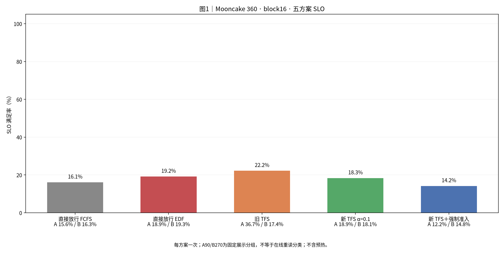
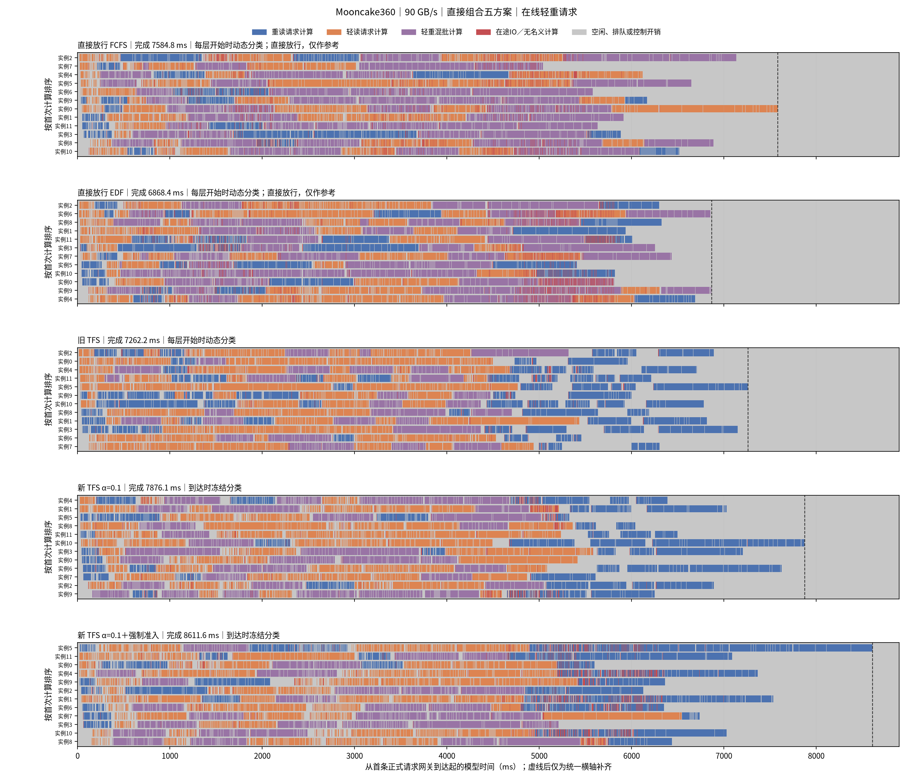
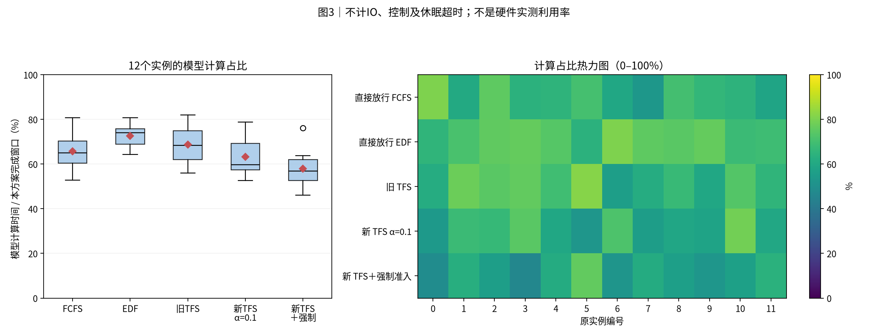
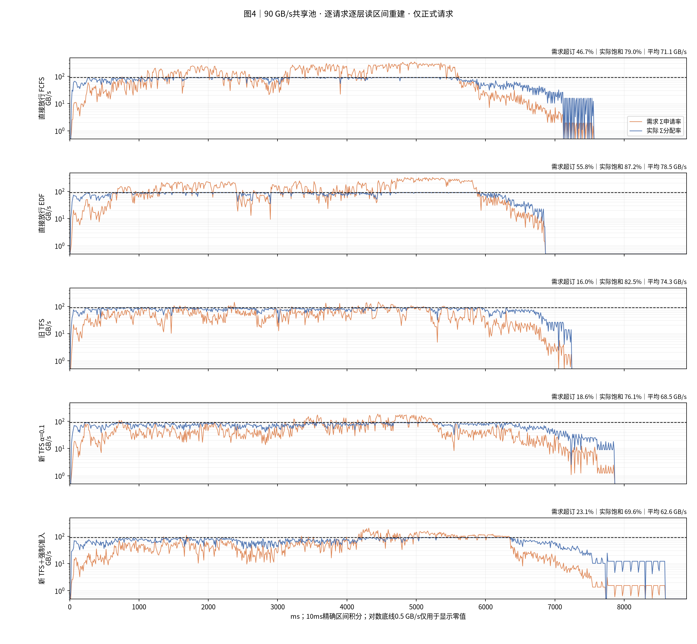
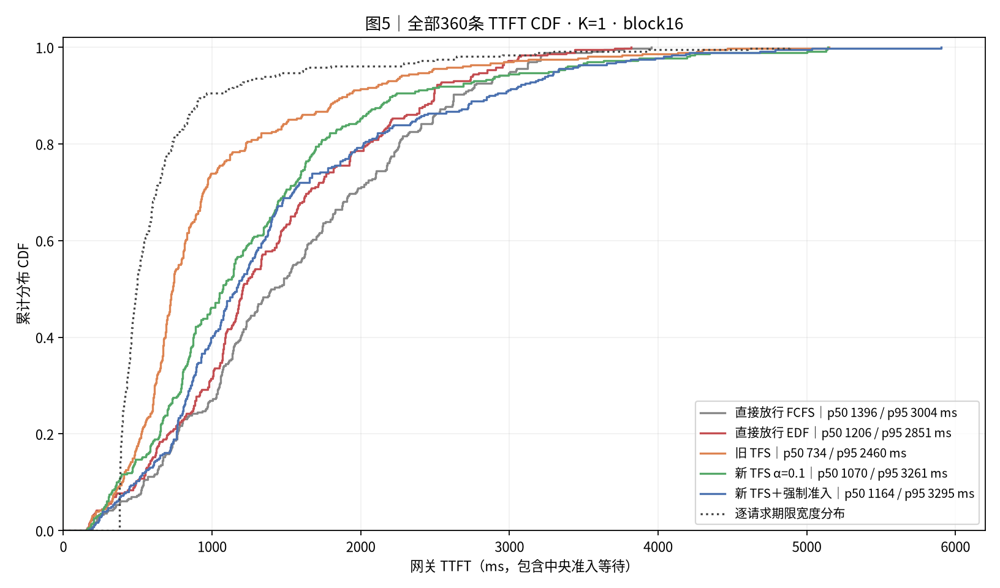
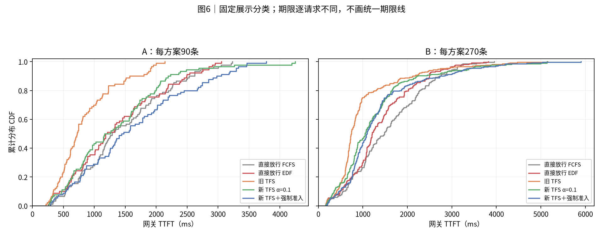
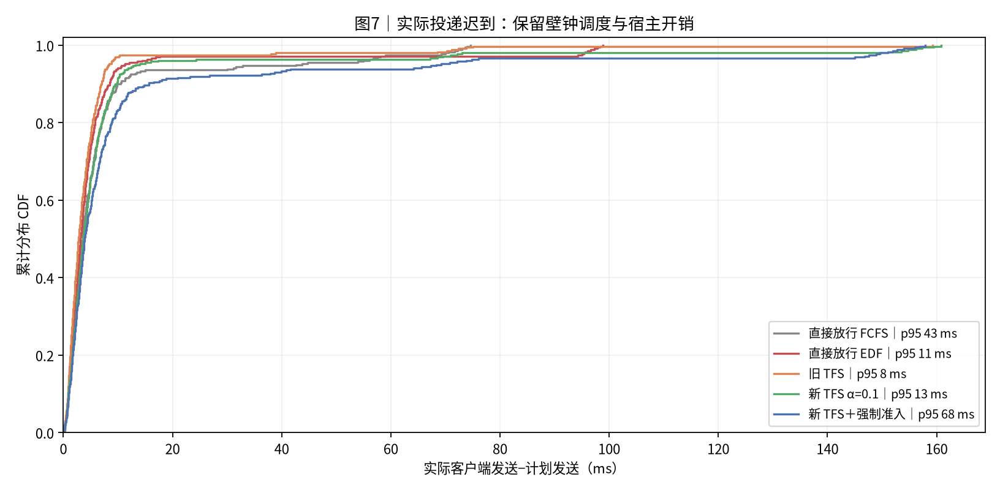

# mooncake_random_360_4s_12_90GBps｜直接提交 FCFS；直接提交 EDF；旧TFS FCFS；TFS EDF α=0.1；TFS EDF α=0.1＋强制准入

|归档信息|内容|
|---|---|
|报告创建时间|2026-10-30T16:27:07+08:00，Asia/Shanghai|
|实际实验日期|2026-10-29；源记录未提供的精确时刻不推断|
|Benchmark|[mooncake_random_360_4s_12_90GBps](../../../benchmark/mooncake_random_360_4s_12_90GBps/README.md)|
|本次操作|只归档既有结果；未运行仿真、未改变性能数值；原图字节保持一致|
|归档清单|[manifest.json](manifest.json)、[归档校验](archive_validation.json)|
|原报告标题|实验结果：Mooncake360 90 GB/s＋直接组合计时五方案对照|

**历史版本报告**：本报告使用 glm5_direct_sum_v1、关闭执行反馈；当前同名 benchmark 配置使用 glm5_actual_batch_work_v2、同步 batch 反馈。输入和资源对应，不能把历史指标视为当前配置的新结果。

|项目|约定|
|---|---:|
|实验日 / 整理日|2026-10-29；五组均重新运行|
|输入|conversation 前360条，保留顺序和同刻组，计划到达窗口0–4秒|
|命中|人为96%远端命中，向下对齐完整16-token块；本地前缀缓存关闭|
|输入总量|5,117,755输入token；4,910,208命中；207,547新计算|
|资源|1个Dynamo前端、12个真实vLLM逻辑实例及EngineCore、独立准入服务；K1|
|组批|max_num_seqs=4；max_num_batched_tokens=8192；逻辑块池30159块|
|计算|glm5_direct_sum_v1；单请求时间相加，仅扣显式重复算子启动；合并比例1；固定TP1/DP8/EP8；78层|
|存储|90 GB/s单共享池、GroupedStorage max-min、零启动延迟；逐层读、预取下一层|
|方案|直接FCFS、直接EDF、旧网关TFS、新调度前TFS α=0.1、新TFS＋空闲强制准入|
|预热 / 重复|每组72条预热，排空后清画像历史并重置GC窗口；正式360条；每方案1次|
|完成与吞吐|首条正式请求网关登记→最后一条正式首token；请求吞吐=360/该窗口|
|TTFT / SLO|TTFT=网关首token−登记时间，含全部等待；TTFT≤4T0；T0按最新画像v3统一计算|
|统计|p50/p95采用nearest-rank；每条期限分别匹配；无置信区间|
|通信|Dynamo Runtime TCP/MessagePack准入；四种在线执行反馈已移除；首token释放保留|
|观测|各组相同本地细粒度记录；正式窗口网关和存储循环GC暂停，结束后恢复|
|展示分组|SLO与CDF保留历史A90/B270；时间线按在线轻重重绘；无C|
|源码|DV 219b465ab4a1562173b7632c4086319c73af5af6，另保留原有RPC阶段诊断补丁；五组同源码和native扩展|
|输入SHA256|57b23ce7ac589220f23a5ce7b1ba768f786fa9506c41d58ddbb3ffa62f315f9b|
|执行边界|真实控制面和Scheduler；GPU计算、专家通信与远端存储传输由模型模拟|

## 0. 总判决

本轮完成最快的是 **直接放行 EDF：6868.4 ms**。总体SLO最高的是 **旧 TFS：22.2%**。每方案只有一次，结果只描述本轮，不证明稳定排名。

|方案|完成ms|请求/s|平均TTFT ms|p95 ms|SLO %|
|---|---:|---:|---:|---:|---:|
|直接放行 FCFS|7584.75|47.46|1537.74|3004.20|16.11|
|直接放行 EDF|6868.42|52.41|1381.19|2850.58|19.17|
|旧 TFS|7262.18|49.57|977.00|2460.42|22.22|
|新 TFS α=0.1|7876.09|45.71|1281.84|3260.97|18.33|
|新 TFS＋强制准入|8611.61|41.80|1423.63|3294.50|14.17|

新TFS相对直接FCFS：完成时间变化 **+3.84%**，平均TTFT变化 **-16.64%**，SLO变化 **+2.22个百分点**。时间变化为正表示变慢。

新TFS相对旧TFS：完成时间变化 **+8.45%**，平均TTFT变化 **+31.20%**，SLO变化 **-3.89个百分点**。时间变化为正表示变慢。

强制准入相对新TFS：完成时间变化 **+9.34%**，平均TTFT变化 **+11.06%**，SLO变化 **-4.17个百分点**。时间变化为正表示变慢。

五组共1800条正式请求全部返回首token并正常结束。全部结果采用本次重新运行的数据。

## 1. 汇总表与 SLO

**读法**：柱高为总体SLO；横轴附A/B各自SLO。每组样本相同，不含72条预热；没有把分类SLO相加。

|方案|准入|实例内排序|等待重读计分|强制|
|---|---:|---:|---:|---:|
|直接FCFS|网关立即转发|FCFS|完整|关|
|直接EDF|网关立即转发|固定deadline EDF|完整|关|
|旧TFS|网关配额控制，动态P75|FCFS|完整|关|
|新TFS α=0.1|实例调度前申请，分类到达时冻结|EDF|等待0.1，获准补齐|关|
|新TFS＋强制|同新TFS|EDF|同新TFS|满足条件的空闲实例每轮至多1条；不等上一笔额度释放|

|方案|A平均TTFT ms|B平均TTFT ms|A SLO %|B SLO %|
|---|---:|---:|---:|---:|
|直接放行 FCFS|1465.59|1561.79|15.56|16.30|
|直接放行 EDF|1372.70|1384.03|18.89|19.26|
|旧 TFS|856.49|1017.17|36.67|17.41|
|新 TFS α=0.1|1347.79|1259.86|18.89|18.15|
|新 TFS＋强制准入|1638.00|1352.17|12.22|14.81|

共同的期限宽度范围为 **375.14–4886.83 ms**，均值 **669.24 ms**。同一请求跨五组使用相同期限宽度。

当前T0按单请求和8192-token参考分块计算，并按逐层预取协议合成读取与计算重叠。这与早期直接将整段读取加计算的画像不同。SLO既不是trace自带要求，也不是固定毫秒数；倍率4为实验设定。

## 2. 完整执行时间线与组批

**读法**：五组各12行，按在线判定绘制：蓝色重读、橙色轻读、紫色轻重混批。新TFS使用到达时冻结标记；旧TFS及直接放行取每层开始时的动态阈值，直接放行的分类仅作参考、不代表额度限制。红色为未被名义计算覆盖的在途IO；灰色含空闲、排队和控制。虚线后仅补齐横轴。

本图使用固定重绘脚本从原始日志生成，不再按历史A/B着色；本次没有重跑实验，全部性能统计保持原值。其他SLO和分类CDF表中的A/B仍是历史展示分组。

|方案|step数|多请求step|平均批大小|批大小1/2/3/4|跨step请求数|
|---|---:|---:|---:|---:|---:|
|直接放行 FCFS|131|94|2.748|37/21/11/62|0|
|直接放行 EDF|136|92|2.647|44/21/10/61|0|
|旧 TFS|191|86|1.885|105/34/21/31|0|
|新 TFS α=0.1|165|89|2.182|76/27/18/44|0|
|新 TFS＋强制准入|170|76|2.118|94/12/14/50|0|

平均批大小=各step请求成员次数之和/step数。请求分块后可以进入多个step，因此不能总用360/step数代替。所有实际step的新token合计必须等于207547，批大小不能用层色块数推断。

|方案|各step单请求模型时间之和：实例秒|合并启动减少：实例毫秒|实际模型计算：实例秒|
|---|---:|---:|---:|
|直接放行 FCFS|60.155147|375.102|59.780045|
|直接放行 EDF|60.155147|366.912|59.788235|
|旧 TFS|60.155147|276.822|59.878325|
|新 TFS α=0.1|60.155147|319.410|59.835737|
|新 TFS＋强制准入|60.155147|311.220|59.843927|

这里的启动减少量是12实例累计值，不能直接当作整批完成时间的缩短量。新模式只减少显式重复启动，合批不会再摊薄权重读取或专家通信时间。

## 3. 模型计算占比分布与热力图

**读法**：每实例名义模型计算时间/本方案完成窗口。箱线和热图使用同一组12个值，色标0–100%。它不是宿主CPU利用率或真实GPU利用率；观察到的计算段还包含sleep超时和本地程序开销。

|方案|模型计算实例秒|4秒窗口计算压力%|全程模型计算占比%|
|---|---:|---:|---:|
|直接放行 FCFS|59.780|124.54|65.68|
|直接放行 EDF|59.788|124.56|72.54|
|旧 TFS|59.878|124.75|68.71|
|新 TFS α=0.1|59.836|124.66|63.31|
|新 TFS＋强制准入|59.844|124.67|57.91|

输入侧单请求参考计算总量为60.155实例秒，除以12×4秒为125.32%。上表采用各组实际batch的估时，两种计算压力口径分开。

## 4. 存储带宽时序

**读法**：橙线为需求，蓝线为模型实际分配速率，黑虚线为90GB/s。由逐请求逐层读取端点重建区间，再按10ms桶积分；零值只在对数图中显示为0.5，CSV保留0。

|方案|平均GB/s|需求超订%|实际饱和%|积分误差B|
|---|---:|---:|---:|---:|
|直接放行 FCFS|71.10|46.65|79.00|1.288391|
|直接放行 EDF|78.51|55.83|87.24|1.228516|
|旧 TFS|74.26|15.98|82.51|1.960205|
|新 TFS α=0.1|68.47|18.57|76.08|1.967163|
|新 TFS＋强制准入|62.62|23.13|69.58|2.210327|

各组正式读取均为 **539,258,683,392 B（539.259 GB）**，连续占满90GB/s也需要5.992秒。4秒输入窗口的存储压力为149.79%。需求超订按需求>B，饱和按实际≥0.9B，分母为各组完成窗口。

重建使用本轮单盘、零启动延迟、始终分配剩余带宽的GroupedStorage语义。端点为双精度时间，末尾按剩余字节裁剪会留下少量积分误差。预先沿用1e-11相对误差阈值；没有缩放速率或改写原时间来消除误差。

## 5. TTFT 累积分布

**读法**：每条曲线360条，按rank/n阶梯绘制。点线为逐请求期限宽度分布。期限各不相同，SLO按每个请求匹配计算，不能由两条CDF交点推断。

**读法**：固定A90/B270展示标签。分类与在线重读判定分开，不把A固定解释为当轮全部重请求。分类期限也不统一。

|方案|p50 ms|p95 ms|客户端平均TTFT的统计范围|
|---|---:|---:|---:|
|直接放行 FCFS|1395.95|3004.20|客户端另存逐请求表；主表使用网关口径|
|直接放行 EDF|1206.33|2850.58|客户端另存逐请求表；主表使用网关口径|
|旧 TFS|734.50|2460.42|客户端另存逐请求表；主表使用网关口径|
|新 TFS α=0.1|1070.28|3260.97|客户端另存逐请求表；主表使用网关口径|
|新 TFS＋强制准入|1164.49|3294.50|客户端另存逐请求表；主表使用网关口径|

## 6. 机制解释与同条件比较

直接FCFS与直接EDF只改变policy/request_ordering。新TFS与强制准入只改变admission.idle_bypass。旧TFS与新TFS同时改变准入位置、分类时刻、实例排序和等待计分，不能将全部差异归因于α。

|方案|网关等待均值ms|转发到首个读取均值ms|重读标记数|正式拒绝次数|强制次数|held峰值|
|---|---:|---:|---:|---:|---:|---:|
|直接放行 FCFS|0.91|918.61|0|0|0|44|
|直接放行 EDF|0.84|783.57|0|0|0|43|
|旧 TFS|293.82|268.29|0|0|0|10|
|新 TFS α=0.1|1.12|772.45|101|721|0|8|
|新 TFS＋强制准入|1.48|889.01|102|29|61|12|

重读标记数统计下发给实例的storage_hint；旧网关模式不下发此标记，0不表示没有重读请求。网关等待发生在转发前；转发到读取还包含路由、worker接收、实例排队、配额等待与调度，不能全部解释成单次RPC延迟。held峰值表示模型内占账数量。强制模式允许符合条件的实例暂时超过中央cap，增加并发也会增加带宽竞争。

本轮已移除load_submitted、layer_load_submitted、load_completed、no_external_load四类中央执行反馈RPC；准入、回滚、强制通知及首token释放仍然在线。读取事实由worker本地日志结束后补入报告，不作为在线策略的信息输入。更早报告的通信、模型、T0、GC或预热条件可能不同；下面仅对比已逐项核实的100GB/s那一轮。

本轮五组同源码；运行文件与上一轮100GB/s逐文件指纹一致，native扩展也一致。相较100GB/s只修改共享池和准入参考带宽，直接组合f=1及其他配置不变。T0按90GB/s重新计算，期限随既有规则变化；计算单请求时间本身不变。两轮各方案均仅运行一次，实际到达、路由同分选择及宿主开销仍有波动。

|方案|100完成ms|90完成ms|完成变化%|100平均ms|90平均ms|平均变化%|
|---|---:|---:|---:|---:|---:|---:|
|直接放行 FCFS|7194.93|7584.75|5.42|1326.55|1537.74|15.92|
|直接放行 EDF|7911.19|6868.42|-13.18|1615.54|1381.19|-14.51|
|旧 TFS|6973.29|7262.18|4.14|975.54|977.00|0.15|
|新 TFS α=0.1|9243.15|7876.09|-14.79|1615.56|1281.84|-20.66|
|新 TFS＋强制准入|7678.47|8611.61|12.15|1168.97|1423.63|21.78|

|方案|100原期限SLO%|90新期限SLO%|变化百分点|90沿用100期限SLO%|
|---|---:|---:|---:|---:|
|直接放行 FCFS|20.28|16.11|-4.17|16.11|
|直接放行 EDF|11.67|19.17|7.50|19.17|
|旧 TFS|20.83|22.22|1.39|22.22|
|新 TFS α=0.1|10.00|18.33|8.33|18.33|
|新 TFS＋强制准入|17.22|14.17|-3.06|14.17|

时间变化为正表示90GB/s更慢。准入参考带宽参与额度计算，因此配额也按原规则随带宽变化。主表SLO仍按各轮原有T0规则；最后一列只将本轮TTFT与同请求的100GB/s期限比较，不改变执行。两轮的汇总及逐请求CSV均保存，旧数值没有被重算或覆盖。[带宽对照数据](report_data/bandwidth_comparison.csv)。

本轮直接放行 EDF、新 TFS α=0.1在90GB/s的完成时间更短。各轮仅一次；不能据此认定降低带宽改善性能，实际到达、路由与组批及宿主调度仍可能影响结果。

本轮所有方案沿用100GB/s期限后，达标请求数均未变化。因此，上表SLO差异不是这次期限重算造成的。

## 7. 计算模型与结论限制

- 按各请求本步真实形状分别使用v2单请求估时，再逐层相加；仅扣max(n-1,0)×3×7µs×78的重复kernel启动。固定TP/DP/EP，权重读取及专家通信逐请求累加。启动合并是仿真假设，未做目标设备定标。
- 12个逻辑执行实例与公式中的参考DP8/EP8是不同层次；本轮没有真实多卡模型分片或同步专家通信。
- 每组一次。路由同分选择、到达迟到、宿主调度和组批变化都可能改变结果，不提供稳定收益或统计显著结论。
- 只做prefill并输出1 token。本地前缀缓存关闭，人为96%外部命中不是原trace实测命中率；不覆盖持续decode、真实存储容量淘汰、真实KV张量和跨机网络。
- 暂停GC仅在受保护测量窗口内生效；本地记录、sleep、存储轮询和真实控制程序仍计入壁钟。

## 8. 附表：实际投递与资源

**读法**：实际客户端发送时间减计划发送时间，保留全部迟到值。五组计划相同不等于实际到达完全相同；它与网关排队不是同一段时间。

|方案|发送迟到均值ms|发送迟到p95 ms|发送迟到最大ms|客户端完成ms|
|---|---:|---:|---:|---:|
|直接放行 FCFS|7.33|42.59|74.62|7589.67|
|直接放行 EDF|6.30|11.24|98.81|6872.38|
|旧 TFS|5.00|8.32|159.24|7265.09|
|新 TFS α=0.1|8.32|13.24|160.88|7879.74|
|新 TFS＋强制准入|12.04|68.27|157.89|8614.29|

|方案|整轮壁钟s（含启动/预热/验收）|子进程RSS峰值GiB|最低可用内存GiB|观察到的swap峰值GiB|
|---|---:|---:|---:|---:|
|直接放行 FCFS|57.672|17.081|8.030|0.000|
|直接放行 EDF|59.625|17.121|8.017|0.000|
|旧 TFS|59.335|17.092|7.979|0.000|
|新 TFS α=0.1|61.210|17.458|7.764|0.000|
|新 TFS＋强制准入|62.723|17.597|7.702|0.000|

## 9. 验证、数据与复现

两实例6请求强制准入冒烟通过后，依次新跑五组。五组均完成360正式＋72预热，12/12实例参与。首token及finish=length逐请求检查；HTTP 200没有被单独当作成功证据。

|方案|正式请求|模型step|层数/请求|公式最大误差s|字节积分误差B|
|---|---:|---:|---:|---:|---:|
|直接放行 FCFS|360|131|78|2.22e-16|1.288391|
|直接放行 EDF|360|136|78|2.22e-16|1.228516|
|旧 TFS|360|191|78|2.22e-16|1.960205|
|新 TFS α=0.1|360|165|78|4.44e-16|1.967163|
|新 TFS＋强制准入|360|170|78|2.22e-16|2.210327|

已核对实际token、字节、逐层屏障、分块、EDF排序、配额与路由记账排空、GC恢复、资源保护、输入/运行源码/native指纹。额外独立验证逐请求主表、60份实例时间账本、CDF排序概率质量、10ms带宽积分、文档链接和ZIP。图表最终状态见验证清单。

- [逐运行统计](report_data/run_summary.csv)、[逐请求统计](report_data/requests.csv)、[实例时间账本](report_data/device_utilization.csv)。
- [带宽10ms桶](report_data/bandwidth_10ms.csv)、[原区间](report_data/storage_intervals.csv.gz)、[CDF样本](report_data/cdf.csv)、[准入统计](report_data/admission_summary.csv)。
- [输入核对](report_data/input_check.json)、[冻结来源和文件摘要](report_data/provenance.json)、[五组运行收据](report_data/matrix_receipt.json)、[独立验证清单](report_data/source_validation.json)。
- 固定重绘脚本（历史构建资源未随本归档分发，见复现说明）、[时间线替换入口](report_data/source_scripts/refresh_timeline.py)、[重绘校验](online_timeline/source_validation.json)、[分类明细](online_timeline/requests.csv)。
- 运行编排及既有RPC诊断补丁在reproduce/；原始Linux数据目录见provenance.json。完整输入token、服务日志和fine_trace留原审计目录，ZIP包含图表重绘所需投影与脚本。
- 在具有NumPy、Matplotlib、Pillow和中文字体的Python环境中运行build_report.py可重绘。逐张检查PNG后运行verify_report.py --finalize --visual-reviewed生成最终清单与分享ZIP。重跑服务还需固定的DV环境、输入和native扩展。

## 10. 简要解读

本轮可先看旧 TFS的SLO与直接放行 EDF的完成时间，再看A/B分组和时间线。比较新TFS与强制准入，观察缩短空闲是否同时增加带宽竞争或伤害短请求。计算压力应使用各组实际batch时间；不能将单请求参考压力、模型计算占比和真实GPU利用率混为一个指标。

## 归档与复现补充

本轮选取的原始数据表及配图保留来源指纹。较大的派生数据用 gzip 无损压缩，原始运行日志不随本归档发布。[复现说明](reproduce/README.md)区分数据重绘和完整仿真重跑；源验证记录与归档验证不是同一次验收。
