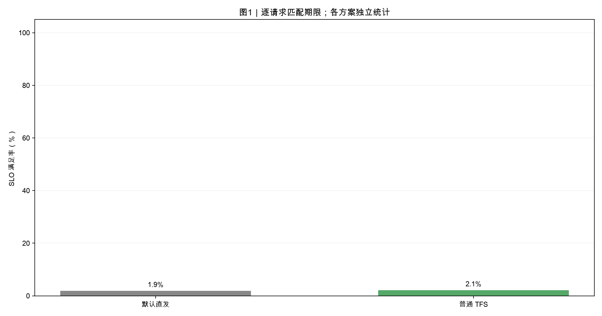
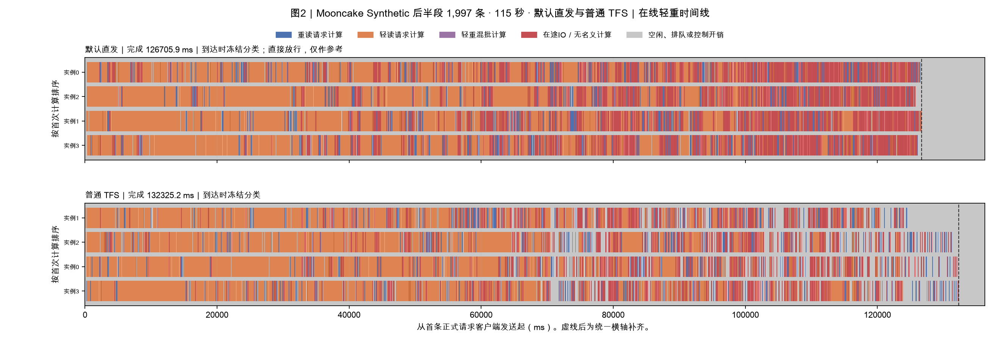
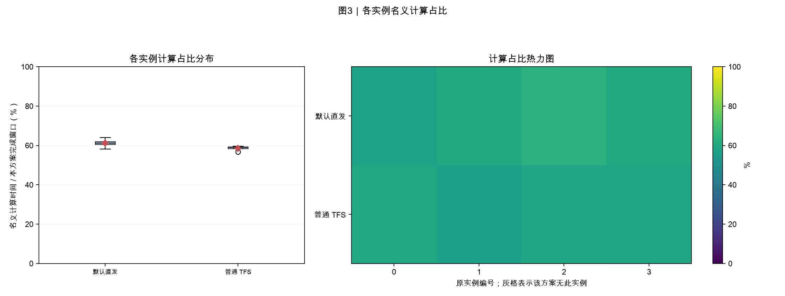
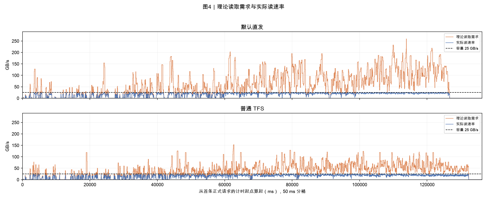
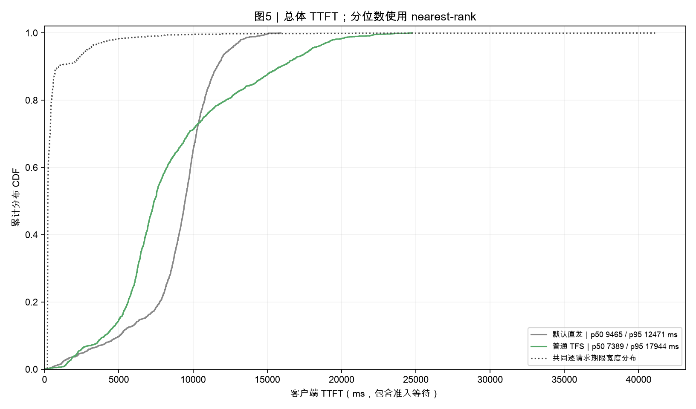
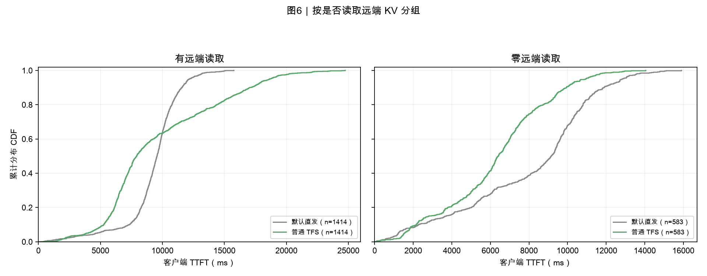
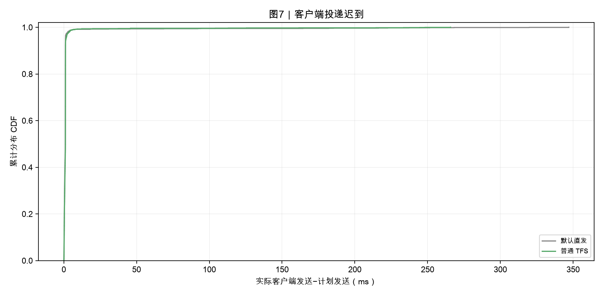

# 实验结果：Mooncake Synthetic 后半段 1,997 条 · 115 秒 · 默认直发与普通 TFS

|项目|约定|
|---|---:|
|执行边界|2026-11-27 在 Mac 各自启动一套全新的原生 Dynamo 1.2 和 CPU vLLM 进程，完成两组仿真。|
|方案顺序|默认直发 → 普通 TFS|
|输入种子 / 重复|每个case独立展示一个冻结运行；种子与重复见附表，未提供时不推断|
|汇总 / 轨迹|不跨case合并样本、不生成置信区间；轨迹保留全部正式请求|
|SLO / TTFT|客户端实际发送至收到首 token；含排队和传输。SLO 逐请求匹配期限。|
|分组|分类表和CDF使用输入cohort；时间线使用在线轻重判定|
|单位|时间秒/毫秒；容量字节；带宽GB/s=10^9 B/s|
|负载|原始轨迹第 1997–3993 条，共 1,997 条。前 1,996 条提供缓存历史。|
|发送|保持相邻到达间隔比例，将上一轮 120 秒的发送时间乘以 115/120。两组共用冻结输入和开放式 HTTP 连接池，每条生成 1 个 token。|
|缓存与截断|冻结远端 KV 前缀，128 token 对齐。命中率 86.19%。9 条超长输入截到 97,792 token。|
|资源|4 个实例，各实例 max_num_seqs=1；16 层逐层读算；6 盘共享 25 GB/s，首层读启动延迟 0.1 ms。运行时钟按 1×。|
|模型|MiniMax 拟合 prefill，单步 50,000 token 预算。计算与存储在 Mac 上模拟，路由与分批使用真实软件路径。|
|SLO 期限|同一请求两组共用 4 × 独立逐层流水参考耗时。参考耗时按 25 GB/s 和冻结前缀计算，不含排队。|
|对照开关|默认走 Dynamo KV 路由直接提交。普通 TFS 开到达时 P75 分类、整数重读配额和 α=0.1 的等待量路由记账，首 token 释放配额；关闭强制准入。|
|时间线配色|TFS 使用到达时冻结的轻重标记。默认的颜色使用同一请求在 TFS 中的标记，仅用于对照。|
|时间边界|客户端单调时钟。TTFT 从实际发送到收到首 token；整批时间从首条实际发送到最后一个首 token。|

## 0. 总判决

两组均完成 **1,997 条**。普通 TFS 相对默认直发的整批完成时间变化为 **+5.62 秒**，从 **126.71 秒**变为 **132.33 秒**。平均 TTFT 变化 **-2.8%**，P95 变化 **+5.47 秒**。

SLO 达标数为 **37 → 42**。层间等 KV 总量为 **140.56 → 79.61 实例·秒**。整批结束由最后一个首 token 决定。 TFS 减少了 43.4% 的层间 KV 等待。发完后仍有 109 条重读等到单配额获批，整批收尾多用 5.62 秒。

## 1. 汇总表与 SLO 柱状图

|方案|请求数|完成ms|平均TTFT ms|P50 ms|P95 ms|SLO%|四个 worker 完成时刻均值（s）|
|---|---:|---:|---:|---:|---:|---:|---:|
|默认直发|1997|126705.9|8946.7|9464.7|12470.6|1.9|126.280|
|普通 TFS|1997|132325.2|8697.5|7388.7|17943.7|2.1|130.058|

以首条正式请求实际发送为 0 秒，按执行 worker 分组取最后一个客户端响应结束时刻。四个 worker 等权取均值。任一 worker 缺少完整记录或未执行请求时，均值标为缺少数据。

|方案|worker 0（s）|worker 1（s）|worker 2（s）|worker 3（s）|四个 worker 完成时刻均值（s）|
|---|---:|---:|---:|---:|---:|
|默认直发|126.506|126.707|125.764|126.142|126.280|
|普通 TFS|132.118|124.493|131.294|132.326|130.058|

### KV 等待

|方案|有读请求|首层合计 实例·秒|首层均值 ms|首层 P95 ms|层间合计 实例·秒|层间均值 ms|层间 P95 ms|
|---|---:|---:|---:|---:|---:|---:|---:|
|默认直发|1414|27.95|19.77|44.39|140.56|99.40|259.20|
|普通 TFS|1414|20.32|14.37|29.74|79.61|56.30|144.83|

均值和 P95 按有读请求计算。首层从提交第 0 层读取到读完。层间累加后续层的暴露等待。


按有无远端读取分组。

|方案|分组|请求数|平均TTFT ms|SLO%|
|---|---:|---:|---:|---:|
|默认直发|有远端读取|1414|9313.8|0.1|
|默认直发|零远端读取|583|8056.5|6.2|
|普通 TFS|有远端读取|1414|9679.7|0.1|
|普通 TFS|零远端读取|583|6315.3|7.0|



**读法**：柱高与上表同口径。每条请求使用自身期限判断是否达标。

## 2. 各方案 full-sort-ms 执行时间线




**读法**：蓝重读、橙轻读、紫轻重混批。红色为未被名义计算覆盖的在途IO，灰色含空闲、排队和控制。动态与冻结分类分别标注；直接放行分类仅作参考。虚线右侧仅为统一横轴补齐。

## 3. 模型计算占比分布与热力图




**读法**：箱线和热力图来自同一组逐实例数据。分母是各方案从首次正式到达到末条首token的窗口。该值不是硬件实测利用率。

## 4. 存储带宽时序




**读法**：各方案共用从零起的线性纵轴。橙线为活跃请求理论读取需求。蓝线为实际读速率，黑虚线为容量。峰值取分桶平均需求的最大值。

独立图使用相同坐标。[默认直发](figure/04_bandwidth_default.png) · [普通 TFS](figure/04_bandwidth_tfs.png)。

|方案|理论峰值 GB/s|理论超载秒数|超载量 GB|缺口量 GB|净超载量 GB|实际均速 GB/s|实际饱和%|
|---|---:|---:|---:|---:|---:|---:|---:|
|默认直发|259.2|85.2|5356.9|706.0|4650.9|15.9|54.0|
|普通 TFS|152.5|89.3|2793.2|657.5|2135.8|15.2|50.6|

## 5. TTFT 累积分布 CDF




**读法**：经验CDF按rank/n绘制，终点为1。期限不同时，SLO必须逐请求匹配，不能由两条CDF交点推算。




**读法**：此处分组来自cohort，可能是历史A/B或业务分类，不用该标签推断在线轻重。

## 6. 机制解释与前序对照

### 6.1 首算前耗时与发完后收尾

|方案|实际发完 秒|发完时未返回|其中重读|收尾 秒|平均发出至首算 秒|
|---|---:|---:|---:|---:|---:|
|默认直发|115.0010|170|74|11.70|8.71|
|普通 TFS|115.0042|180|109|17.32|8.49|


发出至首算包含通信、路由、排队、准入，以及存在时的首层读取。KV 等待表的首层和层间均值及 P95 统计 1,414 条有远端读取的请求。

TFS 发完后还有 109 条重读获批。获批当时的配额和条数为 1 对应 109 条。最后完成请求 `synthetic:L3966` 在 113.10 秒发出，132.15 秒开始计算，层间等 KV 85.98 ms。该请求在 132.12 秒才获批，离实际发送约 19.02 秒。

### 6.2 配对请求分类

|分类|请求数|平均 TTFT ms|P95 TTFT ms|平均发出至首算 ms|
|---|---:|---:|---:|---:|
|重读|670|9185 → 12846|12580 → 20022|8985 → 12715|
|轻读且有远端读取|744|9430 → 6829|11966 → 9588|9278 → 6694|
|零远端读取|583|8056 → 6315|12822 → 10947|7658 → 5919|


箭头左侧为默认直发，右侧为 TFS。两组按同一批请求在 TFS 到达时的判定配对。

### 6.3 按请求计划发送时段分组

|计划发送区间 秒|请求数|平均 TTFT 秒|P95 TTFT 秒|到达计算需求占容量 %|到达存储需求占容量 %|
|---|---:|---:|---:|---:|---:|
|0–23|397|5.14 → 5.00|12.09 → 10.67|126.2|39.0|
|23–46|393|10.89 → 10.75|13.49 → 19.95|83.8|60.9|
|46–69|387|9.72 → 8.25|12.04 → 18.44|53.6|69.3|
|69–92|410|9.27 → 8.81|10.70 → 16.26|46.1|81.6|
|92–115|410|9.71 → 10.62|11.96 → 18.84|27.1|99.9|


每个时段长 23 秒。到达存储需求按时段内到达请求的读取字节计算。时序图按实际读取活动绘制，读出时间可以晚于到达。

最后 23 秒中，到达请求的平均存储需求为 24.99 GB/s。这段有远端读取的请求，平均首层读取耗时为 **26.1 → 15.7 ms**，平均未被计算掩盖的层间 KV 等待为 **151.9 → 72.0 ms**。

## 7. 计算模型与结论限制

沿用原生 Dynamo 1.2、CPU vLLM 单序列调度、MiniMax 16 层名义计算和六盘存储仿真。SLO 期限是各请求独立逐层参考时长的四倍。P95 使用最近秩，TTFT 以客户端实际发送计时。四实例完成时刻使用客户端响应结束，各自取最后完成的一条。整批完成时间以最后一个首 token 为终点。

两种方案各一次。普通 TFS 同时切换重读准入和 α=0.1 路由记账。当前对比未单独测量两个开关的贡献。模拟器与客户端的实现哈希已核对。两组辅助脚本的差异仅涉及到达时重读标记和 TFS 运行后准入日志的补全。

## 8. 附表




**读法**：此图描述客户端实际发送相对计划的迟到，不是单次准入RPC耗时。

|方案|实例数|模型计算占比%|运行标识|
|---|---:|---:|---:|
|默认直发|4|61.2|{"window": "后50%", "planned_send_s": 115.0, "repeat": 1, "route": "Dynamo KV", "dv": "76ebbf6aef2411228968ba895caf69a0155ced68", "dynamo": "721295cadba1fe081800f773e3451079672aa95b", "native_sha256": "6903738d4bc7de23f9aca048fa417a51f84307ff848ad8d2a756f55672d26749"}|
|普通 TFS|4|58.6|{"window": "后50%", "planned_send_s": 115.0, "repeat": 1, "route": "Dynamo KV", "dv": "76ebbf6aef2411228968ba895caf69a0155ced68", "dynamo": "721295cadba1fe081800f773e3451079672aa95b", "native_sha256": "6903738d4bc7de23f9aca048fa417a51f84307ff848ad8d2a756f55672d26749"}|

|方案|序列上限|token预算|存储容量GB/s|准入位置 / 规则|计算模型|
|---|---:|---:|---:|---:|---:|
|默认直发|1|50000|25.0|gateway / arrival|prefill_fit|
|普通 TFS|1|50000|25.0|scheduler / arrival|prefill_fit|

以计划的 115 秒为窗口，名义计算负载为 **67.4%**，存储输入负载为 **70.2%**。两组均读取 **2017.05 GB**，读量和逐层计算检查均通过。本轮 TFS 共批准 670 次重读，拒绝 19433 次；一次请求可能重试多次。结束时剩余配额占用为 0。正式窗口记录了 0 条路由计分降级事件。

上一轮使用相同请求、120 秒发送的默认直发完成时间为 125.73 秒，平均 TTFT 为 5.89 秒，P95 为 10.56 秒。

[发压和收尾](report_data/drain.csv) · [分类统计](report_data/paired_cohorts.csv) · [发送时段统计](report_data/send_windows.csv) · [末条请求](report_data/tail.csv) · [验证明细](report_data/run_audit.csv)

## 9. 验证、数据与复现

已校验请求计数、逐请求SLO、nearest-rank分位数、CDF概率质量、实例时间账本及可用带宽积分。图片人工检查状态见校验文件。

- [实验报告校验记录](report_data/source_validation.json)
- [本次归档校验](archive_validation.json)
- [固定 benchmark](../../../benchmark/mooncake_syntheticback50_1997_115s_4_25GBps/README.md)
- [方案汇总](report_data/run_summary.csv)
- [请求明细](report_data/requests.csv)
- [标准重绘数据](report_data/dataset.json.gz)
- [复现入口](reproduce/generate_report.py)

在报告目录执行：

```bash
gzip -cd report_data/dataset.json.gz > /tmp/mooncake-1997-115s-dataset.json
python reproduce/generate_report.py --dataset /tmp/mooncake-1997-115s-dataset.json --bin-ms 50 --output /tmp/mooncake-1997-115s-redrawn
```

## 10. 简要解读

TFS 把首层读取和层间等待分别降至 14.37 ms 和 56.30 ms（有远端读取的请求均值）。平均 TTFT 的收益集中在轻读和零读。重读平均 TTFT 增加了 3.66 秒，重读 P95 增加了 7.44 秒。窗口最后 23 秒的到达存储需求已接近总带宽，收尾阶段的重读仍按单配额依次获批。时间线灰色累计从 16.28 增至 106.18 实例·秒，其中包含空闲、排队和控制等待。

两组平均发出至首算为 **8707 → 8488 ms**。理论读需求峰值为 **259.2 → 152.5 GB/s**，实际平均读速为 **15.92 → 15.24 GB/s**。理论需求按活跃请求读量除以独立名义计算时间累加。实际带宽上限为 25 GB/s。
