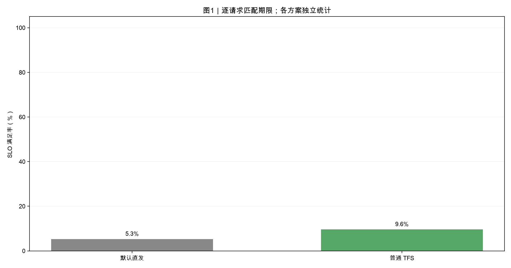
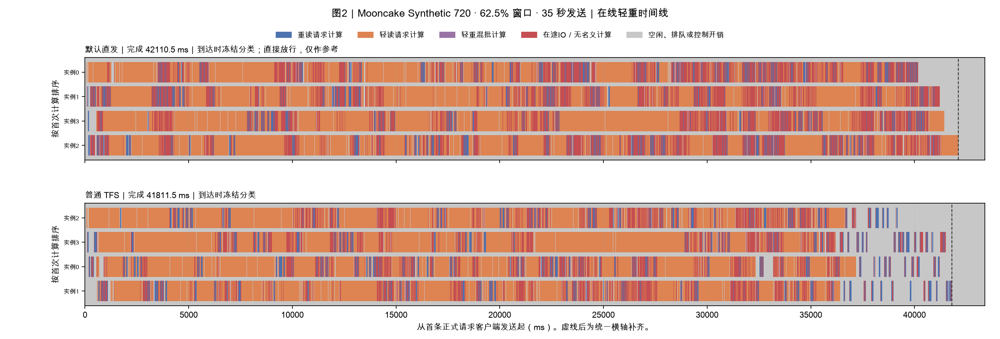
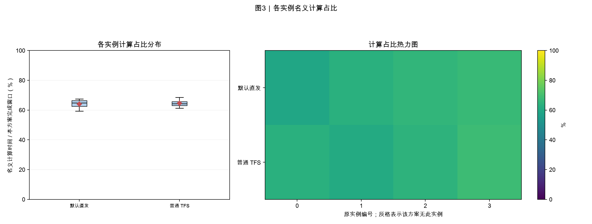
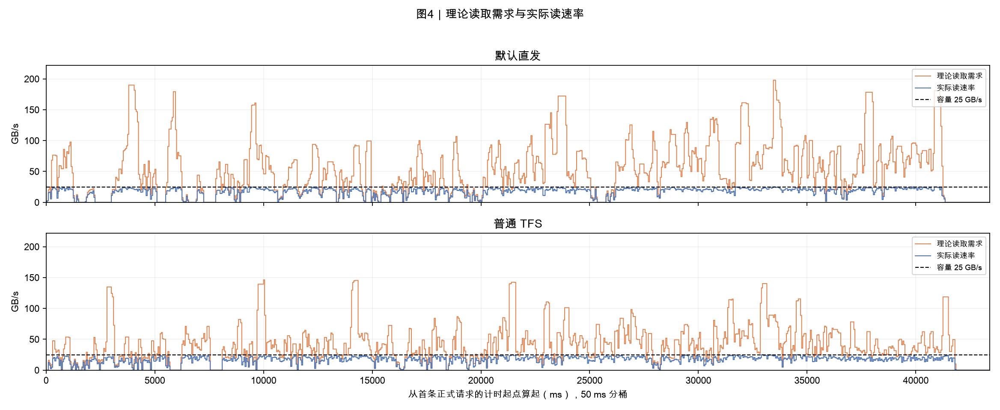
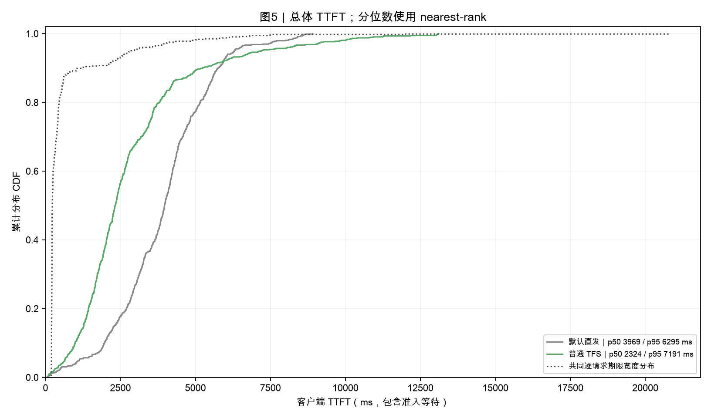
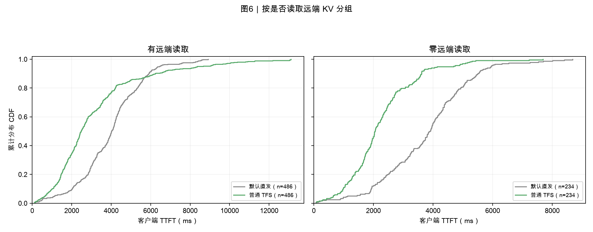
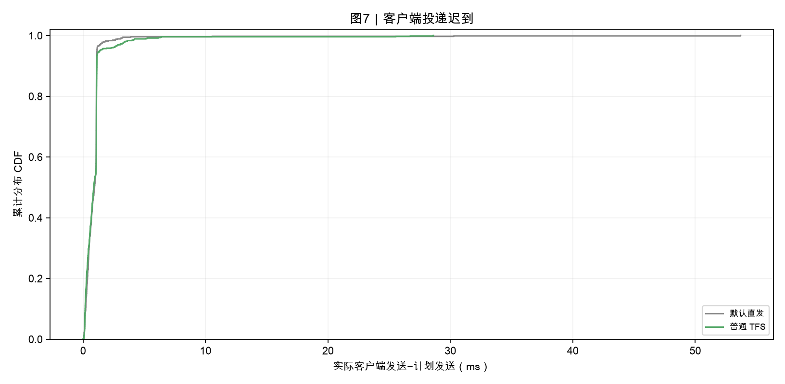

# 实验结果：Mooncake Synthetic 720 · 62.5% 窗口 · 35 秒发送

|项目|约定|
|---|---:|
|执行边界|2026-11-26 在 Mac 顺序运行两组原生 Dynamo 1.2 / CPU vLLM；随后离线整理日志。|
|方案顺序|默认直发 → 普通 TFS|
|输入种子 / 重复|每个case独立展示一个冻结运行；种子与重复见附表，未提供时不推断|
|汇总 / 轨迹|不跨case合并样本、不生成置信区间；轨迹保留全部正式请求|
|SLO / TTFT|客户端实际发送至收到首 token；含排队和传输。SLO 逐请求匹配期限。|
|分组|分类表和CDF使用输入cohort；时间线使用在线轻重判定|
|单位|时间秒/毫秒；容量字节；带宽GB/s=10^9 B/s|
|负载|轨迹共 3,993 条。floor(3993 × 62.5%) = 2,495，取第 2,496–3,215 条并继承前 2,495 条的缓存历史。|
|发送|同一份 40 秒冻结输入。到达时间乘 0.875，计划在 35 秒发完。每条只生成 1 token。|
|缓存与截断|冻结远端 KV 前缀，128 token 对齐。命中率 85.90%。5 条超长输入截到 97,792 token。|
|资源|4 个实例，各实例 max_num_seqs=1；16 层逐层读算；6 盘共享 25 GB/s，首层读启动延迟 0.1 ms。运行时钟按 1×。|
|模型|MiniMax 拟合 prefill，单步 50,000 token 预算。计算与存储在 Mac 上模拟，路由与分批使用真实软件路径。|
|SLO 期限|同一请求两组共用 4 × 独立逐层流水参考耗时。参考耗时按 25 GB/s 和冻结前缀计算，不含排队。|
|对照开关|默认走 Dynamo KV 路由直接提交。普通 TFS 开到达时 P75 分类、整数重读配额和 α=0.1 的等待量路由记账，首 token 释放配额；关闭强制准入。|
|时间线配色|TFS 使用到达时冻结的轻重标记。默认的颜色使用同一请求在 TFS 中的标记，仅用于对照。|
|时间边界|客户端单调时钟。TTFT 从实际发送到收到首 token；整批时间从首条实际发送到最后一个首 token。|
|报告技能|DV drt_develop 3fded665 的报告整理技能。保留四个实例的客户端响应完成时刻，补入本次 KV 等待和理论带宽。|
|后处理|沿用 35 秒实验已冻结的两组原始日志。本次重生报告。|

## 0. 总判决

两组均完成 **720 条**。普通 TFS 相对默认直发的整批用时变化为 **-0.299 秒**。平均首 token 延迟为 **3.913 → 2.857 秒**，P95 为 **6.295 → 7.191 秒**。

SLO 达标数为 **38/720 → 69/720**，变化 **+4.31 个百分点**。层间等 KV 的总量变化为 **-14.42 实例·秒**。该指标累加各实例的请求等待，整批时间取最后一个首 token。

## 1. 汇总表与 SLO 柱状图

|方案|请求数|完成ms|平均TTFT ms|P50 ms|P95 ms|SLO%|四个 worker 完成时刻均值（s）|
|---|---:|---:|---:|---:|---:|---:|---:|
|默认直发|720|42110.5|3912.6|3968.6|6295.3|5.3|41.240|
|普通 TFS|720|41811.5|2857.1|2324.4|7191.2|9.6|40.940|

以首条正式请求实际发送为 0 秒，按执行 worker 分组取最后一个客户端响应结束时刻。四个 worker 等权取均值。任一 worker 缺少完整记录或未执行请求时，均值标为缺少数据。

|方案|worker 0（s）|worker 1（s）|worker 2（s）|worker 3（s）|四个 worker 完成时刻均值（s）|
|---|---:|---:|---:|---:|---:|
|默认直发|40.176|41.225|42.111|41.448|41.240|
|普通 TFS|41.230|41.812|39.198|41.518|40.940|

### KV 等待

|方案|有读请求|首层合计 实例·秒|首层均值 ms|首层 P95 ms|层间合计 实例·秒|层间均值 ms|层间 P95 ms|
|---|---:|---:|---:|---:|---:|---:|---:|
|默认直发|486|8.44|17.37|36.05|38.51|79.25|223.51|
|普通 TFS|486|6.88|14.15|31.44|24.09|49.58|152.49|

均值和 P95 按有读请求计算。首层从提交第 0 层读取到读完。层间累加后续层的暴露等待。


按有无远端读取分组。

|方案|分组|请求数|平均TTFT ms|SLO%|
|---|---:|---:|---:|---:|
|默认直发|有远端读取|486|3978.8|1.9|
|默认直发|零远端读取|234|3775.2|12.4|
|普通 TFS|有远端读取|486|3154.1|2.7|
|普通 TFS|零远端读取|234|2240.1|23.9|



**读法**：柱高与上表同口径。每条请求使用自身期限判断是否达标。

## 2. 各方案 full-sort-ms 执行时间线




**读法**：蓝重读、橙轻读、紫轻重混批。红色为未被名义计算覆盖的在途IO，灰色含空闲、排队和控制。动态与冻结分类分别标注；直接放行分类仅作参考。虚线右侧仅为统一横轴补齐。

## 3. 模型计算占比分布与热力图




**读法**：箱线和热力图来自同一组逐实例数据。分母是各方案从首次正式到达到末条首token的窗口。该值不是硬件实测利用率。

## 4. 存储带宽时序




**读法**：各方案共用从零起的线性纵轴。橙线为活跃请求理论读取需求。蓝线为实际读速率，黑虚线为容量。峰值取分桶平均需求的最大值。

独立图使用相同坐标。[默认直发](figure/04_bandwidth_default.png) · [普通 TFS](figure/04_bandwidth_tfs.png)。

|方案|理论峰值 GB/s|理论超载秒数|超载量 GB|缺口量 GB|净超载量 GB|实际均速 GB/s|实际饱和%|
|---|---:|---:|---:|---:|---:|---:|---:|
|默认直发|198.0|30.2|1486.0|164.7|1321.3|16.9|56.9|
|普通 TFS|146.3|29.8|895.4|121.3|774.2|17.0|56.2|

## 5. TTFT 累积分布 CDF




**读法**：经验CDF按rank/n绘制，终点为1。期限不同时，SLO必须逐请求匹配，不能由两条CDF交点推算。




**读法**：此处分组来自cohort，可能是历史A/B或业务分类，不用该标签推断在线轻重。

## 6. 机制解释与前序对照

### 6.1 等待分解与发压结束后的收尾

|方案|平均发送至首算 ms|首层读累计 实例·秒|层间等 KV 实例·秒|实际最后发出 秒|发完时未完成（重读）|最后发送至整批收尾 秒|
|---|---:|---:|---:|---:|---:|---:|
|默认直发|3696.5|8.44|38.51|35.0009|113（37）|7.110|
|普通 TFS|2660.5|6.88|24.09|35.0012|76（51）|6.810|


首算前时间包含路由、调度、准入和可能的首层读取。层间等待取后续各层读完比上一层算完晚的时间。首层读取累计是首算前时间的一部分。

默认直发 最后完成的是 `L3213`。它于 34.859 秒发出，41.327 秒开始计算，42.110 秒返回首 token。首算前耗时 6468.3 ms，层间等 KV 0.0 ms。

普通 TFS 最后完成的是 `L3177`。它于 33.518 秒发出，41.684 秒开始计算，41.811 秒返回首 token。首算前耗时 8165.7 ms，层间等 KV 61.5 ms。

其中 TFS 最后一条请求在 41.665 秒得到配额，日志记录 1 次配额拒绝。最后一条请求发出后，TFS 仍批准了 50 条重读（配额 1 时 50 条）。同一批输入在 40 秒下，两轮 TFS 都只有 14 条重读在发压结束后取得配额。

### 6.2 同一批请求按 TFS 到达分类配对

|参考分组|请求数|平均 TTFT ms|P95 TTFT ms|平均发送至首算 ms|
|---|---:|---:|---:|---:|
|重读|207|3902 → 4581|6295 → 10219|3712 → 4451|
|轻读且有远端读取|279|4036 → 2096|6538 → 3807|3904 → 1969|
|零远端读取|234|3775 → 2240|5952 → 4689|3436 → 1901|


箭头左侧为默认直发，右侧为普通 TFS。默认组沿用同一请求在 TFS 运行中的冻结分类，用于配对。

### 6.3 与同源 40 秒两轮对照

|发送窗|整批完成 秒|平均 TTFT 秒|P95 TTFT 秒|SLO %|层间等 KV 实例·秒|
|---|---:|---:|---:|---:|---:|
|40 秒第 1 轮|41.99 → 41.99|1.64 → 1.08|3.35 → 2.92|11.7 → 32.2|39.95 → 26.00|
|40 秒第 2 轮|41.67 → 42.12|1.09 → 1.12|2.83 → 3.49|22.2 → 33.3|35.72 → 25.89|
|35 秒本轮|42.11 → 41.81|3.91 → 2.86|6.30 → 7.19|5.3 → 9.6|38.51 → 24.09|


35 秒组将原到达间隔乘以 0.875。三轮共用请求、模型、存储和统计口径。宿主机通信和调度存在运行间波动，35 秒只测一轮。

零远端读取的 234 条不计入 KV 等待均值和 P95。首层 KV 等待从第 0 层读提交到完成，包含存储侧排队、启动和读取。层间 KV 等待累加第 1–15 层未被上一层计算覆盖的读取时间。

## 7. 计算模型与结论限制

原生 Dynamo 1.2 提供 KV 路由。CPU vLLM 实例各最多执行一个序列。计算由 MiniMax 名义耗时模型驱动，存储由六盘逐层模型驱动。宿主机通信和调度使用实际单调时钟。

逐请求 SLO 期限为其独立参考服务时长的 4 倍。参考时长含逐层读算重叠。TTFT 从客户端实际发出计到首 token。整批完成时间采用同一时钟，结束点为最后一个首 token。两组各一次，默认和 TFS 的路由记账与重读准入成套切换。

## 8. 附表




**读法**：此图描述客户端实际发送相对计划的迟到，不是单次准入RPC耗时。

|方案|实例数|模型计算占比%|运行标识|
|---|---:|---:|---:|
|默认直发|4|64.0|{"window": "62.5%", "planned_send_s": 35.0, "repeat": 1, "route": "Dynamo KV", "dv": "76ebbf6aef2411228968ba895caf69a0155ced68", "dynamo": "721295cadba1fe081800f773e3451079672aa95b", "native_sha256": "6903738d4bc7de23f9aca048fa417a51f84307ff848ad8d2a756f55672d26749"}|
|普通 TFS|4|64.5|{"window": "62.5%", "planned_send_s": 35.0, "repeat": 1, "route": "Dynamo KV", "dv": "76ebbf6aef2411228968ba895caf69a0155ced68", "dynamo": "721295cadba1fe081800f773e3451079672aa95b", "native_sha256": "6903738d4bc7de23f9aca048fa417a51f84307ff848ad8d2a756f55672d26749"}|

|方案|序列上限|token预算|存储容量GB/s|准入位置 / 规则|计算模型|
|---|---:|---:|---:|---:|---:|
|默认直发|1|50000|25.0|gateway / arrival|prefill_fit|
|普通 TFS|1|50000|25.0|scheduler / arrival|prefill_fit|

计划发送窗口为 **35 秒**。两组实际发送跨度为 **35.0009 秒**和 **35.0012 秒**。两组均读取 **711.09 GB**。按计划发送窗口计算，名义计算负载为 **77.1%**，存储输入负载为 **81.3%**。40 秒配置的同口径值分别为 **67.4%** 和 **71.1%**。两组分别记录 721 和 721 个单序列 step。

TFS 获批重读 207 条，配额拒绝 4045 次，拒绝数包含同一请求的重试。读速率图使用 50 ms 分桶，实际饱和率由原始区间统计。

[发压和收尾数据](report_data/drain.csv) · [最后五条请求](report_data/tail_requests.csv) · [TFS 最后一条请求准入事件](report_data/tfs_tail_admission.csv) · [原始输入清单](report_data/input_requests.csv)

[KV 等待统计明细](report_data/kv_wait_summary.csv) · [逐请求首层及层间 KV 等待](report_data/requests.csv)

## 9. 验证、数据与复现

已校验请求计数、逐请求SLO、nearest-rank分位数、CDF概率质量、实例时间账本及可用带宽积分。图片人工检查状态见校验文件。

- [校验记录](report_data/source_validation.json)
- [方案汇总](report_data/run_summary.csv)
- [请求明细](report_data/requests.csv)
- [标准重绘数据](report_data/dataset.json.gz)
- [复现入口](reproduce/generate_report.py)

先解压标准重绘数据，再在报告目录执行：

```bash
python reproduce/generate_report.py --bin-ms 50 --dataset report_data/dataset.json --output ../reproduced-report
```

## 10. 简要解读

35 秒下，TFS 的平均首 token 延迟降低约 27%。轻读和零读请求更早开算，重读 P95 从 6.30 秒升到 10.22 秒。发完时 TFS 未完成的请求更少，其中重读数量更多，所以收尾只缩短了约 0.30 秒。两组 SLO 达标率都低于两轮 40 秒运行。

TFS 与默认的理论带宽峰值分别为 146.3 和 198.0 GB/s。实际平均读速分别为 17.01 和 16.89 GB/s。理论需求表示活跃请求需要多快读完才能跟上名义计算，实际读速受 25 GB/s 容量限制。两组的六盘读取记录均已重放核对，字节积分误差绝对值最大为 0.559 字节。
