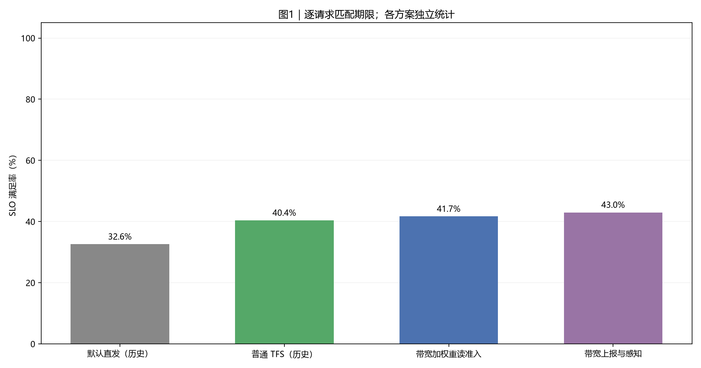
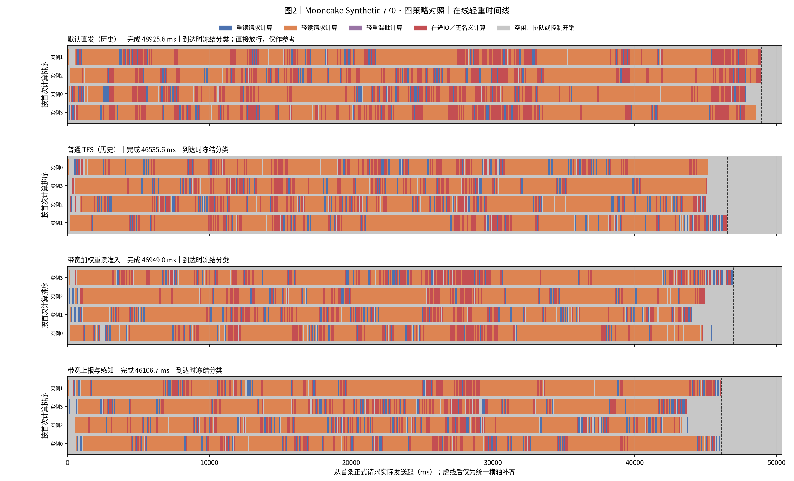
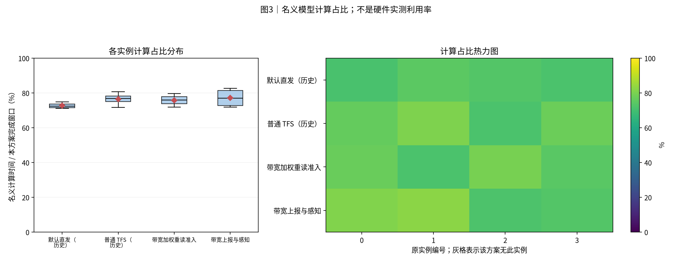
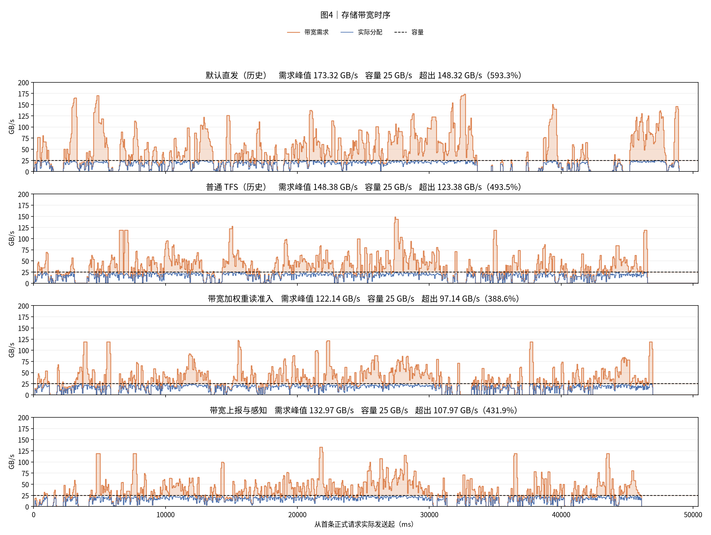
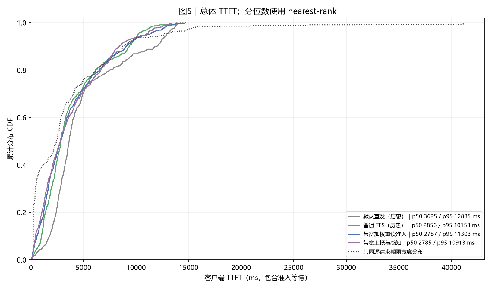
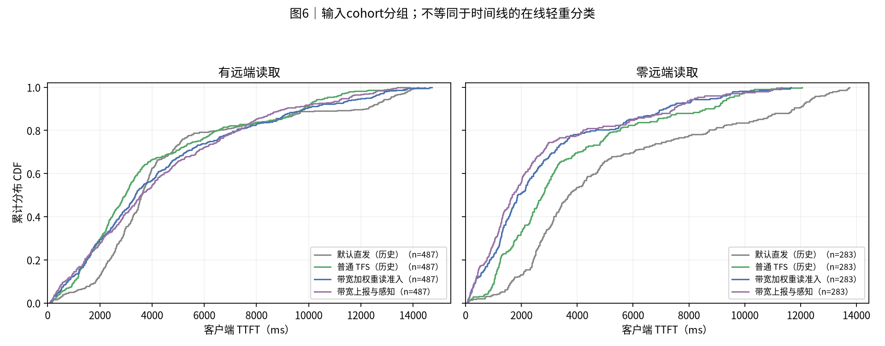
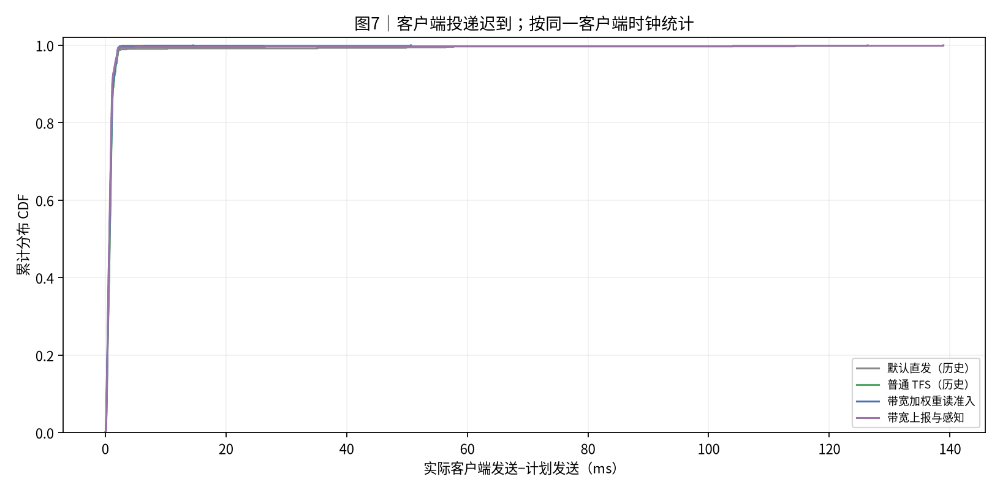

# 实验结果：Mooncake Synthetic 770 · 四策略对照

|项目|约定|
|---|---:|
|执行边界|两轮历史结果与两轮新开环回放。每种策略一轮四实例 WSL CPU 仿真。|
|方案顺序|默认直发（历史） → 普通 TFS（历史） → 带宽加权重读准入 → 带宽上报与感知|
|输入种子 / 重复|每个case独立展示一个冻结运行；种子与重复见附表，未提供时不推断|
|汇总 / 轨迹|不跨case合并样本、不生成置信区间；轨迹保留全部正式请求|
|SLO / TTFT|逐请求匹配期限。TTFT 从客户端实际发送到首 token，包含路由、排队和准入。|
|分组|分类表和CDF使用输入cohort；时间线使用在线轻重判定|
|单位|时间秒/毫秒；容量字节；带宽GB/s=10^9 B/s|
|原始720|原始第 2496–3215 行。保留上次冻结输入的 token、命中长度和 0–35 秒实际计划时刻。|
|追加50|原始第 1–50 行。49 条零读，1 条有远端读取。保留最初出现的前缀命中推导，重放时预置对应 KV。|
|追加时间|第 30 秒开始，按 35/178.369 = 0.19622244 缩放源间隔，最后一条在 32.848 秒发出。|
|资源|四实例，BS=1，FCFS，MiniMax 16 层，六盘共享 25 GB/s。普通 TFS 用 P75 和整数许可。带宽加权按需发许可，带宽上报再叠加快照选队。|
|读量 / 输入 SHA256|713.007 GB / 82e6606c8dd8d84dbfec9ea2c1efb1c3d9839dd135e85c89cc11afa101c84245|
|计时与 SLO|期限为逐请求全 miss prefill 耗时的 4 倍。按完整 prompt 估算，从空前缀开始，沿用 50,000 token 分块预算，远端 KV 读取为零。TTFT 从客户端实际发送到首 token。|
|时间线|默认组采用普通 TFS 的冻结轻重标记作参考。红色为在途 IO 减去名义计算覆盖。|
|带宽|六盘逐层提交事件重放，校对读取完成时刻。50 ms 积分分桶。理论需求按活动请求读取字节除以名义计算时间求和。|
|KV 等待|首层从读取提交到完成。后 15 层累加本层 KV 完成晚于前一层算完的部分。单位为实例·秒。|
|回放分组|默认直发与普通 TFS 使用历史 100 连接上限。带宽加权和带宽上报取消活跃连接上限。各组共用同一计划到达。|

## 0. 总判决

默认直发、普通 TFS 复用此前的两轮。带宽加权、带宽上报是本次新跑的两轮。四组输入相同。历史两轮的客户端连接池上限为 100，新两轮取消了活跃连接上限。策略相对变化先看同口径两组。

在两轮新结果里，带宽加权为基线。增加带宽上报后，整批完成 **46.95 → 46.11 秒**（-0.84 秒），平均 TTFT **3.848 → 3.773 秒**（-0.075 秒），后 15 层等待 **22.09 → 20.21 实例·秒**（-1.88 实例·秒）。按全 miss SLO，带宽上报组达标 331/770，加权组达标 321/770。

|指标|默认直发（历史）|普通 TFS（历史）|带宽加权重读准入|带宽上报与感知|
|---|---:|---:|---:|---:|
|整批完成（秒，首 token）|48.926|46.536|46.949|46.107|
|四实例完成均值（秒，首 token）|48.559|45.463|45.368|44.895|
|平均 TTFT（秒）|4.887|3.895|3.848|3.773|
|P95 TTFT（秒）|12.885|10.153|11.303|10.913|
|首层 KV 等待（实例·秒）|8.122|6.540|6.233|5.995|
|后 15 层 KV 等待（实例·秒）|36.818|23.828|22.086|20.210|
|从客户端发完到最后首 token（秒）|13.924|11.534|11.948|11.106|
|全 miss SLO 达标|251/770（32.60%）|311/770（40.39%）|321/770（41.69%）|331/770（42.99%）|

表中整批和四实例均值均取首 token。第 1 节另列客户端完整响应结束时刻。

## 1. 汇总表与 SLO 柱状图

|方案|请求数|完成ms|平均TTFT ms|p95 ms|SLO%|四个 worker 完成时刻均值（s）|
|---|---:|---:|---:|---:|---:|---:|
|默认直发（历史）|770|48925.6|4886.9|12884.8|32.6|48.559|
|普通 TFS（历史）|770|46535.6|3895.4|10153.2|40.4|45.464|
|带宽加权重读准入|770|46949.0|3848.1|11302.5|41.7|45.368|
|带宽上报与感知|770|46106.7|3773.3|10913.2|43.0|44.896|

以首条正式请求实际发送为 0 秒，按执行 worker 分组取最后一个客户端响应结束时刻。四个 worker 等权取均值。任一 worker 缺少完整记录或未执行请求时，均值标为缺少数据。

|方案|worker 0（s）|worker 1（s）|worker 2（s）|worker 3（s）|四个 worker 完成时刻均值（s）|
|---|---:|---:|---:|---:|---:|
|默认直发（历史）|47.864|48.926|48.901|48.547|48.559|
|普通 TFS（历史）|45.200|46.536|45.017|45.102|45.464|
|带宽加权重读准入|45.503|44.029|44.993|46.949|45.368|
|带宽上报与感知|46.016|46.107|43.774|43.686|44.896|

分类结果使用输入cohort：

|方案|分组|请求数|平均TTFT ms|SLO%|
|---|---:|---:|---:|---:|
|默认直发（历史）|有远端读取|487|4721.2|43.7|
|默认直发（历史）|零远端读取|283|5172.1|13.4|
|普通 TFS（历史）|有远端读取|487|4080.3|51.3|
|普通 TFS（历史）|零远端读取|283|3577.2|21.6|
|带宽加权重读准入|有远端读取|487|4421.7|48.5|
|带宽加权重读准入|零远端读取|283|2861.2|30.0|
|带宽上报与感知|有远端读取|487|4398.3|50.5|
|带宽上报与感知|零远端读取|283|2697.8|30.0|



**读法**：柱高与上表同口径。每条请求使用自身期限判断是否达标。

## 2. 各方案 full-sort-ms 执行时间线




**读法**：蓝重读、橙轻读、紫轻重混批。红色为未被名义计算覆盖的在途IO，灰色含空闲、排队和控制。动态与冻结分类分别标注；直接放行分类仅作参考。虚线右侧仅为统一横轴补齐。

## 3. 模型计算占比分布与热力图




**读法**：箱线和热力图来自同一组逐实例数据。分母是各方案从首次正式到达到末条首token的窗口。该值不是硬件实测利用率。

## 4. 存储带宽时序




**读法**：各方案共用从零起的线性纵轴。橙线为需求，蓝线为实际分配，黑虚线为容量。橙色阴影的高度表示需求超出容量的 GB/s。峰值取图中时间桶的平均需求最大值。

|方案|平均GB/s|需求超订%|实际饱和%|
|---|---:|---:|---:|
|默认直发（历史）|14.6|59.3|18.3|
|普通 TFS（历史）|15.3|64.1|10.5|
|带宽加权重读准入|15.2|61.0|8.9|
|带宽上报与感知|15.5|61.5|10.2|

## 5. TTFT 累积分布 CDF




**读法**：经验CDF按rank/n绘制，终点为1。期限不同时，SLO必须逐请求匹配，不能由两条CDF交点推算。




**读法**：此处分组来自cohort，可能是历史A/B或业务分类，不用该标签推断在线轻重。

## 6. 机制解释与前序对照

### 实际发压边界

|策略|客户端发完（秒）|网关画像收齐（秒）|发完时未画像（条）|画像前平均延迟（秒）|画像前 P95（秒）|画像后未结束峰值|
|---|---:|---:|---:|---:|---:|---:|
|默认直发（历史）|35.001|—|—|—|—|—|
|普通 TFS（历史）|35.001|39.295|65|0.344|3.278|100|
|带宽加权重读准入|35.001|35.004|1|0.002|0.004|160|
|带宽上报与感知|35.001|35.004|1|0.003|0.004|152|

客户端发完指启动最后一次请求调用。网关收齐依据每条请求的画像到达日志。历史默认直发缺少同口径的画像记录，表中以破折号表示。画像前延迟包含 HTTP 连接、传输与入口处理。

### 准入与选队

|策略|重读获批|并行重读许可峰值|单条超预算且单独获批|开工登记|快照选队事件数|需求峰值 GB/s|
|---|---:|---:|---:|---:|---:|---:|
|默认直发（历史）|—|—|—|—|—|173.3|
|普通 TFS（历史）|208|1|—|—|—|148.4|
|带宽加权重读准入|209|1|159|—|—|122.1|
|带宽上报与感知|209|1|159|483|4232|133.0|

带宽加权用均分门槛和 P75 判重，按请求需求发放重读许可。带宽上报在该策略上叠加异步开工登记与本地选队。快照选队事件含原顺序与重选，按事件计数。需求峰值按 50 ms 桶统计。需求曲线表示理论需求，终端收益以 TTFT 和读取依赖的暴露等待判断。

### 按历史普通 TFS 标签配对的平均 TTFT（秒）

|固定分组|条数|默认直发（历史）|普通 TFS（历史）|带宽加权重读准入|带宽上报与感知|
|---|---:|---:|---:|---:|---:|
|历史 TFS 重读|208|4.844|5.347|5.557|5.366|
|历史 TFS 轻读且有远端读|279|4.630|3.136|3.575|3.677|
|零远端读|283|5.172|3.577|2.861|2.698|

固定标签只用于配对，同一行四列都是相同的请求。执行时间线使用每轮的在线冻结标签，历史默认组使用普通 TFS 标签作参考。

### 追加 50 条和收尾

|输入组|条数|默认直发（历史）|普通 TFS（历史）|带宽加权重读准入|带宽上报与感知|
|---|---:|---:|---:|---:|---:|
|原 720 条｜30 秒前|604|3.272|2.768|2.682|2.745|
|追加 50 条|50|9.625|6.632|6.019|5.711|
|原 720 条｜30 秒起|116|11.252|8.586|8.984|8.290|

|策略|30–35 秒计算占比|35 秒至本轮结束计算占比|客户端发完时未返回首 token|
|---|---:|---:|---:|
|默认直发（历史）|61.1%|78.3%|165|
|普通 TFS（历史）|87.0%|76.0%|165|
|带宽加权重读准入|91.2%|69.6%|160|
|带宽上报与感知|90.0%|73.6%|152|

追加 50 条在 30.000–32.848 秒发起，49 条零读。这 50 条的变化同时体现选队与路由带来的开工差异。四实例累计等待可以同时发生，和整批完成时间采用不同单位。

## 7. 计算模型与结论限制

四组各一轮 WSL CPU 仿真。两轮新跑采用相同回放脚本、容量、冻结输入和模型。全 miss SLO 在报告阶段用同一计算模型离线重算，TTFT 取原回放记录，运行配置和调度记录保留原值。历史两轮保留原数据，适合看结构与历史参考。与新组做策略归因时应先在修复后的回放器上重建默认直发与普通 TFS 对照。默认直发关闭 TFS 路由记账，其余三组均使用 α=0.1。

## 8. 附表




**读法**：此图描述客户端实际发送相对计划的迟到，不是单次准入RPC耗时。

|方案|实例数|模型计算占比%|运行标识|
|---|---:|---:|---:|
|默认直发（历史）|4|72.8|{"repeat": 1, "native_sha256": "2887ddcf901e2f03652d438f5dce3a0c9d28170234d16c7a1baa106e6273fcab", "prefill_model_sha256": "48776fc742ba30edd6715219cff9fb9891104c55c5cc8e45df3a3f292857e1aa", "frontend_start": "2026-11-27T09:55:29.787438+08:00", "frontend_stop": "2026-11-27T09:56:53.624497+08:00", "replay_pool": "historical_httpx_default_100"}|
|普通 TFS（历史）|4|76.5|{"repeat": 1, "native_sha256": "2887ddcf901e2f03652d438f5dce3a0c9d28170234d16c7a1baa106e6273fcab", "prefill_model_sha256": "48776fc742ba30edd6715219cff9fb9891104c55c5cc8e45df3a3f292857e1aa", "frontend_start": "2026-11-27T09:57:14.160582+08:00", "frontend_stop": "2026-11-27T09:58:36.995881+08:00", "replay_pool": "historical_httpx_default_100"}|
|带宽加权重读准入|4|75.8|{"repeat": 1, "native_sha256": "2887ddcf901e2f03652d438f5dce3a0c9d28170234d16c7a1baa106e6273fcab", "prefill_model_sha256": "48776fc742ba30edd6715219cff9fb9891104c55c5cc8e45df3a3f292857e1aa", "frontend_start": "2026-11-27T11:19:31.307060+08:00", "frontend_stop": "2026-11-27T11:20:55.038862+08:00", "replay_pool": "uncapped_active_connections"}|
|带宽上报与感知|4|77.2|{"repeat": 1, "native_sha256": "2887ddcf901e2f03652d438f5dce3a0c9d28170234d16c7a1baa106e6273fcab", "prefill_model_sha256": "48776fc742ba30edd6715219cff9fb9891104c55c5cc8e45df3a3f292857e1aa", "frontend_start": "2026-11-27T11:21:15.513383+08:00", "frontend_stop": "2026-11-27T11:22:42.383724+08:00", "replay_pool": "uncapped_active_connections"}|

|方案|序列上限|token预算|存储容量GB/s|准入位置 / 规则|计算模型|
|---|---:|---:|---:|---:|---:|
|默认直发（历史）|1|50000|25.0|gateway / arrival|prefill_fit|
|普通 TFS（历史）|1|50000|25.0|scheduler / arrival|prefill_fit|
|带宽加权重读准入|1|50000|25.0|scheduler / arrival|prefill_fit|
|带宽上报与感知|1|50000|25.0|scheduler / arrival|prefill_fit|

[客户端汇总](report_data/client_comparison.csv) · [网关到达核对](report_data/client_ingress.csv) · [准入与开工事件计数](report_data/admission_counts.csv) · [逐请求 KV 等待](report_data/request_wait_details.csv) · [尾段计算时间](report_data/tail_compute.csv) · [带宽重放误差](report_data/bandwidth_audit.csv)

## 9. 验证、数据与复现

已校验请求计数、逐请求SLO、nearest-rank分位数、CDF概率质量、实例时间账本及可用带宽积分。图片人工检查状态见校验文件。

- [校验记录](report_data/validation.json)
- [方案汇总](report_data/run_summary.csv)
- [请求明细](report_data/requests.csv)
- [标准重绘数据](report_data/dataset.json)
- [复现入口](reproduce/generate_report.py)
- [冻结 trace](frozen_input/trace.jsonl.gz) · [清单](frozen_input/manifest.json) · [带宽加权配置](frozen_input/config.bandwidth.json) · [带宽上报配置](frozen_input/config.snapshot-tfs.json)

在报告目录执行：

```bash
python reproduce/generate_report.py --dataset report_data/dataset.json --output ../reproduced-report
```

## 10. 简要解读

优先比较带宽加权与带宽上报两组。先用网关到达表确认负载进入时间，再用同横轴的时间线和带宽图找变化时段。最后用固定标签和追加请求表核对收益落在哪批请求。历史组保留用于判断结构与早期发现。
