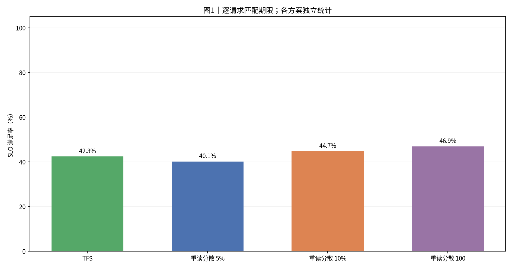
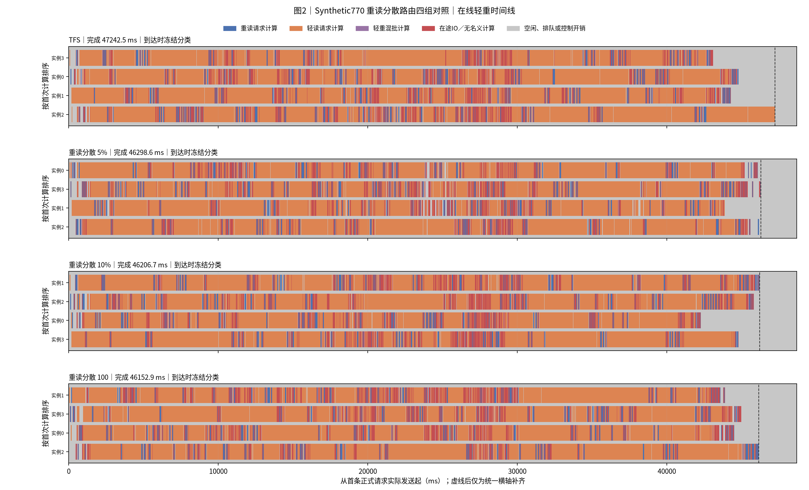
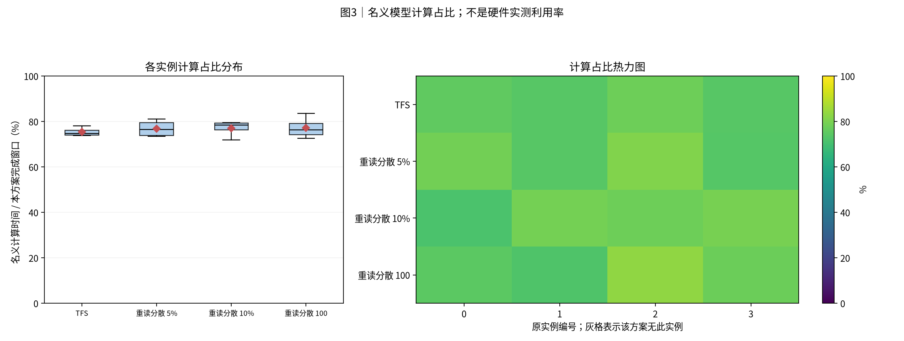
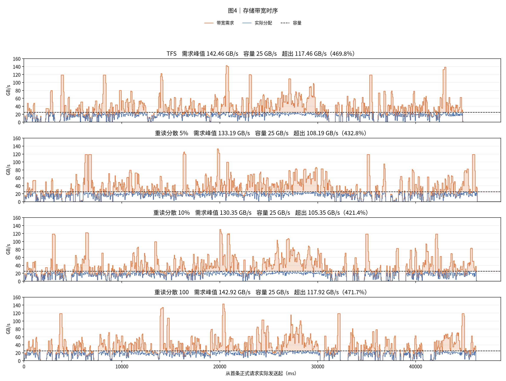
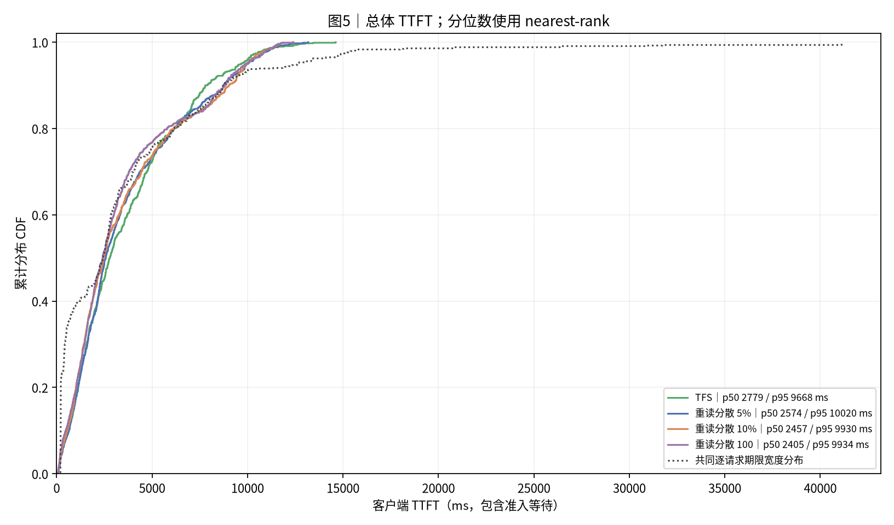
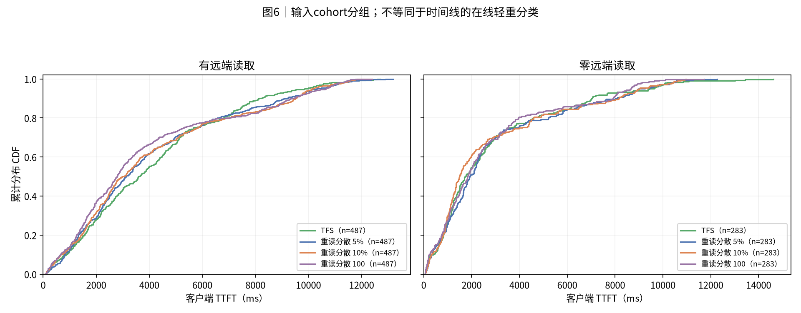
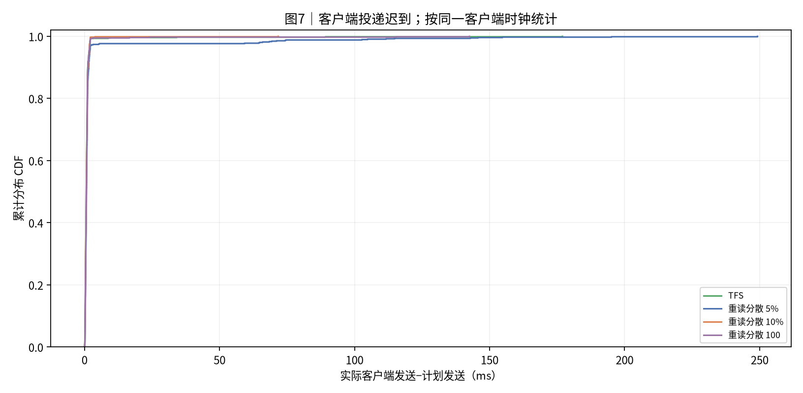

# 实验结果：Synthetic770 重读分散路由四组对照

|项目|约定|
|---|---:|
|执行边界|同一 Dynamo 1.2 构建下的四轮 WSL CPU 仿真，每档各一轮。|
|方案顺序|TFS → 重读分散 5% → 重读分散 10% → 重读分散 100|
|输入种子 / 重复|每个case独立展示一个冻结运行；种子与重复见附表，未提供时不推断|
|汇总 / 轨迹|不跨case合并样本、不生成置信区间；轨迹保留全部正式请求|
|SLO / TTFT|逐请求匹配期限。TTFT 从客户端实际发送到首 token，包含路由、排队和准入。|
|分组|分类表和CDF使用输入cohort；时间线使用在线轻重判定|
|单位|时间秒/毫秒；容量字节；带宽GB/s=10^9 B/s|
|负载|770 条请求，35 秒开环发送，单输出 token。|
|资源|四实例、BS=1、FCFS、16 层、六盘共享 25 GB/s。|
|公共策略|α=0.1、带宽加权许可、全量带宽上报和快照选队。|
|路由边界|5% 和 10% 限制候选原分差，100 取消分差上限。三档均匹配 KV 命中。|
|输入 SHA256|82e6606c8dd8d84dbfec9ea2c1efb1c3d9839dd135e85c89cc11afa101c84245|
|带宽与等待|按逐层提交时间重放六盘模型。按请求累计首层提交至完成与后 15 层暴露等待。|
|计时与 SLO|期限为逐请求全 miss prefill 耗时的 4 倍。按完整 prompt 估算，从空前缀开始，沿用 50,000 token 分块预算，远端 KV 读取为零。TTFT 从客户端实际发送到首 token。|

## 0. 总判决

四轮各完成 770 条。**整批最短为 重读分散 100，平均 TTFT 最低为 重读分散 100。**100 组比 TFS 整批少 1.09 秒，平均 TTFT 少 210 ms。本轮四组中 TFS 的 P95 TTFT 最低。100 组比 TFS 高 266 ms。

|指标|TFS|重读分散 5%|重读分散 10%|重读分散 100|
|---|---:|---:|---:|---:|
|整批最后首 token（秒）|47.242|46.299|46.207|46.153|
|平均 TTFT（秒）|3.644|3.640|3.583|3.434|
|P95 TTFT（秒）|9.668|10.020|9.930|9.934|
|首层 KV 等待（实例·秒）|5.965|5.758|5.986|6.107|
|后 15 层 KV 等待（实例·秒）|21.204|20.172|21.248|21.384|


## 1. 汇总表与 SLO 柱状图

|方案|请求数|完成ms|平均TTFT ms|p95 ms|SLO%|四个 worker 完成时刻均值（s）|
|---|---:|---:|---:|---:|---:|---:|
|TFS|770|47242.5|3643.9|9668.0|42.3|44.862|
|重读分散 5%|770|46298.6|3639.8|10019.7|40.1|45.609|
|重读分散 10%|770|46206.7|3583.4|9929.9|44.7|44.778|
|重读分散 100|770|46152.9|3433.9|9933.7|46.9|44.889|

以首条正式请求实际发送为 0 秒，按执行 worker 分组取最后一个客户端响应结束时刻。四个 worker 等权取均值。任一 worker 缺少完整记录或未执行请求时，均值标为缺少数据。

|方案|worker 0（s）|worker 1（s）|worker 2（s）|worker 3（s）|四个 worker 完成时刻均值（s）|
|---|---:|---:|---:|---:|---:|
|TFS|44.808|44.294|47.243|43.103|44.862|
|重读分散 5%|46.083|43.883|46.170|46.299|45.609|
|重读分散 10%|42.287|46.207|45.822|44.795|44.778|
|重读分散 100|44.508|43.899|46.153|44.998|44.889|

分类结果使用输入cohort：

|方案|分组|请求数|平均TTFT ms|SLO%|
|---|---:|---:|---:|---:|
|TFS|有远端读取|487|4112.2|48.3|
|TFS|零远端读取|283|2838.1|32.2|
|重读分散 5%|有远端读取|487|4049.2|47.4|
|重读分散 5%|零远端读取|283|2935.2|27.6|
|重读分散 10%|有远端读取|487|4044.9|52.4|
|重读分散 10%|零远端读取|283|2789.1|31.4|
|重读分散 100|有远端读取|487|3852.7|55.4|
|重读分散 100|零远端读取|283|2713.3|32.2|



**读法**：柱高与上表同口径。每条请求使用自身期限判断是否达标。

## 2. 各方案 full-sort-ms 执行时间线




**读法**：蓝重读、橙轻读、紫轻重混批。红色为未被名义计算覆盖的在途IO，灰色含空闲、排队和控制。动态与冻结分类分别标注；直接放行分类仅作参考。虚线右侧仅为统一横轴补齐。

## 3. 模型计算占比分布与热力图




**读法**：箱线和热力图来自同一组逐实例数据。分母是各方案从首次正式到达到末条首token的窗口。该值不是硬件实测利用率。

## 4. 存储带宽时序




**读法**：各方案共用从零起的线性纵轴。橙线为需求，蓝线为实际分配，黑虚线为容量。橙色阴影的高度表示需求超出容量的 GB/s。峰值取图中时间桶的平均需求最大值。

|方案|平均GB/s|需求超订%|实际饱和%|
|---|---:|---:|---:|
|TFS|15.1|62.1|10.1|
|重读分散 5%|15.4|60.9|9.4|
|重读分散 10%|15.4|60.7|9.7|
|重读分散 100|15.4|62.3|11.3|

## 5. TTFT 累积分布 CDF




**读法**：经验CDF按rank/n绘制，终点为1。期限不同时，SLO必须逐请求匹配，不能由两条CDF交点推算。




**读法**：此处分组来自cohort，可能是历史A/B或业务分类，不用该标签推断在线轻重。

## 6. 机制解释与前序对照

### 相对同构建的 TFS 基线

|策略|整批变化（秒）|平均 TTFT 变化（秒）|重读获批等待变化（秒）|
|---|---:|---:|---:|
|重读分散 5%|-0.944|-0.004|-0.338|
|重读分散 10%|-1.036|-0.061|-0.083|
|重读分散 100|-1.090|-0.210|-0.282|


### 路由和等待

|策略|已核对路由|改选|接受更高分|改选后遇运行中轻读剩余超过 100 ms|各 worker 重读峰值|末 20 条获批分布|重读平均获批等待（秒）|重读平均 TTFT（秒）|轻读平均 TTFT（秒）|
|---|---:|---:|---:|---:|---:|---:|---:|---:|---:|
|TFS|0|0|0|0|15 / 13 / 12 / 7|5 / 7 / 4 / 4|3.432|4.719|3.246|
|重读分散 5%|208|28|28|0|8 / 10 / 9 / 11|4 / 2 / 5 / 9|3.094|4.549|3.303|
|重读分散 10%|209|49|49|2|8 / 10 / 11 / 7|0 / 8 / 10 / 2|3.349|4.712|3.163|
|重读分散 100|208|117|117|2|7 / 7 / 7 / 6|5 / 5 / 6 / 4|3.151|4.547|3.022|


路由计数按每个请求末次决策与账本绑定对齐。TFS 基线采用原路由路径，改选计数为零。峰值列是各 worker 在各自时刻达到的最大值。等待从 worker 收到 hint 到获批，包含本地调度和许可等待。重读和轻读列按各轮在线分类统计。

### 固定请求集合的平均 TTFT（秒）

|按基线固定请求集合|请求数|TFS|重读分散 5%|重读分散 10%|重读分散 100|
|---|---:|---:|---:|---:|---:|
|重读|208|4.719|4.549|4.730|4.547|
|轻读|562|3.246|3.303|3.159|3.022|


### 重读分布

|策略|重读获批|各 worker 重读落点|绑定后平均队列极差（条）|
|---|---:|---:|---:|
|TFS|208|54 / 51 / 59 / 44|6.841|
|重读分散 5%|208|50 / 48 / 43 / 67|3.755|
|重读分散 10%|209|54 / 54 / 53 / 48|3.847|
|重读分散 100|208|48 / 56 / 53 / 51|1.029|


绑定后队列极差是四个 worker 等待重读条数的最大值减最小值，按绑定位点平均。10% 组在线多判重 1 条，固定请求集合按 TFS 基线的标签比较。四组重读许可同时持有峰值均为 1。100 组重读分布最均匀，该组的后 15 层累计 KV 等待略升。5% 组减少了约 1.03 实例·秒的层间等待，其总体平均 TTFT 只减少约 4 ms。100 组固定集合的轻读平均 TTFT 下降约 224 ms，重读下降约 172 ms，两类排队都出现改善。单轮数据支持这些观测，且受各轮路由和执行时序影响。

## 7. 计算模型与结论限制

Dynamo 路由平局、回放和进程调度会随运行变化。每组各一轮，差值表示本次观测。逐请求 SLO 为全 miss prefill 模型耗时的四倍。CPU 仿真按模型计算与共享存储时序执行。

## 8. 附表




**读法**：此图描述客户端实际发送相对计划的迟到，不是单次准入RPC耗时。

|方案|实例数|模型计算占比%|运行标识|
|---|---:|---:|---:|
|TFS|4|75.4|{"repeat": 1, "native_sha256": "8dd768bee814139d5ed04e5735c58556064c089fd6c17c4a597bf4c3aa775726", "prefill_model_sha256": "48776fc742ba30edd6715219cff9fb9891104c55c5cc8e45df3a3f292857e1aa", "frontend_start": "2026-11-27T16:34:04.395634+08:00", "frontend_stop": "2026-11-27T16:35:34.004976+08:00", "heavy_spread": "off"}|
|重读分散 5%|4|76.9|{"repeat": 1, "native_sha256": "8dd768bee814139d5ed04e5735c58556064c089fd6c17c4a597bf4c3aa775726", "prefill_model_sha256": "48776fc742ba30edd6715219cff9fb9891104c55c5cc8e45df3a3f292857e1aa", "frontend_start": "2026-11-27T16:35:55.539182+08:00", "frontend_stop": "2026-11-27T16:37:25.954608+08:00", "heavy_spread": "5"}|
|重读分散 10%|4|77.0|{"repeat": 1, "native_sha256": "8dd768bee814139d5ed04e5735c58556064c089fd6c17c4a597bf4c3aa775726", "prefill_model_sha256": "48776fc742ba30edd6715219cff9fb9891104c55c5cc8e45df3a3f292857e1aa", "frontend_start": "2026-11-27T16:37:45.641625+08:00", "frontend_stop": "2026-11-27T16:39:13.620229+08:00", "heavy_spread": "10"}|
|重读分散 100|4|77.1|{"repeat": 1, "native_sha256": "8dd768bee814139d5ed04e5735c58556064c089fd6c17c4a597bf4c3aa775726", "prefill_model_sha256": "48776fc742ba30edd6715219cff9fb9891104c55c5cc8e45df3a3f292857e1aa", "frontend_start": "2026-11-27T16:39:31.313499+08:00", "frontend_stop": "2026-11-27T16:40:58.706557+08:00", "heavy_spread": "100"}|

|方案|序列上限|token预算|存储容量GB/s|准入位置 / 规则|计算模型|
|---|---:|---:|---:|---:|---:|
|TFS|1|50000|25.0|scheduler / arrival|prefill_fit|
|重读分散 5%|1|50000|25.0|scheduler / arrival|prefill_fit|
|重读分散 10%|1|50000|25.0|scheduler / arrival|prefill_fit|
|重读分散 100|1|50000|25.0|scheduler / arrival|prefill_fit|

[逐策略路由与准入统计](report_data/heavy_routing.csv) · [首层与后 15 层逐请求等待](report_data/request_wait_details.csv) · [带宽重放校验](report_data/bandwidth_audit.csv)

## 9. 验证、数据与复现

已校验请求计数、逐请求SLO、nearest-rank分位数、CDF概率质量、实例时间账本及可用带宽积分。图片人工检查状态见校验文件。

- [校验记录](report_data/validation.json)
- [方案汇总](report_data/run_summary.csv)
- [请求明细](report_data/requests.csv)
- [标准重绘数据](report_data/dataset.json)
- [复现入口](reproduce/generate_report.py)

在报告目录执行：

```bash
python reproduce/generate_report.py --dataset report_data/dataset.json --output ../reproduced-report
```

## 10. 简要解读

优先对照总体平均 TTFT 和整批完成时间。再结合获批等待、末 20 条获批分布和时间线，检查把重读分到其他 worker 后，是否加快了开工与收尾。
