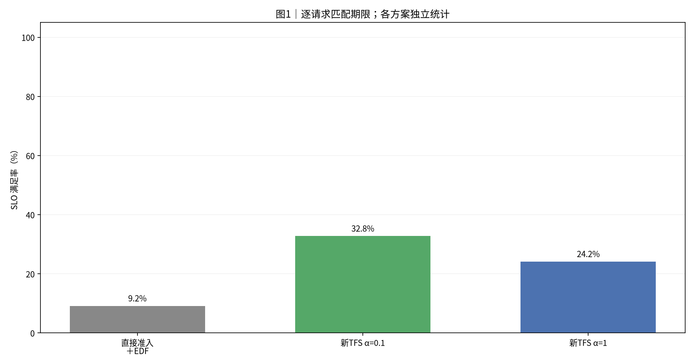
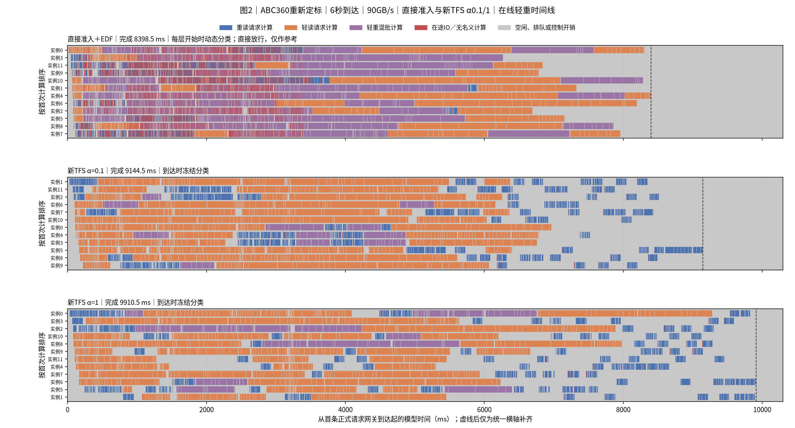
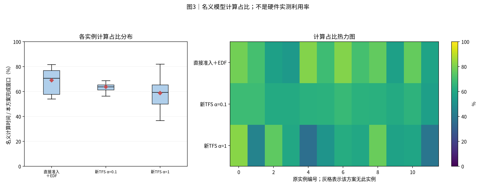
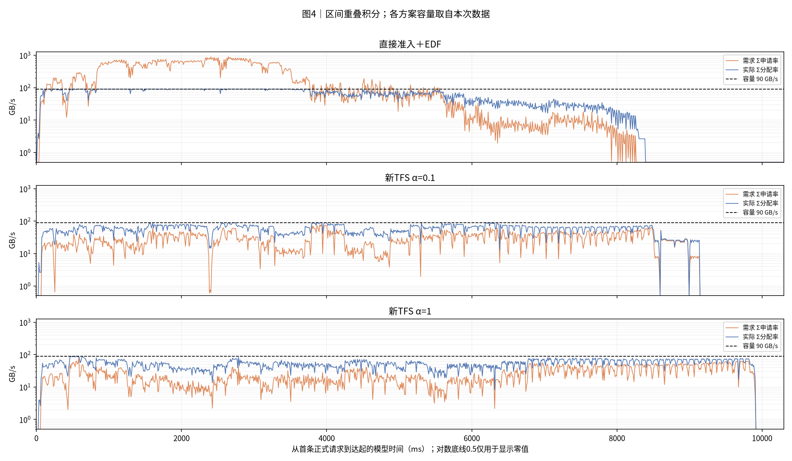
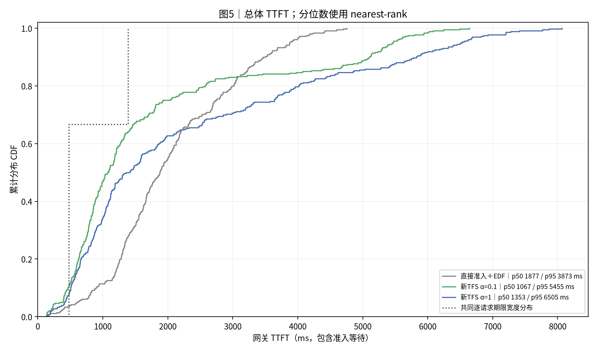
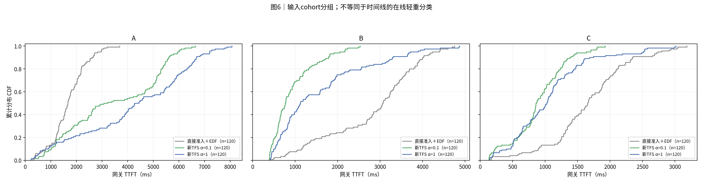
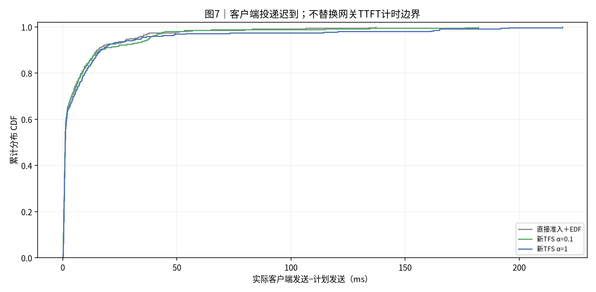

# synthetic_abc_360_6s_12_90GBps｜直接提交 EDF；TFS EDF α=0.1；TFS EDF α=1

|归档信息|内容|
|---|---|
|报告创建时间|2026-10-30T16:27:07+08:00，Asia/Shanghai|
|实际实验日期|2026-10-30；源记录未提供的精确时刻不推断|
|Benchmark|[synthetic_abc_360_6s_12_90GBps](../../../benchmark/synthetic_abc_360_6s_12_90GBps/README.md)|
|本次操作|只归档既有结果；未运行仿真、未改变性能数值；原图字节保持一致|
|归档清单|[manifest.json](manifest.json)、[归档校验](archive_validation.json)|
|原报告标题|实验结果：ABC360重新定标｜6秒到达｜90GB/s｜直接准入与新TFS α0.1/1|

**研究版运行报告**：该 benchmark 当前在交付运行器中仍为 export_only。本文结果来自已完成的研究版实验，不代表交付运行器已实现这套运行合同。


|项目|约定|
|---|---:|
|执行边界|从冻结日志离线整理；本次没有重跑实验|
|方案顺序|直接准入＋EDF → 新TFS α=0.1 → 新TFS α=1|
|输入种子 / 重复|每个case独立展示一个冻结运行；种子与重复见附表，未提供时不推断|
|汇总 / 轨迹|不跨case合并样本、不生成置信区间；轨迹保留全部正式请求|
|SLO / TTFT|逐请求匹配deadline；TTFT=first_token−gateway arrival，包含准入等待|
|分组|分类表和CDF使用输入cohort；时间线使用在线轻重判定|
|单位|时间秒/毫秒；容量字节；带宽GB/s=10^9 B/s|
|实验日 / 整理日|2026-10-30 / 2026-10-30|
|输入|原ABC seed416到达节奏整体乘6/3.612；各120条，共360条；从原时间0到末次计划到达6秒|
|请求形状|A h30720/u259；B h9392/u2048；C h0/u348；每请求输出1 token|
|资源|12逻辑实例；单共享池90 GB/s；block16/12258逻辑块；batch≤4/8192新token；K=1|
|计时模型|当前研究版glm5_direct_sum_v1、启动合并比例1、TP1/DP8/EP8；3 Dense+75 MoE层；不是旧SA八层|
|存储模型|每token共1408×78=109824 B；grouped max-min；零启动延迟；逐层KV预取下一层；每请求前缀只读一次|
|方案|直接准入EDF、新TFS α0.1、新TFS α1；无强制准入、无老化；TFS调度前准入、到达冻结重读、HTTP首token释放|
|通信|Dynamo Runtime TCP/MessagePack准入；最终答复恢复调度、EOF后台收尾；四类执行反馈已关闭|
|预热 / 重复|每方案72预热、排空并重置分类历史/GC，再运行360正式；每方案一次；顺序直接→α0.1→α1|
|静态负载|参考计算97.29%，输入存储97.89%；总读取528.631 GB；不是实际利用率|
|命中假设|按类别固定远端命中token，关闭本地prefix缓存；同形状请求也逐请求读取，无跨请求读取去重|
|SLO / 时间|TTFT=网关到达→首token；每请求deadline=arrival+4×glm5_reference_v3服务时间；完成窗口为首次正式网关到达→末条首token|
|版本|DV b6aca299ec9888d25435c94013f05d73fd8fa825；原native扩展；隔离副本只加Kahan诊断字节计数补丁，不修改读算公式或分配状态|
|执行边界|2026-10-30实际运行三组；报告阶段离线读取冻结日志。真实Dynamo路由、vLLM调度及网络控制面；GLM5/D950PR计算与90GB/s存储为CPU仿真|
|原始审计目录|/home/zed/.local/share/state-aware-network/audits/abc360-glm90-6s-20261030-r1|

## 0. 总判决

三组各360条正式请求全部完成。直接准入完成最快、P95最低；α0.1平均TTFT与SLO最好。

|方案|完成ms|平均TTFT ms|P95 ms|SLO %|
|---|---:|---:|---:|---:|
|直接准入＋EDF|8398.5|2056.4|3873.0|9.17|
|新TFS α=0.1|9144.5|1748.3|5454.8|32.78|
|新TFS α=1|9910.5|2288.9|6504.7|24.17|


新TFS α=0.1相对直接：完成变化+8.88%，平均TTFT变化-14.98%，SLO变化+23.61个百分点。

新TFS α=1相对直接：完成变化+18.00%，平均TTFT变化+11.31%，SLO变化+15.00个百分点。

每方案只运行一次。各指标可能给出不同排名；没有统计显著性或稳定最优结论。

直接准入首次尝试发生一次Runtime返回流连接失败，359/360完成后停止并保留；主表使用相同配置的完整重跑。

## 1. 汇总表与 SLO 柱状图

|方案|请求数|完成ms|平均TTFT ms|p95 ms|SLO%|网关等待ms|
|---|---:|---:|---:|---:|---:|---:|
|直接准入＋EDF|360|8398.5|2056.4|3873.0|9.2|0.8|
|新TFS α=0.1|360|9144.5|1748.3|5454.8|32.8|1.1|
|新TFS α=1|360|9910.5|2288.9|6504.7|24.2|1.3|

分类结果使用输入cohort：

|方案|分组|请求数|平均TTFT ms|SLO%|
|---|---:|---:|---:|---:|
|直接准入＋EDF|A|120|1689.4|5.8|
|直接准入＋EDF|B|120|2814.7|17.5|
|直接准入＋EDF|C|120|1665.1|4.2|
|新TFS α=0.1|A|120|3417.4|1.7|
|新TFS α=0.1|B|120|932.7|82.5|
|新TFS α=0.1|C|120|894.8|14.2|
|新TFS α=1|A|120|4224.3|4.2|
|新TFS α=1|B|120|1579.2|57.5|
|新TFS α=1|C|120|1063.2|10.8|



**读法**：柱高与上表同口径。每条请求使用自身期限判断是否达标。

## 2. 各方案 full-sort-ms 执行时间线




**读法**：蓝重读、橙轻读、紫轻重混批。红色为未被名义计算覆盖的在途IO，灰色含空闲、排队和控制。动态与冻结分类分别标注；直接放行分类仅作参考。虚线右侧仅为统一横轴补齐。

## 3. 模型计算占比分布与热力图




**读法**：箱线和热力图来自同一组逐实例数据。分母是各方案从首次正式到达到末条首token的窗口。该值不是硬件实测利用率。

## 4. 存储带宽时序




**读法**：橙线为需求，蓝线为实际分配，虚线为本次容量。按时间重叠积分，不对不等长事件直接取平均。零值在CSV保留0。

|方案|平均GB/s|需求超订%|实际饱和%|
|---|---:|---:|---:|
|直接准入＋EDF|62.9|47.7|69.9|
|新TFS α=0.1|57.8|2.5|64.2|
|新TFS α=1|53.3|1.0|59.3|

## 5. TTFT 累积分布 CDF




**读法**：经验CDF按rank/n绘制，终点为1。期限不同时，SLO必须逐请求匹配，不能由两条CDF交点推算。




**读法**：此处分组来自cohort，可能是历史A/B或业务分类，不用该标签推断在线轻重。

## 6. 机制解释与前序对照

三组共享输入、到达计划、设备/存储容量、预热与原生扩展，全部EDF。α0.1与α1只改变等待重读路由计分系数；α1仍执行配额与同步申请，不等于直接准入。

|方案|step数|平均batch|batch直方图|正式额度拒绝数|最终配额|最小可用GiB|swap峰值GiB|
|---|---:|---:|---:|---:|---:|---:|---:|
|直接准入＋EDF|117|3.08|{'1': 23, '2': 13, '4': 68, '3': 13}|0|不限制|8.08|0.000|
|新TFS α=0.1|237|1.52|{'1': 167, '2': 34, '3': 19, '4': 17}|3109|3|8.19|0.000|
|新TFS α=1|216|1.67|{'1': 149, '2': 21, '4': 31, '3': 15}|5789|3|7.96|0.000|


|方案|正式配额最小|最大|最终|冻结重读类别计数|
|---|---:|---:|---:|---:|
|新TFS α=0.1|3|30|3|{'A': 120, 'B': 1}|
|新TFS α=1|3|30|3|{'A': 120, 'B': 1}|


配额按已到达历史P75计算。A读算压力28.433GB/s，稳定阈值下floor(90/28.433)=3。配额是未释放重读账目数上限，不等于任意时刻实际读取并发；额度仍按首token释放。

A/B/C为构造类别，与在线冻结轻重分类不同。初期阈值可能把少量B标记成重读。报告的执行状态从worker日志离线补全；中央没有恢复四类执行反馈。

|方案|客户端平均TTFT ms|客户端同宽SLO %|平均迟到ms|最大迟到ms|网关到达跨度s|
|---|---:|---:|---:|---:|---:|
|直接准入＋EDF|2072.0|9.17|6.4|137.1|5.996|
|新TFS α=0.1|1764.4|32.50|7.2|182.1|5.997|
|新TFS α=1|2305.7|23.89|9.1|218.9|6.000|


计划到达窗口与实际网关到达跨度分列。迟到可能影响组批。时间线红色为在途IO并集减去名义计算，灰色含空闲、排队和控制，不能只凭颜色推断纯IO阻塞或某次RPC耗时。

本轮带宽观察：直接组前半段出现明显需求超订，随后回落；两种TFS压低了在途需求，但重读完成更晚。需求超订时间占比由直接的47.74%降至α0.1的2.47%和α1的1.01%。这不是各方案都提高了吞吐的证据；总完成窗口反而延长。

α0.1的收益存在类别差异：A类平均TTFT由1689.4ms变为3417.4ms；B类平均TTFT由2814.7ms变为932.7ms；C类平均TTFT由1665.1ms变为894.8ms。B/C改善，A等待与尾部延迟增加，不能把总体SLO改善解释为所有请求都受益。

三组名义计算总量分别为69.649、69.846、69.811实例秒，相差不到0.3%。因此，本轮TFS拖尾不能主要解释为小batch在公式中产生更多计算工作。时间线后段重读更稀疏；配额等待、路由分配和主机控制开销需另做分段归因。

首次直接准入尝试：r00293到达worker10后，Dynamo Runtime建立返回流失败，报Network is unreachable（os error 101）。其余359条正式请求完成，该请求无首token。确认停滞后向所属驱动发送SIGINT，保留失败日志，子进程清理通过。按完全相同的输入、源码、参数及超时重跑，不纳入成功性能统计。原因记录：{"status": "failed", "arm": "edf", "formal_complete_before_interrupt": 359, "formal_total": 360, "failed_request": "r00293", "engine_uuid": "5ee6ce68-1e86-4ea5-9fb0-fbab3a149da8", "worker": 10, "reason": "Dynamo Runtime failed to create response stream: Network is unreachable (os error 101)", "action": "Sent SIGINT to owned driver after all other requests drained; no completion invented; identical config retry", "cleanup_alive": []}

## 7. 计算模型与结论限制

|类别|条数|远端命中token|新算token|参考计算ms|读取GB|
|---|---:|---:|---:|---:|---:|
|A|120|30720|259|118.659|3.373793|
|B|120|9392|2048|346.392|1.031467|
|C|120|0|348|118.675|0|


总参考计算70.047实例秒、总读取528.631GB。6秒输入窗口对应计算97.29%、存储97.89%。这描述输入工作量，不是硬件利用率，也不保证实际运行只在局部过载。逐层等待、实际组批、分块、路由和主机开销会影响完成窗口。

GLM5为3 Dense+75 MoE层，TP1/DP8/EP8，direct_sum启动合并比例1。保留算子模型常数，真实GPU/NPU未参与。12个逻辑实例不等于本机12台实机。计算时间不含排队、RPC与逐层存储等待。

固定远端命中是合成假设；每请求前缀读取一次，不对相同内容跨请求免读。未复现生产缓存淘汰、共享读合并、取消或抢占压力。K=1，6秒是到达计划缩放，不是时间倍率。

此实验同时改变了旧SA八层ABC的计算模型、KV字节、请求形状和到达窗口，不能与旧报告直接比较调度收益。各方案仅一次，执行顺序固定；本机控制面性能不能当作跨机网络延迟。

## 8. 附表




**读法**：此图描述客户端实际发送相对计划的迟到，不是单次准入RPC耗时。

|方案|实例数|模型计算占比%|运行标识|
|---|---:|---:|---:|
|直接准入＋EDF|12|69.1|{"input": "ABC360重新定标 seed416", "planned_window_s": 6, "seed": 416, "repeat": 1, "source_commit": "b6aca299ec9888d25435c94013f05d73fd8fa825"}|
|新TFS α=0.1|12|63.7|{"input": "ABC360重新定标 seed416", "planned_window_s": 6, "seed": 416, "repeat": 1, "source_commit": "b6aca299ec9888d25435c94013f05d73fd8fa825"}|
|新TFS α=1|12|58.7|{"input": "ABC360重新定标 seed416", "planned_window_s": 6, "seed": 416, "repeat": 1, "source_commit": "b6aca299ec9888d25435c94013f05d73fd8fa825"}|

|方案|序列上限|token预算|存储容量GB/s|准入位置 / 规则|计算模型|
|---|---:|---:|---:|---:|---:|
|直接准入＋EDF|4|8192|90.0|gateway / dynamic|glm5_direct_sum_v1|
|新TFS α=0.1|4|8192|90.0|scheduler / arrival|glm5_direct_sum_v1|
|新TFS α=1|4|8192|90.0|scheduler / arrival|glm5_direct_sum_v1|

|方案|step数|平均batch|batch直方图|正式额度拒绝数|最终配额|最小可用GiB|swap峰值GiB|
|---|---:|---:|---:|---:|---:|---:|---:|
|直接准入＋EDF|117|3.08|{'1': 23, '2': 13, '4': 68, '3': 13}|0|不限制|8.08|0.000|
|新TFS α=0.1|237|1.52|{'1': 167, '2': 34, '3': 19, '4': 17}|3109|3|8.19|0.000|
|新TFS α=1|216|1.67|{'1': 149, '2': 21, '4': 31, '3': 15}|5789|3|7.96|0.000|


|方案|客户端平均TTFT ms|客户端同宽SLO %|平均迟到ms|最大迟到ms|网关到达跨度s|
|---|---:|---:|---:|---:|---:|
|直接准入＋EDF|2072.0|9.17|6.4|137.1|5.996|
|新TFS α=0.1|1764.4|32.50|7.2|182.1|5.997|
|新TFS α=1|2305.7|23.89|9.1|218.9|6.000|


## 9. 验证、数据与复现

已校验请求计数、逐请求SLO、nearest-rank分位数、CDF概率质量、实例时间账本及可用带宽积分。图片人工检查状态见校验文件。

- [校验记录](report_data/source_validation.json)
- [方案汇总](report_data/run_summary.csv)
- [请求明细](report_data/requests.csv)
- [标准重绘数据](report_data/dataset.json.gz)
- [复现入口](../../tools/generate_report.py)

在报告目录执行：

```bash
python reproduce/generate_report.py --dataset report_data/dataset.json --output ../reproduced-report
```

## 10. 简要解读

先分别检查完成窗口、平均TTFT、P95与SLO，再结合完整轨迹和带宽确认竞争是否呈突发。不要将配额3理解为恒定3路读取，也不要从需求峰值下降单独推出吞吐提升。

## 归档与复现补充

本轮选取的原始数据表及配图保留来源指纹。较大的派生数据用 gzip 无损压缩，原始运行日志不随本归档发布。[复现说明](reproduce/README.md)区分数据重绘和完整仿真重跑；源验证记录与归档验证不是同一次验收。
