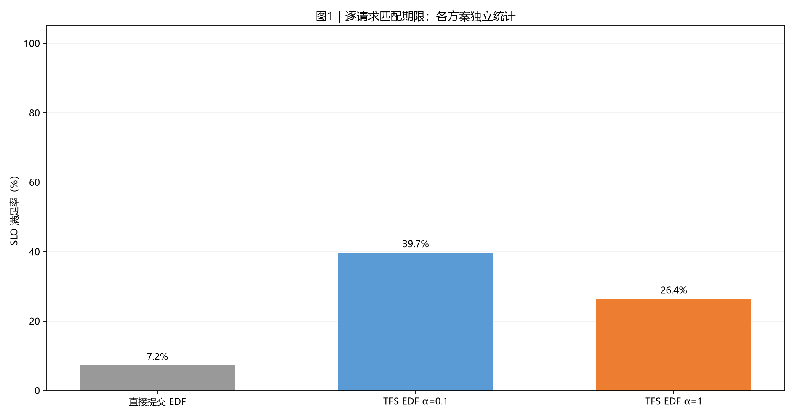
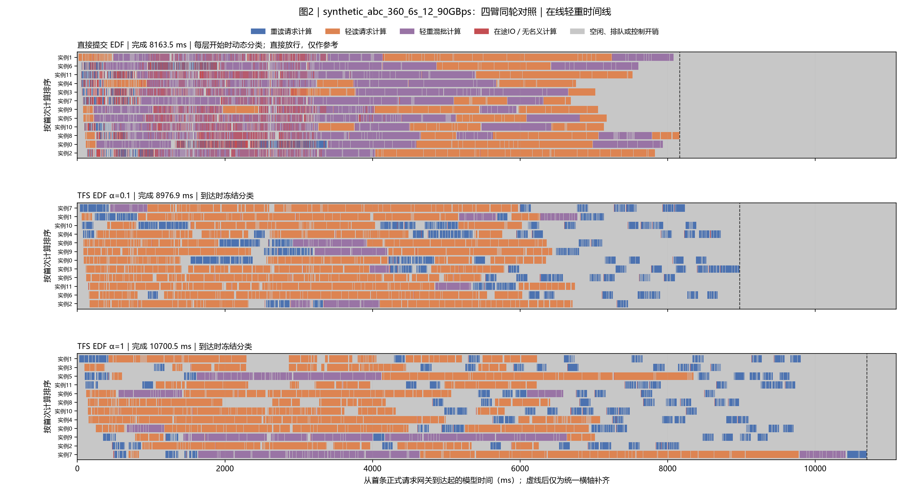
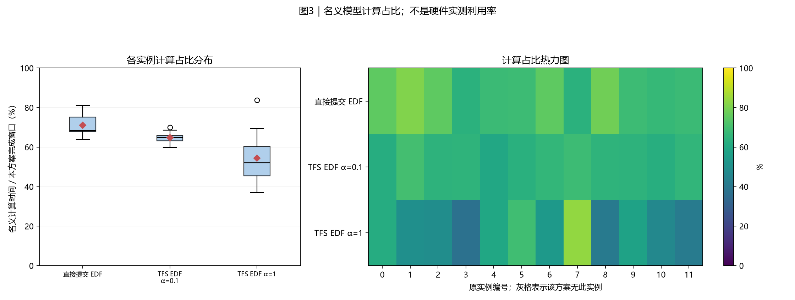
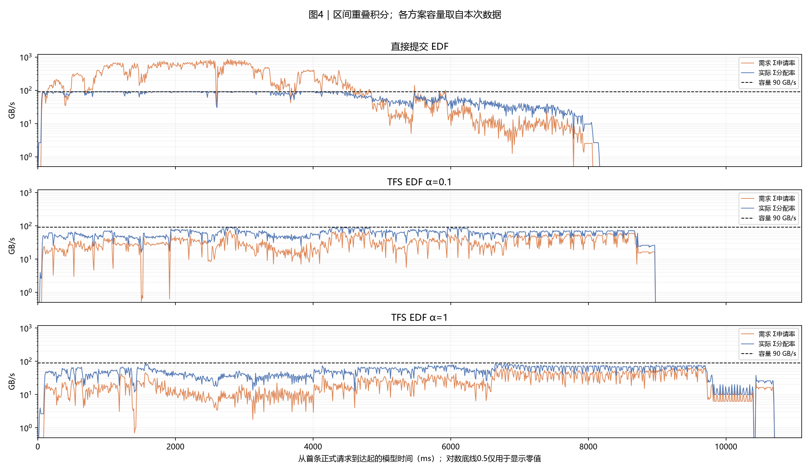
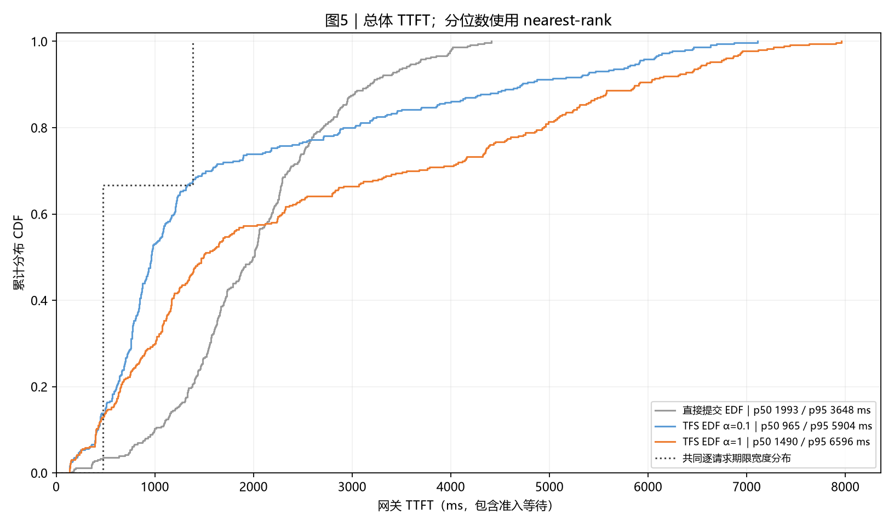
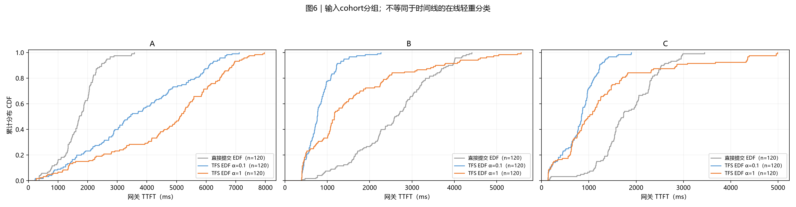
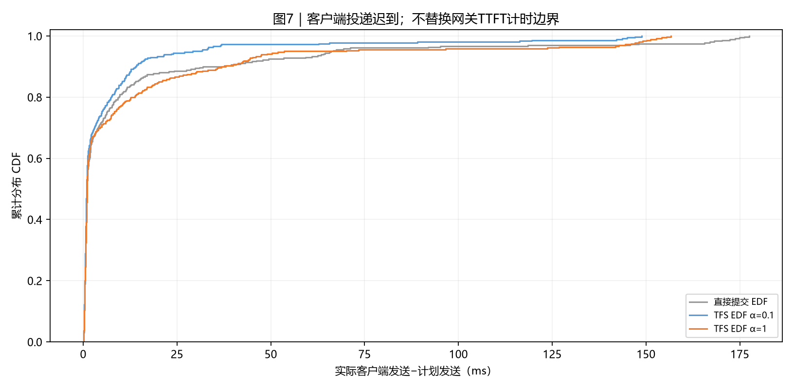

# 实验结果：synthetic_abc_360_6s_12_90GBps：四臂同轮对照

|项目|约定|
|---|---:|
|执行边界|从冻结日志离线整理；本次没有重跑实验|
|方案顺序|直接提交 EDF → TFS EDF α=0.1 → TFS EDF α=1|
|输入种子 / 重复|每个case独立展示一个冻结运行；种子与重复见附表，未提供时不推断|
|汇总 / 轨迹|不跨case合并样本、不生成置信区间；轨迹保留全部正式请求|
|SLO / TTFT|逐请求匹配deadline；TTFT=first_token−gateway arrival，包含准入等待|
|分组|分类表和CDF使用输入cohort；时间线使用在线轻重判定|
|单位|时间秒/毫秒；容量字节；带宽GB/s=10^9 B/s|

## 0. 总判决

## 0 结论

本报告为 **人工ABC六秒 90GB/s（固定三形状，6s 窗口）** 的同轮多臂对照（同一冻结输入与 native 构建，正式 360 条、预热 72 条已排除）。

- 直接提交 EDF：mean 2028 ms、p95 3648 ms、SLO 7.2%、完成 8164 ms
- TFS EDF α=0.1：mean 1744 ms、p95 5904 ms、SLO 39.7%、完成 8977 ms
- TFS EDF α=1：mean 2513 ms、p95 6596 ms、SLO 26.4%、完成 10700 ms

- **SLO 最优**：TFS EDF α=0.1（39.7%）；**mean TTFT 最优**：TFS EDF α=0.1（1744 ms）。
- 单轮运行，轮间噪声 mean ±15%~30%；小于该量级的差异不作优劣结论。

## 1. 汇总表与 SLO 柱状图

|方案|请求数|完成ms|平均TTFT ms|p95 ms|SLO%|网关等待ms|
|---|---:|---:|---:|---:|---:|---:|
|直接提交 EDF|360|8163.5|2027.5|3648.2|7.2|1.3|
|TFS EDF α=0.1|360|8976.9|1743.9|5904.2|39.7|1.2|
|TFS EDF α=1|360|10700.5|2513.2|6596.2|26.4|2.0|

分类结果使用输入cohort：

|方案|分组|请求数|平均TTFT ms|SLO%|
|---|---:|---:|---:|---:|
|直接提交 EDF|A|120|1708.8|5.8|
|直接提交 EDF|B|120|2560.6|12.5|
|直接提交 EDF|C|120|1813.1|3.3|
|TFS EDF α=0.1|A|120|3605.4|1.7|
|TFS EDF α=0.1|B|120|821.9|94.2|
|TFS EDF α=0.1|C|120|804.3|23.3|
|TFS EDF α=1|A|120|4617.2|2.5|
|TFS EDF α=1|B|120|1607.1|59.2|
|TFS EDF α=1|C|120|1315.4|17.5|



**读法**：柱高与上表同口径。每条请求使用自身期限判断是否达标。

## 2. 各方案 full-sort-ms 执行时间线




**读法**：蓝重读、橙轻读、紫轻重混批。红色为未被名义计算覆盖的在途IO，灰色含空闲、排队和控制。动态与冻结分类分别标注；直接放行分类仅作参考。虚线右侧仅为统一横轴补齐。

## 3. 模型计算占比分布与热力图




**读法**：箱线和热力图来自同一组逐实例数据。分母是各方案从首次正式到达到末条首token的窗口。该值不是硬件实测利用率。

## 4. 存储带宽时序




**读法**：橙线为需求，蓝线为实际分配，虚线为本次容量。按时间重叠积分，不对不等长事件直接取平均。零值在CSV保留0。

|方案|平均GB/s|需求超订%|实际饱和%|
|---|---:|---:|---:|
|直接提交 EDF|64.8|51.7|72.0|
|TFS EDF α=0.1|58.9|3.7|65.4|
|TFS EDF α=1|49.4|0.9|54.9|

## 5. TTFT 累积分布 CDF




**读法**：经验CDF按rank/n绘制，终点为1。期限不同时，SLO必须逐请求匹配，不能由两条CDF交点推算。




**读法**：此处分组来自cohort，可能是历史A/B或业务分类，不用该标签推断在线轻重。

## 6. 机制解释与前序对照

## 6 机制与前序对照

- 三臂（direct/tfs-a01/tfs-a1）为共享 EDF/模型/存储的既有基线；lease 臂按带宽派生轻重线（0.1×盘带宽）、每盘 B/s 账本五步放行、读开始/末层读毕事件释放与 f=1/m 路由折扣（m=10）。
- 调参定标（三轮重复采样）：判定线 1.2×、m=10 在 mean/p95/完成时间上优于默认 1.1×/m=4，SLO 在噪声内；random 对判定线 ≥1.5× 有 SLO 悬崖。
- 条件(a)只保护"不加候选仍可达标"的在读者；迟到的读毕事件容忍不杀引擎。

## 7. 计算模型与结论限制

## 7 限制

- 仿真边界：GLM5 解析计时与存储速率属于仿真（grouped max-min 注水），不是 Ascend910C 实测；控制消息走本机回环。
- 单轮对照，无跨轮统计显著性；同配置轮间 mean 差可达 ±15%~30%。
- lease 合同限定单共享池（disks=1）；多盘仅结构预留。

## 8. 附表




**读法**：此图描述客户端实际发送相对计划的迟到，不是单次准入RPC耗时。

|方案|实例数|模型计算占比%|运行标识|
|---|---:|---:|---:|
|直接提交 EDF|12|71.1|{"round": "formal-synthetic_abc_360_6s_12_90GBps", "arm": "direct"}|
|TFS EDF α=0.1|12|64.8|{"round": "formal-synthetic_abc_360_6s_12_90GBps", "arm": "tfs-a01"}|
|TFS EDF α=1|12|54.4|{"round": "formal-synthetic_abc_360_6s_12_90GBps", "arm": "tfs-a1"}|

|方案|序列上限|token预算|存储容量GB/s|准入位置 / 规则|计算模型|
|---|---:|---:|---:|---:|---:|
|直接提交 EDF|4|8192|90.0|gateway / dynamic|glm5_direct_sum_v1|
|TFS EDF α=0.1|4|8192|90.0|scheduler / arrival|glm5_direct_sum_v1|
|TFS EDF α=1|4|8192|90.0|scheduler / arrival|glm5_direct_sum_v1|

## 8 附表口径

- 逐请求 TTFT/SLO 期限按各自画像 4×T0 匹配；分位数 nearest-rank。
- 时间线为在线轻重（到达冻结 hint），红色为在途 IO 并集扣除名义计算，灰色含空闲/排队/控制；历史 A/B/C/D 仅业务分组。

## 9. 验证、数据与复现

已校验请求计数、逐请求SLO、nearest-rank分位数、CDF概率质量、实例时间账本及可用带宽积分。图片人工检查状态见校验文件。

- [校验记录](report_data/validation.json)
- [方案汇总](report_data/run_summary.csv)
- [请求明细](report_data/requests.csv)
- [标准重绘数据](report_data/dataset.json.gz)
- [复现入口](reproduce/generate_report.py)

在报告目录执行：

```bash
python reproduce/generate_report.py --dataset report_data/dataset.json --output ../reproduced-report
```

## 10. 简要解读

## 10 解读

- 租约臂把重读并发控制从"条数"改为"带宽份额"，并以事件驱动记账把虚占窗口从"下发→首token"缩到"获准→读开始"（约 7-8ms）。
- 收益集中在含"重读+重计算"混合类的负载；纯重读轻算或小需求密集负载上既有 TFS（α=0.1）仍是更优选择。
