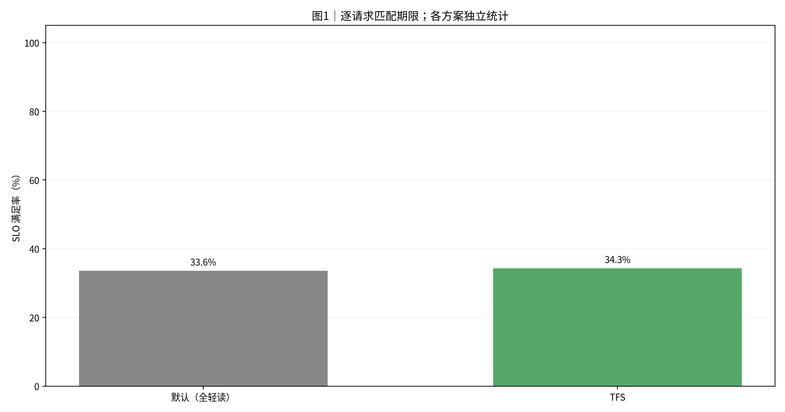
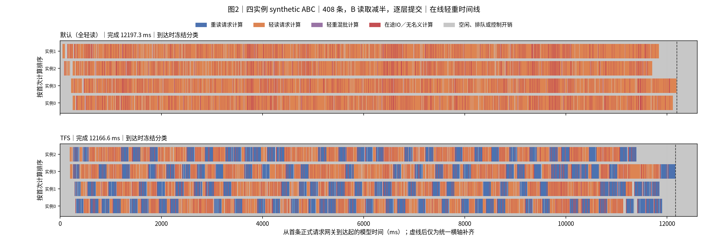
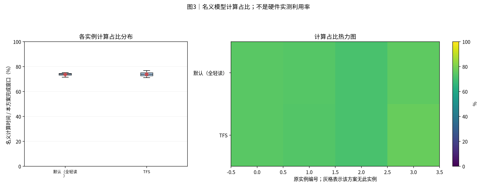
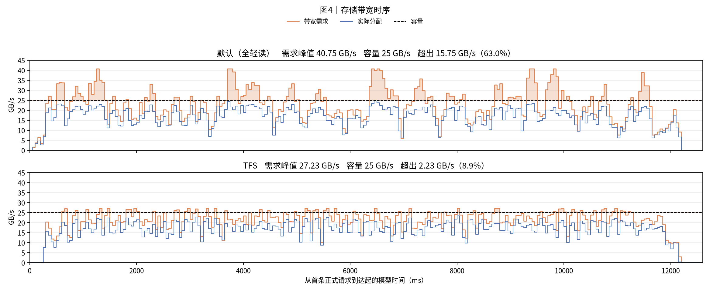
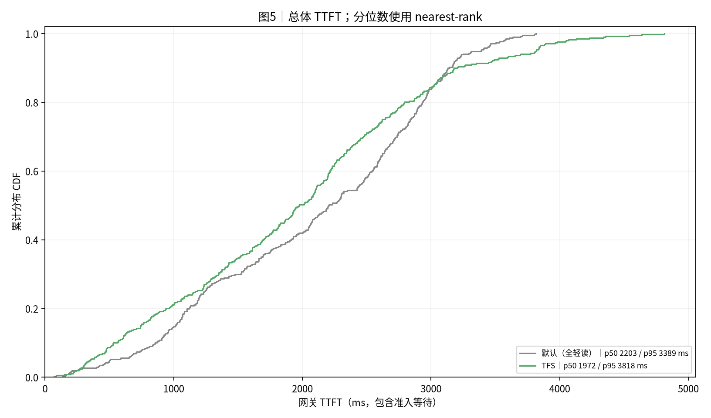
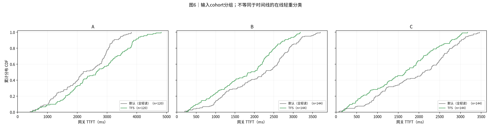
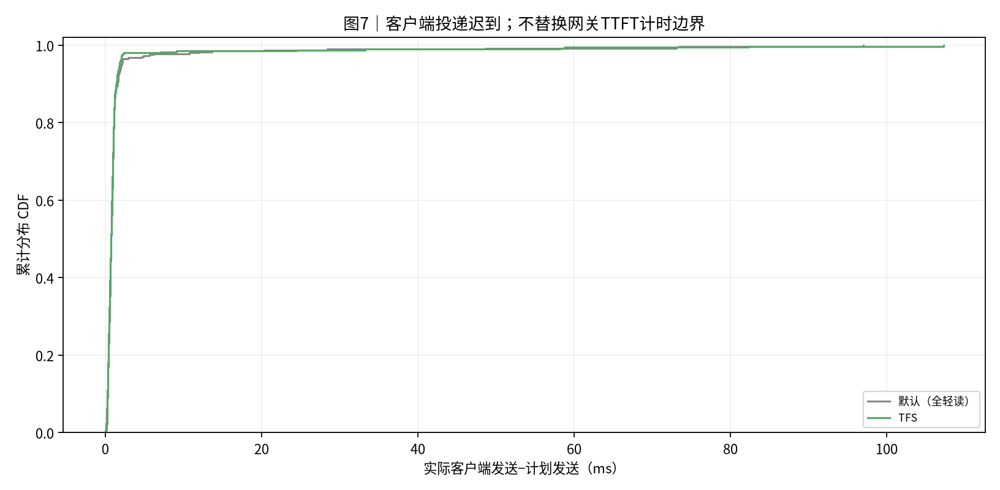

# 实验结果：四实例 synthetic ABC｜408 条，B 读取减半，逐层提交

|项目|约定|
|---|---:|
|执行边界|本地四实例 CPU 仿真，原生 Dynamo 1.2 路由、MiniMax 16 层计算模型和六盘存储模型。两种策略都按每批一层提前提交下一层读取。|
|方案顺序|默认（全轻读） → TFS|
|输入种子 / 重复|每个case独立展示一个冻结运行；种子与重复见附表，未提供时不推断|
|汇总 / 轨迹|不跨case合并样本、不生成置信区间；轨迹保留全部正式请求|
|SLO / TTFT|逐请求匹配deadline；TTFT=first_token−gateway arrival，包含准入等待|
|分组|分类表和CDF使用输入cohort；时间线使用在线轻重判定|
|单位|时间秒/毫秒；容量字节；带宽GB/s=10^9 B/s|
|运行|同一份冻结 trace，每策略一次，先默认再 TFS。四实例，每步最多一条，FCFS，α=0.1，强制准入关闭。|
|形状 H / U|A 120 条：20,480 / 2,048；B 各 72 条：4,608 或 4,736 / 2,048；C 144 条：0 / 384。8 秒到达，每条输出 1 token。|
|共享存储|6 盘，共享 25 GB/s。每个命中 token 读取 65,536 字节。|
|输入 SHA256|6ddd099448964e1208de96e7a1a3cee422a6e570fc2ab2cdf0e0f692092690c5|
|期限|输入 catalog 的 4 倍全长冷 prefill 期限。|
|指标边界|第 0 节以客户端为准。第 1—5 节通用图表使用网关登记到首 token 的时间。|

## 0. 总判决

同一份 408 条输入，两组各完成 408/408。客户端计时从实际发送开始，整批完成时间截至最后一条响应结束。表中负数表示耗时缩短。

|客户端指标|默认|TFS|相对变化|
|---|---|---|---|
|整批完成时间|12.22 s|12.18 s|-0.3%|
|总体平均 TTFT|2.31 s|2.11 s|-8.6%|
|P95 TTFT|4.13 s|4.08 s|-1.3%|

本轮 TFS 缩短了总体平均 TTFT，整批排空时间相差约 0.04 秒。B、C 的首 token 提前，A 的首 token 延后。

## 1. 汇总表与 SLO 柱状图

|方案|请求数|完成ms|平均TTFT ms|p95 ms|SLO%|网关等待ms|
|---|---:|---:|---:|---:|---:|---:|
|默认（全轻读）|408|12197.3|2082.7|3388.9|33.6|88.1|
|TFS|408|12166.6|1953.4|3818.3|34.3|82.4|

分类结果使用输入cohort：

|方案|分组|请求数|平均TTFT ms|SLO%|
|---|---:|---:|---:|---:|
|默认（全轻读）|A|120|2222.1|100.0|
|默认（全轻读）|B|144|2112.2|8.3|
|默认（全轻读）|C|144|1937.1|3.5|
|TFS|A|120|2617.6|90.0|
|TFS|B|144|1760.5|20.1|
|TFS|C|144|1592.8|2.1|



**读法**：柱高与上表同口径。每条请求使用自身期限判断是否达标。

## 2. 各方案 full-sort-ms 执行时间线




**读法**：蓝重读、橙轻读、紫轻重混批。红色为未被名义计算覆盖的在途IO，灰色含空闲、排队和控制。动态与冻结分类分别标注；直接放行分类仅作参考。虚线右侧仅为统一横轴补齐。

## 3. 模型计算占比分布与热力图




**读法**：箱线和热力图来自同一组逐实例数据。分母是各方案从首次正式到达到末条首token的窗口。该值不是硬件实测利用率。

## 4. 存储带宽时序




**读法**：各方案共用从零起的线性纵轴。橙线为需求，蓝线为实际分配，黑虚线为容量。橙色阴影的高度表示需求超出容量的 GB/s。峰值取图中时间桶的平均需求最大值。

|方案|平均GB/s|需求超订%|实际饱和%|
|---|---:|---:|---:|
|默认（全轻读）|16.8|38.5|6.6|
|TFS|16.9|23.8|0.8|

## 5. TTFT 累积分布 CDF




**读法**：经验CDF按rank/n绘制，终点为1。期限不同时，SLO必须逐请求匹配，不能由两条CDF交点推算。




**读法**：此处分组来自cohort，可能是历史A/B或业务分类，不用该标签推断在线轻重。

## 6. 机制解释与前序对照

### A、B 的后续层读取有多少被计算掩盖

|类别|策略|客户端平均 TTFT（s）|首层等待（ms/条）|后 15 层累计等待（ms/条）|后续层按时就绪率|
|---|---|---|---|---|---|
|A|默认|2.417|13.10|18.68|65.6%|
|A|TFS|2.751|11.61|4.75|78.2%|
|B|默认|2.348|5.55|8.00|81.1%|
|B|TFS|1.924|5.76|10.23|72.6%|
|C|默认|2.174|无读取|无读取|无读取|
|C|TFS|1.757|无读取|无读取|无读取|

首层等待取读提交到存储完成。后续层在上一层算完时已经读完即为按时就绪。迟到部分按每个请求的 15 层累加，多个 worker 的等待可能同时发生。C 没有远端读取，其 TTFT 变化反映整条执行路径。

以 50 ms 分桶，模型带宽需求峰值从默认的 40.75 GB/s 降至 TFS 的 27.23 GB/s。A 的读取更容易被计算掩盖，但 A 到首 token 的平均时间增加了约 0.33 秒。A 的逐层等待只覆盖获准执行后的部分，准入排队也会影响首 token。

## 7. 计算模型与结论限制

只有一轮配对。端到端收益包含排队、路由与运行时波动。本次两组都使用分批大小 1，只比较同一提交方式下的策略差异。

## 8. 附表




**读法**：此图描述客户端实际发送相对计划的迟到，不是单次准入RPC耗时。

|方案|实例数|模型计算占比%|运行标识|
|---|---:|---:|---:|
|默认（全轻读）|4|73.7|{"repeat": 1, "ordering": "FCFS", "alpha": 0.1}|
|TFS|4|73.9|{"repeat": 1, "ordering": "FCFS", "alpha": 0.1}|

|方案|序列上限|token预算|存储容量GB/s|准入位置 / 规则|计算模型|
|---|---:|---:|---:|---:|---:|
|默认（全轻读）|1|50000|25.0|scheduler / arrival|未提供|
|TFS|1|50000|25.0|scheduler / arrival|未提供|

每组 264 条请求读取 KV，共 4,224 笔层读取。逐请求核对读取字节。全部 264 条在第 0 层计算开始前已发出第 1 层读取。TFS 共发放 124 个重读许可，80 条请求至少一次因额度被跳过。

## 9. 验证、数据与复现

已校验请求计数、逐请求SLO、nearest-rank分位数、CDF概率质量、实例时间账本及可用带宽积分。图片人工检查状态见校验文件。

- [校验记录](report_data/validation.json)
- [方案汇总](report_data/run_summary.csv)
- [请求明细](report_data/requests.csv)
- [标准重绘数据](report_data/dataset.json)
- [复现入口](reproduce/generate_report.py)

在报告目录执行：

```bash
python reproduce/generate_report.py --dataset report_data/dataset.json --output ../reproduced-report
```

## 10. 简要解读

A 的后续层累计等待从每条 18.68 ms 变为 4.75 ms。B 则从 8.00 ms 变为 10.23 ms。逐层等待与客户端完成时间分别反映计算掩盖效果和整批排空速度。
