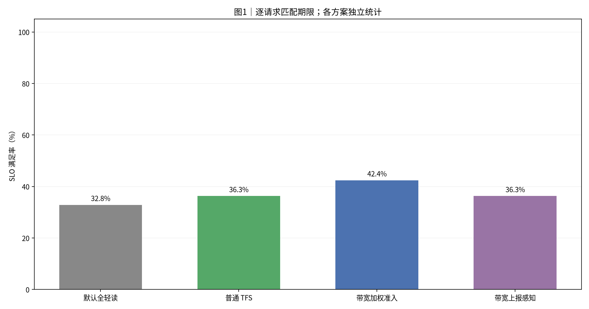
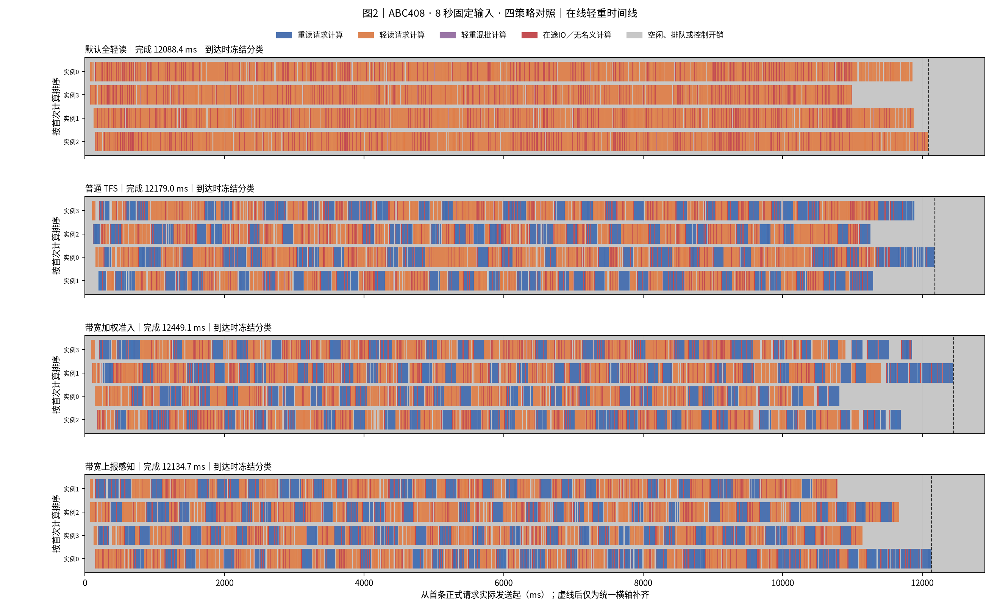
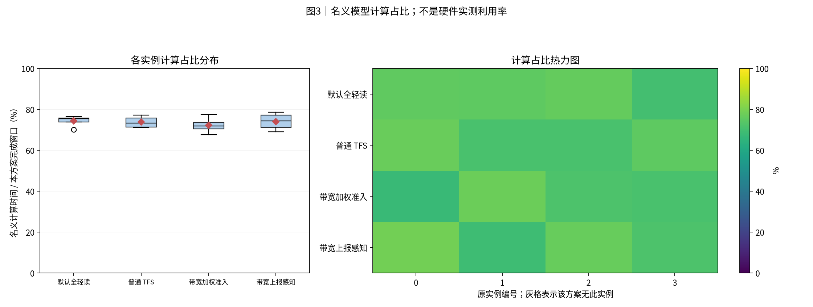
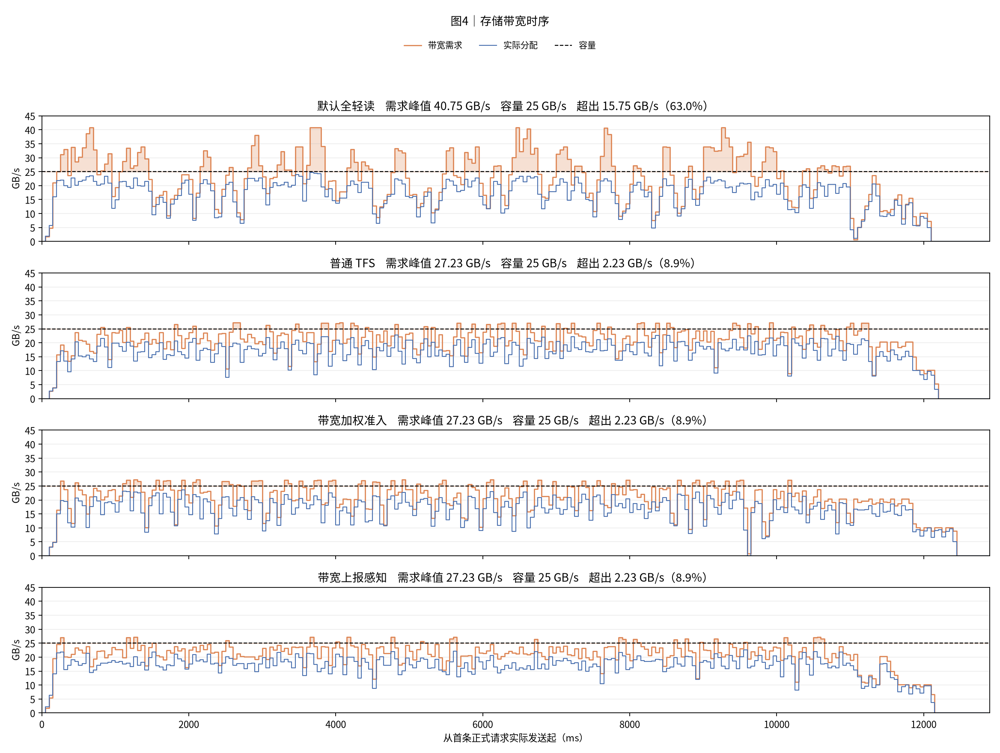
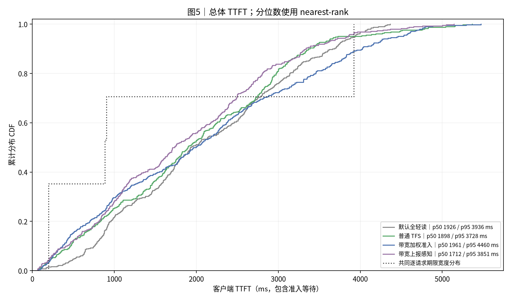
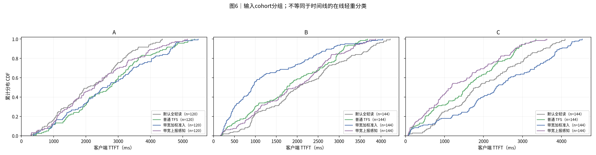
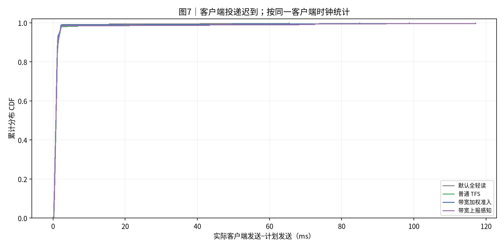

# 实验结果：ABC408 · 8 秒固定输入 · 四策略对照

|项目|约定|
|---|---:|
|执行边界|四实例 WSL CPU 进程栈仿真。每种策略一次新的完整回放。|
|方案顺序|默认全轻读 → 普通 TFS → 带宽加权准入 → 带宽上报感知|
|输入种子 / 重复|每个case独立展示一个冻结运行；种子与重复见附表，未提供时不推断|
|汇总 / 轨迹|不跨case合并样本、不生成置信区间；轨迹保留全部正式请求|
|SLO / TTFT|逐请求匹配期限。TTFT 从客户端实际发送到首 token，包含路由、排队和准入。|
|分组|分类表和CDF使用输入cohort；时间线使用在线轻重判定|
|单位|时间秒/毫秒；容量字节；带宽GB/s=10^9 B/s|
|固定输入|A120: H20480/U2048；B144: H4608或4736/U2048；C144: H0/U384。8秒到达，逐层提交。|
|配置|四实例，BS=1，MiniMax 16 层，六盘共享 25 GB/s，α=0.1。|
|SLO 期限|完整输入、远端 KV 读取为 0、50,000 token 分块。逐请求期限宽度取全 miss prefill 计算耗时的 4 倍。|
|计时|TTFT 从客户端实发到首 token。整批以客户端最后完整响应为终点。主表和时间线另用最后首 token。|
|冻结 trace SHA256|6ddd099448964e1208de96e7a1a3cee422a6e570fc2ab2cdf0e0f692092690c5|

## 0. 总判决

四种策略各完成 **408 条**，每轮读取 **205.15 GB**。普通 TFS 相对默认的后 15 层等待变化 **-2.539 实例·秒**，带宽加权相对普通 TFS 变化 **-0.144 实例·秒**。叠加带宽上报与选队后，相对带宽加权变化 **-0.044 实例·秒**，客户端 P95 变化 **-0.609 秒**。

|指标|默认全轻读|普通 TFS|带宽加权准入|带宽上报感知|
|---|---:|---:|---:|---:|
|整批最后完整响应（秒）|12.089|12.179|12.450|12.135|
|最后一个首 token（秒）|12.088|12.179|12.449|12.135|
|客户端平均 TTFT（秒）|2.091|1.977|2.078|1.849|
|客户端 P95 TTFT（秒）|3.936|3.728|4.460|3.851|
|首层累计 KV 等待（实例·秒）|2.546|2.250|2.217|2.118|
|后 15 层累计 KV 等待（实例·秒）|4.526|1.987|1.844|1.799|
|16 层累计 KV 等待（实例·秒）|7.072|4.237|4.061|3.917|
|实际发送跨度（秒）|7.992|7.992|7.992|7.991|
|全 miss SLO|134/408（32.8%）|148/408（36.3%）|173/408（42.4%）|148/408（36.3%）|


## 1. 汇总表与 SLO 柱状图

|方案|请求数|完成ms|平均TTFT ms|p95 ms|SLO%|四个 worker 完成时刻均值（s）|
|---|---:|---:|---:|---:|---:|---:|
|默认全轻读|408|12088.4|2090.9|3935.5|32.8|11.707|
|普通 TFS|408|12179.0|1977.0|3727.8|36.3|11.658|
|带宽加权准入|408|12449.1|2078.0|4459.8|42.4|11.704|
|带宽上报感知|408|12134.7|1849.1|3851.0|36.3|11.436|

以首条正式请求实际发送为 0 秒，按执行 worker 分组取最后一个客户端响应结束时刻。四个 worker 等权取均值。任一 worker 缺少完整记录或未执行请求时，均值标为缺少数据。

|方案|worker 0（s）|worker 1（s）|worker 2（s）|worker 3（s）|四个 worker 完成时刻均值（s）|
|---|---:|---:|---:|---:|---:|
|默认全轻读|11.862|11.877|12.089|11.002|11.707|
|普通 TFS|12.179|11.302|11.262|11.889|11.658|
|带宽加权准入|10.814|12.450|11.693|11.859|11.704|
|带宽上报感知|12.135|10.790|11.672|11.146|11.436|

分类结果使用输入cohort：

|方案|分组|请求数|平均TTFT ms|SLO%|
|---|---:|---:|---:|---:|
|默认全轻读|A|120|2161.4|91.7|
|默认全轻读|B|144|2128.0|13.9|
|默认全轻读|C|144|1994.9|2.8|
|普通 TFS|A|120|2666.4|83.3|
|普通 TFS|B|144|1799.5|24.3|
|普通 TFS|C|144|1580.2|9.0|
|带宽加权准入|A|120|2697.7|76.7|
|带宽加权准入|B|144|1275.4|48.6|
|带宽加权准入|C|144|2364.3|7.6|
|带宽上报感知|A|120|2342.7|86.7|
|带宽上报感知|B|144|1894.0|20.1|
|带宽上报感知|C|144|1393.0|10.4|



**读法**：柱高与上表同口径。每条请求使用自身期限判断是否达标。

## 2. 各方案 full-sort-ms 执行时间线




**读法**：蓝重读、橙轻读、紫轻重混批。红色为未被名义计算覆盖的在途IO，灰色含空闲、排队和控制。动态与冻结分类分别标注；直接放行分类仅作参考。虚线右侧仅为统一横轴补齐。

## 3. 模型计算占比分布与热力图




**读法**：箱线和热力图来自同一组逐实例数据。分母是各方案从首次正式到达到末条首token的窗口。该值不是硬件实测利用率。

## 4. 存储带宽时序




**读法**：各方案共用从零起的线性纵轴。橙线为需求，蓝线为实际分配，黑虚线为容量。橙色阴影的高度表示需求超出容量的 GB/s。峰值取图中时间桶的平均需求最大值。

|方案|平均GB/s|需求超订%|实际饱和%|
|---|---:|---:|---:|
|默认全轻读|17.0|43.0|8.7|
|普通 TFS|16.8|19.7|1.2|
|带宽加权准入|16.5|23.3|4.0|
|带宽上报感知|16.9|11.1|0.4|

## 5. TTFT 累积分布 CDF




**读法**：经验CDF按rank/n绘制，终点为1。期限不同时，SLO必须逐请求匹配，不能由两条CDF交点推算。




**读法**：此处分组来自cohort，可能是历史A/B或业务分类，不用该标签推断在线轻重。

## 6. 机制解释与前序对照

### 准入与选队

|策略|重读获批|超预算单独获批|开工登记|快照选队事件|候选均超剩余预算|峰值需求 GB/s|
|---|---:|---:|---:|---:|---:|---:|
|默认全轻读|0|—|—|—|—|40.75|
|普通 TFS|124|—|—|—|—|27.23|
|带宽加权准入|120|0|—|—|—|27.23|
|带宽上报感知|120|0|264|917|23|27.23|

普通 TFS 用在线 P75 判重和整数许可。带宽加权加入 6.25 GB/s 均分门槛，按估计需求记账。当账本为空时，单条超出总预算的重读可以独占许可。带宽上报在相同账本上添加异步开工登记和按快照选队。B 类理想带宽中位数为 3.39 GB/s。普通 TFS 判重 4 条 B，带宽加权判重 0 条 B。快照选队计数包含维持原顺序和重复评估。需求峰值取 50 ms 桶。带宽图使用统一线性轴展示实际分配与容量的差异。

### 按输入 A/B/C 分组

|策略|输入类别|请求数|在线判重|理想带宽中位数 GB/s|后 15 层等待（实例·秒）|客户端 P95（秒）|SLO 达标|
|---|---:|---:|---:|---:|---:|---:|---:|
|默认全轻读|A|120|0|10.19|2.904|3.999|110|
|默认全轻读|B|144|0|3.39|1.623|3.883|20|
|默认全轻读|C|144|0|0.00|0.000|3.774|4|
|普通 TFS|A|120|120|10.19|0.546|4.826|100|
|普通 TFS|B|144|4|3.39|1.442|3.387|35|
|普通 TFS|C|144|0|0.00|0.000|3.053|13|
|带宽加权准入|A|120|120|10.19|0.506|4.762|92|
|带宽加权准入|B|144|0|3.39|1.338|3.133|70|
|带宽加权准入|C|144|0|0.00|0.000|4.244|11|
|带宽上报感知|A|120|120|10.19|0.496|4.570|104|
|带宽上报感知|B|144|0|3.39|1.304|3.490|29|
|带宽上报感知|C|144|0|0.00|0.000|3.073|15|

A/B/C 是冻结输入类别。每种策略的在线判重数量来自该轮日志。理想带宽按读取字节除以名义计算时间估算。

## 7. 计算模型与结论限制

四种策略各重新跑一轮，使用相同的冻结 trace、客户端回放器、四实例配置和存储模型。客户端不设并发连接上限。CPU 进程栈的路由、实际开工时刻与 RPC 耗时会随运行变化。单轮差值描述本次回放。按全 miss 口径计算的 SLO 只用于报告，运行中的调度画像和期限保留原值。

## 8. 附表




**读法**：此图描述客户端实际发送相对计划的迟到，不是单次准入RPC耗时。

|方案|实例数|模型计算占比%|运行标识|
|---|---:|---:|---:|
|默认全轻读|4|74.3|{"repeat": 1, "native_sha256": "2887ddcf901e2f03652d438f5dce3a0c9d28170234d16c7a1baa106e6273fcab", "prefill_model_sha256": "48776fc742ba30edd6715219cff9fb9891104c55c5cc8e45df3a3f292857e1aa", "frontend_start": "2026-11-27T14:12:40.829438+08:00", "frontend_stop": "2026-11-27T14:13:18.460097+08:00"}|
|普通 TFS|4|73.8|{"repeat": 1, "native_sha256": "2887ddcf901e2f03652d438f5dce3a0c9d28170234d16c7a1baa106e6273fcab", "prefill_model_sha256": "48776fc742ba30edd6715219cff9fb9891104c55c5cc8e45df3a3f292857e1aa", "frontend_start": "2026-11-27T14:13:36.564080+08:00", "frontend_stop": "2026-11-27T14:14:17.178565+08:00"}|
|带宽加权准入|4|72.2|{"repeat": 1, "native_sha256": "2887ddcf901e2f03652d438f5dce3a0c9d28170234d16c7a1baa106e6273fcab", "prefill_model_sha256": "48776fc742ba30edd6715219cff9fb9891104c55c5cc8e45df3a3f292857e1aa", "frontend_start": "2026-11-27T14:14:36.356553+08:00", "frontend_stop": "2026-11-27T14:15:17.367536+08:00"}|
|带宽上报感知|4|74.1|{"repeat": 1, "native_sha256": "2887ddcf901e2f03652d438f5dce3a0c9d28170234d16c7a1baa106e6273fcab", "prefill_model_sha256": "48776fc742ba30edd6715219cff9fb9891104c55c5cc8e45df3a3f292857e1aa", "frontend_start": "2026-11-27T14:15:33.791421+08:00", "frontend_stop": "2026-11-27T14:16:12.202837+08:00"}|

|方案|序列上限|token预算|存储容量GB/s|准入位置 / 规则|计算模型|
|---|---:|---:|---:|---:|---:|
|默认全轻读|1|50000|25.0|scheduler / arrival|prefill_fit|
|普通 TFS|1|50000|25.0|scheduler / arrival|prefill_fit|
|带宽加权准入|1|50000|25.0|scheduler / arrival|prefill_fit|
|带宽上报感知|1|50000|25.0|scheduler / arrival|prefill_fit|

[客户端汇总](report_data/client_comparison.csv) · [A/B/C 分组](report_data/by_class.csv) · [逐请求 KV 等待](report_data/request_wait_details.csv) · [准入与上报](report_data/admission_counts.csv) · [带宽重放校验](report_data/bandwidth_audit.csv)

## 9. 验证、数据与复现

已校验请求计数、逐请求SLO、nearest-rank分位数、CDF概率质量、实例时间账本及可用带宽积分。图片人工检查状态见校验文件。

- [校验记录](report_data/validation.json)
- [方案汇总](report_data/run_summary.csv)
- [请求明细](report_data/requests.csv)
- [标准重绘数据](report_data/dataset.json)
- [复现入口](reproduce/generate_report.py)
- [冻结 trace](frozen_input/trace.jsonl.gz) · [输入清单](frozen_input/manifest.json) · [逐请求输入](frozen_input/requests.csv)

在报告目录执行：

```bash
python reproduce/generate_report.py --dataset report_data/dataset.json --output ../reproduced-report
```

## 10. 简要解读

本次后 15 层等待最少的是 **带宽上报感知**，客户端 P95 最低的是 **普通 TFS**。首层等待按提交至读完累计。后 15 层累计上一层计算结束后尚未读完的区间。
