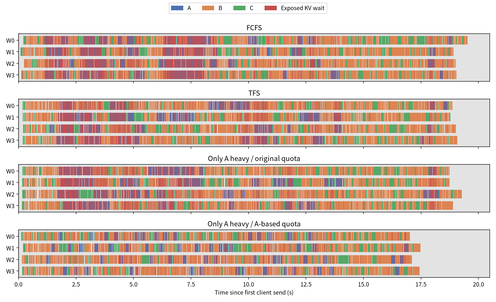

# 540条ABC：默认、TFS与固定A额度

A60: H51200/U768；B240: H2048/U4096；C240: H0/U384。12秒到达。

## 0. 总判决

保留原实验四方案单轮结果；本次仅归档，未重新运行。仅A重读且按A定额度的版本cap=1。

## 1. 汇总

|策略|完成s|平均TTFT s|P95 s|首层等待s|后15层等待s|
|---|---:|---:|---:|---:|---:|
|默认 FCFS|19.520|5.281|7.757|3.385|14.517|
|普通 TFS|19.075|4.931|7.616|3.044|12.016|
|仅 A 重读，原额度|19.272|5.114|7.621|3.241|12.589|
|仅 A 重读，按 A 定额度|17.482|3.629|5.735|2.744|5.527|

## 2. 执行时间线

读法：沿用原图。颜色对应业务A/B/C，不等于在线轻重分类。

## 3. 计算占比

源简报未提供独立图，本次不补造。

## 4. 存储带宽时序

源简报未提供独立图，本次不补造。

## 5. TTFT分布

源简报未提供独立图，本次不补造。

## 6. 机制

普通P75会把B也判重读，原额度为27；仅改A标签仍保留原额度，与按A重新定额度为1不同。

## 7. 限制

CPU仿真单轮，无置信区间；不代表A2实测。

## 8. 附表

完整数据：[results.csv](results.csv)。

## 9. 验证与复现

图与CSV保持源文件字节。本次未运行仿真。

## 10. 解读

分类和配额共同决定行为；不能把仅A重读与固定额度1混为同一策略。
