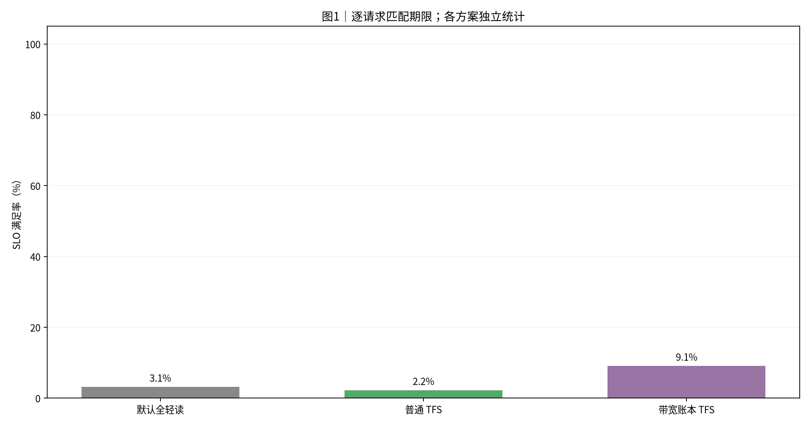
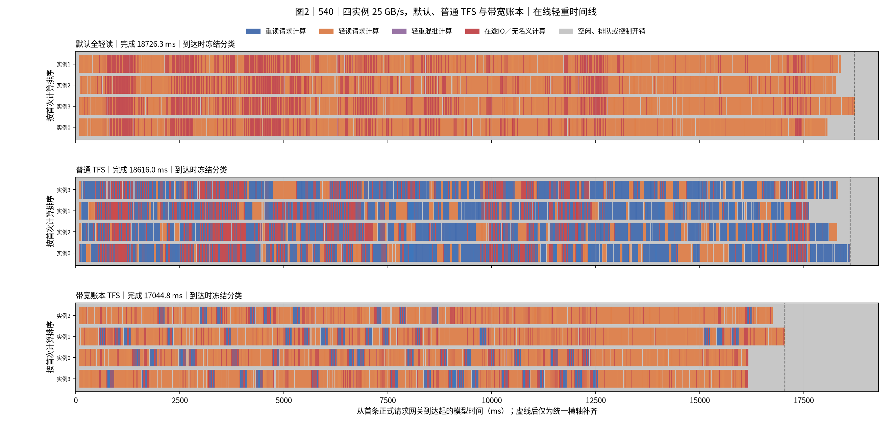
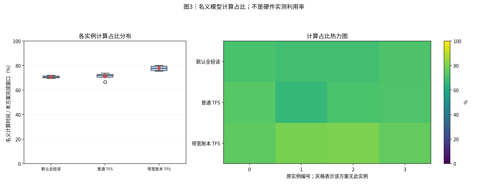
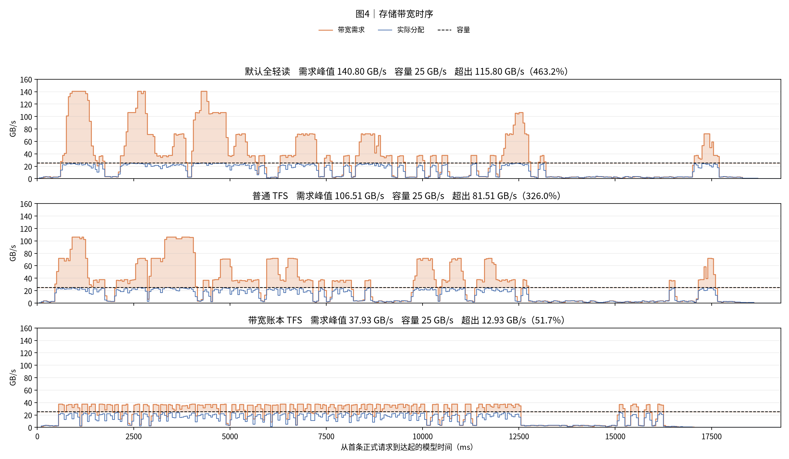
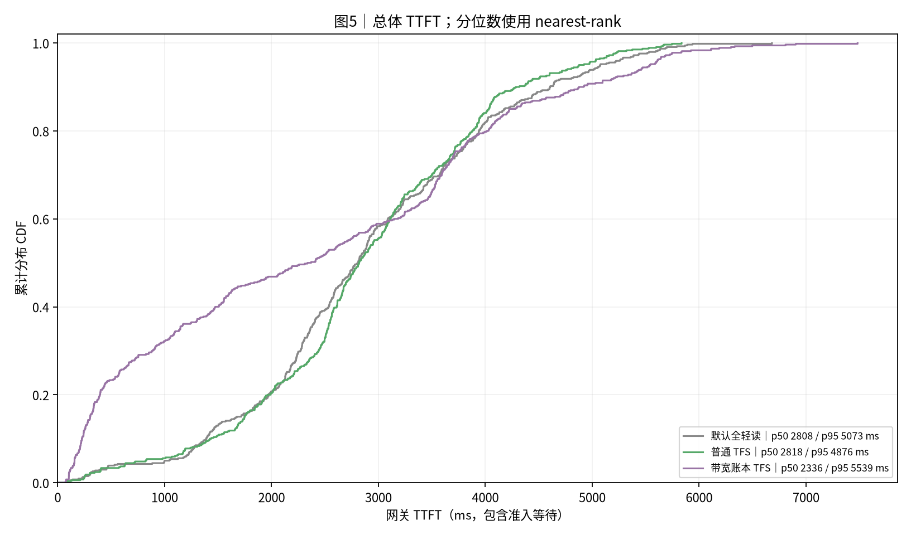
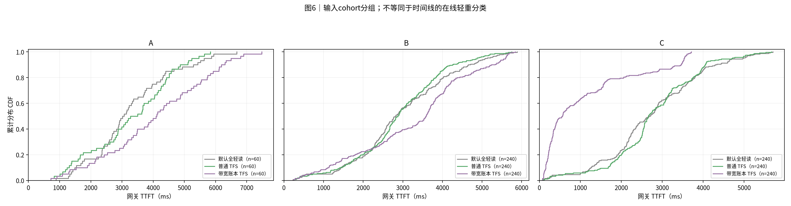
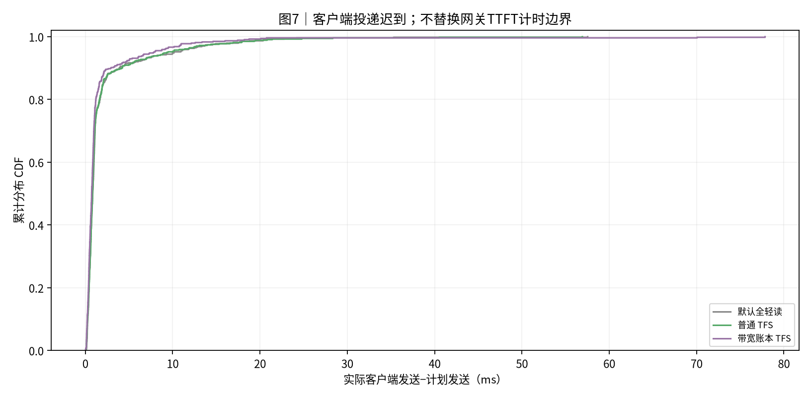

# 实验结果：540｜四实例 25 GB/s，默认、普通 TFS 与带宽账本

|项目|约定|
|---|---:|
|执行边界|本轮各方案新运行一次 CPU 进程栈仿真；本报告离线读取冻结日志。|
|方案顺序|默认全轻读 → 普通 TFS → 带宽账本 TFS|
|输入种子 / 重复|每个case独立展示一个冻结运行；种子与重复见附表，未提供时不推断|
|汇总 / 轨迹|不跨case合并样本、不生成置信区间；轨迹保留全部正式请求|
|SLO / TTFT|逐请求匹配deadline；TTFT=first_token−gateway arrival，包含准入等待|
|分组|分类表和CDF使用输入cohort；时间线使用在线轻重判定|
|单位|时间秒/毫秒；容量字节；带宽GB/s=10^9 B/s|
|实验日期|2026-11-25、2026-11-26|
|固定负载|synthetic_abclonghit_540_12s_4_25GBps|
|请求数 / 到达窗口|540 / 12.0 s|
|输入 SHA256|678ec1850c2a6cb1076ff439cf877b50e02bdf4eadb394cd14a6aa3e2e850eed|
|读量|233.539 GB|
|资源|四实例、每实例 BS=1、MiniMax 16 层、6 盘共享 25 GB/s，FCFS，α=0.1，关闭强制准入|
|带宽|50ms 积分分桶；实际分配由逐层提交事件在共享六盘模型离线重放；理论需求按执行请求求和|
|客户端与网关|第 0 节使用客户端 TTFT 和完成时间；标准 CDF/主表采用 central 画像到首 token；SLO 使用冻结 deadline。|
|SLO 定义|逐请求 deadline=到达时刻+4×原画像 reference_service_s；保留每条期限和按原公式得到的名义计算。|

## 0. 总判决

- 相比默认全轻读，新 TFS 的整批完成时间变化 -9.0%，平均 TTFT 变化 -43.2%，四实例平均完成时刻变化 -10.0%。
- 相比普通 TFS，新 TFS 的整批完成时间变化 -8.4%，平均 TTFT 变化 -41.1%，四实例平均完成时刻变化 -9.3%。

|指标|默认全轻读|普通 TFS|带宽账本 TFS|
|---|---:|---:|---:|
|客户端整批完成（s）|18.762|18.653|17.080|
|四 worker 完成时刻均值（s）|18.406|18.259|16.568|
|客户端平均 TTFT（s）|4.790|4.620|2.720|
|客户端 P95 TTFT（s）|7.342|6.879|5.865|
|SLO 满足率（%）|3.148|2.222|9.074|
|首层累计 KV 等待（s）|3.359|3.208|2.722|
|后 15 层累计 KV 等待（s）|13.376|11.901|6.143|
|累计 KV 等待合计（s）|16.735|15.108|8.865|

上表的完成时间和 TTFT 为客户端口径；后续标准主表与 CDF 为 central 画像口径。

## 1. 汇总表与 SLO 柱状图

|方案|请求数|完成ms|平均TTFT ms|p95 ms|SLO%|网关等待ms|四个 worker 完成时刻均值（s）|
|---|---:|---:|---:|---:|---:|---:|---:|
|默认全轻读|540|18726.3|2907.0|5073.5|3.1|62.3|18.406|
|普通 TFS|540|18616.0|2889.2|4876.5|2.2|54.7|18.259|
|带宽账本 TFS|540|17044.8|2391.8|5538.9|9.1|51.1|16.568|

以首条正式请求实际发送为 0 秒，按执行 worker 分组取最后一个客户端响应结束时刻。四个 worker 等权取均值。任一 worker 缺少完整记录或未执行请求时，均值标为缺少数据。

|方案|worker 0（s）|worker 1（s）|worker 2（s）|worker 3（s）|四个 worker 完成时刻均值（s）|
|---|---:|---:|---:|---:|---:|
|默认全轻读|18.104|18.450|18.310|18.762|18.406|
|普通 TFS|18.653|17.670|18.345|18.367|18.259|
|带宽账本 TFS|16.207|17.080|16.788|16.197|16.568|

分类结果使用输入cohort：

|方案|分组|请求数|平均TTFT ms|SLO%|
|---|---:|---:|---:|---:|
|默认全轻读|A|60|3254.5|0.0|
|默认全轻读|B|240|2973.0|5.0|
|默认全轻读|C|240|2754.3|2.1|
|普通 TFS|A|60|3275.1|0.0|
|普通 TFS|B|240|2890.5|3.8|
|普通 TFS|C|240|2791.4|1.2|
|带宽账本 TFS|A|60|4072.7|0.0|
|带宽账本 TFS|B|240|3258.5|4.6|
|带宽账本 TFS|C|240|1104.8|15.8|



**读法**：柱高与上表同口径。每条请求使用自身期限判断是否达标。

## 2. 各方案 full-sort-ms 执行时间线




**读法**：蓝重读、橙轻读、紫轻重混批。红色为未被名义计算覆盖的在途IO，灰色含空闲、排队和控制。动态与冻结分类分别标注；直接放行分类仅作参考。虚线右侧仅为统一横轴补齐。

## 3. 模型计算占比分布与热力图




**读法**：箱线和热力图来自同一组逐实例数据。分母是各方案从首次正式到达到末条首token的窗口。该值不是硬件实测利用率。

## 4. 存储带宽时序




**读法**：各方案共用从零起的线性纵轴。橙线为需求，蓝线为实际分配，黑虚线为容量。橙色阴影的高度表示需求超出容量的 GB/s。峰值取图中时间桶的平均需求最大值。

|方案|平均GB/s|需求超订%|实际饱和%|
|---|---:|---:|---:|
|默认全轻读|12.5|51.8|22.2|
|普通 TFS|12.5|52.6|22.8|
|带宽账本 TFS|13.7|59.0|13.8|

## 5. TTFT 累积分布 CDF




**读法**：经验CDF按rank/n绘制，终点为1。期限不同时，SLO必须逐请求匹配，不能由两条CDF交点推算。




**读法**：此处分组来自cohort，可能是历史A/B或业务分类，不用该标签推断在线轻重。

## 6. 机制解释与前序对照

默认强制全轻读，实际 KV 读取保持一致。普通 TFS 冻结进入时的 P75 轻重标记，以重读条数计许可。新方案增加均摊门槛 6.25 GB/s，以原模型需求判重，再将画像带宽四舍五入到整数 B/s，用于 RPC、账本与本地选择。被拒后用剩余带宽和均摊门槛选轻读。

|策略|A 判重/总数|B 判重/总数|C 判重/总数|许可获批|拒绝次数|曾被拒绝或跳过的请求数|
|---|---:|---:|---:|---:|---:|---:|
|默认全轻读|0/60|0/240|0/240|0|0|0|
|普通 TFS|60/60|240/240|0/240|300|0|0|
|带宽账本 TFS|60/60|0/240|0/240|60|250|52|

新 TFS 的累计 KV 等待为 8.865 s，普通 TFS 为 15.108 s，默认策略为 16.735 s。首层等待取提交至存储完成；逐层等待取上一层计算完成至下一层读取完成的正差。跨 worker 求和，不能直接从整批完成时间扣除。时间线红色为在途读取减名义计算的区间，口径与依赖等待不同。

新方案账本峰值为 35.199 GB/s；自身需求大于 25 GB/s 且单独获批 60 次；最后账本归零。本次拒绝后选择轻读：符合上限 172 次，选择最小需求兜底 78 次。沿用上次拒绝上限：符合上限 0 次，兜底 0 次。以上为选队事件计数，同一请求可能多次被选。

普通 TFS 的额度更新次数按额度分布为 `{"null":3,"27":537}`。普通 TFS 的申请 RPC 平均/P95 为 2.704/5.187 ms，新方案为 1.766/3.269 ms。拒绝次数包含重复申请。

## 7. 计算模型与结论限制

本次每种策略仅执行一次。独立路由和 CPU 调度时序有波动。模型计算占比和模拟分配带宽不等于真机 NPU 与 OD 测量；无法据此确认 AIV/HBM 竞争。轻读没有全局预算预留，过载仍可能出现。

带宽账本 TFS有一轮未计入报告。小数带宽版本曾通过，随后统一按整数 B/s 最终版本重跑。客户端成功 540/540 条。该轮日志保留在本机 `540-bandwidth-superseded-float`，报告使用最终版本的完整验收轮。

## 8. 附表




**读法**：此图描述客户端实际发送相对计划的迟到，不是单次准入RPC耗时。

|方案|实例数|模型计算占比%|运行标识|
|---|---:|---:|---:|
|默认全轻读|4|70.7|{"repeat": 1, "ordering": "FCFS", "alpha": 0.1, "frontend_start": "2026-11-25T17:55:55.415573+08:00", "frontend_stop": "2026-11-25T17:56:42.637717+08:00"}|
|普通 TFS|4|71.1|{"repeat": 1, "ordering": "FCFS", "alpha": 0.1, "frontend_start": "2026-11-25T17:57:05.469206+08:00", "frontend_stop": "2026-11-25T17:57:53.268205+08:00"}|
|带宽账本 TFS|4|77.7|{"repeat": 1, "ordering": "FCFS", "alpha": 0.1, "frontend_start": "2026-11-26T08:57:45.547794+08:00", "frontend_stop": "2026-11-26T08:58:34.332342+08:00"}|

|方案|序列上限|token预算|存储容量GB/s|准入位置 / 规则|计算模型|
|---|---:|---:|---:|---:|---:|
|默认全轻读|1|50000|25.0|scheduler / arrival|未提供|
|普通 TFS|1|50000|25.0|scheduler / arrival|未提供|
|带宽账本 TFS|1|50000|25.0|scheduler / arrival|未提供|

逐请求 H/U、实际归属、理论需求和 KV 等待详见[请求明细](report_data/request_wait_details.csv)。客户端主指标及逐次读取重放最大误差详见[客户端对照](report_data/client_comparison.csv)。

[排除的尝试及原始日志指纹](report_data/excluded_attempts.csv)。

## 9. 验证、数据与复现

已校验请求计数、逐请求SLO、nearest-rank分位数、CDF概率质量、实例时间账本及可用带宽积分。图片人工检查状态见校验文件。

- [校验记录](report_data/source_validation.json)
- [方案汇总](report_data/run_summary.csv)
- [请求明细](report_data/requests.csv)
- [标准重绘数据](report_data/dataset.json.gz)
- [复现入口](reproduce/generate_report.py)

从仓库根目录执行（自动解压冻结数据）：

```bash
python scripts/manage_reports.py redraw "synthetic_abclonghit_540_12s_4_25GBps/20261126-090103_默认_TFS_带宽账本" --output <新的输出目录>
```

## 10. 简要解读

对比普通 TFS，带宽账本的 50ms 理论需求峰值从 106.51 变为 37.93 GB/s。客户端平均 TTFT 变化 -41.1%，P95 变化 -14.7%，SLO 满足率变化 +6.9 个百分点。这些指标从不同角度描述一次回放，结合时间线看排队长尾。

普通 TFS 判重 240 条 B，申请拒绝 0 次。带宽账本判重 0 条 B，批准 60 次超 25 GB/s 的单独读取。后 15 层累计等待从 11.901 s 降为 6.143 s。
